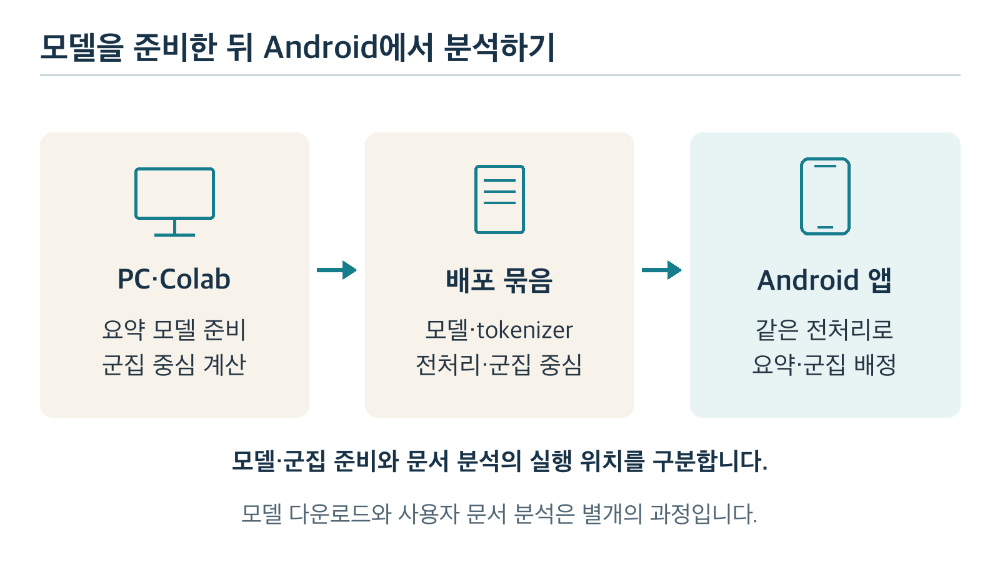

# 텍스트 분류·요약을 위한 온디바이스 AI 학습 계획

Android 개발 경험이 있는 AI 비전공자를 위한 입문 → 중급 기본 과정과 고급 예정 과정

[학습 계획 PDF](학습%20계획.pdf) · 개정: 2026년 10월 23일

## 이 과정을 마치면 무엇을 만들 수 있나요?

이 과정의 최종 결과물은 **한국어·영어 문서를 정해 둔 종류로 분류하고 새 문장으로 요약하는 Android 앱**이다. 글자를 담은 TXT 파일과 페이지 배치를 보존하는 PDF 문서를 다룬다. PDF는 텍스트를 추출할 수 있는 문서로 범위를 정한다. 두 기능을 먼저 PC에서 설계하고 검증한 뒤 휴대폰에 연결한다.

온디바이스 AI(on-device AI)는 휴대폰 같은 기기 안에서 모델을 실행해 입력을 처리하는 방식이다. 이 과정에서는 문서 내용을 서버로 보내 분석하지 않고 휴대폰 안에서 분류·요약하는 구성을 목표로 한다.

- **문서 분류:** 사람이 정한 종류인 카테고리 중 하나를 예측한다. 카테고리 이름과 문서의 정답 종류인 라벨을 먼저 정하고 라벨이 붙은 예시로 모델을 학습·평가한다. 어느 종류에도 맞지 않거나 판단이 애매한 문서는 보류할 기준을 따로 정한다.
- **문서 요약:** 원문을 읽고 핵심을 새 문장으로 쓰는 생성 요약을 목표로 한다. 원문 문장을 골라 붙이는 추출 요약은 비교 기준이자 기기 제약이 클 때의 대체 방법이다.
- **Android 통합:** 두 기능을 휴대폰 안에서 실행하고 결과의 품질·속도·메모리 사용량을 실제 기기에서 확인한다.

처음에는 문서 하나에 정답 종류 하나를 붙이는 단일 라벨 분류를 다룬다. 실제 분야와 카테고리, 목표 휴대폰, 허용할 지연·메모리는 시제품으로 설계를 검증하는 POC(Proof of Concept)에 들어가기 전에 정한다. 여러 종류가 섞인 문서는 라벨 규칙에 따라 판단하고 규칙으로도 정하기 어려우면 보류 사례로 기록한다.

## 전체 경로부터 살펴보기

기본 과정은 **Chapter 1~6 → POC A → Chapter 7 → POC B → Chapter 8 → POC C** 순서로 진행한다. 각 POC에서는 여러 개념을 결합해 실제 문서에서 설계의 가능성과 한계를 확인한다.

*그림 1. 기본 과정의 학습 경로. 각 POC에 들어가기 전에 해당 Chapter의 이론·예제·단원 실습·평가 확인을 마친다.*

**기본 과정 · Chapter 1~8:** 기존 모델과 알고리즘을 이해하고 문서 분류·생성 요약을 비교·평가·배포하는 활용·설계 중급을 목표로 한다. 요약 모델 추가학습은 선택 심화다. 선택했다면 작은 학습 실험과 원본 대비 평가까지 수행한다.

**고급 예정 과정 · Chapter 9~14:** 기본 과정과 POC A~C를 마친 뒤 학습 방법·문서 표현·실행 비용을 개선한다. 현재는 학습 범위와 진입·완료 기준을 정한 상태이며 교재는 추후 작성한다. 구체적인 순서와 조건은 이 문서의 「고급 과정 안내 · 학습 예정」에 정리했다.

## 지금 어디에서 시작하나요?

처음 시작한다면 **Chapter 1. AI와 머신러닝 기본 개념**을 읽는다. Python을 아직 몰라도 종이와 메모장으로 기본 실습을 할 수 있다. Python으로 같은 계산을 실행하는 실습은 선택 사항이다.

Chapter 1을 마쳤다면 **Chapter 2. Python·NumPy와 문서 데이터 처리**에서 직접 만든 한·영 문서를 읽고 정리하는 실습을 시작한다.

Chapter 2를 마쳤다면 **Chapter 3. 기초 수학과 전통적 머신러닝**에서 문서를 숫자로 표현하고 간단한 분류·군집 계산을 따라간다.

| 현재 등록된 자료 | 읽는 방법 |
| --- | --- |
| [AI와 머신러닝 기본 개념 · Markdown](chapter1/AI와_머신러닝_기본_개념.md) | 화면에서 본문·그림·실습을 읽는다. |
| [AI와 머신러닝 기본 개념 · PDF](chapter1/AI와_머신러닝_기본_개념.pdf) | 목차와 페이지를 따라 교재 형태로 읽는다. |
| [Python·NumPy와 문서 데이터 처리 · Markdown](chapter2/Python·NumPy와_문서_데이터_처리.md) | 코드·그림·실습을 따라 읽고 입력을 바꿔 본다. |
| [Python·NumPy와 문서 데이터 처리 · PDF](chapter2/Python·NumPy와_문서_데이터_처리.pdf) | 목차와 페이지를 따라 교재 형태로 읽는다. |
| [기초 수학과 전통적 머신러닝 · Markdown](chapter3/기초_수학과_전통적_머신러닝.md) | 손 계산·그림·실습을 따라 읽고 입력을 바꿔 본다. |
| [기초 수학과 전통적 머신러닝 · PDF](chapter3/기초_수학과_전통적_머신러닝.pdf) | 목차와 페이지를 따라 교재 형태로 읽는다. |
| [딥러닝 기초와 PyTorch · Markdown](chapter4/딥러닝_기초와_PyTorch.md) | 예측·손실·기울기·갱신과 실습 결과를 연결한다. |
| [딥러닝 기초와 PyTorch · PDF](chapter4/딥러닝_기초와_PyTorch.pdf) | 목차와 페이지를 따라 교재 형태로 읽는다. |
| [자연어 처리와 사전학습 모델 이해 · Markdown](chapter5/자연어_처리와_사전학습_모델_이해.md) | 토큰·문맥 표현·분류·생성의 차이를 실습한다. |
| [자연어 처리와 사전학습 모델 이해 · PDF](chapter5/자연어_처리와_사전학습_모델_이해.pdf) | 목차와 페이지를 따라 교재 형태로 읽는다. |
| [문서 분류 모델 설계와 평가 · Markdown](chapter6/문서_분류_모델_설계와_평가.md) | 라벨·자료 분리·지표·보류를 연결해 두 모델을 비교한다. |
| [문서 분류 모델 설계와 평가 · PDF](chapter6/문서_분류_모델_설계와_평가.pdf) | 목차와 페이지를 따라 교재 형태로 읽는다. |

**「학습 전」은 교재 PDF가 아직 등록되지 않았다는 뜻이다.** 학습자의 진도나 실력을 나타내는 표시가 아니다. Chapter 7~14에는 예정 PDF 파일명을 적었으며 파일이 등록되면 링크와 상태를 함께 갱신한다.

### 학습 대상과 범위

이 계획은 프로그램을 작성하는 언어인 Python과 AI의 기초부터 시작한다. 입력은 한국어·영어 TXT와 텍스트를 추출할 수 있는 PDF다.

PC·Mac 또는 Colab에서 학습·비교한 뒤 Kotlin 앱의 CPU에서 검증한다. Colab은 브라우저로 접속해 클라우드 컴퓨터에서 Python을 실행하는 환경이다. CPU는 일반 계산을 수행하는 처리 장치다.

학습의 중심은 온디바이스 AI 모델링이다. 모델링은 목적에 맞는 모델을 선택하거나 추가학습하고 문서 입력부터 결과 확인까지의 처리 방법을 설계하는 과정이다. Android 기기에서 실행할 수 있도록 모델의 크기·속도·메모리 사용량과 분류·요약 품질을 함께 확인한다.

사진 속 글자를 읽는 광학 문자 인식(OCR, Optical Character Recognition)은 후속 범위다. 새 대규모 모델을 방대한 자료로 처음부터 학습시키는 과정은 포함하지 않는다. 기본 개념 Chapter에서는 개념과 작은 예제에 집중하고 앱 연결과 기능 명세는 Chapter 8. Android 온디바이스 배포와 경량화 및 POC C에서 다룬다.

## 학습 방법과 POC 진입 조건

각 Chapter는 **쉬운 이론 → 작은 예제 → 단원 실습 → 이해·평가 확인** 순서로 진행한다. 기간보다 완료 기준으로 다음 단계에 진입한다. 작은 예제에서는 한 개념을, 단원 실습에서는 그 과목의 기능을 익힌다.

Chapter별 계획은 「배우는 목적 → 핵심 질문 → 이론과 원리 → 예제와 단원 실습 → 완료 기준과 다음 단계」 순서로 읽는다. 핵심 질문을 먼저 확인하고 실습을 마친 뒤 자신의 말과 바꾼 예제로 답해 본다. 답하기 어려운 항목은 해당 Chapter의 이론과 원리를 다시 살펴본다.

예제를 실행하기 전에는 ‘입력 하나를 바꾸면 결과가 어떻게 달라질까?’를 먼저 생각한다. 실행 뒤에는 예상과 실제 결과를 비교하고 차이가 생긴 단계를 해당 Chapter의 원리로 설명한다.

전문 용어는 쉬운 뜻과 함께 익힌다. 중요한 정의·작동 원리·성립 조건·한계를 생략하지 않으며 예제를 실행하는 방법과 왜 그런 결과가 나오는지를 함께 배운다. 각 Chapter의 「이론과 원리」는 학습할 범위를 안내하며 세부 계산은 해당 교재에서 순서대로 설명한다.

POC는 예제를 한 번 실행했다고 완료되는 단계가 아니다. 필요한 이론·단원 실습·평가 학습을 마친 뒤 다음 조건을 확인한다.

- 입력·출력, 알고리즘의 역할, 왜 해당 방법을 사용하는지 설명할 수 있다.
- 예제의 문서·설정을 직접 바꾸고 결과를 재현하며 차이를 설명할 수 있다.
- 좋은 결과와 실패 사례를 구분하고 비교할 자료와 평가 기준을 정할 수 있다.

## Chapter 1. AI와 머신러닝 기본 개념

**교재 PDF:** [AI와_머신러닝_기본_개념.pdf](chapter1/AI와_머신러닝_기본_개념.pdf)

### 배우는 목적

‘AI가 학습한다’는 말이 실제로 무엇을 뜻하는지 문서 예제로 이해한다. 이 Chapter에서는 자료로 모델을 학습시키는 일, 학습된 모델로 새 문서를 처리하는 일, 결과가 맞는지 확인하는 일을 구분한다.

### 핵심 질문

1. AI·머신러닝·딥러닝은 어떻게 다른가?
2. 모델은 무엇으로 문서를 판단하는가?
3. 학습시키는 것과 사용하는 것은 어떻게 다른가?
4. 정답을 알려 주고 배우는 방법과 정답 없이 묶는 방법은 어떻게 다른가?
5. 문서를 분류하는 것과 요약하는 것은 어떻게 다른가?
6. 배운 문서를 잘 맞히면 좋은 모델인가?
7. 이미 학습된 모델을 쓰는 것과 더 학습시키는 것은 어떻게 다른가?

### 이론과 원리

#### AI·머신러닝·딥러닝의 관계

인공지능(AI, Artificial Intelligence)은 컴퓨터의 판단·인식·언어 처리 등을 다루는 넓은 분야다. 머신러닝(machine learning)은 그 안에서 데이터를 통해 패턴을 배우는 방법이다. 딥러닝(deep learning)은 여러 계산 층을 연결한 신경망을 학습하는 머신러닝 방식이다.

#### 데이터·특성·파라미터와 모델

‘배터리’가 있는 문서를 정보 기술 분야인 IT로 분류하는 작은 예제를 사용한다. 문서는 데이터이고 특정 단어가 있는지는 판단에 쓰는 단서인 특성이다. 단어별 점수를 더해 결과를 내는 계산과 점수표가 모델을 이룬다. 자료에서 구한 단어 점수처럼 학습으로 정하는 내부 숫자를 파라미터라고 부른다.

#### 학습·추론·평가

예제 문서에서 단어 점수를 구하는 과정이 학습이다. 그 점수로 새 문서를 분류하는 과정이 추론이다. 분류 결과를 따로 보관한 정답과 비교하는 과정이 평가다. 일반적인 추론에서는 새 문서 하나를 처리했다고 점수가 자동으로 바뀌지 않는다.

#### 지도학습과 비지도 군집화

문서에 IT·스포츠 같은 정답 종류인 라벨을 붙여 학습하는 것이 지도학습이다. 정답 라벨 없이 문서 사이의 비슷함을 찾아 묶는 군집화는 비지도학습의 한 방법이다. 세 그룹으로 묶더라도 각 그룹의 주제 이름은 결과를 읽은 사람이 붙인다. 군집화는 분류와의 차이를 이해하기 위한 비교 내용이다.

#### 분류·추출 요약·생성 요약

분류는 IT처럼 정해진 종류를 고른다. 추출 요약은 원문에서 중요한 문장을 고르고 생성 요약은 원문을 바탕으로 새 문장을 만든다. 요약은 문장이 자연스러운지뿐 아니라 핵심 내용이 빠지거나 사실이 바뀌지 않았는지도 확인한다.

#### 일반화와 평가 자료의 분리

처음 보는 문서에도 잘 적용하는 능력을 일반화라고 한다. 학습 문서에 지나치게 맞춰 새 문서에서 나빠지는 현상은 과적합이다.

이를 확인하려고 학습에 쓸 자료, 방법을 고를 검증 자료, 마지막 확인에 쓸 최종 평가 자료를 나눈다. 원문 100개를 60·20·20개로 나누는 설명용 예제로 역할을 익힌다.

비율은 고정 규칙이 아니며 같은 원문의 복사본·조각·번역문이 서로 다른 자료에 섞이면 평가가 실제보다 좋아 보일 수 있음을 배운다.

#### 사전학습과 추가학습

많은 자료로 미리 배우는 과정이 사전학습이다. 그 모델을 내 작업의 자료로 더 조정하는 과정이 추가학습이다. 기존 모델에 ‘요약해 줘’라고 요청하는 것과, 문서·요약 예시로 모델의 가중치를 바꾸는 일은 다르다. 가중치는 파라미터의 한 종류이며 추가학습 후에도 실제로 좋아졌는지 따로 평가해야 한다.

### 예제와 단원 실습

종이와 메모장으로 다음 활동을 한다. Python으로 같은 계산을 실행하는 실습은 선택 사항이다.

- **학습·추론·평가 구분하기:** 정답이 붙은 짧은 문서들에서 단어 점수를 구한다. 새 문서의 점수를 더해 IT·스포츠를 예측하고 맞힌 경우와 틀린 경우의 이유를 설명한다.
- **분류 라벨 붙이기:** 문서 30개에 정답 종류를 붙이고 두 종류에 걸친 문서의 판단 근거를 적는다. **선택 비교:** 별도의 한·영 문서 8개를 정답 라벨 없이 두 그룹과 세 그룹으로 묶어 보고 분류와의 차이를 살핀다.
- **분류와 요약 비교하기:** 같은 문서에 종류를 붙이고 중요한 원문 문장을 고르고 한 문장으로 다시 요약한다. 세 결과가 어떻게 다른지 비교하고 요약에서 빠진 내용과 바뀐 사실을 찾는다.

### 완료 기준과 다음 단계

다음 질문에 예를 들어 답할 수 있으면 Chapter 2. Python·NumPy와 문서 데이터 처리로 넘어간다. 기본 개념을 실제 문서에 적용하려면 파일에서 글자를 읽고 자료를 정리하는 방법이 필요하다.

- AI·머신러닝·딥러닝은 어떤 관계이고 작은 문서 분류 모델의 데이터·특성·파라미터는 각각 무엇인가?
- 단어 점수를 구할 때와 그 점수로 새 문서를 분류할 때 무엇이 다른가?
- 정답 종류를 맞히는 분류와 비슷한 문서를 모으는 군집화는 어떻게 다른가?
- 추출 요약과 생성 요약은 무엇을 출력하며 올바른 요약인지 어떻게 확인하는가?
- 왜 처음 보는 문서로 확인해야 하며 검증 자료와 최종 평가 자료를 따로 두는가?
- 기존 모델에 요약을 요청하는 것과 예시 자료로 추가학습하는 것은 어떻게 다른가?

이 Chapter의 실습은 기본 개념을 이해하기 위한 작은 예제다. 실제 모델 설계는 Chapter 6. 문서 분류 모델 설계와 평가, Chapter 7. 문서 요약 모델 설계와 추가학습에서 배운다. Android 연결과 앱 기능 설계는 Chapter 8. Android 온디바이스 배포와 경량화 및 POC C에서 다룬다.

## Chapter 2. Python·NumPy와 문서 데이터 처리

**교재 PDF:** [Python·NumPy와_문서_데이터_처리.pdf](chapter2/Python·NumPy와_문서_데이터_처리.pdf)

**학습 자료:** [Python·NumPy와_문서_데이터_처리.md](chapter2/Python·NumPy와_문서_데이터_처리.md)

### 배우는 목적

문서를 읽고 정리하며 모델이 계산할 수 있는 데이터와 배열을 준비한다.

### 핵심 질문

- 파일에서 꺼낸 글자를 모델 입력으로 쓰기까지 무엇을 확인해야 할까?
- 배열의 행·열과 문서·문단의 관계는 어떻게 설명할까?
- 같은 원문의 조각과 번역문을 왜 따로 흩어 놓으면 안 될까?

### 이론과 원리

**배울 내용**

Python 변수·함수·리스트·딕셔너리·파일 읽기와 실행 환경을 익힌다.

추가 기능을 묶은 패키지와 숫자 배열을 다루는 NumPy를 배운다. 배열의 크기·모양(Shape), 원소 고르기(인덱싱), 간단한 집계도 익힌다.

TXT·PDF에서 글자를 추출하고 계산에 맞게 입력을 정리하는 전처리를 배운다. 추출 직후의 원시 텍스트(raw text)를 보존하고 줄바꿈·공백·반복 머리말을 목적에 맞게 정리한다. 문단 경계와 문장 경계를 구분하고 문장 분리도 연습한다.

**작동 원리와 한계**

파일에서 꺼낸 글자가 곧 모델 입력은 아니다. 문서·문장·숫자 배열로 바꾸면서 문서가 뒤섞이거나 핵심 내용이 빠지지 않는지 확인한다.

줄바꿈을 모두 공백으로 바꾸면 문단은 남을까? 빈 줄로 나눴던 문단도 합쳐지므로 줄바꿈을 한꺼번에 없애지 않는다. 원문과 정리 결과를 대조하며 문단 경계와 날짜·수치·부정 표현을 확인한다. 정리 규칙은 원문에서 확인한 문제에 맞춰 적용한다.

어떤 정보가 남고 사라지는지는 숫자 표현 방식에 따라 다르다.

학습 자료는 모델을 맞추는 데, 검증 자료는 설정을 고르는 데, 최종 평가 자료는 선택이 끝난 결과를 확인하는 데 사용한다.

### 예제와 단원 실습

**함께 살펴볼 작은 예제:** 문서 여러 개를 목록으로 읽고 문단 수·길이를 구한다. 한·영 문장에서 줄바꿈·띄어쓰기·문장 경계를 확인하고 배열의 행·열이 무엇인지 설명한다.

**직접 해 볼 단원 실습:** 출처·언어·문서를 구별할 식별 번호(ID)와 분류 라벨을 기록한다. 원시 텍스트를 보존한 채 빈 입력·중복·PDF 반복 머리말을 정리한다. 원문과 정리 결과를 비교하며 의미와 문단 경계를 유지한다.

같은 원문의 조각·번역본이 서로 다른 자료에 들어가지 않도록 묶어서 학습·검증·최종 평가로 나눈다. 요약용 문서–요약 쌍도 같은 원칙으로 나눈다.

### 완료 기준과 다음 단계

정리한 문서를 다시 읽어 같은 배열을 만들고 전처리 규칙과 데이터 분리 이유를 설명한다. 원문과 대조해 의미와 문단 경계가 유지됐는지 확인하고 바꾼 부분과 그 이유를 설명한다. 분류 라벨을 문서 ID와 연결하고 라벨이 없거나 애매한 문서를 표시한다.

문서 길이와 문단 수만으로는 문서의 뜻을 충분히 표현하기 어렵다. 완료 기준을 충족하면 Chapter 3. 기초 수학과 전통적 머신러닝에서 단어를 숫자로 표현하고 분류 점수로 연결하는 방법을 배운다.

## Chapter 3. 기초 수학과 전통적 머신러닝

**교재 PDF:** [기초_수학과_전통적_머신러닝.pdf](chapter3/기초_수학과_전통적_머신러닝.pdf)

**학습 자료:** [기초_수학과_전통적_머신러닝.md](chapter3/기초_수학과_전통적_머신러닝.md)

### 배우는 목적

문서를 숫자로 표현하는 원리와 선형 분류기의 계산을 이해하고, 복잡한 모델과 비교할 기준선을 만든다. 기준선은 새 방법의 개선 여부를 판단할 때 쓰는 간단한 첫 모델이다.

정답 종류를 쓰지 않는 군집화의 기본 계산도 살펴본다. Chapter 1에서 비교한 분류·군집화의 차이를 숫자로 확인하기 위해서다.

### 핵심 질문

- 문서를 숫자로 바꾸면 어떤 단어가 분류에 영향을 주는지 어떻게 알 수 있을까?
- 단어 점수와 가중치를 더해 종류별 점수를 만드는 과정은 무엇일까?
- 학습 자료의 단어 통계를 새 문서에도 그대로 적용해야 하는 이유는 무엇일까?
- 정답 종류 없이 숫자로 표현한 문서를 비슷한 것끼리 어떻게 묶을까?

### 이론과 원리

**배울 내용**

숫자 목록인 벡터와 이를 행·열로 모은 행렬을 배운다. 평균·분산·내적을 익힌다. 내적은 같은 위치의 숫자를 곱해 모두 더하는 계산이며, 분류기에서 단어별 값과 가중치를 합쳐 종류별 점수를 만드는 데 쓴다.

단어 빈도와 TF-IDF(Term Frequency–Inverse Document Frequency)를 배운다. TF-IDF는 문서 안의 단어 빈도와 그 단어가 여러 문서에서 흔한 정도를 함께 고려해 단어에 점수를 준다. 그 숫자를 입력받아 라벨별 점수를 계산하는 로지스틱 회귀 분류기를 익힌다. 문장 점수를 이용해 원문에서 문장을 고르는 추출 요약도 생성 요약의 비교 기준으로 배운다.

정답 종류 없이 숫자 자료를 묶는 K-Means(K-평균)도 배운다. 미리 정한 수만큼 중심을 둔다. 각 자료를 가장 가까운 중심에 배정한다. 묶인 자료의 좌표별 평균으로 중심을 갱신하는 계산을 한 번 따라간다.

**작동 원리와 한계**

TF-IDF는 한 문서에 자주 나오면서 전체 문서에는 흔하지 않은 단어를 두드러지게 표현한다.

학습 문서에서 어휘와 단어별 문서 빈도를 구한다. 여러 문서에 흔한 단어의 비중을 낮추는 값이 IDF다. 새 문서에도 학습 때 정한 어휘와 IDF를 그대로 적용한다. 최종 평가 문서로 어휘나 IDF를 다시 계산하면 평가할 정보가 학습 과정에 새어 들어간다.

분류기는 종류마다 단어의 가중치를 학습한다. 새 문서의 TF-IDF 값과 가중치로 종류별 점수를 계산하고 가장 높은 종류를 예측한다. 로지스틱 회귀는 점수를 확률 형태로 바꾸지만, 높은 확률값도 정답을 보장하지 않는다.

K-Means는 각 자료와 중심 사이의 거리를 비교해 묶는다. 시작 중심과 묶음 수에 따라 결과가 달라질 수 있다. 묶음 번호는 IT·스포츠 같은 정답 종류의 이름을 뜻하지 않는다.

종류별 예시가 부족하거나 라벨이 틀리면 학습한 가중치도 흔들린다. 단어가 같아도 문맥이 다른 문서를 구별하기 어렵고, 한국어와 영어의 어휘가 달라 한 언어에서 익힌 단서를 다른 언어에 그대로 쓰기 어렵다. 이런 한계를 Chapter 5. 자연어 처리와 사전학습 모델 이해의 문맥 모델과 비교한다.

### 예제와 단원 실습

**함께 살펴볼 작은 예제:** ‘배터리’와 ‘경기’의 TF-IDF 값을 단순화한 두 칸짜리 벡터를 만든다. 종류별 가중치를 곱해 더하고, 어느 종류의 점수가 높은지 손으로 계산한다. 원문에서 문장 점수가 높은 문장을 고르는 추출 요약도 살펴본다.

군집화 예제에서는 평면의 점 세 개를 두 중심 중 더 가까운 중심에 배정한다. 묶인 점의 좌표별 평균을 구해 중심을 한 번 갱신한다.

**직접 해 볼 단원 실습:** 손 계산 뒤 머신러닝 도구를 모은 Python 패키지인 scikit-learn으로 TF-IDF·로지스틱 회귀를 연결한다. 라벨이 붙은 한·영 문서를 학습·검증·최종 평가로 나누고 학습 자료에서만 TF-IDF를 맞춘다.

새 문서의 예측과 틀린 사례를 기록한다. 핵심 문장을 원문 순서로 표시해 추출 요약 기준선도 만든다.

K-Means 예제에서는 점 하나의 위치나 시작 중심을 바꾸고 묶음이 달라지는 이유를 설명한다. 분류의 정답 라벨과 군집 번호를 구분한다.

### 완료 기준과 다음 단계

TF-IDF를 학습 자료에 맞추는 단계와 새 문서를 변환하는 단계를 구분한다. 단어 점수·가중치·예측의 관계를 손 계산으로 설명하고, 평가 자료를 모델을 맞추는 데 사용하지 않았는지 확인한다. 알고리즘 전체의 직접 구현은 요구하지 않는다.

K-Means에서 점의 배정과 중심 갱신을 계산한다. 정답 라벨로 배우는 분류와 군집화를 구별한다.

단어의 가중치를 합치는 분류기를 익혔다면 여러 계산 층의 가중치를 학습하는 과정으로 범위를 넓힌다. 완료 기준을 충족하면 Chapter 4. 딥러닝 기초와 PyTorch로 진행한다.

## Chapter 4. 딥러닝 기초와 PyTorch

**교재 PDF:** [딥러닝_기초와_PyTorch.pdf](chapter4/딥러닝_기초와_PyTorch.pdf)

**학습 자료:** [딥러닝_기초와_PyTorch.md](chapter4/딥러닝_기초와_PyTorch.md)

### 배우는 목적

신경망을 만들고 학습시키는 도구인 PyTorch를 사용한다. 학습 코드를 읽고 검증 결과에 따라 설정을 조정하는 기초를 익힌다.

### 핵심 질문

- 입력에서 예측을 만들고 가중치를 바꾸기까지 어떤 계산을 할까?
- 학습 오차가 줄었는데 새 자료에서 나빠질 수 있는 이유는 무엇일까?
- 학습률·반복 횟수·배치 크기의 효과를 어떻게 구분할까?

### 이론과 원리

**배울 내용**

숫자 배열인 Tensor와 그 모양(Shape), 가중치가 있는 계산 층들을 연결한 신경망을 배운다.

활성화 함수는 층의 계산값을 비선형으로 바꾼다. 여기서 비선형은 입력과 출력의 관계가 하나의 직선으로 표현되지 않는다는 뜻이다. 입력에서 예측을 계산하는 순전파와 예측 오차를 수치화한 손실(Loss)도 익힌다.

기울기(gradient)는 가중치를 바꾸면 오차가 어떻게 달라지는지 나타낸다. 자동미분으로 이 기울기를 계산하고 최적화 도구(optimizer)로 가중치를 갱신하는 과정을 연결해 배운다.

한 번에 처리하는 자료 수(batch size)와 전체 학습 자료를 훑은 횟수(epoch)를 익힌다. 갱신 크기를 조절하는 학습률도 배운다. 학습·검증 모드, 과적합과 저장·재실행도 다룬다.

**작동 원리와 한계**

활성화 함수는 단순한 직선 관계만으로 표현하기 어려운 패턴을 신경망이 다루게 한다.

예측 → 손실 계산 → 기울기 계산 → 가중치 갱신을 반복하며 손실을 줄이는 방향을 찾는다.

손실에서 앞선 층 방향으로 미분값을 연결해 각 가중치의 기울기를 구하는 과정이 역전파이며 PyTorch의 자동미분 기능으로 수행한다.

학습 자료의 오차만 줄고 새 자료에서 나빠지는 과적합이 생길 수 있으므로 검증 결과를 따로 확인한다. 미분은 작은 숫자 변화가 오차를 어떻게 바꾸는지부터 이해한다.

Chapter 3의 TF-IDF 벡터를 입력으로 쓰면 신경망 층을 늘려도 이미 버린 단어 순서는 되살릴 수 없다. 단어의 순서와 문맥을 다루는 방법은 Chapter 5. 자연어 처리와 사전학습 모델 이해에서 배운다.

### 예제와 단원 실습

**함께 살펴볼 작은 예제:** Chapter 3의 같은 TF-IDF 문서 벡터와 분류 라벨을 작은 신경망에 넣는다. 입력 → 예측 → 손실 → 기울기 계산 → 가중치 갱신 → 검증의 한 바퀴를 따라가며 선형 분류기의 계산과 비교한다.

**직접 해 볼 단원 실습:** 학습률·반복 횟수·배치 크기를 하나씩 바꾸며 학습·검증 오차를 기록한다. 모델을 저장·불러오고 학습에 쓰지 않은 자료의 결과를 확인한다.

### 완료 기준과 다음 단계

학습 코드의 각 단계와 과적합을 설명하고 고정한 실행 조건에서 결과를 재현한다. 학습·검증 자료는 Chapter 3처럼 원문 묶음째 나눈다. 같은 TF-IDF 입력에서 선형 분류기와 신경망의 계산 차이를 말한다. 두 모델 모두 단어 순서를 입력으로 받지 않는다는 점도 확인한다. 작은 자료의 점수만으로 어느 모델이 더 낫다고 단정하지 않는다. 오차가 줄지 않을 때 입력·학습 설정·검증 자료를 점검한다.

학습의 한 바퀴를 익혀도 문장을 어떤 숫자로 바꾸고 문맥을 어떻게 다룰지는 더 배워야 한다. 완료 기준을 충족하면 Chapter 5. 자연어 처리와 사전학습 모델 이해로 진행한다.

## Chapter 5. 자연어 처리와 사전학습 모델 이해

**교재 PDF:** [자연어_처리와_사전학습_모델_이해.pdf](chapter5/자연어_처리와_사전학습_모델_이해.pdf)

**학습 자료:** [자연어_처리와_사전학습_모델_이해.md](chapter5/자연어_처리와_사전학습_모델_이해.md)

### 배우는 목적

사람이 쓰는 언어를 컴퓨터로 다루는 자연어 처리의 기초를 익힌다. 문서 종류를 예측하는 사전학습 분류 모델과 새 문장을 쓰는 생성 요약 모델의 입력·출력을 구분하고 후보를 고른다.

### 핵심 질문

- 문장을 토큰과 벡터로 바꾸는 이유는 무엇일까?
- 분류 모델과 요약을 만드는 생성 모델은 각각 무엇을 출력할까?
- 한·영 문서를 넣을 수 있으면 두 언어의 분류·요약 품질도 좋을까?

### 이론과 원리

**배울 내용**

Chapter 2에서 배운 UTF-8 인코딩은 글자를 파일의 바이트로 바꾼다. 토큰화는 읽은 문자열을 모델이 처리할 조각인 토큰으로 나눈다. 각 조각에는 번호인 토큰 ID를 붙인다. 이때 쓰는 도구가 토크나이저(tokenizer)다. 띄어쓰기로 나눈 단어와 한 단어를 더 작은 조각으로 나눈 부분단어 토큰은 다를 수 있다.

시작·끝 등 역할을 알리는 특수 토큰, 길이를 채우는 패딩(padding), 한도를 넘는 부분을 자르는 잘림(truncation)을 배운다. 토큰 ID는 뜻의 크기를 나타내는 점수가 아니다. 모델은 각 ID에 대응하는 숫자 벡터인 임베딩(embedding)을 찾는다. 토큰 순서는 위치 정보로 알리고 패딩 부분은 마스크(mask)로 구분한다.

Transformer는 다른 토큰과의 관계를 계산해 문맥에 따른 표현을 만든다. 분류 모델은 이 표현에서 문서의 종류별 점수를 구한다. 생성 모델은 입력 문서와 앞서 만든 토큰을 바탕으로 다음 토큰 후보를 계산한다. 긴 문서를 나눌 때는 조각별 분류 결과를 문서 하나의 판단으로 합치는 방법도 살핀다. Transformer 내부의 자세한 어텐션 계산은 Chapter 10. Transformer와 문서 요약 추가학습 심화에서 배운다.

**작동 원리와 한계**

사전학습 모델은 이미 많은 자료에서 구한 가중치를 가져와 사용한다.

분류 모델은 입력 문서를 숫자로 표현한 뒤 정해진 종류별 점수를 낸다. 생성 모델은 문서와 앞서 생성한 토큰을 바탕으로 다음 토큰 후보를 계산해 요약문을 만든다. 분류 점수와 요약문은 서로 다른 출력이다.

두 언어를 입력할 수 있다는 사실만으로 한·영 분류나 요약 품질이 같다고 볼 수 없다. 실제 문서를 언어별로 평가한다.

긴 문서의 조각별 판단을 합치는 방법도 분류 결과에 영향을 준다. 앞부분만 입력하면 뒤쪽 근거가 빠지므로 분할한 입력과 전체 문서의 관계를 확인한다.

모델에 맞는 tokenizer가 필요하다. 같은 문장도 토크나이저에 따라 토큰 수가 달라진다. 입력 한도 밖에서 잘린 부분의 정보는 모델에 전달되지 않는다.

### 예제와 단원 실습

**함께 살펴볼 작은 예제:** 짧은 한·영 문장을 토큰과 ID로 바꾸고 패딩 마스크를 읽는다. 같은 종류의 한·영 문서와 종류가 다른 문서의 분류 점수를 비교한다. 생성 모델로 짧은 문서를 요약하고 분류 점수가 요약문 자체는 아니라는 점을 확인한다.

**직접 해 볼 단원 실습:** 같은 뜻을 담은 한·영 문장의 토큰 조각·ID·토큰 수를 비교한다. 입력 한도를 줄여 어느 문장과 근거가 잘리는지 원문에서 찾는다. 긴 문서를 나눠 조각별 분류 점수를 얻고 문서 판단으로 합친다. 모델별 한·영 지원·입력 한도·라이선스·메모리·실행 도구 지원의 확인 사항을 기록한다. 실습에서는 고정한 사전학습 인코더 위의 분류 층을 학습하고 짧은 생성 모델의 언어별 실패도 관찰한다. 실제 변환·기기 실행은 Chapter 8에서 검증하며 추가학습 전에 배포 가능성을 먼저 시험한다.

### 완료 기준과 다음 단계

UTF-8 인코딩과 토큰화의 역할을 구분한다. 토큰 ID에서 임베딩과 문맥 표현을 거쳐 분류 점수 또는 생성 토큰에 이르는 흐름을 설명한다. 한·영 토큰 수와 잘린 원문 근거를 제시한다. 선택한 후보의 언어별 품질과 기기 제약도 기록한다.

모델이 결과를 낸다는 사실만으로 내 문서에 적합한지는 알 수 없다. 완료 기준을 충족하면 Chapter 6. 문서 분류 모델 설계와 평가에서 라벨 규칙과 평가 자료를 정하고 후보를 비교한다.

## Chapter 6. 문서 분류 모델 설계와 평가

**교재 PDF:** [문서_분류_모델_설계와_평가.pdf](chapter6/문서_분류_모델_설계와_평가.pdf)

**학습 자료:** [문서_분류_모델_설계와_평가.md](chapter6/문서_분류_모델_설계와_평가.md)

### 배우는 목적

정해 둔 카테고리와 라벨 규칙으로 문서 분류 모델을 설계한다. 간단한 기준선과 작은 사전학습 모델을 같은 자료에서 비교하고 틀린 이유까지 확인한다.

### 핵심 질문

- 두 종류의 경계가 애매한 문서에 어떤 라벨을 붙일까?
- 전체 정확도가 높아도 특정 종류나 언어에서 실패할 수 있는 이유는 무엇일까?
- 어느 종류에도 맞지 않는 문서를 언제 보류할까?

### 이론과 원리

**배울 내용**

문서 하나에 한 라벨을 붙이는 기준과 카테고리별 예시를 정한다. 카테고리의 뜻이 겹치면 라벨을 붙이는 사람마다 정답이 달라지므로 포함·제외 예시와 애매한 문서의 처리 규칙을 만든다.

TF-IDF·로지스틱 회귀를 첫 기준선으로 만든다. 작은 사전학습 모델은 문서를 숫자로 표현하는 본체를 가져와 고정하고 그 위에 종류별 점수를 내는 분류 층을 붙인다. 두 모델 모두 학습 자료의 같은 카테고리 라벨을 정답으로 배운 뒤 비교한다. 학습·검증·최종 평가 자료를 분리하고 종류별 문서 수가 크게 다를 때도 기록한다.

정답과 예측을 종류별로 세는 혼동행렬을 배운다. 정밀도는 해당 종류로 예측한 문서 중 맞힌 비율이고, 재현율은 실제 해당 종류인 문서 중 맞힌 비율이다. F1은 두 비율의 조화평균으로 낮은 쪽 값에 크게 영향을 받는다.

**작동 원리와 한계**

정확도는 전체 문서에서 맞힌 비율이다. 흔한 종류만 잘 맞혀도 높게 나올 수 있으므로 종류별 정밀도·재현율·F1과 혼동행렬을 함께 읽는다. 한·영과 문서 길이별 오류도 따로 살핀다.

라벨이 잘못되거나 같은 원문의 조각·번역본이 학습과 평가에 나뉘어 들어가면 성능을 믿기 어렵다. 최종 평가 자료는 모델과 보류 기준을 정한 뒤 한 번 확인하는 데 사용한다.

모델은 정해 둔 종류 안에서 점수를 낸다. 범위 밖 문서에도 점수가 나올 수 있으므로 검증용 범위 밖 문서를 따로 모아 보류 기준을 정한다. 최종 평가에는 이 문서들과 겹치지 않는 범위 밖 문서를 쓴다.

보류는 혼동행렬에서 별도의 예측 결과로 센다. 재현율의 분모에는 보류한 문서를 포함해 실제 그 종류인 문서를 모두 넣는다. 보류한 문서는 맞힌 것으로 세지 않는다. 범위 밖 문서에 종류를 붙였다면 해당 종류의 정밀도에서도 오답으로 센다. 자동 분류한 문서 중 잘못 분류한 비율에는 이 경우도 포함한다. 보류율은 최종 평가 문서 전체에서 보류한 비율이다. 보류가 늘면 잘못된 자동 분류는 줄 수 있지만 자동 처리하는 문서도 줄어든다.

### 예제와 단원 실습

**함께 살펴볼 작은 예제:** Chapter 3~5와 같은 IT·경제·스포츠의 라벨 규칙을 만들고 두 종류가 섞인 문서를 어떻게 처리할지 정한다. 보류를 한 칸으로 둔 작은 혼동행렬에서 IT의 정밀도·재현율을 손으로 계산한다. 실제 IT 문서를 보류해도 재현율의 분모에 남는지 확인한다.

**직접 해 볼 단원 실습:** 같은 라벨의 학습·검증 자료로 TF-IDF 기준선과 분류 층을 학습한 작은 사전학습 모델을 만든다. 한·영, 종류, 길이별 예측과 실패 예시를 표로 비교한다. 검증용 범위 밖 문서로 보류 기준을 고른 뒤, 별도로 보관한 최종 평가 문서로 확인한다.

교재는 원문 36묶음의 한·영 문서 72개로 절차를 연습한다. 같은 원문의 번역본은 같은 분할에 둔다. 긴 글은 공통 안내와 실제 사건 문단을 붙인 인공 자료이며 실제 문서 품질을 대표하지 않는다. 문단·토큰 단위로 나눈 조각 벡터를 평균하고 문서 라벨로 학습한다. 앞부분 잘림과 조각별 확률 평균도 같은 분류 층에서 대조한다.

교육용 자동 처리 오류·처리율 조건을 검증에서 적용하고 모델·임계값을 고정한다. 최종 평가에서 목표를 못 맞혀도 설정을 다시 골라 통과로 바꾸지 않는다. 실제 서비스의 목표와 자료는 POC A에서 새로 정한다.

### 완료 기준과 다음 단계

카테고리 정의·라벨 규칙·자료 분리·모델 선택·보류 기준을 기록한다. 보류를 포함한 혼동행렬과 종류별 정밀도·재현율·F1, 자동 분류 중 오분류율과 전체 보류율을 설명한다. 언어·길이·범위 밖 문서의 실패 사례를 재현할 수 있으면 POC A로 진행한다.

분류 결과는 문서의 종류를 알려 주지만 핵심 내용을 짧게 전달하지는 않는다. POC A를 마친 뒤 Chapter 7. 문서 요약 모델 설계와 추가학습으로 진행한다.

## Chapter 7. 문서 요약 모델 설계와 추가학습

**예정 PDF:** `문서_요약_모델_설계와_추가학습.pdf` · **학습 전**

### 배우는 목적

새 문장으로 핵심을 쓰는 생성 요약 모델과 입력 처리 흐름을 설계한다. 추출 요약을 같은 문서의 기준선으로 삼아 한·영 품질과 실행 비용을 판단한다.

### 핵심 질문

- 추출 요약과 생성 요약은 품질과 비용에서 어떻게 다를까?
- 자연스러운 요약이 원문에도 충실한지 어떻게 확인할까?
- 입력 설정을 바꾸는 일과 모델을 추가학습하는 일은 무엇이 다를까?

### 이론과 원리

**배울 내용**

원문 문장을 고르는 추출 요약과 새 문장을 만드는 생성 요약을 비교한다. 목표 출력은 원문 언어로 쓴 생성 요약이다.

작업·출력 조건을 전달하는 지시인 프롬프트를 배운다. 가장 높은 다음 토큰을 고르는 방식과 후보에서 확률에 따라 뽑는 샘플링을 비교한다. 생성이 멈추는 종료 토큰과 최대 새 토큰 수, 긴 문서 분할·조각 요약·최종 통합도 다룬다.

원문에 없는 내용과 누락을 찾는다. ROUGE는 생성 결과와 사람이 작성한 참고 요약의 표현이 얼마나 겹치는지 살피는 자동 점수의 한 종류다. 요약의 각 사실을 원문 근거와 따로 대조한다. 겹침 점수만으로 사실 일치를 보장할 수는 없다.

**작동 원리와 한계**

생성 요약은 원문과 앞서 만든 출력을 바탕으로 다음 토큰을 이어 만든다.

자연스러운 표현을 만들어도 날짜·수치·인물 관계를 잘못 쓸 수 있다. 원문에 근거가 없는 내용을 사실처럼 쓰는 오류와 핵심 내용을 빼먹는 오류를 구분한다.

프롬프트나 출력 설정을 바꾸는 것은 입력·실행 조건의 변경이며 모델 가중치를 학습하는 것과 다르다.

토큰 선택 방식과 종료 조건을 바꾸면 같은 모델의 요약 길이·반복·처리 시간이 달라질 수 있다. 샘플링을 사용한 결과는 실행마다 달라질 수 있으므로 설정과 출력도 함께 기록한다.

문서를 나눠 요약할 때는 조각별 정보와 전체 문맥을 다시 합쳐야 한다. 앞·중간·끝에 있는 근거가 최종 요약에 어떻게 반영됐는지 확인한다.

참고 요약과 비슷하다는 점수만으로 원문의 사실을 지켰다고 판단하지 않는다.

### 예제와 단원 실습

**함께 살펴볼 작은 예제:** 짧은 문서를 원문 언어로 요약한다. 프롬프트·토큰 선택 방식·최대 새 토큰 수를 하나씩 바꾼다. 같은 문서에서 원문 문장을 고른 추출 요약도 만든다. 자연스러운 문장과 사실에 맞는 문장이 다른 기준임을 확인한다.

**직접 해 볼 단원 실습:** 짧은 문서 → 설정 변경 → 긴 문서 분할·통합 순서로 진행한다. 문서 앞·중간·끝의 핵심 내용 보존과 반복·누락을 검토한다. 요약에 적힌 날짜·수치·주체의 원문 근거 위치를 표시한다. 사실이 바뀌거나 근거가 없는 주장도 기록한다. 같은 문서에서 추출·생성 요약의 겹침 점수·사실성·비용을 비교한다.

#### 선택 심화 · 추가학습 중급

문서–요약 쌍을 준비하고 학습·검증·최종 평가 자료를 분리한다. 이미 학습된 모델을 목적에 맞는 자료로 더 학습하는 추가학습을 수행한다.

기반 가중치는 고정하고 작은 가중치만 학습하는 LoRA도 선택할 수 있다. LoRA는 큰 가중치의 수정량을 두 작은 행렬의 곱으로 표현해 학습할 가중치 수와 갱신 정보의 메모리를 줄인다. 기반 모델도 필요하므로 전체 실행 모델이 자동으로 작아지는 방법은 아니다.

원본 대비 개선·악화와 비용을 확인하며 용어 이해나 코드 실행만으로 완료하지 않는다. 학습 결과의 기기 배포 가능성도 먼저 확인한다.

### 완료 기준과 다음 단계

모델·생성 설정·처리 흐름·원문 근거를 담은 평가표·실패 예시를 재현하고 설명할 수 있을 때 POC B로 진행한다. 요약문 작성 예제를 따라 하는 단계와 모델 선택·평가 단계를 구분한다.

PC에서 품질을 확인한 모델도 휴대폰에서는 실행 도구와 자원 제약을 더 확인해야 한다. POC B를 마친 뒤 Chapter 8. Android 온디바이스 배포와 경량화로 진행한다.

## Chapter 8. Android 온디바이스 배포와 경량화

**예정 PDF:** `Android_온디바이스_배포와_경량화.pdf` · **학습 전**

### 배우는 목적

선택한 분류·생성 요약 경로를 기기에서 재현하고 품질·속도·메모리 제약에 맞춘다.

### 핵심 질문

- PC와 Android에서 같은 모델의 결과를 비교하려면 무엇을 맞춰야 할까?
- 변환·양자화로 파일이 작아지면 실행도 빨라질까?
- 두 기능의 품질과 실제 기기 자원을 어떤 조건에서 측정할까?

### 이론과 원리

**배울 내용**

분류 모델·라벨 목록·tokenizer와 생성 요약 모델·tokenizer를 각각 저장한다. TF-IDF 기준선을 쓴다면 어휘와 IDF도 함께 저장한다. PC와 앱의 전처리·특수 토큰·토큰 ID·패딩 마스크·입력 길이·문서 분할 조건을 맞춘다. 생성 요약에서는 토큰 선택 방식과 종료·최대 새 토큰 수도 맞춘다.

모델의 실행 형식을 바꾸는 변환을 배운다. 먼저 작은 입력으로 목표 Android 실행 도구가 분류·생성 모델의 계산과 tokenizer를 지원하는지 확인한다. 지원되는 경로에서 CPU 실행을 기준으로 삼고, 숫자를 더 적은 비트로 표현하는 양자화도 다룬다.

비동기 실행·취소·자원 해제·오류 상태를 다룬다. 생성 모델의 기기 실행이 어려우면 같은 평가 조건에서 추출 요약의 품질과 비용을 확인한다.

**작동 원리와 한계**

같은 모델이라도 입력을 다르게 만들면 결과가 달라질 수 있으므로 PC와 앱의 처리 조건을 맞춘다.

양자화는 가중치 등의 숫자를 적은 비트의 단계로 근사해 저장 부담을 줄이며 이때 생기는 오차가 품질에 영향을 줄 수 있다.

실행 메모리·속도 개선은 기기와 실행 도구가 해당 계산을 어떻게 지원하는지에 따라 다르다. 파일 크기만으로 판단하지 않고 실제 실행에서 확인한다.

### 예제와 단원 실습

**함께 살펴볼 작은 예제:** 같은 문서에서 PC·Android의 토큰 ID·패딩 마스크·입력 길이를 먼저 비교한다. 동일한 배포 모델과 전처리 조건으로 분류 점수·예측 라벨을 대조한다. 생성 요약은 같은 입력·생성 설정에서 결과의 사실성과 누락을 비교한다. 숫자 차이는 정한 허용 오차로 확인하고 원본 → 변환 → 양자화의 품질 변화는 별도로 평가한다.

**직접 해 볼 단원 실습:** 비행기 모드와 한·영 문서로 실행·취소·재실행을 확인한다. 같은 입력 길이·출력 조건에서 최초 로딩과 준비 후 실행 시간을 나누고 프로세스 최대 메모리와 모델·tokenizer 파일 크기를 기록한다. 앱 연결은 에뮬레이터, 성능 판단은 실기기로 검증한다.

### 완료 기준과 다음 단계

동일한 배포 모델의 PC 기준과 입력 토큰·분류 결과·요약 품질을 대조한다. 토큰 ID·마스크·길이와 생성 설정이 일치하는지 확인한다. 허용 오차와 차이의 원인, 품질·지연·메모리를 설명할 수 있을 때 POC C로 진행한다. 생성 요약은 실기기 지원·자원·품질을 확인해 적용한다. 목표를 충족하지 못하면 측정 근거와 추출 요약 대체 경로를 남긴다.

POC C의 실행 결과와 평가 기록까지 갖추면 「기본 과정 평가·기록과 도달 기준」을 확인한다. 품질이 떨어지거나 기기 비용이 큰 원인을 더 깊이 개선하려면 「고급 과정 안내 · 학습 예정」의 진입 조건에 따라 학습을 확장한다.

## 모델별 POC와 Android 통합 POC

모든 POC는 「학습 방법과 POC 진입 조건」의 공통 진입 조건을 만족한 뒤 진행한다. 비교 자료·목표·판정 기준을 먼저 정하고 실험 중 바꾼 조건을 기록한다. 실제 문서는 사용 권한이 있는 자료를 사용하며 개인 정보가 필요하면 제거한다.

| POC | 진입 시점 | 핵심 결과물 |
| --- | --- | --- |
| A · 문서 분류 모델 | Chapter 1~6 이론·단원 실습·평가 확인 후 | PC 분류 시제품, 종류별 평가표·설계안 |
| B · 문서 요약 모델 | POC A와 Chapter 7의 이론·단원 실습·평가 확인 후 | PC 요약 시제품, 평가표·설계안 |
| C · Android 통합 | A·B와 Chapter 8 단원 실습 완료 후 | 오프라인 통합 앱, PC 대조·측정표 |

### POC A · 문서 분류 모델 설계 검증

**진입 조건:** Chapter 1~6의 이론·예제·단원 실습·평가 확인을 마친다. 라벨 규칙, 문서 표현, 종류별 예측과 평가의 역할을 설명하고 바꾼 예제로 재현할 수 있어야 한다.

**입력:** 카테고리 정의와 정답 라벨이 있는 한·영 문서, 학습·검증·최종 평가로 나눈 자료, 검증용·최종 평가용으로 따로 모은 범위 밖 문서, 대상 휴대폰의 목표 조건.

**진행:** TF-IDF·로지스틱 회귀 기준선과 사전학습 본체에 분류 층을 붙인 모델을 같은 라벨로 학습한다. 사전학습 본체는 고정하고 분류 층을 학습한다. 검증 자료로 모델과 보류 기준을 고른 뒤, 최종 평가 자료의 종류별 성능과 한·영·길이별 오류를 살핀다. 범위 밖 문서가 어떻게 처리되는지도 기록한다.

**완료:** 재실행 가능한 코드·전처리·라벨 목록·모델 설정을 남긴다. 보류를 별도 예측으로 센 혼동행렬과 종류별 정밀도·재현율·F1을 제시한다. 자동 분류한 문서 중 오분류율과 최종 평가 문서 전체의 보류율도 적는다. 실패 예시와 선택 이유를 설명하고, 학습 자료의 높은 정확도만으로 완료하지 않는다.

### POC B · 문서 요약 모델 설계 검증

**진입 조건:** POC A와 Chapter 7의 이론·예제·단원 실습·평가 확인을 마친다. 추출·생성 요약의 차이와 사실성·누락 평가를 설명할 수 있어야 한다. 추가학습은 기본 과정의 필수 진입 조건이 아니다.

**입력:** 원문·조각·번역본을 묶음째 나눈 한·영 검증 문서와 최종 평가 문서, 사람이 정리한 핵심 내용 또는 참고 요약. 두 자료는 추가학습에도 사용하지 않는다.

**진행:** 생성 요약을 목표 출력으로 만들고 동일한 문서의 추출 요약과 비교한다. 검증 문서에서 모델·프롬프트·입력 분할·생성 설정을 고른다. 조건을 고정한 뒤 최종 평가 문서는 한 번 확인한다. 날짜·수치·관계의 원문 근거와 사실성, 핵심 내용 보존·누락·반복·처리 시간을 평가한다.

**완료:** 요약 코드·모델·tokenizer·설정과 평가표를 저장한다. 좋은 결과와 실패 예시를 포함한 설계안을 남기고 다른 사람이 같은 문서로 재실행할 수 있게 한다. 추가학습을 했다면 원본과 학습 후 모델을 같은 최종 평가 자료로 비교한다.

### POC C · Android 통합 검증

**진입 조건:** POC A·B와 Chapter 8의 단원 실습·평가 확인을 마친다. 동일한 배포 모델의 PC·Android 처리 조건을 맞추고 실기기 측정 방법을 설명할 수 있어야 한다.

**입력:** A·B에서 선택한 분류·요약 모델과 처리 흐름, 카테고리·라벨 목록, 고정한 한·영 평가 문서와 대상 실기기.

**Android 연결 설명:** 이 단계에서 앱 코드·모델·실행 도구의 역할과 학습·추론의 위치를 연결해 이해한다. PC·Colab에서 분류·요약 모델을 준비하고 모델·tokenizer·전처리 설정·라벨 목록을 호환되는 묶음으로 앱에 배포한다.

앱은 문서 읽기·입력 준비·실행 요청·결과 표시를, 실행 도구는 모델 계산을 담당한다.

문서 분석을 휴대폰 안에서 수행하는 구성이 온디바이스 AI다. 모델 다운로드와 사용자 문서를 서버에서 분석하는 것은 구분한다.

*그림 2. POC C의 Android 연결. 분류 모델·라벨 목록과 요약 모델을 준비하고, 휴대폰에서 문서를 분류·요약한다.*

**기능 명세 실습:** 입력 파일과 언어, 카테고리 정의·보류 표시, 요약 출력 형태를 적는다. 실행 위치와 빈 입력·여러 주제가 섞인 문서의 처리 방향을 기록한다.

PC에서 학습한 분류 모델과 라벨 목록을 앱에 함께 넣는다. 앱에서 새 문서를 같은 방식으로 전처리해 예측 라벨과 보류 여부를 표시한다. 기기 자원과 미지원 입력의 처리도 명세에 포함한다.

**진행:** 문서 선택 → 텍스트 추출 → 분류·생성 요약 → 결과 표시를 연결한다. 오프라인에서 동일 배포 모델의 PC 기준과 분류 라벨·점수, 요약의 사실성·누락을 대조하고 차이를 설명한다. 취소·연속 실행과 실기기 자원을 측정한다. 생성 요약이 목표를 충족하지 못하면 추출 요약 대체 경로를 같은 조건에서 평가한다.

**완료:** 대상 기기·Android 버전·입출력 조건·로딩/실행 시간·최대 메모리·파일 크기를 기록한다. 분류의 종류별 오류·보류와 요약의 사실성·누락을 설명하고 생성 모델을 적용하거나 대체한 근거를 남긴다. 기기마다 동일한 생성 속도를 가정하지 않는다.

## 기본 과정 평가·기록과 도달 기준

- 자료·전처리·라벨 목록·모델 버전·실행 조건을 기록하고 고정 자료로 비교한다. 모델 선택에 쓰는 자료와 최종 평가 자료를 구분하며 같은 원문의 복제·번역본이 양쪽에 섞이지 않게 확인한다.
- 분류는 혼동행렬과 종류별 정밀도·재현율·F1을 함께 검토한다. 한·영과 길이별 실패, 범위 밖 문서의 보류와 잘못된 자동 분류를 따로 확인한다.
- 요약은 언어별 사실성·핵심 내용 보존·누락을 직접 검토한다. 자동 점수만으로 사실성을 판단하지 않는다. 추가학습·최종 평가 문서는 분리한다.
- 이론을 설명하고 작은 실습을 독립적으로 바꾸며 POC에서 대안을 비교·선택하고 Android에서 두 기능의 실행 근거를 제시하면 기본 활용·설계 중급을 완료한다.
- 요약 추가학습까지 수행했다면 데이터 준비·학습·검증·원본 대비 평가·배포 확인을 별도로 기록해 선택 심화 완료를 구분한다.

## 고급 과정 안내 · 학습 예정

**배우는 목적:** 기존 모델을 실행하는 수준에서 더 나아가 어떤 원인으로 분류·생성 요약 품질이 떨어지거나 기기 비용이 커지는지 실험으로 찾고 개선한다. 최종 목표는 같은 한국어·영어 문서의 정해진 종류 분류와 생성 요약이며 대규모 사전학습이나 모든 기기의 가속기 지원을 필수로 삼지 않는다.

**진입 조건:** 기본 과정 Chapter 1~8의 이론·실습과 POC A~C를 마친다. 입력 처리·모델 선택·평가·실기기 측정 결과를 자신의 말로 설명하고 재실행할 수 있어야 한다. Chapter 7의 선택 추가학습을 건너뛰었다면 Chapter 10. Transformer와 문서 요약 추가학습 심화에 들어가기 전에 작은 요약 추가학습 실험을 먼저 수행한다.

**학습 순서:** Chapter 9 → Chapter 10·11 → Chapter 12 → Chapter 13 → Chapter 14 → 고급 종합 POC D로 진행한다. Chapter 10과 11은 각자 필요한 선수 개념을 익힌 뒤 병행할 수 있다. 모든 고급 Chapter도 쉬운 설명 → 작은 계산·예제 → 단원 실습 → 평가 확인 순서를 따른다.

**학습 방식의 구분:** 분류 모델은 사람이 붙인 카테고리 라벨을 정답으로 사용한다. 요약 추가학습에는 문서–요약 쌍을, 증류에는 교사 모델의 출력과 정답 라벨을 사용할 수 있다. 각 실험이 무엇을 학습 신호로 쓰는지 기록한다.

**환경과 비교 기준:** 학습·증류는 PC나 클라우드 컴퓨터에서 작은 모델·자료로 시작한다. GPU는 그래픽 처리 장치로 같은 형태의 계산을 여러 개 동시에 처리하는 데 적합하다. 필요한 GPU 메모리와 비용을 먼저 확인하고 Android로 변환 가능한지도 작은 입력으로 시험한다.

Chapter 9에서 고급 과정의 검증 자료와 별도로 최종 평가 자료를 새로 마련해 봉인한다. Chapter 10~13은 검증 자료로 후보를 고른다. 봉인한 자료는 POC D에서 최종 비교에 한 번 사용한다. 기본 POC A~C의 최종 평가 결과는 당시 기준선의 기록으로만 남기며 그 결과에 맞춰 새 모델을 고르지 않는다.

## Chapter 9. 수학·통계와 실험 설계 심화

**예정 PDF:** `수학·통계와_실험_설계_심화.pdf` · **학습 전**

### 배우는 목적

모델의 학습 원리와 실험의 변동을 이해하고 개선을 판단할 공통 기준을 세운다. 고급 과정에서만 쓸 최종 평가 자료도 별도로 준비한다.

**선수 학습:** 기본 과정 완료, 특히 Chapter 3·4의 벡터·미분·학습 과정 이해.

### 핵심 질문

- 손실을 줄이는 계산과 사용자가 느끼는 품질은 어떻게 연결될까?
- 자료나 초기값을 바꿔도 개선이라는 결론을 유지할 수 있을까?
- 여러 변경 중 어느 것이 효과를 냈는지 어떻게 확인할까?

### 이론과 원리

**배울 내용**

행렬 곱과 미분의 연결을 살핀다. 여러 계산의 미분을 연결하는 연쇄법칙을 배우고 확률·조건부 확률과 확률분포도 다룬다.

정답에 준 확률이 낮을수록 벌점을 크게 주는 교차 엔트로피 손실을 익힌다.

기울기의 반대 방향으로 가중치를 조금씩 바꾸는 경사하강법과 기울기의 평균·크기 추정으로 갱신을 조절하는 Adam을 비교한다.

전체 자료에서 뽑은 일부인 표본과 그 평균·변동을 살핀다. 보관한 표본에서 중복을 허용해 다시 뽑는 부트스트랩(bootstrap)으로 평가 결과의 변동을 확인한다. 비교 조건을 고정하는 실험 설계도 다룬다.

**작동 원리와 한계**

손실은 학습이 줄이려는 수치이며 사용자가 느끼는 품질과 같지 않을 수 있다.

같은 방법도 자료와 초기값에 따라 결과가 달라지므로 한 번의 좋은 점수만으로 개선을 판단하지 않는다.

일부 기능만 켜고 끄는 비교 실험으로 어느 변경이 효과를 냈는지 확인한다.

### 예제와 단원 실습

**함께 살펴볼 작은 예제:** 작은 행렬의 곱과 한 가중치의 갱신을 계산한다. 정답에 준 확률을 바꿔 손실을 비교하고 같은 문서 묶음에서 뽑은 표본에 따라 평가 점수가 달라지는 모습을 확인한다.

**직접 해 볼 단원 실습:** POC A~C의 모델과 당시 최종 평가 결과를 기준선 기록으로 보관한다. 고급 과정의 검증 자료와 새 최종 평가 자료는 원문 단위로 분리한다. 새 최종 평가 자료는 기본 POC 자료와도 겹치지 않게 한다. 같은 문서의 조각·번역본과 검증용 범위 밖 문서도 섞이지 않게 확인한다. 분류는 한·영, 종류, 길이별 평가표와 오류 유형을 정하고 여러 초기값으로 반복한다. 요약의 사실성·누락, 분류의 종류별 F1·자동 분류 중 오분류율·전체 보류율, 기기 시간·메모리 목표를 미리 적는다.

### 완료 기준과 다음 단계

확률·손실·가중치 갱신을 작은 수치로 설명하고 비교 조건·결과 변동·실패 사례를 포함한 실험 계획서를 만든다. 봉인할 고급 과정 최종 평가 자료와 검증 자료의 역할을 구분한다. 반복 횟수가 적거나 평가 자료가 좁을 때 결론의 한계도 설명한다.

개선 여부를 가릴 기준을 세웠다면 요약·분류 모델의 어느 가중치를 어떻게 바꿀지 실험할 수 있다. 실험 기준을 고정한 뒤 Chapter 10. Transformer와 문서 요약 추가학습 심화와 Chapter 11. 문서 분류 모델 추가학습 심화로 진행한다. 두 과목의 선수 학습 조건도 각각 확인한다.

## Chapter 10. Transformer와 문서 요약 추가학습 심화

**예정 PDF:** `Transformer와_문서_요약_추가학습_심화.pdf` · **학습 전**

### 배우는 목적

요약 모델 내부 계산을 이해하고 데이터·학습 방식·긴 문서 처리 중 무엇을 바꿀지 근거를 갖고 결정한다.

**선수 학습:** Chapter 5·7·9. Chapter 7의 작은 요약 추가학습과 원본 대비 평가 완료.

### 핵심 질문

- attention은 토큰의 정보를 어떤 계산으로 섞을까?
- 데이터·학습 방식·긴 문서 처리 중 무엇을 바꿀지 어떻게 정할까?
- 학습 메모리를 줄인 모델을 휴대폰에서도 그대로 실행할 수 있을까?

### 이론과 원리

**배울 내용**

토큰 사이의 관련성을 계산해 정보를 섞는 어텐션(attention)을 배운다. Q(query)는 찾으려는 정보를 나타낸다. K(key)는 Q와 비교할 정보를 나타낸다. V(value)는 관련성에 따라 합칠 정보다.

소프트맥스(softmax)는 관련성 점수를 합이 1인 비율로 바꾼다. 여러 묶음의 Q·K·V로 관련성을 따로 계산해 합치는 멀티 헤드 어텐션(multi-head attention)도 배운다. 이와 함께 토큰 순서를 알려 주는 위치 정보와 참조할 수 없는 토큰을 가리는 마스크도 다룬다.

토큰마다 같은 계산을 따로 적용하는 순방향 신경망(FFN, Feed-Forward Network)을 살핀다. 앞선 계산값을 더하는 잔차 연결도 배운다. 한 토큰의 특성값을 평균·분산을 이용해 정리하는 층 정규화(LayerNorm, Layer Normalization)도 다룬다.

입력을 읽는 encoder와 출력을 만드는 decoder를 살핀다. 토큰별 손실을 배우고 전체 가중치 추가학습과 LoRA를 비교한다.

양자화한 기반 가중치를 고정하고 LoRA를 학습하는 QLoRA는 선택 심화로 둔다. 기반 가중치의 저장 부담과 학습할 가중치 수를 함께 줄여 학습 메모리를 아끼는 방법이다.

**작동 원리와 한계**

attention은 관련성 점수를 비율로 바꿔 토큰 정보를 섞으며 문맥을 표현한다.

LayerNorm에서 어떤 값들을 묶어 평균·분산을 구하는지 확인한다. 문장 길이나 문서 수를 뜻하는 축과 토큰의 특성을 뜻하는 축을 구분한다.

학습 때 이전 정답 토큰을 주는 조건과 추론 때 이전 생성 토큰을 쓰는 조건은 달라 오류가 이어질 수 있다.

긴 문서를 나눠 요약하면 조각의 사실과 전체 관계가 누락될 수 있어 최종 통합을 따로 검토한다.

학습 메모리를 줄이는 방법과 Android에서 실행할 모델 형식은 구분한다. QLoRA의 학습 형식을 기기에서 그대로 지원한다고 가정하지 않는다.

### 예제와 단원 실습

**함께 살펴볼 작은 예제:** 토큰 세 개의 attention 점수와 가중합을 계산하고 마스크 유무를 비교한다. 같은 문서의 요약에서 잘못 바뀐 날짜·숫자와 누락된 근거 문장을 찾는다.

**직접 해 볼 단원 실습:** 작은 요약 모델에서 문서–요약 쌍의 품질과 언어별 구성을 확인한다. 가능한 자원 안에서 전체 추가학습과 LoRA를 비교하고 학습률·학습 대상·문서 분할 중 한 조건씩 바꾼다. QLoRA는 필요한 경우 시험한다. 보관한 학습 상태에서 재개하고 Chapter 9의 고급 과정 검증 자료로 한·영 사실성·누락·반복과 변환 가능성을 확인해 후보를 고른다. Chapter 9에서 봉인한 최종 평가 자료는 열지 않는다.

### 완료 기준과 다음 단계

attention부터 손실·갱신까지의 흐름, 선택한 학습 방식과 데이터의 영향을 설명한다. 원본 대비 개선과 악화, 학습 비용, 긴 문서의 한계, 기기 배포 가능성을 재현 가능한 보고서에 남긴다.

추가학습으로 품질을 높여도 모델 크기와 실행 비용은 목표를 넘을 수 있다. Chapter 11. 문서 분류 모델 추가학습 심화의 실습도 마친 뒤 Chapter 12. 지식 증류와 모델 경량화 심화로 진행한다.

## Chapter 11. 문서 분류 모델 추가학습 심화

**예정 PDF:** `문서_분류_모델_추가학습_심화.pdf` · **학습 전**

### 배우는 목적

Chapter 6. 문서 분류 모델 설계와 평가에서 만든 분류 모델의 사전학습 본체를 더 학습한다. 분류 층만 학습한 기본 모델과 TF-IDF 기준선보다 실제로 나아졌는지 검증한다.

**선수 학습:** Chapter 5·6·9. Transformer 계산은 Chapter 10의 attention 부분까지 이해.

### 핵심 질문

- 정답 라벨이 모델의 어느 계산을 바꾸는가?
- 특정 카테고리만 잘 맞히는 모델을 전체 정확도로 판단해도 될까?
- 분류 모델을 바꾸면 보류 기준과 앱의 라벨 목록을 왜 다시 확인해야 할까?

### 이론과 원리

**배울 내용**

Chapter 6에서는 사전학습 본체를 고정하고 분류 층을 같은 카테고리 라벨로 학습했다. 이 Chapter에서는 본체의 일부 또는 전체 가중치까지 정답 라벨로 조정한다. 정답 종류에 준 확률이 낮을수록 손실이 커지는 교차 엔트로피도 다룬다.

라벨 품질·종류별 자료 수·긴 문서의 조각별 예측 통합을 살핀다. 모델의 일부만 학습할지 전체를 학습할지 비교하고, Chapter 9. 수학·통계와 실험 설계 심화의 조건에 맞춰 효과를 평가한다.

**작동 원리와 한계**

라벨이 붙은 문서와 예측을 비교해 분류 층과 선택한 본체 가중치를 조정한다. 같은 뜻을 다른 단어로 쓴 문서에 도움이 될 수 있지만, 잘못 붙인 라벨과 한쪽 종류로 치우친 자료도 배운다.

학습 손실이 줄거나 전체 정확도가 높아졌다고 모든 종류가 좋아진 것은 아니다. Chapter 6의 분류 모델과 TF-IDF 기준선을 비교 대상으로 보관한다. 후보를 고를 때는 Chapter 9의 고급 과정 검증 자료에서 종류별 F1, 한·영·길이별 오류를 비교한다.

분류 점수는 범위 밖 문서에서도 나올 수 있다. 보류 기준은 검증용 범위 밖 문서로 다시 정한다. 보류를 별도 예측으로 세고, 실제 해당 종류인 모든 문서를 재현율의 분모에 남긴다. 자동 분류 중 오분류율과 전체 보류율도 함께 확인한다. 라벨의 뜻이나 순서가 바뀌면 이전 앱의 라벨 목록을 그대로 붙일 수 없다.

### 예제와 단원 실습

**함께 살펴볼 작은 예제:** ‘배터리 충전 시간이 줄었다’에 붙인 IT 라벨과 모델의 IT·생활 점수를 비교한다. 정답 쪽 점수가 낮을 때 손실이 커지는 이유를 계산하고, 라벨이 잘못 붙었을 때 학습 방향이 어떻게 어긋나는지 살핀다.

**직접 해 볼 단원 실습:** Chapter 6에서 분류 층을 학습한 모델의 본체를 같은 카테고리 라벨로 더 학습한다. 라벨 누락·충돌과 종류별 자료 수를 먼저 점검한다. 학습 대상·문서 분할·학습률을 한 조건씩 바꿔 검증 자료로 고른다. TF-IDF 기준선·Chapter 6 모델·추가학습 후보를 Chapter 9의 같은 고급 과정 검증 자료로 비교한다. 보류 기준과 라벨 목록도 다시 확인한다.

### 완료 기준과 다음 단계

라벨을 학습 신호로 쓰는 과정과 데이터·학습 설정의 영향을 설명한다. Chapter 6 모델·TF-IDF 기준선 대비 검증 자료의 개선과 악화, 종류별 오류, 보류 비율, 기기 배포 가능성을 재현 가능한 보고서에 남긴다.

품질이 좋아진 후보도 휴대폰에서 실행할 비용을 함께 비교해야 한다. Chapter 10. Transformer와 문서 요약 추가학습 심화의 실습도 마친 뒤 Chapter 12. 지식 증류와 모델 경량화 심화로 진행한다.

## Chapter 12. 지식 증류와 모델 경량화 심화

**예정 PDF:** `지식_증류와_모델_경량화_심화.pdf` · **학습 전**

### 배우는 목적

품질과 모델 크기의 균형을 찾고 압축 효과를 실제 기기 비용으로 판단한다.

**선수 학습:** Chapter 8·9와 Chapter 10·11의 학습·평가 실습 완료.

### 핵심 질문

- 학생 모델은 교사의 어떤 출력이나 표현을 배울까?
- 증류·양자화·프루닝은 각각 무엇을 줄이고 어떤 오류를 만들 수 있을까?
- 작아진 모델을 실제 기기에서도 채택할 근거는 무엇일까?

### 이론과 원리

**배울 내용**

큰 교사 모델의 출력·표현을 작은 학생 모델이 배우는 지식 증류를 익힌다.

학습을 마친 모델의 숫자 표현을 줄이는 학습 후 양자화(PTQ)와 줄어든 숫자 표현에서 생기는 오차를 학습 중 고려하는 양자화 인지 학습(QAT)을 비교한다.

일부 가중치·구조를 줄이는 프루닝도 원리와 실행 도구 지원을 살핀다.

모든 방법을 동시에 적용하지 않으며 증류와 PTQ를 먼저 실습하고 QAT·프루닝 구현은 필요에 따라 선택한다.

**작동 원리와 한계**

증류는 학생 모델을 새로 학습하는 과정이고 LoRA처럼 학습할 가중치 수를 줄이는 것과 목적이 다르다.

분류 학생은 교사의 종류별 점수와 사람이 붙인 정답 라벨을 함께 학습 신호로 삼을 수 있다. 생성 요약 학생은 교사가 만든 요약을 따라 쓰는 오차 등을 학습 목표로 삼을 수 있다. 어떤 신호를 썼는지와 라벨·출력 형식을 함께 확인한다.

작은 학생 모델은 교사의 잘못된 분류나 사실과 다른 요약도 배울 수 있다. 교사의 출력만 믿지 않고 검증 문서의 정답 라벨과 원문을 대조한다. 봉인한 최종 평가 자료는 POC D에서 확인한다.

분류 모델을 줄여도 라벨의 뜻과 순서를 유지해야 한다. 출력 점수가 바뀌면 보류 기준도 검증 자료에서 다시 확인한다.

### 예제와 단원 실습

**함께 살펴볼 작은 예제:** 같은 문서에서 교사·학생의 종류별 점수와 정답 라벨을 비교한다. 숫자를 적은 단계로 반올림했을 때 오차를 계산하고 파일이 작아져도 실행이 빨라지지 않는 경우를 살펴본다.

**직접 해 볼 단원 실습:** 분류 모델이나 요약 모델 하나를 대상으로 증류한다. 이후 원본·학생·PTQ 모델을 같은 검증 조건에서 비교한다. 정적 PTQ는 실제 입력을 대표하는 한·영 보정 자료로 숫자 범위를 정하며 검증·최종 평가 자료와 분리한다. 품질 손실이 크면 원래 학습 도구에서 QAT를 검토한다. 분류 모델을 바꿨다면 라벨 순서와 보류 기준을 다시 확인한다.

### 완료 기준과 다음 단계

한·영 분류·요약 품질, 파일 크기, 실기기 메모리·시간을 비교해 채택하거나 제외한 이유를 설명한다. 사용한 학습 신호·압축 설정과 실행 도구 지원을 기록하며 크기 감소만으로 성공을 선언하지 않는다.

모델을 줄인 뒤에도 실제로 느린 단계와 메모리 사용 원인은 측정해야 한다. 완료 기준을 충족하면 Chapter 13. Android 추론 성능 최적화로 진행한다.

## Chapter 13. Android 추론 성능 최적화

**예정 PDF:** `Android_추론_성능_최적화.pdf` · **학습 전**

### 배우는 목적

느린 단계와 메모리 사용 원인을 측정하고 대상 휴대폰에서 효과가 있는 최적화를 선택한다.

**선수 학습:** Chapter 8의 실기기 POC C와 Chapter 12의 배포 가능한 모델 비교 완료.

### 핵심 질문

- 전체 처리 중 어느 단계가 시간과 메모리를 많이 쓸까?
- 가속기를 켜면 실제로 어떤 계산이 그곳에서 실행될까?
- 동일한 품질·입출력 조건에서 최적화 효과를 어떻게 비교할까?

### 이론과 원리

**배울 내용**

어느 단계가 시간과 자원을 쓰는지 측정하는 프로파일링(profiling)을 배운다. CPU의 실행 작업 단위인 스레드와 입력 길이를 조절한다. 데이터를 잠시 담는 공간인 버퍼를 재사용하는 방법도 다룬다.

NPU(Neural Processing Unit)는 신경망 계산을 위해 만든 처리 장치다. GPU·NPU로 계산을 맡기는 가속 방식도 살핀다.

가속기가 지원하지 않는 계산을 CPU 등 다른 실행 경로가 맡는 폴백(fallback)을 배운다. 첫 실행의 준비 비용과 계산 결과를 보관해 재사용하는 캐시(cache)를 살핀다. 모델 가중치·중간 계산값의 메모리도 구분한다.

생성 모델에서는 이전 토큰에서 구한 K·V를 보관하는 키·값 캐시(KV cache)를 다룬다. 같은 값을 다시 계산하는 일을 줄이는 대신 저장 공간을 쓰므로 속도·메모리를 함께 비교한다.

**작동 원리와 한계**

가속기를 켰다는 설정과 실제 계산이 가속기에서 실행됐다는 사실은 다르다.

자료 이동·준비 비용과 CPU에 남은 계산 때문에 오히려 느려질 수 있다.

생성 모델의 입력 처리와 토큰을 하나씩 만드는 단계는 비용이 다르며 입력·출력 길이가 측정 결과를 바꾼다.

### 예제와 단원 실습

**함께 살펴볼 작은 예제:** 문서 읽기·토큰 변환·분류 계산·요약 생성·결과 표시 시간을 나누어 느린 단계를 찾는다. 입력 길이와 스레드 수를 하나씩 바꾸고 첫 실행과 준비 후 실행을 비교한다.

**직접 해 볼 단원 실습:** CPU를 기준으로 지원되는 GPU·NPU 경로를 시험하고 로그·프로파일러로 실제 실행 위치와 fallback을 확인한다. 검증용 문서의 같은 입력·출력 조건에서 전체 처리 시간·최대 메모리·연속 실행의 발열·전력 영향을 실기기로 기록한다. 전력 측정 방법과 한계도 적는다. 지원 기기가 없으면 CPU 최적화를 수행하고 해당 가속기 검증은 미완료로 남긴다.

### 완료 기준과 다음 단계

원인 측정 → 한 조건 변경 → 품질·자원 재측정의 과정을 재현한다. 대상 기기·실행 도구·정밀도·지원 조건과 실제 개선을 제시하고 지원되지 않거나 더 느린 경로를 제외한 근거를 남긴다.

한 번 빠르게 실행됐다고 모델 교체 뒤의 품질과 동작까지 보장되지는 않는다. 완료 기준을 충족하면 Chapter 14. 품질 평가와 모델 운영에서 교체·복구·재평가 절차로 연결한다.

## Chapter 14. 품질 평가와 모델 운영

**예정 PDF:** `품질_평가와_모델_운영.pdf` · **학습 전**

### 배우는 목적

앞선 평가를 통합하고 모델 교체 뒤에도 앱의 품질과 동작을 유지할 절차를 만든다.

**선수 학습:** Chapter 9에서 정한 평가 기준과 Chapter 10~13의 실험·기기 결과 확보.

### 핵심 질문

- 모델 교체 뒤 기존 기능이 나빠지지 않았는지 어떻게 확인할까?
- 모델·tokenizer·라벨 목록의 버전이 맞아야 하는 이유는 무엇일까?
- 문제가 생기면 무엇을 복구하고 언제 다시 평가할까?

### 이론과 원리

**배울 내용**

변경 후 기존 기능이 나빠지는지 확인하는 회귀 평가를 배운다. 사람 간 평가 기준을 맞추고 입력 문서의 주제·언어 구성이 변하는 데이터 변화를 살핀다. 실험·모델 버전 관리도 다룬다.

분류 모델·tokenizer·라벨 목록·보류 기준과 요약 모델·tokenizer·생성 설정을 호환되는 묶음으로 배포한다. 문제가 생기면 이전 묶음으로 되돌리는 복구도 다룬다.

이러한 머신러닝 개발·평가·배포·관리를 연결하는 실무를 MLOps(Machine Learning Operations)라고 한다. 실험 조건과 모델을 함께 기록하고 평가를 통과한 묶음을 배포한 뒤 동작을 확인하는 절차를 익힌다. 이 과정은 온디바이스 앱에 필요한 범위로 시작한다.

**작동 원리와 한계**

파일 하나가 정상이어도 분류 모델과 tokenizer·라벨 순서가 어긋나면 다른 종류를 표시할 수 있다. 요약 모델과 생성 설정이 어긋나면 결과와 실행 비용이 달라진다.

분류 모델을 바꾸면 종류별 품질과 보류 기준을 다시 확인한다. 라벨의 뜻을 바꾸면 같은 이름의 점수도 이전 결과와 바로 비교할 수 없다.

입력 구성의 변화는 재평가할 신호이며 그 자체가 자동 재학습을 뜻하지 않는다.

### 예제와 단원 실습

**함께 살펴볼 작은 예제:** 같은 문서를 원본·새 모델로 실행해 품질 차이를 찾는다. 라벨 순서를 잘못 조합한 경우를 확인하고 호환되는 묶음으로 복구한다. 같은 요약에 서로 다른 평가를 내렸다면 원문 근거로 기준을 맞춘다.

**직접 해 볼 단원 실습:** 한·영·길이·주제별 고정 회귀 자료와 새 검증 문서를 함께 사용한다. 봉인한 최종 평가 자료는 후보 선택이나 오류 수정에 사용하지 않는다. 빈 입력·잘못된 PDF·취소·메모리 부족·모델 교체 실패를 검증한다. 버전과 설정만으로 결과를 다시 만들고 교체 실패 시 이전 모델 묶음으로 복구한다. 문서 원문을 서버로 보내지 않는 평가·기록 방식을 기본으로 설계한다.

### 완료 기준과 다음 단계

품질 허용 기준, 교체 전 확인 사항, 호환 버전, 복구·재평가 조건을 문서와 실행 결과로 제시한다. 평가를 처음 시작하는 단계가 아니라 Chapter 9~13의 결과를 통합하는 단계임을 설명할 수 있을 때 POC D로 진행한다.

POC D에서는 Chapter 9~14에서 얻은 개선을 기본 POC A~C의 결과와 단계별로 비교한다.

## 고급 종합 POC D · 개선 모델과 앱 검증 예정

**진입 조건:** Chapter 9~14의 필요한 이론·예제·단원 실습·평가를 모두 마친다. 선택 항목인 QLoRA·QAT·프루닝과 특정 가속기는 적용 여부와 미검증 범위를 적는다. 기본 POC A~C의 결과와 비교할 자료·기기·품질·자원 목표를 고정한다.

**입력:** POC A~C에서 보관한 기준 모델, Chapter 10~13의 검증 자료로 고른 분류·요약 후보 모델, 각 모델에 맞춘 라벨 목록·보류 기준, Chapter 9에서 새로 봉인한 고급 과정 최종 평가 문서와 대상 실기기.

**진행:** 기준 모델 → 추가학습 → 경량화 → 기기 최적화의 효과를 검증 자료에서 단계별로 비교한다. 모델 묶음의 교체·오류 처리·이전 버전 복구도 검증 자료에서 확인한다. 후보를 확정한 뒤 봉인한 자료에서 기준 모델과 후보를 한 번 최종 비교한다. 종류별 분류·보류와 원문에 맞는 생성 요약, 전체 시간·메모리·연속 실행을 확인한다.

**완료 기준:** 모든 점수가 좋아져야 한다고 가정하지 않고 사전에 정한 품질·자원 목표로 개선안을 채택하거나 제외한다. 최소 한 대상 실기기에서 오프라인 실행과 모델 교체·복구를 재현한다. 데이터와 학습 신호, 코드와 설정, 평가와 측정을 어떻게 연결했는지 최종 설계 보고서에 남긴다. 비교한 기법 수나 특정 가속기 사용 여부만으로 고급 과정 완료를 판단하지 않는다.
