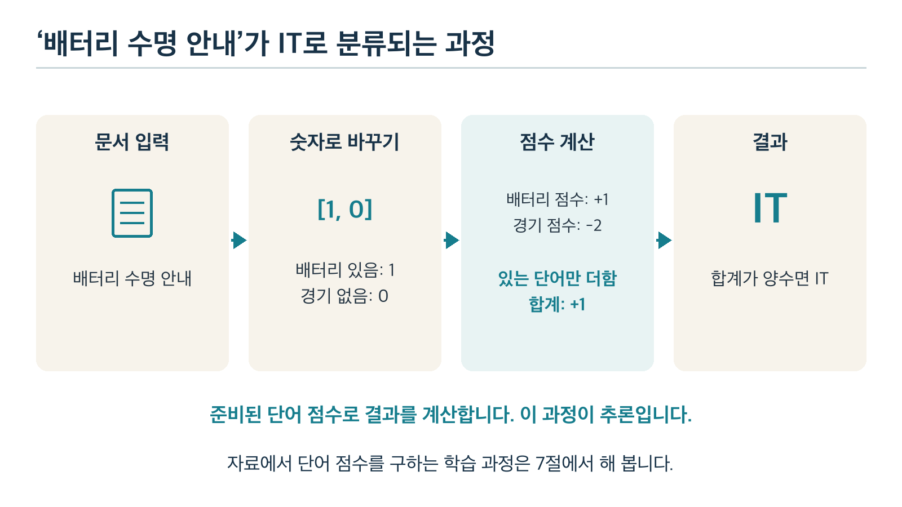
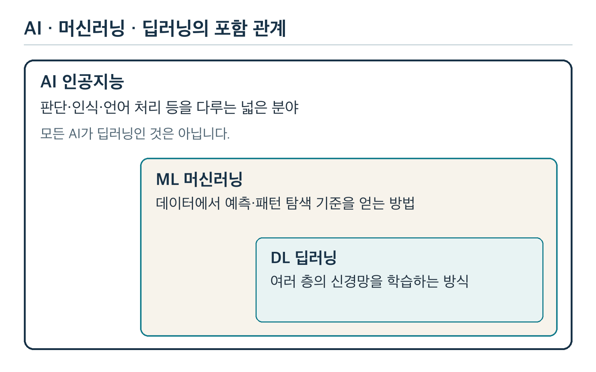
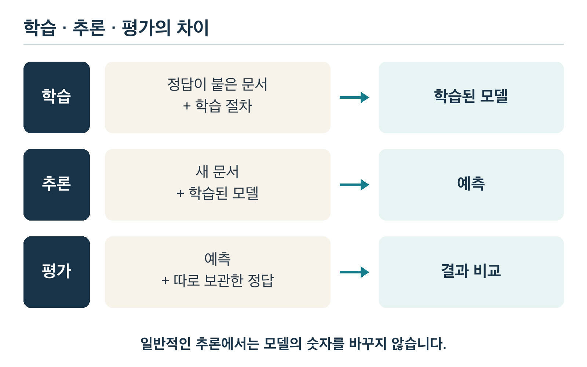
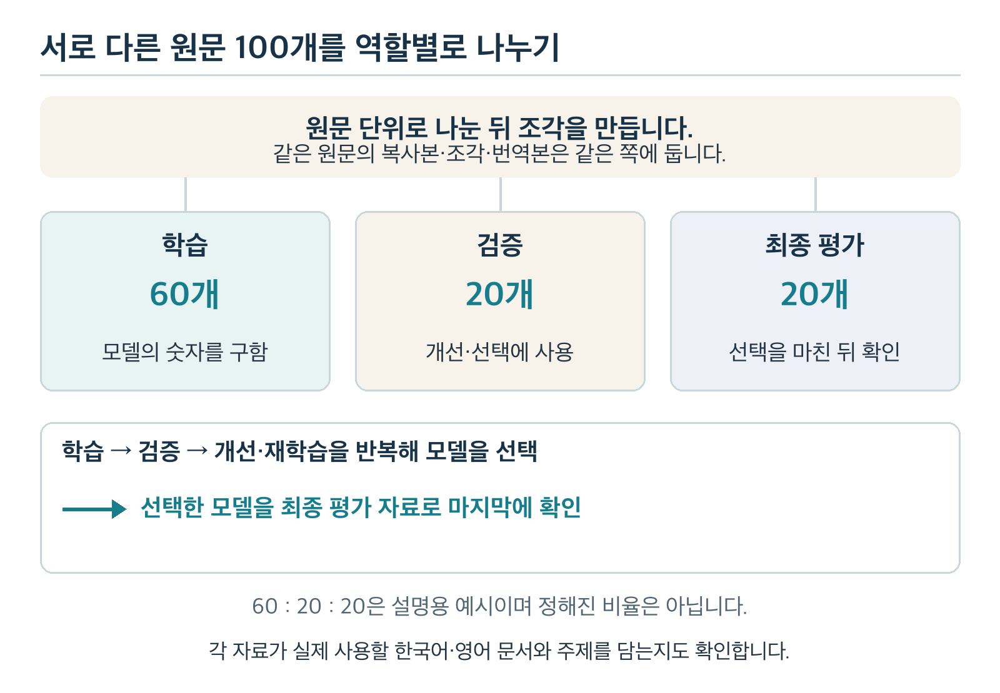
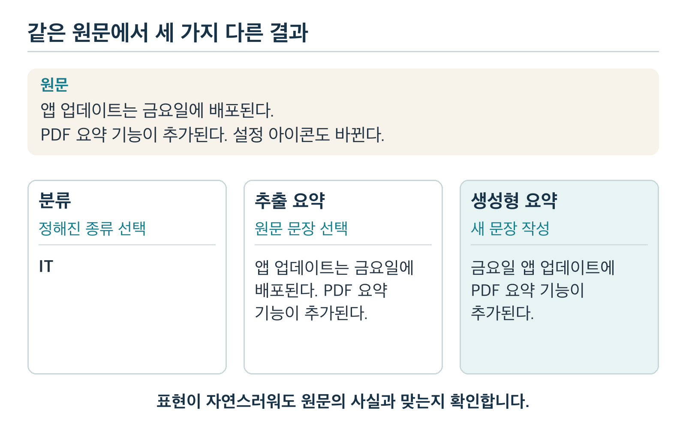

# 과목 1 AI와 머신러닝 기본 개념

문서에 종류 이름을 붙이거나 긴 글을 짧게 줄이는 기능은 어떻게 만들까요? 이 자료는 이런 문서 작업을 예로 들어 AI를 처음 공부하는 비전공자가 기본 원리를 익히도록 돕습니다.

**AI(인공지능, artificial intelligence)**는 판단·인식·언어 처리 같은 일을 컴퓨터로 수행하게 하는 넓은 분야입니다. 이 과목에서는 문서 분류와 생성형 요약을 목표로 모델·학습·추론의 관계를 배웁니다. 군집화는 분류와의 차이를 이해하는 비교 사례로 살펴봅니다.

종이와 메모장만으로 필수 실습을 할 수 있습니다. 11절 「선택 실습 Python으로 같은 점수표 만들기」는 선택 사항이며 별도 라이브러리가 필요하지 않습니다.

전체 학습 순서는 [학습 계획서](../README.md)에서 확인할 수 있습니다.

## 1. 이 과목에서 할 수 있게 될 일

이 과목은 전체 학습 과정의 출발점입니다. AI 관련 지식이나 Python 경험은 필요하지 않습니다. 문서를 읽고 간단한 덧셈을 하며 계산 이유를 설명하는 것부터 시작합니다.

| 이번에 할 일 | 연결되는 학습 | 확인할 결과 |
| --- | --- | --- |
| 원하는 문서 작업을 정한다 | 2~6절의 개념과 작은 예제 | 입력·모델·출력과 학습·추론·평가를 구분한다 |
| 직접 계산하고 판단한다 | 7~9절의 단원 실습 | 점수표·라벨·요약을 만들고 실패 이유를 설명한다 |
| 배운 원리를 새 예에 적용한다 | 10절의 확인 문제와 12절의 완료 확인 | 문서나 숫자를 바꿔도 이유를 설명한다 |

이 과목의 목표는 용어 암기보다 다음 질문에 자신의 말로 답하는 것입니다.

- 모델·데이터·파라미터는 각각 무엇인가요?
- 학습과 추론은 어떻게 다른가요?
- 정답으로 배우는 분류와 정답 없이 묶는 군집화는 어떻게 다른가요?
- 정해진 종류를 고르는 분류와 원문을 줄이는 요약은 결과가 어떻게 다른가요?
- 추출 요약과 생성형 요약은 어떻게 다르며, 요약의 사실을 어떻게 확인하나요?
- 정답 기준이 모호하거나 정한 종류에 맞지 않는 문서는 어떻게 다루나요?
- 사전학습·추가학습·추론은 어떻게 다른가요?
- 학습·검증·최종 평가 자료는 왜 구분하나요?

**읽기 → 작은 계산 → 단원 실습 → 설명하고 확인하기**의 순서는 다음과 같습니다:

1. 2~6절의 설명과 예제를 읽습니다. 4.2절의 대표 모델과 4.3절의 문서 임베딩은 선택 심화입니다. 직접 계산하거나 판단하는 항목은 먼저 풀고 바로 이어지는 해설에서 답과 이유를 확인합니다.
2. 7절 「실습 1 손으로 학습하고 추론하기」, 8.1~8.3절의 문서 라벨링, 9절 「실습 3 분류와 요약을 구분하기」를 수행합니다. 8.4절의 군집화 비교는 선택 실습입니다.
3. 10절 「확인 문제」의 1~11·14번에 답하고 각 문항 바로 아래의 해설로 이유를 확인합니다. 12~13번은 8.4절을 풀었다면 답해 보세요. 막힌 내용은 문제 묶음에 적힌 절로 돌아가 설명과 계산을 다시 살펴봅니다.
4. 12절 「과목 1 완료 확인」에서 자신의 말로 설명하고 예제를 바꿔 적용할 수 있는지 점검합니다. 11절의 Python 실행은 선택 사항입니다.

실행이 성공하거나 정답을 읽었다는 이유만으로 이해한 것으로 표시하지 마세요. 예를 들어 새 문서를 넣었을 때 ‘바뀌는 것은 문서의 합계이고 단어 점수는 그대로다’라고 설명할 수 있어야 합니다.

## 2. AI에게 어떤 글을 주고, 어떤 결과를 받을까요?

**이 절의 목표는 ‘AI로 문서를 분석한다’는 말을 구체적인 일로 바꾸는 것입니다.** 먼저 어떤 글을 줄지, 그 글에서 어떤 결과를 받고 싶은지 정합니다. 같은 글을 주어도 문서의 종류를 고르는 일과 내용을 짧게 줄이는 일은 서로 다릅니다.

### 2.1 입력은 AI에게 주는 글이고, 출력은 받고 싶은 결과입니다

다음 글을 AI에게 준다고 생각해 봅시다. 이 글과 아래의 결과는 모두 학습을 위해 만든 예제입니다.

> 새 스마트폰에 배터리 절약 기능이 추가됐다. 이 기능을 켜면 화면 밝기가 자동으로 낮아진다. 설정 화면의 아이콘도 바뀌었다.

이 원문이 **입력(input)**입니다. 원하는 작업을 정한 뒤 얻는 결과를 **출력(output)**이라고 합니다. 같은 글에서 ‘종류 이름’과 ‘핵심을 줄인 글’ 중 무엇을 받고 싶은가요? 아래는 같은 원문에 서로 다른 작업을 적용한 예입니다.

| 하고 싶은 일 | 작업 이름 | 출력 예시 |
| --- | --- | --- |
| IT·경제·스포츠 중 이 글의 종류를 고른다 | 문서 분류 | IT |
| 배터리 기능의 핵심을 설명하는 원문 문장을 고른다 | 추출 요약 | 새 스마트폰에 배터리 절약 기능이 추가됐다. 이 기능을 켜면 화면 밝기가 자동으로 낮아진다. |
| 배터리 기능의 핵심을 새로운 한 문장으로 줄인다 | 생성형 요약 | 새 스마트폰에 화면 밝기를 자동으로 낮추는 배터리 절약 기능이 추가됐다. |

‘IT’라는 이름을 받아도 원문의 핵심 내용을 읽을 수는 없습니다. 짧은 요약문을 받는 것은 종류 이름 하나를 고르는 일과 다릅니다. 그래서 **원하는 출력**이 무엇인지 먼저 정해야 필요한 모델과 평가 방법을 고를 수 있습니다.

**모델(model)**은 입력에서 결과를 계산하도록 만든 것입니다. 이 표에서는 작업별 결과를 비교합니다. 하나의 모델이 모든 결과를 자동으로 함께 제공한다는 뜻은 아닙니다.

### 2.2 문서 여러 개를 비슷한 내용끼리 모으는 일도 있습니다

이번에는 위 원문을 문서 A라고 하고 두 문서를 더 가져옵니다. 아래는 이 세 문서를 내용에 따라 두 그룹으로 묶은 한 예입니다.

| 문서 | 내용 |
| --- | --- |
| A | 위의 스마트폰 배터리 절약 기능 소개 |
| B | 휴대폰에서 배터리를 아끼는 설정을 소개한다. |
| C | 축구팀이 결승전에서 우승했다. |

| 그룹 | 함께 묶인 문서 | 내용상 공통점 |
| --- | --- | --- |
| 0 | A와 B | 휴대폰 배터리 기능·설정 |
| 1 | C | 축구 경기 소식 |

이처럼 여러 문서 사이의 비슷함을 비교해 묶는 작업을 **군집화(clustering)**라고 합니다. 여기서는 정답 주제 이름을 먼저 주지 않았습니다. 사람이 묶인 내용을 읽고 그룹 0의 이름을 **휴대폰 배터리**로 정할 수 있습니다.

그룹 번호 자체가 주제 이름을 뜻하지는 않습니다. 위 묶음은 이해를 돕는 예이며 실제 모델이 언제나 이렇게 묶는다는 보장은 없습니다.

분류의 출력은 정해진 종류 중 하나이고 군집화의 결과는 문서들이 어느 그룹에 함께 묶였는지입니다. 따라서 군집화에서는 비교할 문서 모음이 필요합니다. ‘새 글의 종류를 맞히기’와 ‘문서 모음을 비슷한 것끼리 나누기’를 구분해 두세요.

군집화의 기초 계산은 Chapter 3 「기초 수학과 전통적 머신러닝」에서 배웁니다. 정답 종류를 사용해 문서를 분류하고 결과를 평가하는 방법은 Chapter 6 「문서 분류 모델 설계와 평가」에서 배웁니다.

종류를 고르거나 문서 사이의 비슷함을 비교하려면 컴퓨터는 글을 어떻게 다뤄야 할까요? 2.3절 「컴퓨터가 글을 처리하려면 숫자로 바꾸어 계산합니다」에서 숫자 표현이 필요한 이유를 살펴봅니다.

### 2.3 컴퓨터가 글을 처리하려면 숫자로 바꾸어 계산합니다

사람은 글을 읽지만 컴퓨터의 모델은 계산할 수 있는 숫자를 사용합니다. 그래서 **문서 입력 → 숫자로 표현 → 모델 계산 → 결과**의 흐름이 필요합니다. 분류·군집화·요약은 원하는 결과가 다르므로 사용하는 숫자 표현과 계산도 달라질 수 있습니다.

계산 과정을 쉽게 보려고 입력을 ‘배터리 수명 안내’라는 짧은 글로 바꿔 봅시다. 이미 학습한 단어 점수가 배터리 +1, 경기 -2라고 가정합니다. 합계가 양수면 IT, 음수면 스포츠, 0이면 판단 보류로 정하는 작은 모델입니다.

#### 함께 풀기: 준비된 점수로 문서 분류하기

1. **글을 준다:** ‘배터리 수명 안내’를 입력한다.
2. **계산할 숫자로 바꾼다:** 단어가 있으면 1, 없으면 0으로 표시한다. 이 글에는 배터리가 있고 경기는 없으므로 이 순서로 쓴 숫자 목록은 `[1, 0]`이다.
3. **준비된 점수로 계산한다:** 들어 있는 단어인 배터리의 점수 +1을 더한다. 경기는 없으므로 더하지 않는다. 합계는 +1이다.
4. **결과를 낸다:** 합계가 양수이므로 IT를 출력한다.



*그림 1. 하나의 입력에서 출력까지 이어지는 단어 점수 예제. 7절 모델의 일부 단어만 보여 주는 단순화이며 실제 언어모델의 계산이나 품질을 나타내지는 않습니다.*

여기서 한 일은 **이미 준비된 점수로 결과를 계산한 것**입니다. 글 하나를 처리했다고 점수를 새로 배우거나 바꾸지는 않았습니다. 그 점수를 자료에서 구하는 학습 과정은 7.2절 「학습 자료」의 점수표를 채우며 직접 해 봅니다. 실제 언어모델은 단어의 있음·없음만 보는 이 예제보다 복잡한 숫자 표현과 계산을 사용합니다.

#### 직접 해보고 해설 확인하기

같은 모델에 ‘경기 결과 안내’를 넣어 보세요. 단어 순서를 [배터리, 경기]로 두고, 이 문서에 두 단어가 각각 있는지 숫자로 표시해 보세요. 준비된 점수를 더하면 합계는 얼마이며, 어떤 결과가 나올까요?

**해설:** 숫자 목록은 `[0, 1]`입니다. 경기 점수 -2를 더하면 합계는 -2이고, 이 모델은 스포츠를 출력합니다. 입력 문서가 바뀌어도 준비된 점수는 그대로입니다. 실제 TXT·PDF 파일에서 원문을 읽는 방법은 Chapter 2 「Python·NumPy와 문서 데이터 처리」에서 배웁니다.

## 3. AI와 머신러닝과 딥러닝

### 3.1 세 용어의 관계

문서의 종류를 고르는 프로그램을 만든다고 해 봅시다. 사람이 단어 규칙을 직접 적을 수도 있고 예제 자료에서 판단 기준을 얻는 방법도 있습니다. 이런 문서 AI를 설명할 때 AI·머신러닝·딥러닝 중 어떤 이름을 써야 할까요?

AI는 넓은 분야의 이름입니다. 머신러닝은 그 안의 한 접근법이며 딥러닝은 머신러닝의 한 종류입니다.

| 용어 | 쉽게 이해하기 | 문서 분석의 예 |
| --- | --- | --- |
| AI 인공지능, artificial intelligence | 판단·인식·언어 처리 같은 일을 컴퓨터로 수행하게 하는 넓은 분야 | 문서 내용을 분석하는 기능 |
| ML 머신러닝, machine learning | 데이터에서 예측이나 패턴 탐색에 쓸 계산 기준을 얻는 방법 | 정답 종류로 문서 분류를 배우거나 비슷한 문서끼리 묶기 |
| DL 딥러닝, deep learning | 여러 층으로 구성된 신경망을 학습하는 머신러닝 방식 | 사전학습 언어모델을 이용한 분류나 생성형 요약 |



*그림 2. AI, 머신러닝, 딥러닝의 포함 관계. 딥러닝은 AI를 구현하는 여러 방법 중 하나입니다.*

**신경망(neural network)**은 입력 숫자를 여러 계산 단계에 통과시켜 결과를 내는 모델입니다. 각 단계인 **층(layer)**은 앞 단계의 숫자를 계산해 다음 단계로 넘깁니다. 학습에서는 이 계산에 쓰는 숫자를 조정합니다.

뇌가 문장을 이해하는 과정을 그대로 재현한다는 뜻은 아닙니다. 실제 계산과 학습 원리는 Chapter 4 「딥러닝 기초와 PyTorch」에서 배웁니다.

표의 ‘사전학습 모델’은 많은 자료로 미리 학습해 둔 모델을 뜻합니다. 이를 내 작업에 활용하는 방법은 5.4절 「사전학습과 추가학습과 추론」에서 비교합니다. 모든 문서 분류 문제에 큰 언어모델이 필요한 것은 아닙니다. 작은 머신러닝 모델도 분류에 사용할 수 있습니다.

같은 문서 분류라도 사람이 규칙을 직접 적을지 자료에서 기준을 배울지 선택해야 합니다. 3.2절 「사람이 규칙을 쓰는 방법과 데이터로 배우는 방법」에서 두 방법의 차이와 한계를 비교합니다.

### 3.2 사람이 규칙을 쓰는 방법과 데이터로 배우는 방법

개발자가 다음 규칙을 직접 만들 수 있습니다.

> 문서에 ‘축구’라는 글자가 있으면 스포츠로 분류한다.

이 규칙은 이해하고 수정하기 쉽습니다. 하지만 ‘축구 경기 기록을 관리하는 새 앱의 기능 소개’도 스포츠로 분류할 수 있습니다. 앱 기능을 소개하는 문서라면 IT가 더 적절할 수 있습니다.

정답을 붙인 예제로 배우는 **지도학습(supervised learning)**으로 분류기를 만들 수 있습니다. 이때는 정답이 붙은 여러 문서로부터 단어와 주제의 관계 등을 계산합니다. 사람이 문서 하나하나의 모든 판단 규칙을 작성하는 대신 데이터로부터 예측에 사용할 숫자를 얻습니다.

정답 종류 없이 자료 안의 공통점이나 구조를 찾는 **비지도학습(unsupervised learning)**도 있습니다. 4.2절 「지도학습과 비지도학습」에서 두 방식을 비교합니다.

사람이 하는 일도 남아 있습니다. 무엇을 분류할지, 어떤 자료를 쓸지, 어떤 학습 방법으로 계산할지, 결과를 어떻게 평가할지는 사람이 설계합니다. 데이터로 배웠다고 문맥을 언제나 올바르게 구분하는 것은 아닙니다.

**생각해 보기:** 회사 규정의 특정 번호가 포함됐는지만 확인한다면 문자열 검색으로 충분할 수 있습니다. 여러 표현으로 쓰인 문서의 주제를 구분한다면 머신러닝을 검토할 이유가 생깁니다.

7.2절 「학습 자료」의 점수표 예제로 이 차이를 연결해 봅시다. 사람은 ‘IT 문서에 나온 단어에는 1을 더한다’는 학습 절차를 정합니다. 그 절차로 문서와 정답을 계산하면 ‘배터리’의 점수 1을 얻습니다.

이후 ‘배터리 수명 안내’라는 새 문서에서는 이미 얻은 1을 읽어 IT로 예측합니다. 마지막으로 별도 정답과 비교해 평가합니다.

이 흐름은 **문서와 정답 → 학습으로 얻은 점수 → 새 문서의 예측 → 정답과 비교한 평가**입니다. 사람이 직접 ‘배터리가 있으면 IT’라는 최종 규칙을 적는 방식과 달리 점수 자체를 자료에서 구했습니다.

다만 사람이 학습 절차와 살펴볼 단어를 정한 매우 단순한 모델입니다. 데이터가 스스로 목적을 정하거나 모든 판단 방법을 만들어 내는 것은 아닙니다.

4절 「데이터와 모델을 구분하기」에서는 이때 쓰는 문서·정답·입력 정보·점수의 이름을 구분합니다.

## 4. 데이터와 모델을 구분하기

### 4.1 입력과 라벨

다음 세 문서를 IT·경제·스포츠로 나눠 달라고 한다면 배우는 데 필요한 정답은 무엇일까요? 지도학습 문서 분류에서 입력은 문서 내용입니다. **라벨(label)**은 그 문서에 붙인 정답 종류입니다. 먼저 이 비교용 예제로 용어를 익힙니다.

| 입력 문서 | 라벨 |
| --- | --- |
| 새 스마트폰의 카메라 기능을 소개한다 | IT |
| 기업의 올해 매출과 영업이익을 발표한다 | 경제 |
| 축구 선수가 결승전에서 득점했다 | 스포츠 |

이렇게 정답을 붙인 예제로 배우는 방식을 **지도학습**이라고 합니다. 7.2절 「학습 자료」에서는 점수표 작성을 실습합니다. 8.2절 「라벨링 표」에서는 문서에 정답을 붙입니다. 두 실습에서 최종 목표인 문서 분류에 필요한 지도학습의 기초를 익힙니다.

두 실습에서 붙인 정답은 8.4절 「선택 비교: 라벨 없이 한국어·영어 문서 묶어 보기」에는 사용하지 않습니다. 4.2절 「지도학습과 비지도학습」에서는 정답을 주지 않고 무엇을 배울 수 있는지 비교합니다.

문서의 라벨은 문서가 가진 절대적인 속성이라기보다 만들고 싶은 기능의 분류 기준에 따라 정해집니다. 예를 들어 IT 회사의 매출 기사도 ‘주요 내용이 실적이면 경제’라는 기준을 정했다면 경제가 됩니다.

### 4.2 지도학습과 비지도학습

2.2절 「문서 여러 개를 비슷한 내용끼리 모으는 일도 있습니다」의 문서 A·B·C처럼 정답 종류를 먼저 주지 않고 비슷한 글을 모을 수도 있습니다. 문서와 함께 정답을 주는지에 따라 학습에서 얻으려는 결과가 달라집니다.

**지도학습**은 문서 같은 입력과 그 정답 라벨을 함께 주고 새 입력의 결과를 예측할 기준을 배우는 방식입니다. 예를 들어 IT·스포츠 라벨이 붙은 문서로 배우면 새 문서의 종류를 예측할 수 있습니다.

**비지도학습**은 정답 라벨 없이 자료 안의 공통점이나 구조를 찾는 방식입니다. 이 교재에서 다루는 군집화는 문서 내용을 비교해 비슷한 것끼리 묶습니다. IT·스포츠라는 이름을 정답으로 미리 주지 않습니다.

| 비교할 것 | 지도학습 분류 | 비지도 군집화 |
| --- | --- | --- |
| 학습에 주는 것 | 문서와 정답 라벨 | 정답 라벨이 없는 문서 모음 |
| 얻으려는 것 | 정해진 종류의 예측 | 비슷한 문서들의 묶음 |

두 방식은 **학습할 때 정답 라벨을 쓰는지**로 구분합니다. 신경망을 쓰는지는 별개의 기준이므로, 두 방식 모두 전통적 머신러닝 방법과 딥러닝 방법으로 구현할 수 있습니다.

#### 심화 디딤돌: 대표적인 머신러닝·딥러닝 방법

이 항목은 선택 읽기입니다. 우선 ‘정답 라벨을 쓰는가’와 ‘신경망을 쓰는가’가 서로 다른 질문임을 이해하면 됩니다. 다음 모델 이름은 두 기준을 함께 볼 때의 사례이며 이름과 세부 알고리즘을 외울 필요는 없습니다.

- **지도학습·전통적 머신러닝: 의사결정나무.** 정답 라벨이 붙은 문서에서 단어 유무 같은 조건을 배워 분류합니다.
- **지도학습·딥러닝: BERT 기반 문서 분류기.** BERT는 문장 속 단어의 앞뒤 문맥을 살피는 언어모델입니다. 정답 라벨이 붙은 문서로 추가학습해 종류를 예측합니다. 지도학습인 부분은 라벨을 사용한 추가학습입니다.
- **비지도학습·전통적 머신러닝: K-Means.** 정답 라벨 없이 숫자로 표현한 문서를 가까운 것끼리 묶습니다.
- **정답 라벨 없이 배우는 딥러닝: 딥 오토인코더.** 입력을 압축했다가 복원하며 숫자 표현을 배웁니다. 입력 자체를 복원 목표로 삼으므로 자기지도학습(self-supervised learning)으로도 구분합니다.

K-Means의 기초 계산은 Chapter 3 「기초 수학과 전통적 머신러닝」에서, 신경망 학습 원리는 Chapter 4 「딥러닝 기초와 PyTorch」에서 배웁니다.

BERT 같은 사전학습 모델은 Chapter 5 「자연어 처리와 사전학습 모델 이해」에서 소개합니다. 분류에 맞게 조정하는 과정은 Chapter 11 「문서 분류 모델 추가학습 심화」에서 다룹니다. 오토인코더는 정답 라벨 없이 입력을 복원하며 숫자 표현을 배우는 비교 사례입니다.

### 4.3 특성과 모델과 파라미터

#### 입력 정보와 학습으로 얻은 숫자를 구분하기

‘배터리 수명 안내’와 ‘경기 결과 안내’를 번갈아 넣으면 무엇이 달라질까요? 2.3절 「컴퓨터가 글을 처리하려면 숫자로 바꾸어 계산합니다」의 모델에서는 입력 문서의 단어 유무가 달라집니다. 이미 준비된 단어 점수는 그대로 사용합니다.

컴퓨터는 텍스트를 계산 가능한 숫자로 바꿔 처리합니다. 모델이 판단에 사용하는 입력 정보를 **특성(feature)**이라고 부릅니다. 단순한 예에서는 특정 단어가 있는지 여부가 특성이 될 수 있습니다.

모델은 입력에서 결과를 계산하는 구조와 그 구조에 들어가는 숫자를 포함합니다. 학습 과정에서 조정하거나 데이터로부터 구하는 숫자를 **파라미터(parameter)**라고 합니다. **가중치(weight)**는 파라미터의 한 종류입니다.

| 구분 | 배터리 수명 안내 | 경기 결과 안내 | 왜 다른가요? |
| --- | --- | --- | --- |
| 입력의 특성: [배터리 있음, 경기 있음] | [1, 0] | [0, 1] | 문서에 들어 있는 문자열이 다릅니다 |
| 준비된 파라미터: [배터리 점수, 경기 점수] | [+1, -2] | [+1, -2] | 같은 모델로 추론하므로 점수표를 고정합니다 |
| 계산 결과 | +1, IT | -2, 스포츠 | 같은 점수표에서 입력에 해당하는 점수만 더합니다 |

이 표의 두 점수는 2.3절 「컴퓨터가 글을 처리하려면 숫자로 바꾸어 계산합니다」에서 이미 학습했다고 가정한 값입니다. 입력의 숫자 표현과 자료에서 얻은 파라미터는 둘 다 숫자이지만 맡은 일이 다릅니다.

실습의 단어 점수는 자료에서 얻는 파라미터입니다. 사람이 정하는 그룹 수 N은 계산 방법의 설정입니다. 이 값은 8.4절 「선택 비교: 라벨 없이 한국어·영어 문서 묶어 보기」에서 사용합니다.

7절 「실습 1 손으로 학습하고 추론하기」에서 만드는 지도학습 분류 모델의 구성은 다음과 같습니다.

| 구성 | 실습에서 맡은 역할 |
| --- | --- |
| 특성 | ‘스마트폰’, ‘배터리’, ‘선수’, ‘경기’가 있는지 |
| 파라미터 | 각 단어에 붙는 점수 |
| 예측 계산 | 입력에 있는 단어들의 점수를 더하기 |
| 출력 | IT, 스포츠 또는 판단 보류 |

실제 언어모델은 훨씬 많은 숫자와 복잡한 계산을 사용합니다. 그렇지만 **입력을 계산에 넣어 결과를 얻는다**는 큰 흐름은 같습니다.

#### 심화 디딤돌: 문서 내용을 비교할 수 있는 숫자로 표현하기

이 항목은 선택 읽기입니다. 8.4절 「선택 비교: 라벨 없이 한국어·영어 문서 묶어 보기」와 비교해 보고 싶을 때 읽어 보세요.

‘배터리를 오래 쓰는 설정’과 ‘배터리 절약 설정’처럼 표현이 다른 문서도 가까이 모으려면 무엇이 필요할까요?

문서 군집화에서도 내용을 숫자로 바꾸어 서로 비교할 수 있어야 합니다. **문서 임베딩(embedding)**은 문서 내용을 `[0.2, 0.7, ...]` 같은 숫자 목록으로 표현한 것입니다. 모델이 학습한 기준에 따라 이 숫자를 계산합니다.

이런 순서가 있는 숫자 목록을 **벡터(vector)**라고 합니다. 문서를 임베딩으로 바꾸는 모델이 문서 표현 모델입니다. 각 숫자가 그대로 IT 점수나 정답 확률을 뜻하지는 않습니다.

어떤 모델은 문서 내용이 비슷하면 숫자 표현도 가깝게 나오도록 학습됩니다. 이런 모델을 사용하면 쓰인 단어가 달라도 비슷한 내용을 찾는 데 도움이 됩니다. 아래 숫자는 이 원리를 보여 주려고 직접 만든 **설명용 좌표**입니다. 실제 임베딩이나 성능 측정값은 아닙니다.

| 문서 | 언어와 내용 | 설명용 숫자 두 개 |
| --- | --- | --- |
| A | 한국어: 배터리를 오래 쓰는 설정을 소개한다. | [0.90, 0.10] |
| B | 영어: This setting helps the battery last longer. | [0.85, 0.15] |
| C | 한국어: 축구팀의 우승 소식. | [0.10, 0.90] |

B는 ‘이 설정은 배터리를 더 오래 쓰도록 돕는다’는 뜻입니다. 이 단순 예에서는 두 좌표의 차이를 살펴봅니다. A와 B의 차이는 각각 0.05로 작습니다. A와 C의 차이는 각각 0.80으로 큽니다.

이 좌표는 언어가 다른 A·B가 같은 한국어인 A·C보다 내용상 가까운 상황을 표현합니다. A와 B를 묶고 C를 따로 두면 ‘언어별 묶음’과 다른 결과가 됩니다.

실제 임베딩에는 더 많은 숫자를 사용할 수 있습니다. 각 숫자에 ‘배터리’나 ‘축구’처럼 사람이 읽을 수 있는 뜻이 정해져 있지는 않습니다.

숫자를 임의로 만들어 넣는 대신 학습된 문서 표현 모델로 계산합니다. 숫자가 크다는 이유만으로 더 좋은 문서나 높은 정답 확률을 뜻하지도 않습니다.

문서 사이의 가까움은 선택한 모델과 비교 계산 방법에 따라 달라집니다. 사람이 원하는 주제의 비슷함과 다를 수 있습니다. A·B처럼 같은 내용의 한영 문서가 가까운지, A·C처럼 같은 언어이지만 내용이 다른 문서가 구분되는지 함께 확인합니다.

실제 표현 모델과 거리·유사도를 계산하는 방법은 Chapter 5 「자연어 처리와 사전학습 모델 이해」에서 배웁니다. 여기서는 **문서를 숫자로 표현해야 계산으로 비교할 수 있고 그 표현이 묶음의 품질에 영향을 준다**는 관계를 이해하면 됩니다.

## 5. 학습과 추론은 언제 일어날까요

### 5.1 학습은 데이터에서 계산 기준을 얻는 과정입니다

핵심 질문: 문서를 하나 반영하면 어떤 숫자가 바뀔까요? **학습(training)**에서는 데이터를 사용해 모델의 파라미터를 구하거나 조정합니다. 지도학습 신경망에서는 예측과 정답의 차이를 줄이도록 숫자를 조정합니다.

이 과목에서는 더 작은 계산으로 그 뜻을 확인합니다. 자료에서 얻은 숫자가 예측에 어떻게 쓰이는지 손으로 따라가 봅시다.

#### 함께 풀기: 첫 IT 문서를 반영하기

4.3절 「특성과 모델과 파라미터」의 네 단어를 사용합니다. 여기서 단어가 있는지는 글에 해당 문자열이 포함됐는지만 확인합니다. 단어의 경계나 문맥까지 살피는 계산은 아닙니다.

숫자의 순서는 항상 **스마트폰·배터리·선수·경기**입니다. 점수를 모두 0으로 시작하고 IT 문서에 들어 있는 단어의 점수에는 1을 더합니다.

없는 단어의 점수는 그대로 둡니다. 같은 단어가 한 문서에 여러 번 있어도 한 번만 반영합니다.

첫 학습 자료는 A ‘스마트폰 배터리 개선 소식’이며 정답은 IT입니다. 스마트폰과 배터리가 있으므로 두 점수에 각각 1을 더합니다.

| 단계 | 스마트폰 | 배터리 | 선수 | 경기 |
| --- | --- | --- | --- | --- |
| 처음 점수 | 0 | 0 | 0 | 0 |
| A가 바꾸는 양 | +1 | +1 | 0 | 0 |
| A 반영 후 | 1 | 1 | 0 | 0 |

`[0, 0, 0, 0] → [1, 1, 0, 0]`으로 점수표가 바뀌었습니다. 사람이 ‘1을 더한다’는 절차를 정했고 어떤 점수에 더할지는 문서 내용과 정답이 결정했습니다.

#### 직접 해보고 해설 확인하기

다음 학습 자료 B는 ‘스마트폰 신제품 발표’이고 정답은 IT입니다. A를 반영한 `[1, 1, 0, 0]`에서 이어서 계산해 보세요. B에는 배터리라는 단어가 없습니다. 배터리의 점수는 0으로 돌아갈까요, 1로 남을까요?

**해설:** B를 반영한 점수는 **`[2, 1, 0, 0]`**입니다. 스마트폰은 기존 1에 1을 더해 2가 됩니다. 배터리는 B에 없으므로 기존 1을 유지합니다. 없는 단어의 값을 0으로 지우는 계산이 아닙니다. 선수와 경기도 기존 0을 유지합니다.

이것이 자료에서 숫자를 얻는 **학습**입니다. 이 두 IT 문서는 원리를 익히는 작은 예제입니다.

7.2절 「학습 자료」에서는 같은 계산을 처음부터 다시 하고 스포츠 문서 C·D까지 반영해 점수표를 완성합니다. 스포츠 문서는 들어 있는 단어의 점수에서 1을 빼므로 다른 결과가 나옵니다.

학습 방법마다 계산은 다릅니다. 군집화에서는 정답 라벨 대신 데이터 사이의 비슷함을 활용합니다. 실제 신경망의 학습을 ‘단어마다 1을 더하거나 빼는 것’으로 생각하지는 마세요.

여기서는 **데이터와 학습 절차 → 학습된 모델**이라는 관계를 계산으로 확인했습니다. 5.2절 「추론은 학습한 기준으로 새 입력을 처리하는 과정입니다」에서는 이렇게 얻은 숫자를 고정한 뒤 새 입력에 사용합니다.

### 5.2 추론은 학습한 기준으로 새 입력을 처리하는 과정입니다

핵심 질문: 새 문서를 읽을 때도 단어 점수가 바뀔까요? **추론(inference)**은 준비된 모델로 새 입력의 결과를 계산하는 과정입니다. 5.1절의 두 IT 문서만 반영한 점수 `[2, 1, 0, 0]`을 고정하고 비교해 봅시다.

#### 함께 풀기: 고정된 점수로 새 문서 계산하기

새 입력 ‘배터리 수명 안내’에는 배터리가 들어 있습니다. 배터리의 점수 1을 읽어 합계 1을 구합니다. 합계가 양수이므로 이 예제의 규칙에서는 IT를 출력합니다.

계산이 끝나도 점수표는 `[2, 1, 0, 0]` 그대로입니다. 새 입력마다 계산하는 문서의 합계와 고정해 둔 단어 점수를 구분하세요.

#### 직접 해보고 해설 확인하기

같은 점수표에 ‘스마트폰 배터리 사용 안내’를 넣으면 합계는 얼마일까요? 그 문서를 두 번 연속 넣었을 때 스마트폰 점수가 2에서 3으로 바뀔까요?

**해설:** 합계는 `2 + 1 = 3`이고 예측은 IT입니다. 같은 입력을 다시 넣어도 합계는 3입니다. **추론은 단어 점수를 읽어 문서의 합계를 구하는 일**이므로 스마트폰 점수가 3으로 바뀌지 않습니다.

| 비교 | 5.1절의 학습 | 5.2절의 추론 |
| --- | --- | --- |
| 주어진 것 | 문서와 정답 | 새 문서와 고정된 점수표 |
| 계산의 목적 | 단어 점수 구하기 | 문서의 점수 합과 결과 구하기 |
| 단어 점수 변경 | 자료에 따라 변경 | 변경하지 않음 |

**새 문서와 학습된 모델 → 예측 결과**가 추론입니다. 일반적인 추론에서 결과를 출력했다고 모델의 가중치가 자동으로 바뀌지는 않습니다. 사람이 결과를 수정하더라도 그 피드백으로 다시 학습하거나 모델을 갱신하는 별도 과정이 있어야 반영됩니다.

결과를 계산했다면 그 결과가 쓸 만한지도 확인해야 합니다. 5.3절 「평가는 목적에 맞게 결과를 확인하는 과정입니다」에서는 학습에 쓴 문서를 맞혔다는 사실만으로 충분한지 살펴봅니다.

### 5.3 평가는 목적에 맞게 결과를 확인하는 과정입니다

#### 학습 문서를 맞혔어도 새 문서를 확인하는 이유

이미 풀어 본 문제를 다시 맞혔다면 새로운 문제도 잘 풀 수 있을까요? **평가(evaluation)**는 결과가 목적에 맞는지 확인하는 과정입니다.

정답이 있는 지도학습 분류에서는 **입력만 모델에 주어 예측한 뒤 따로 보관한 정답과 비교**합니다. 예측에 사용할 정보와 평가할 때 확인할 정답을 구분합니다.

5.1절의 두 IT 문서만 반영한 점수표를 다시 생각해 봅시다. A ‘스마트폰 배터리 개선 소식’의 합은 3이고 B ‘스마트폰 신제품 발표’의 합은 2이므로 둘 다 IT로 예측합니다. 하지만 다음 문서도 IT라는 이유만으로 잘 맞힐까요?

> 새 휴대전화의 기능을 소개한다.

이 문서에는 네 문자열인 스마트폰·배터리·선수·경기가 하나도 없습니다. 합계는 0이고 이 예제의 규칙에서는 판단을 보류합니다. 사람은 휴대전화와 스마트폰의 관련성을 알지만 이 점수표는 해당 문자열이 있는지만 확인합니다.

| 확인한 문서 | 결과 | 알 수 있는 것 |
| --- | --- | --- |
| 학습에 쓴 A·B | 둘 다 IT | 이 두 학습 문서는 맞힘 |
| 다른 표현의 새 IT 문서 | 0, 판단 보류 | 새 표현을 처리하는 데 한계가 있음 |

처음 보는 자료에도 배운 기준을 적용해 잘 처리하는 능력을 **일반화(generalization)**라고 합니다. 학습 자료의 우연한 특징까지 지나치게 맞춰 새 자료에서 성능이 나빠지는 현상을 **과적합(overfitting)**이라고 합니다.

이 작은 모델은 위 사례처럼 새 표현에 약합니다. 몇 문서의 결과만으로 전체 성능을 정하거나 과적합이 원인이라고 확정할 수는 없습니다. 표현 방식의 부족, 학습 자료의 부족 등도 살펴봐야 합니다.

학습·추론·평가를 구분하면 개선할 위치도 찾기 쉽습니다.

| 상황 | 무엇을 하는 중인가요? |
| --- | --- |
| 정답 문서로 단어 점수를 구한다 | 학습 |
| 구한 점수로 새 문서를 분류한다 | 추론 |
| 예측과 따로 보관한 정답을 비교한다 | 평가 |
| 틀린 원인을 살펴보고 학습 자료를 보완해 점수를 다시 구한다 | 추가 학습·재학습 |



*그림 3. 지도학습 분류 예제로 본 학습, 추론, 평가. 일반적인 추론에서는 학습된 숫자를 바꾸지 않습니다. 군집화와 요약은 작업 목적에 맞는 평가를 사용합니다.*

#### 학습·검증·최종 평가 자료는 맡은 일이 다릅니다

모델을 고를 때 계속 살펴본 문서는 마지막 확인에도 새 문서라고 할 수 있을까요? 새 자료에서 나온 결과를 확인하려면 자료를 역할별로 나누고 그 역할을 지켜야 합니다.

| 자료 | 맡은 일 |
| --- | --- |
| 학습 자료 | 모델의 파라미터를 구하거나 조정 |
| 검증 자료 | 결과를 비교하며 학습 방법이나 모델을 선택 |
| 최종 평가 자료, 테스트 자료 | 선택을 마친 모델을 별도 자료로 마지막 확인 |

한국어·영어 문서와 정답 라벨을 준비했다고 가정합시다. 서로 다른 원문은 100개입니다. 같은 원문의 복사본·조각·번역을 별도 원문으로 세지 않습니다.

이를 학습 60개, 검증 20개, 최종 평가 20개로 나눕니다. **60:20:20은 역할을 설명하기 위한 예이며 정해진 표준 비율이 아닙니다.** 자료의 양과 목적에 따라 조정합니다.

1. **학습 60개:** 단어 점수를 구합니다. 검증·최종 평가 문서와 그 정답은 이 점수 계산에 넣지 않습니다.
2. **검증 20개:** 예측을 정답과 비교합니다. 예를 들어 단어 네 개를 쓰는 방법과 여섯 개를 쓰는 방법 중 하나를 고릅니다. 각 방법의 점수는 학습 60개에서만 구합니다.
3. **최종 평가 20개:** 방법과 모델을 더 바꾸지 않고 마지막 결과를 확인합니다.

순서는 **학습 → 검증으로 비교·선택 → 최종 평가**입니다. 최종 평가에서 틀린 문서를 보고 단어 목록을 계속 고치면 어떻게 될까요?

가중치를 그 자료로 직접 학습하지 않아도 그 자료에 맞는 방법을 선택하게 됩니다. 그 결과를 완전히 새로운 문서에 대한 평가라고 보기 어렵습니다.

최종 평가 결과를 계기로 모델을 다시 개선할 수는 있습니다. 다만 마지막 확인에는 개발 과정에서 쓰지 않은 새 평가 자료가 필요합니다. 검증 자료만 반복해서 살피며 거기에 지나치게 맞추는 문제도 생길 수 있습니다.

#### 섞으면 안 되는 것은 파일명이 아니라 원문의 정보입니다

파일 이름만 바꾸면 모델에게도 새 문서가 될까요? 원문 A를 앞부분 A-1과 뒷부분 A-2로 잘랐다고 합시다. A-1을 학습에, A-2를 최종 평가에 넣으면 문장이나 내용이 겹칠 수 있습니다.

A의 복사본이나 영어 번역을 최종 평가에 넣어도 처음 보는 내용인지 판단하기 어려워집니다.

평가 자료는 독립적으로 남겨야 합니다. 이런 자료의 정보가 학습이나 선택 과정에 들어가 결과를 부풀리는 문제를 **데이터 누수 또는 데이터 혼입(data leakage)**이라고 부릅니다.

먼저 복사본을 정리하고 같은 원문에서 나온 조각·번역문을 하나의 **원문 묶음**으로 관리합니다. 그 묶음 전체를 학습·검증·최종 평가 중 한쪽에만 넣습니다.

원문 묶음을 배정한 뒤 각 자료 안에서 필요한 조각을 만듭니다. 파일명이 다르다는 이유만으로 서로 다른 자료라고 판단하지 않습니다.



*그림 4. 자료를 역할별로 분리하는 예. 같은 원문의 복사본·조각·번역문은 같은 쪽에 둡니다. 60:20:20은 설명용 비율이며 원문 수와 조각 수는 구분합니다.*

#### 직접 해보고 해설 확인하기

학습에 원문 A를 넣고 검증에는 A의 영어 번역을 넣었습니다. 최종 평가에는 원문 A의 뒷부분을 넣었습니다. 각 파일의 이름은 모두 다릅니다. 세 자료가 독립적으로 나뉜 것일까요? 어떻게 고쳐야 할까요?

**해설:** 세 자료에 같은 원문의 정보가 들어갔으므로 독립적으로 나뉜 것이 아닙니다. A와 그 번역·조각을 같은 원문 묶음으로 모으고 그 묶음 전체를 세 자료 중 한쪽에만 배정합니다. 나머지 자료에는 다른 원문 묶음을 넣습니다.

#### 평가 결과에는 대표성과 자료 수의 한계가 있습니다

한국어 IT 문서에서 잘 맞힌 결과로 영어 스포츠 문서의 품질도 알 수 있을까요? **대표성**은 앞으로 처리할 문서의 특징을 평가 자료가 얼마나 잘 담는지를 뜻합니다.

한영 문서를 처리할 목적이라면 한국어·영어와 주요 주제가 어떻게 들어갔는지 살펴봐야 합니다. 최종 평가에 한국어 IT 문서만 있으면 영어 스포츠 문서의 품질은 알 수 없습니다.

길이·형식도 실제 사용 문서와 크게 다르지 않은지 확인합니다. 파일을 무작위로 섞는 것만으로 대표성이 보장되지는 않습니다.

평가 자료가 적으면 결과도 크게 흔들립니다. 원문 20개에서 18개를 맞히면 `18 ÷ 20 = 90%`입니다. 한 개의 정오답만 달라져도 5%포인트가 바뀝니다.

따라서 이 90%를 모든 문서의 성능이라고 단정하지 않습니다. 다양한 새 자료를 충분히 모으고 전체 결과와 언어·주제별 실패를 함께 확인합니다.

평가 자료를 더 남기면 결과를 판단하는 데 도움이 되지만 학습 자료는 줄어듭니다. 이 균형을 생각하며 자료 수와 분리 방법을 정합니다.

군집화와 요약도 평가가 필요하지만 확인할 대상은 다릅니다. 군집화에서는 대표 문서가 내용상 비슷한지, 언어만 같아서 묶인 것은 아닌지 살펴봅니다. 그룹 번호가 사람의 번호와 같다는 이유로 정확하다고 판단하지 않습니다.

요약에서는 핵심 내용이 담겼는지와 원문의 사실을 바꾸지 않았는지를 확인합니다. 5.4절 「사전학습과 추가학습과 추론」에서는 미리 학습된 모델을 쓸 때도 이런 평가가 필요한 이유를 살펴봅니다.

### 5.4 사전학습과 추가학습과 추론

기존 문서 요약 모델이 제품 안내문에서 배포일을 자주 빠뜨린다고 가정합시다. ‘배포일을 포함해 줘’라는 요청을 넣는 일과 원하는 요약 예시로 모델을 더 학습시키는 일은 어떻게 다를까요? 다음은 작업 순서를 설명하는 사례이며 실제 성능 측정값은 아닙니다.

문서 AI를 만들 때 모든 것을 처음부터 학습할 필요는 없습니다. 이미 학습된 모델에서 출발하면 기존에 배운 언어 패턴을 활용할 수 있기 때문입니다.

| 구분 | 쉬운 뜻과 예 |
| --- | --- |
| 사전학습 pretraining | 많은 자료로 기본 패턴을 미리 배우는 과정. 언어모델이라면 본문의 일부나 다음 부분을 정답으로 삼아 예측하는 작업 등으로 학습 |
| 추가학습 fine-tuning | 이미 학습한 모델을 내 작업의 자료로 더 조정하는 과정. 문서와 원하는 요약 예시를 사용해 요약 작업에 맞출 수 있음 |
| 추론 inference | 준비된 모델로 새 문서의 결과를 계산하는 과정. 일반적인 추론에서는 모델의 가중치를 바꾸지 않음 |

**사전학습 모델을 불러오기 → 우선 추론해 평가하기 → 필요할 때 추가학습 → 다시 평가하기**로 접근합니다. 모델에 ‘이 문서를 요약해 줘’라는 요청을 넣는 것만으로는 추가학습이 되지 않습니다. 추가학습은 가중치를 바꾸는 별도 과정입니다.

#### 문서 요약 모델로 생각해 보기

배포일 누락 문제를 확인하고 개선하는 과정을 가중치의 변화와 함께 살펴봅시다.

| 단계 | 하는 일 | 모델의 가중치 |
| --- | --- | --- |
| 원래 결과 확인 | 기존 모델에 문서를 넣어 핵심 누락·사실 오류를 기록 | 그대로 사용 |
| 필요성 판단 | 요청에 배포일을 포함하라고 적어도 부족한지, 원하는 요약 기준이 명확한지 확인 | 그대로 사용 |
| 추가학습 | 학습용 원문과 원하는 요약을 짝지어 예시 요약을 예측하도록 계산하고 오차를 줄이는 방향으로 조정 | 학습 대상 가중치를 변경 |
| 검증과 최종 평가 | 검증 자료로 학습 방법을 고른 뒤 쓰지 않은 새 문서에서 원래 모델과 결과 비교 | 평가 중에는 그대로 사용 |

예를 들어 학습용 원문이 ‘새 버전은 금요일에 배포된다. PDF 요약 기능이 추가된다’라면 원하는 요약 예시는 ‘금요일 배포되는 새 버전에 PDF 요약 기능이 추가된다’로 만들 수 있습니다.

추가학습에서는 이런 원문·요약 쌍을 여러 개 사용합니다. 원문이 입력이고 원하는 요약이 학습 목표입니다. 실제 언어모델은 요약을 이루는 부분들을 순서대로 예측하는 계산 등을 사용합니다.

문서 파일을 저장하거나 정답 요약을 화면에 보여 주기만 해서는 학습되지 않습니다. 예시를 사용해 가중치를 조정하는 별도 계산이 필요합니다.

요청문에 ‘배포일을 포함해 요약해 줘’라고 적는 것은 모델에 줄 입력을 바꾸는 일입니다. 가중치를 고치는 학습과 다릅니다. 그 요청만으로 목적에 충분하다면 추가학습이 필요하지 않을 수도 있습니다.

추가학습을 하더라도 예시에만 맞추거나 원래 능력이 나빠질 수 있으므로 실제로 개선됐는지 별도 자료로 확인합니다. 한국어 자료로만 확인한 결과를 영어에도 그대로 적용하지 않습니다.

사전학습 모델은 기존의 언어 패턴을 활용하는 출발점입니다. 내 문서와 언어를 처리할 때의 품질까지 보장하는 완성품은 아닙니다. 여기서는 **요청해서 결과를 계산하는 것과 자료로 가중치를 조정하는 것을 구분**합니다.

실제 모델 사용은 Chapter 5 「자연어 처리와 사전학습 모델 이해」에서 배웁니다. 요약 추가학습은 Chapter 7 「문서 요약 모델 설계와 추가학습」에서 배웁니다.

6절 「분류와 두 가지 요약 방식」에서는 어떤 결과를 받아야 목적에 맞는지 분류와 요약을 다시 비교합니다.

## 6. 분류와 두 가지 요약 방식

문서의 종류만 빠르게 확인하고 싶은가요, 아니면 핵심 내용을 읽고 싶은가요? 같은 원문이라도 원하는 출력에 따라 작업과 품질 확인 방법이 달라집니다. 다음 원문을 함께 사용해 봅시다.

> ① 문서 관리 앱의 업데이트는 금요일에 배포된다. ② 이번 업데이트에는 PDF 요약 기능이 추가된다. ③ 설정 화면의 아이콘도 바뀐다.

### 6.1 분류

**분류(classification)**는 정해진 종류 중에서 문서에 맞는 종류를 고르는 작업입니다.

> 출력 예시: IT

분류 기준을 먼저 정해야 합니다. 이 문서에는 회사나 제품 가격이 언급되어도 주요 내용이 앱 기능이라면 IT로 분류할 수 있습니다.

정해진 종류 중 하나를 예측하는 분류가 이 학습 과정의 목표입니다. 2.2절 「문서 여러 개를 비슷한 내용끼리 모으는 일도 있습니다」의 군집화는 분류와 출력이 어떻게 다른지 비교하는 예제입니다.

### 6.2 추출 요약

**추출 요약(extractive summarization)**은 원문에서 중요한 문장을 선택하는 작업입니다.

> 출력 예시: 문서 관리 앱의 업데이트는 금요일에 배포된다. 이번 업데이트에는 PDF 요약 기능이 추가된다.

문장을 그대로 가져와도 중요한 문장을 빠뜨리거나 앞뒤 문맥을 빼서 의미가 달라질 수 있습니다. 문장을 복사했다는 사실만으로 좋은 요약이 되지는 않습니다.

### 6.3 생성형 요약

**생성형 요약(abstractive summarization)**은 원문의 내용을 바탕으로 새로운 문장을 작성하는 작업입니다.

> 출력 형식 예시: 금요일 업데이트로 문서 관리 앱에 PDF 요약 기능이 추가된다.

읽기 쉬운 문장을 만들 수 있지만 원문에 없는 정보를 넣거나 사실을 바꿀 수도 있습니다. 예를 들어 ‘토요일에 자동 번역 기능이 추가된다’는 요약은 날짜와 기능이 모두 잘못됐습니다. 이러한 오류를 **환각(hallucination)**이라고 부릅니다.

위 출력은 방식의 차이를 보여 주기 위해 직접 작성한 예시입니다. 실제 모델의 실행 결과나 성능 측정값은 아닙니다.

영어도 같은 원리로 요약합니다. 예를 들어 ‘The app update arrives on Friday. It adds PDF summaries.’를 ‘The Friday update adds PDF summaries.’로 정리할 수 있습니다.

이 교재에서는 한국어 원문은 한국어로, 영어 원문은 영어로 요약하는 예제부터 사용합니다. 요약과 다른 언어로 번역하는 작업은 구분합니다.

### 6.4 모델을 고르는 방향

원하는 작업을 정하면 필요한 모델과 비교할 결과도 구체적으로 고를 수 있습니다.

| 작업 | 모델을 고르는 방향 | 결과에서 확인할 것 |
| --- | --- | --- |
| 문서 분류 | 정답 라벨이 붙은 자료로 학습한 작은 모델부터 사용 가능 | 새 문서의 정답 종류와 예측 비교 |
| 추출 요약 | 원문 문장을 고르는 비교 기준이나 기기 제약이 클 때 검토할 대안 | 핵심 문장 누락과 문맥에 따른 의미 변화 |
| 생성형 요약 | 새 문장을 만들 수 있는 모델 필요 | 핵심 내용 누락과 원문의 사실 변경 |

요약 방식과 관계없이 핵심 내용과 원문의 사실이 유지됐는지 확인합니다. 한국어와 영어의 결과도 각각 살펴봅니다.

아래 그림은 앞의 원문과 다른 짧은 글로 세 가지 출력을 비교합니다.



*그림 5. 그림 속 한 원문으로 만든 세 가지 출력 예시. 생성형 요약은 표현뿐 아니라 사실 일치도 확인합니다.*

7절 「실습 1 손으로 학습하고 추론하기」부터는 지금까지 살펴본 학습·분류 기준·요약 품질을 직접 계산하고 판단합니다. 좋은 결과뿐 아니라 틀리거나 판단하기 어려운 결과의 이유도 기록해 보세요.

## 7. 실습 1 손으로 학습하고 추론하기

**목표:** 지도학습 분류 예제로 학습에서 숫자를 얻고 추론에서는 그 숫자를 사용한다는 차이를 직접 확인합니다. 이 점수표는 실제 분류 모델의 계산을 단순화한 손계산 예제입니다.

설명을 단순하게 만들기 위해 이 실습만 IT와 스포츠 두 종류를 사용합니다. 8.1~8.3절의 라벨링에서는 IT·경제·스포츠 세 종류로 확장합니다.

### 7.1 사람이 먼저 정할 것

- 살펴볼 문자열은 ‘스마트폰’, ‘배터리’, ‘선수’, ‘경기’ 네 가지입니다.
- 점수는 모두 0에서 시작합니다.
- IT 문서에 들어 있는 문자열의 점수에는 1을 더합니다.
- 스포츠 문서에 들어 있는 문자열의 점수에서는 1을 뺍니다.
- 각 문자열은 문서 하나에서 여러 번 나와도 한 번만 반영합니다.

이번에는 문자열이 들어 있는지만 확인하므로 ‘스마트폰으로’에도 ‘스마트폰’이 있다고 봅니다. 텍스트를 처리 단위로 나누는 도구를 **토크나이저(tokenizer)**라고 합니다. 토크나이저와 문맥을 반영하는 계산은 Chapter 5 「자연어 처리와 사전학습 모델 이해」에서 배웁니다.

### 7.2 학습 자료

| 번호 | 문서 | 정답 |
| --- | --- | --- |
| A | 스마트폰 배터리 개선 소식 | IT |
| B | 스마트폰 신제품 발표 | IT |
| C | 선수 경기 인터뷰 | 스포츠 |
| D | 경기 결과 발표 | 스포츠 |

먼저 빈칸을 채운 뒤 아래 점수표와 계산 해설로 확인하세요.

| 문자열 | 처음 | A 반영 후 | B 반영 후 | C 반영 후 | D 반영 후 |
| --- | --- | --- | --- | --- | --- |
| 스마트폰 | 0 |  |  |  |  |
| 배터리 | 0 |  |  |  |  |
| 선수 | 0 |  |  |  |  |
| 경기 | 0 |  |  |  |  |

**점수표와 계산 해설:** A·B의 IT 문서에는 단어 점수에 1을 더하고 C·D의 스포츠 문서에는 1을 뺍니다. 한 문서에 같은 단어가 여러 번 나와도 한 번만 반영합니다.

| 문자열 | 처음 | A 반영 후 | B 반영 후 | C 반영 후 | D 반영 후 |
| --- | --- | --- | --- | --- | --- |
| 스마트폰 | 0 | 1 | 2 | 2 | 2 |
| 배터리 | 0 | 1 | 1 | 1 | 1 |
| 선수 | 0 | 0 | 0 | -1 | -1 |
| 경기 | 0 | 0 | 0 | -1 | -2 |

IT 문서 A·B에 나온 스마트폰 점수는 2가 되고 스포츠 문서 C·D에 나온 경기 점수는 -2가 됩니다. 배터리는 A에만 있어 1, 선수는 C에만 있어 -1입니다. 이 점수는 사람이 정한 절차를 학습 자료에 적용해 얻었습니다.

### 7.3 처음 보는 입력으로 추론하기

점수표가 완성되면 고정합니다. 아래 문서에 들어 있는 문자열의 점수를 더하세요.

- 합이 양수이면 IT로 예측합니다.
- 합이 음수이면 스포츠로 예측합니다.
- 합이 0이면 이 실습의 규칙에 따라 판단을 보류합니다.

| 새 입력 | 점수 합 | 예측 |
| --- | --- | --- |
| 배터리 수명 안내 |  |  |
| 선수 경기 기록 |  |  |
| 스마트폰으로 경기 촬영 |  |  |
| 김치찌개 만드는 방법 |  |  |
| 경기도 버스 노선 안내 |  |  |

이 점수는 계산에 사용하는 값이며 정답일 확률이나 신뢰도를 뜻하지 않습니다.

**계산과 예측 해설:** 완성한 점수표는 `[스마트폰 2, 배터리 1, 선수 -1, 경기 -2]`입니다. 입력에 포함된 문자열의 점수를 더해 양수면 IT, 음수면 스포츠, 0이면 판단을 보류합니다.

| 새 입력 | 계산 | 예측과 이유 |
| --- | --- | --- |
| 배터리 수명 안내 | 1 | IT. 배터리만 있어 합계가 양수입니다. |
| 선수 경기 기록 | -1 + -2 = -3 | 스포츠. 선수와 경기 점수가 모두 음수입니다. |
| 스마트폰으로 경기 촬영 | 2 + -2 = 0 | 판단 보류. 스마트폰과 경기 점수가 서로 상쇄됩니다. |
| 김치찌개 만드는 방법 | 해당 문자열 없음, 합계 0 | 판단 보류. 네 문자열이 하나도 없습니다. |
| 경기도 버스 노선 안내 | ‘경기’가 포함되어 -2 | 스포츠로 오판. 문자열 포함만 확인해 ‘경기’가 ‘경기도’에 들어 있다고 판단했습니다. |

합계가 0인 두 문서도 이유는 다를 수 있습니다. 스마트폰·경기 문서는 점수가 상쇄됐고 요리 문서는 아는 문자열이 없어 0이 됐습니다. ‘경기도’를 스포츠로 잘못 판단한 사례는 단어 경계와 문맥을 고려하지 않는 방식의 한계를 보여 줍니다.

### 7.4 생각할 질문

1. 문자열의 종류를 고른 것과 점수를 얻은 것은 어떻게 다른가요?
2. 새 문서를 분류할 때 점수표를 바꿨나요?
3. 점수 합이 0인 두 문서는 같은 이유로 0이 되었나요?
4. ‘경기도 버스 노선 안내’를 잘못 판단했다면 무엇이 부족했나요?

이 실습은 학습 원리를 보여 주는 매우 작은 분류 모형입니다. 문자열 목록과 계산 절차는 사람이 설계했고 점수는 정답 데이터에서 구했습니다. 손으로 수행한 계산을 프로그램으로 반복하면 컴퓨터가 같은 절차로 점수를 얻을 수 있습니다. 모델이 스스로 무엇이든 발견하지는 않습니다.

판단 보류도 이 실습에서 정한 규칙입니다. 실제 모델에서도 언제 보류할지 기준을 정하고 검증해야 하며 AI가 모르는 입력을 자동으로 알아낸다고 가정하지 않습니다.

## 8. 실습 2 문서 라벨링과 군집화 비교

**목표:** 8.1~8.3절에서는 30개 문서에 라벨을 붙이며 지도학습 분류에 필요한 일관된 정답 기준을 만듭니다. 8.4절은 별도의 한영 문서를 정답 라벨 없이 묶어 보는 선택 비교입니다.

라벨링에서는 미리 정한 종류에 맞춰 각 문서에 정답을 붙입니다. 8.4절의 군집화에서는 정답을 먼저 주지 않고 비슷한 문서를 묶은 뒤 설명용 이름을 붙입니다. 두 작업의 차이를 확인하되, 이 과목의 필수 결과물은 8.1~8.3절의 라벨과 판단 근거입니다.

### 8.1 이번 실습의 분류 기준

| 라벨 | 기준 |
| --- | --- |
| IT | 기술·제품·앱의 기능이나 작동 방법이 주요 내용 |
| 경제 | 매출·실적·가격·금리·무역·고용 같은 경제 활동이 주요 내용 |
| 스포츠 | 경기 결과·기록·선수의 훈련·전술이 주요 내용 |

이 문서가 주로 무엇을 설명하는지를 기준으로 하나를 고릅니다. 유명한 회사나 특정 단어가 나온다는 이유만으로 결정하지 않습니다.

하나를 고르기 어렵다면 ‘보류’라고 적고 이유를 남기세요. 보류는 이 실습에서 기록하는 상태입니다. 세 종류 분류기가 자동으로 출력하는 네 번째 라벨이라고 가정하지 않습니다.

### 8.2 라벨링 표

각 행을 짧은 문서 한 개로 보고 ‘내 판단’과 ‘이유’를 적습니다. 아래 문서는 모두 이 교재에서 만든 가상의 연습 문장입니다. 세 묶음을 차례로 푼 뒤 각 표 아래의 예시 판단과 이유를 확인합니다.

#### 기본 사례: 문서 1~18

먼저 주요 내용이 비교적 뚜렷한 문서에 기준을 적용합니다. 특정 단어 하나보다 문서가 주로 설명하는 대상을 적어 보세요.

| 번호 | 문서 | 내 판단 | 이유 |
| --- | --- | --- | --- |
| 1 | 새 스마트폰의 카메라 기능과 촬영 설정을 소개한다. |  |  |
| 2 | 기업의 올해 영업이익이 지난해보다 늘었다. |  |  |
| 3 | 축구팀이 결승전에서 승리해 우승했다. |  |  |
| 4 | 앱 업데이트로 문서를 폴더별로 정리하는 기능이 추가됐다. |  |  |
| 5 | 환율 변동이 수출 기업의 실적에 미친 영향을 분석한다. |  |  |
| 6 | 수영 선수가 자유형 경기에서 개인 최고 기록을 세웠다. |  |  |
| 7 | 운영체제 업데이트가 보안 취약점을 수정했다. |  |  |
| 8 | 식료품 물가 상승으로 가계의 생활비 부담이 커졌다. |  |  |
| 9 | 야구팀의 선발 투수가 다음 경기를 준비하며 훈련했다. |  |  |
| 10 | 프로그램에서 PDF의 텍스트를 추출하는 방법을 설명한다. |  |  |
| 11 | 유통 회사가 분기 매출과 영업이익을 발표했다. |  |  |
| 12 | 마라톤 선수가 종전 기록을 단축하며 결승선을 통과했다. |  |  |
| 13 | 배터리 충전 속도를 높이는 새 기술의 원리를 설명한다. |  |  |
| 14 | 중앙은행의 금리 결정이 금융시장에 미친 영향을 다룬다. |  |  |
| 15 | 농구 선수가 한 경기에서 최다 득점을 올렸다. |  |  |
| 16 | 두 CPU의 계산 성능과 소비 전력을 비교한다. |  |  |
| 17 | 고용 통계에 나타난 취업자 수와 실업률 변화를 분석한다. |  |  |
| 18 | 배드민턴 선수의 경기 운영과 전술을 설명한다. |  |  |

**예시 판단과 해설:** 다른 판단을 했다면 단어 하나보다 문서의 주요 내용을 기준으로 삼았는지 확인하세요.

| 문서 | 예시 판단 | 이유 |
| --- | --- | --- |
| 1·4·7·10·13·16 | IT | 기능·작동 방법·기술 성능이 중심입니다. |
| 2·5·8·11·14·17 | 경제 | 실적·물가·금리·고용 등 경제 활동이 중심입니다. |
| 3·6·9·12·15·18 | 스포츠 | 경기 결과·기록·훈련·전술이 중심입니다. |

#### 주제가 겹치는 사례: 문서 19~24

두 분야의 단어가 함께 나옵니다. 회사의 업종이나 도구 이름과 문서의 주요 내용을 구분해 보세요.

| 번호 | 문서 | 내 판단 | 이유 |
| --- | --- | --- | --- |
| 19 | 스마트폰 회사의 매출과 이익이 증가한 이유를 분석한다. |  |  |
| 20 | 축구 경기 기록을 관리하는 앱의 새 기능을 소개한다. |  |  |
| 21 | 프로야구단의 입장권 매출과 운영 비용을 분석한다. |  |  |
| 22 | 스포츠 촬영용 카메라의 자동 초점 기능을 설명한다. |  |  |
| 23 | 반도체 수출 금액이 전체 수출에서 차지하는 비중을 분석한다. |  |  |
| 24 | 스마트폰으로 촬영한 영상을 활용해 축구 선수의 전술을 분석한다. |  |  |

**예시 판단과 해설:** 회사나 도구의 이름이 아니라 문서에서 설명하는 중심 내용을 기준으로 합니다.

| 문서 | 예시 판단 | 이유 |
| --- | --- | --- |
| 19 | 경제 | 스마트폰 회사가 주어지만 매출과 이익을 분석합니다. |
| 20 | IT | 축구가 등장하지만 앱의 기능을 소개합니다. |
| 21 | 경제 | 야구단의 경기보다 입장권 매출과 운영 비용을 다룹니다. |
| 22 | IT | 스포츠 촬영에 쓰이지만 카메라 기능을 설명합니다. |
| 23 | 경제 | 반도체 기술보다 수출 금액과 비중을 분석합니다. |
| 24 | 스포츠 | 스마트폰은 도구이고 선수 전술이 중심입니다. |

#### 판단을 멈춰야 하는 사례: 문서 25~30

한 종류를 고를 근거가 부족하거나 정한 범위를 벗어날 수 있습니다. 보류하거나 입력 오류로 판단했다면 ‘주제 혼합·정보 부족·범위 밖·빈 입력’ 중 이유를 함께 적습니다. 30번은 문서 칸 자체가 비어 있습니다.

| 번호 | 문서 | 내 판단 | 이유 |
| --- | --- | --- | --- |
| 25 | 전반부는 새 앱의 기능을, 후반부는 회사의 실적을 같은 비중으로 다룬다. |  |  |
| 26 | 한 문서에 수영 경기 결과와 스마트폰 신제품 소개가 함께 들어 있다. |  |  |
| 27 | 제목은 선수의 광고 계약 발표이며, 본문은 제공되지 않았다. |  |  |
| 28 | 김치찌개 재료와 조리 순서를 설명한다. |  |  |
| 29 | 여행지의 숙소와 관광 코스를 소개한다. |  |  |
| 30 |  |  |  |

**예시 판단과 해설:** 보류 이유를 주제 혼합·정보 부족·분류 범위 밖으로 나누고 빈 문서는 입력 오류로 기록할 수 있습니다.

| 문서 | 예시 판단 | 이유 |
| --- | --- | --- |
| 25·26 | 보류 | 두 주제가 함께 있어 하나를 고를 기준이 부족합니다. |
| 27 | 보류 | 제목만으로 경기·선수 활동 중심인지 계약 금액 분석인지 알기 어렵습니다. |
| 28·29 | 보류 | 요리와 여행은 정한 세 분류의 범위에 맞지 않습니다. |
| 30 | 입력 오류 | 분석할 내용이 없는 빈 문서입니다. |

19~27번은 기준에 따라 판단이 달라질 수 있는 예입니다. 실제 서비스에서는 복수 라벨을 허용할 수도 있지만 이 실습에서는 문서의 주요 내용 하나를 고르는 기준을 연습합니다.

### 8.3 기록할 것

1. 어려웠던 문서를 최소 3개 고르고 이유를 적습니다.
2. ‘주제가 섞임’, ‘기존 분류에 해당하지 않음’, ‘입력 부족’을 구분합니다.
3. 나와 다른 사람이 같은 자료를 분류해도 비슷한 결과가 나오도록 기준을 한 문장 보완합니다.

예시 해설에서 30번은 내용이 없어 입력 오류로 기록했고 28·29번은 내용은 있지만 정한 세 분류의 범위 밖이라 보류했습니다. 빈 문서는 입력 검사로 걸러낼 수 있습니다.

범위 밖 문서를 다루려면 별도의 설계와 평가가 필요할 수 있습니다. 모든 문서를 세 종류 중 하나로 억지로 넣으면 그럴듯한 오답이 나올 수 있습니다.

### 8.4 선택 비교: 라벨 없이 한국어·영어 문서 묶어 보기

이번에는 정답 주제를 붙이지 않고 비슷한 문서를 모읍니다. 아래 문서의 A~H는 문서를 구별하는 표시이며 정답 라벨이 아닙니다. 여기서 N은 만들 그룹의 수입니다. ‘그룹 0’ 같은 번호는 묶음을 구별할 뿐 주제 이름을 뜻하지 않습니다.

| 문서 | 내용 |
| --- | --- |
| A | 스마트폰 배터리를 오래 사용하는 설정을 소개한다. |
| B | The phone has a battery-saving setting. |
| C | 앱에서 문서를 폴더로 정리하는 방법을 설명한다. |
| D | The app sorts documents into folders. |
| E | 축구팀이 결승전에서 우승했다. |
| F | The football team won the final. |
| G | 농구 선수가 경기에서 30점을 넣었다. |
| H | The basketball player scored 30 points. |

영어 읽기가 어렵다면 다음 뜻을 참고하세요. B는 ‘휴대폰에 배터리 절약 설정이 있다’, D는 ‘앱이 문서를 폴더로 정리한다’, F는 ‘축구팀이 결승전에서 이겼다’, H는 ‘농구 선수가 30점을 넣었다’입니다. 이것은 실습을 돕는 뜻풀이이며 모델이 번역한 결과는 아닙니다.

1. 먼저 그룹 이름을 정하지 말고, 문서 내용의 비슷함을 기준으로 **N=2**인 두 묶음을 만듭니다. 모든 문서를 한 묶음에 한 번씩 넣습니다.
2. 묶은 다음 각 그룹에서 대표 문서 하나와 핵심어를 고르고 설명용 이름을 붙입니다.
3. 같은 문서를 다시 살펴보고 **N=3**인 세 묶음을 만듭니다. 처음의 두 묶음을 반드시 유지할 필요는 없습니다.
4. N을 바꾸니 무엇이 더 자세히 나뉘었는지, 같은 내용의 한국어·영어가 함께 묶였는지 적습니다.

| 설정과 묶음 | 묶은 문서 | 대표 문서·핵심어·그룹 이름 |
| --- | --- | --- |
| N=2 · 첫째 |  |  |
| N=2 · 둘째 |  |  |
| N=3 · 첫째 |  |  |
| N=3 · 둘째 |  |  |
| N=3 · 셋째 |  |  |

**예시 결과와 해설:** 가능한 묶음 하나는 N=2에서 A·B·C·D와 E·F·G·H로 나누는 것입니다. N=3에서는 A·B, C·D, E·F·G·H로 나눌 수 있습니다.

| 설정 | 묶은 문서 | 설명용 이름 |
| --- | --- | --- |
| N=2 | A·B·C·D | 휴대폰·앱 기능 |
| N=2 | E·F·G·H | 스포츠 경기 |
| N=3 | A·B | 배터리 설정 |
| N=3 | C·D | 문서 정리 앱 |
| N=3 | E·F·G·H | 스포츠 경기 |

예를 들어 N=3의 A·B 묶음에서는 A를 대표 문서로, ‘배터리·절약·설정’을 핵심어로 고를 수 있습니다. 한국어·영어 문장이 완전히 같지 않아도 비슷한 주제를 다루므로 함께 묶었습니다. N=2에서는 휴대폰과 앱 기능을 넓게 묶었고 N=3에서는 두 주제를 나누었습니다.

다른 N=3 결과도 가능합니다. A·B·C·D, E·F, G·H로 묶어 ‘기기·앱 기능 / 축구 / 농구’로 설명할 수 있습니다. N만으로 그룹의 주제나 세부 수준이 하나로 정해지지는 않습니다.

실제 군집 계산에서도 N을 바꾸면 이전 그룹이 그대로 유지된다는 보장은 없습니다. 문서를 언어별로만 나누면 서로 다른 내용이 한 그룹에 섞일 수 있습니다.

손으로 하는 이 연습에서는 사람이 문서를 읽고 묶습니다. 실제 모델을 학습하거나 정확도를 평가한 실험은 아닙니다. 이 실습에서는 같은 언어인지보다 내용이 비슷한지 확인해야 합니다. 문서 분류의 평가는 Chapter 6 「문서 분류 모델 설계와 평가」에서 배웁니다.

## 9. 실습 3 분류와 요약을 구분하기

다음 원문에서 요약에 포함할 핵심 정보를 ‘배포일’과 ‘제공 기능’으로 정했다고 가정합니다.

> 문서 앱의 새 버전은 금요일에 배포된다. 이번 버전은 PDF 요약 기능을 제공한다. 설정 화면의 아이콘도 바뀐다.

직접 다음 세 가지를 작성하세요.

1. IT·경제·스포츠 중 분류 하나를 고릅니다.
2. 원문 문장 두 개를 선택해 추출 요약을 작성합니다.
3. 원문에 있는 사실만 사용해 한 문장으로 다시 요약합니다.

그다음 아래 요약이 적절한지 판단해 보세요.

> 문서 앱이 토요일에 업데이트되며 자동 번역 기능을 제공한다.

무엇이 잘못됐는지 원문과 대조해서 설명합니다. 글이 자연스러운지와 원문에 맞는지는 서로 다른 평가 항목입니다.

**예시 답과 해설:**

- **분류:** IT. 문서 앱의 기능을 설명합니다.
- **추출 요약:** ‘문서 앱의 새 버전은 금요일에 배포된다. 이번 버전은 PDF 요약 기능을 제공한다.’ 원문에서 핵심 정보가 담긴 두 문장을 그대로 골랐습니다.
- **한 문장 요약:** 금요일 배포되는 문서 앱의 새 버전은 PDF 요약 기능을 제공합니다. 두 핵심 정보인 배포일과 제공 기능을 한 문장으로 줄였습니다.
- **제시된 요약의 문제:** 금요일을 토요일로 바꾸고 PDF 요약 기능을 자동 번역 기능으로 바꿨습니다. 문장은 자연스러워도 원문의 사실과 다릅니다.

## 10. 확인 문제

각 문항에 먼저 답한 뒤 바로 아래 해설에서 답과 이유를 확인하세요. 막히면 해당 문항에 적힌 복습 절에서 예제를 바꿔 적용한 뒤 다시 답합니다.

#### 1~4번: 모델·파라미터·학습·추론

**확인할 목표:** 모델의 구성과 숫자를 얻는 과정, 얻은 숫자를 쓰는 과정을 구분합니다.

**1. 질문:** AI와 머신러닝과 딥러닝은 서로 어떤 관계인가요?

**해설:** AI가 가장 넓은 분야이고 머신러닝은 AI의 한 접근법이며 딥러닝은 머신러닝의 한 종류입니다. **복습:** 3.1절 「세 용어의 관계」.

**2. 질문:** ‘IT 문서에 스마트폰이 있으면 그 점수에 1을 더한다’라는 학습 절차와, 그 절차로 얻은 최종 점수표는 각각 어떤 역할인가요?

**해설:** 점수를 얻는 절차는 사람이 설계한 학습 방법이고 최종 점수표는 데이터에서 구한 파라미터입니다. 점수표와 예측 계산을 함께 사용해 작은 모델을 구성합니다. **복습:** 4.3절 「특성과 모델과 파라미터」, 5.1절 「학습은 데이터에서 계산 기준을 얻는 과정입니다」.

**3. 질문:** 새 문서를 분류하는 동안 점수표를 고정해서 사용했다면 학습인가요, 추론인가요?

**해설:** 이미 얻은 파라미터로 결과를 계산하므로 추론입니다. **복습:** 5.2절 「추론은 학습한 기준으로 새 입력을 처리하는 과정입니다」.

**4. 질문:** 사람이 분류 결과를 수정하면 모델이 자동으로 학습하나요?

**해설:** 자동으로 학습하지 않습니다. 피드백을 모아 재학습하거나 모델을 갱신하는 별도 과정이 있어야 반영됩니다. **복습:** 5.2절 「추론은 학습한 기준으로 새 입력을 처리하는 과정입니다」.

#### 5~7번: 분류 기준·요약·사전학습 모델

**확인할 목표:** 원하는 출력과 모델 사용 단계를 구분합니다.

**5. 질문:** ‘스마트폰 회사의 매출 분석’이 경제로 분류될 수 있는 이유는 무엇인가요?

**해설:** 회사의 업종보다 문서가 다루는 주요 내용을 기준으로 삼기 때문입니다. 이 문서에서는 매출과 이익이 중심입니다. **복습:** 4.1절 「입력과 라벨」, 8.1절 「이번 실습의 분류 기준」.

**6. 질문:** 추출 요약은 원문 문장을 가져오므로 항상 올바른 요약인가요?

**해설:** 아닙니다. 핵심 내용을 빠뜨리거나 앞뒤 문맥을 빼서 의미를 바꿀 수 있습니다. **복습:** 6.2절 「추출 요약」.

**7. 질문:** 사전학습 모델에 ‘문서를 요약해 줘’라고 요청하면 추가학습이 되나요?

**해설:** 아닙니다. 준비된 모델에 요청해 결과를 계산하는 것은 추론입니다. 추가학습은 자료를 사용해 가중치를 조정하는 별도 과정입니다. **복습:** 5.4절 「사전학습과 추가학습과 추론」.

#### 8~10번: 새 자료에서의 평가와 판단의 한계

**확인할 목표:** 새 자료로 검증해야 하는 이유와 모르는 입력에 대한 한계를 설명합니다.

**8. 질문:** 검증 자료로 모델을 고른 뒤 최종 평가 자료를 따로 쓰는 이유는 무엇인가요?

**해설:** 검증 자료는 모델이나 방법을 고르는 데 이미 사용했습니다. 선택을 마친 모델을 따로 보관한 최종 평가 자료로 확인해야 선택에 쓰지 않은 문서에서의 결과를 볼 수 있습니다. **복습:** 5.3절 「평가는 목적에 맞게 결과를 확인하는 과정입니다」의 학습·검증·최종 평가 자료 설명.

**9. 질문:** 분류할 수 있는 종류가 세 개뿐인 모델에 요리 문서를 넣으면 반드시 ‘모름’을 출력하나요?

**해설:** 아닙니다. 설계에 따라 기존 세 종류 중 하나를 출력할 수 있습니다. 보류하거나 범위 밖으로 처리하려면 별도의 기준을 마련해야 합니다. **복습:** 7.4절 「생각할 질문」, 8.3절 「기록할 것」.

**10. 질문:** 학습에 쓴 문서에서 잘 맞혔다는 결과만으로 모델 품질을 판단해도 될까요?

**해설:** 충분하지 않습니다. 학습에 쓰지 않은 새 문서에서도 결과를 확인해야 합니다. 몇 개의 결과만으로 전체 성능이나 실패 원인을 단정하지 않습니다. **복습:** 5.3절 「평가는 목적에 맞게 결과를 확인하는 과정입니다」의 일반화와 평가 한계 설명.

#### 11~14번: 지도·비지도 구분과 자료의 독립성

**확인할 목표:** 11번에서 지도학습과 비지도학습을 구분하고 14번에서 같은 원문의 자료를 분리합니다. 12~13번은 8.4절의 선택 비교를 풀었다면 답해 보세요.

**11. 질문:** 비지도 군집화도 문서마다 IT·경제·스포츠 정답을 먼저 붙여야 하나요?

**해설:** 아닙니다. 비지도 군집화는 문서의 정답 주제 라벨 없이 비슷한 문서를 묶습니다. 결과를 검토할 때 참고 정보를 붙이는 일과 학습에 정답을 주는 일은 다릅니다. **복습:** 4.2절 「지도학습과 비지도학습」.

**12. 질문:** N=3으로 묶은 결과에서 ‘그룹 0’은 항상 같은 주제를 뜻하나요? N은 주제 이름인가요?

**해설:** 아닙니다. N은 그룹 수이고 그룹 0은 구별을 위한 번호입니다. 번호에 고정된 주제 의미는 없으며 사람이 대표 문서와 핵심어를 보고 설명용 이름을 붙입니다. **복습:** 8.4절 「선택 비교: 라벨 없이 한국어·영어 문서 묶어 보기」.

**13. 질문:** 한국어와 영어 문서가 서로 다른 그룹으로 깔끔하게 나뉘면 내용별 군집화 목표를 달성했다고 볼 수 있나요?

**해설:** 그렇다고 단정할 수 없습니다. 같은 내용의 한영 문서가 갈라지고 다른 내용의 같은 언어 문서만 모였다면, 모델이 내용보다 언어를 기준으로 묶었을 수 있습니다. **복습:** 4.3절 「특성과 모델과 파라미터」의 한영 문서 좌표, 8.4절 「선택 비교: 라벨 없이 한국어·영어 문서 묶어 보기」.

**14. 질문:** 같은 원문을 잘라 만든 A-1을 학습에, A-2와 그 원문의 영어 번역을 최종 평가에 넣었습니다. 파일명이 모두 다르면 괜찮을까요? 어떻게 나누어야 할까요?

**해설:** 파일명이 달라도 같은 원문의 정보가 겹치므로 평가 결과가 부풀 수 있습니다. 원문과 그 복사본·조각·번역문을 한 묶음으로 관리하고 묶음 전체를 학습·검증·최종 평가 중 한쪽에만 배정합니다. **복습:** 5.3절 「평가는 목적에 맞게 결과를 확인하는 과정입니다」의 원문 묶음 분리 설명.

## 11. 선택 실습 Python으로 같은 점수표 만들기

7절 「실습 1 손으로 학습하고 추론하기」를 이해했다면 다음 코드를 Python 3에서 실행해 보세요. 7.2절 「학습 자료」와 같은 점수표를 만드는 코드입니다. 기본 라이브러리만 사용합니다. 문자열 목록과 학습 절차는 코드에 정하고 점수는 학습 자료로부터 구합니다.

네 코드 블록을 하나의 `.py` 파일에 1~4단계 순서로 붙여 실행합니다. 같은 Python 실행 환경에서 단계별로 이어서 실행해도 됩니다. 중간에 실행 환경을 새로 열면 앞 단계의 변수가 없어지므로 1단계부터 다시 실행하세요.

#### 1단계: 사용할 문자열과 정답 자료 준비하기

`words`에는 확인할 네 문자열을 순서대로 둡니다. `training_docs`에는 문서와 정답을 짝지어 둡니다. 7.2절의 A~D와 같은 자료입니다.

```python
words = ["스마트폰", "배터리", "선수", "경기"]
training_docs = [
    ("스마트폰 배터리 개선 소식", "IT"),
    ("스마트폰 신제품 발표", "IT"),
    ("선수 경기 인터뷰", "스포츠"),
    ("경기 결과 발표", "스포츠"),
]
```

#### 2단계: 자료에서 단어 점수 구하기

이 단계가 학습입니다. `scores`의 단어 점수를 모두 0으로 만든 뒤 문서마다 IT이면 1을 더하고 스포츠이면 1을 뺍니다. 문자열이 문서에 있는지만 확인하므로 같은 문서에 여러 번 나와도 한 번 반영합니다.

```python
# 학습: 정답 자료로 점수를 구합니다.
scores = {word: 0 for word in words}
for text, label in training_docs:
    change = 1 if label == "IT" else -1
    for word in words:
        if word in text:
            scores[word] += change
```

학습이 끝나면 `scores`는 스마트폰 2, 배터리 1, 선수 -1, 경기 -2를 담습니다. 새 문서를 처리할 때는 이 점수를 읽어야 하므로 값을 유지합니다.

#### 3단계: 고정된 점수로 추론하는 함수 만들기

`predict`는 입력 `text`에 들어 있는 문자열의 점수를 더합니다. 합계의 부호로 예측 이름을 정하고 이름과 합계를 함께 돌려줍니다. 2단계에서 구한 `scores`를 사용하며 이 함수 안에서는 점수를 바꾸지 않습니다.

```python
def predict(text):
    # 추론: 학습한 점수를 읽기만 합니다.
    total = sum(scores[word] for word in words if word in text)
    if total > 0:
        return "IT", total
    if total < 0:
        return "스포츠", total
    return "판단 보류", total
```

#### 4단계: 새 입력을 넣고 결과 출력하기

`new_docs`는 7.3절 「처음 보는 입력으로 추론하기」와 같은 다섯 문서입니다. 먼저 학습한 점수를 출력하고 각 문서를 `predict`에 넣습니다. 예상했던 합계·예측과 실제 출력이 같은지 확인하세요.

```python
new_docs = [
    "배터리 수명 안내",
    "선수 경기 기록",
    "스마트폰으로 경기 촬영",
    "김치찌개 만드는 방법",
    "경기도 버스 노선 안내",
]

print("학습한 점수:", scores)
for text in new_docs:
    label, total = predict(text)
    print(f"{text} -> {label} (점수 {total})")
```

예상 출력:

```text
학습한 점수: {'스마트폰': 2, '배터리': 1, '선수': -1, '경기': -2}
배터리 수명 안내 -> IT (점수 1)
선수 경기 기록 -> 스포츠 (점수 -3)
스마트폰으로 경기 촬영 -> 판단 보류 (점수 0)
김치찌개 만드는 방법 -> 판단 보류 (점수 0)
경기도 버스 노선 안내 -> 스포츠 (점수 -2)
```

이 점수는 예측 확률이나 신뢰도가 아닙니다. 점수가 크다는 이유만으로 실제로 더 정확하다고 결론 내리지 않습니다. Python·문서 데이터 처리는 Chapter 2 「Python·NumPy와 문서 데이터 처리」에서, 머신러닝의 기초는 Chapter 3 「기초 수학과 전통적 머신러닝」에서 배웁니다.

### 바꿔 보기

1. `new_docs`에 문서를 추가합니다. 예측 결과를 보고 점수표가 자동으로 바뀌는지 확인하세요.
2. 학습 자료에 `("배터리 스마트폰 기능", "IT")`를 추가하고 프로그램을 처음부터 다시 실행합니다.
3. 두 번째 실행에서는 스마트폰 3, 배터리 2가 됩니다. ‘스마트폰으로 경기 촬영’의 합은 1이 되어 IT가 됩니다. 정답 자료가 예측 기준에 영향을 준다는 뜻이며 품질이 좋아졌다는 증거는 아닙니다.
4. 학습 자료의 스포츠 문서 하나를 IT라고 잘못 표시하면 어떻게 될지 예측하고 실행합니다. 실제로 잘못된 학습이므로 변경한 라벨은 실습 후 되돌립니다.

## 12. 과목 1 완료 확인

### 핵심 요약

문서는 입력이며 모델은 숫자로 표현한 입력과 파라미터를 사용해 결과를 계산합니다.

학습은 파라미터를 구하거나 조정하는 과정이고 일반적인 추론은 그 값을 고정해 새 입력의 결과를 계산하는 과정입니다.

결과는 분류·요약의 목적에 맞게 평가하며 학습·검증·최종 평가의 원문 묶음이 서로 겹치지 않도록 나눕니다.

각 항목을 자신의 말로 설명하고 문서나 숫자 하나를 바꾸어도 적용할 수 있을 때 체크합니다. 설명이 막히면 각 묶음에 적힌 복습할 절과 확인 문제를 이용하세요. 질문의 답을 외우는 것보다 계산과 실패 이유를 설명하는 것이 완료 기준입니다.

### 모델의 구성과 학습·추론

- [ ] 모델·파라미터·학습·추론을 예로 들어 설명할 수 있다.
- [ ] 사전학습 모델로 추론하는 것과 추가학습으로 가중치를 바꾸는 것을 구분할 수 있다.
- [ ] 손으로 구한 점수표를 7.2~7.3절의 해설과 비교하고 새 문서의 점수를 계산할 수 있다.
- [ ] 문서 입력·숫자 표현·모델 계산·출력의 흐름을 설명할 수 있다.

4.3절 「특성과 모델과 파라미터」, 5.1~5.2절의 학습·추론 설명, 5.4절 「사전학습과 추가학습과 추론」을 복습합니다. 10절의 2~4·7번 문항과 바로 아래 해설, 7.2~7.3절의 점수표와 계산 해설을 확인합니다.

### 새 자료에서 평가하기

- [ ] 일반화와 과적합을 구분하고 예를 들 수 있다.
- [ ] 학습·검증·최종 평가 자료의 역할과 분리 이유를 설명할 수 있다.
- [ ] 같은 원문의 복사본·조각·번역문이 서로 다른 자료에 섞이면 왜 문제가 되는지 설명할 수 있다.
- [ ] 평가 자료의 언어·주제 대표성과 자료가 적을 때의 불확실성을 설명할 수 있다.

5.3절 「평가는 목적에 맞게 결과를 확인하는 과정입니다」를 복습하고 10절의 8·10·14번에 다시 답합니다. 90%라는 숫자만 말하지 말고 원문 묶음의 분리·대표성·자료 수의 한계를 함께 설명합니다.

### 문서 라벨링과 지도·비지도 구분

- [ ] 8.1절의 분류 기준을 30개 문서에 적용하고, 주제가 겹치는 문서를 왜 그 종류로 판단했는지 설명할 수 있다.
- [ ] 주제가 섞인 문서·범위 밖 문서·빈 입력을 구분하고 보류 또는 입력 오류의 이유를 적을 수 있다.
- [ ] 정답 라벨로 종류를 배우는 분류와 정답 없이 비슷한 문서를 묶는 군집화의 차이를 설명할 수 있다.

4.1~4.2절의 라벨과 학습 방식 설명을 복습합니다. 8.2절의 예시 판단과 자신의 기록을 비교하고 10절의 5·9·11번 문항과 해설을 확인합니다. 8.4절과 10절의 12~13번은 더 비교해 보고 싶을 때 선택해서 풉니다.

### 분류와 요약의 출력·품질

- [ ] 분류·추출 요약·생성형 요약의 출력 차이를 설명할 수 있다.
- [ ] 한국어와 영어 요약에서 핵심 내용의 누락과 원문의 날짜·기능이 바뀐 오류를 찾을 수 있다.

2.1절 「입력은 AI에게 주는 글이고, 출력은 받고 싶은 결과입니다」와 6절 「분류와 두 가지 요약 방식」을 복습합니다. 9절의 예시 답과 해설을 자신의 요약과 대조하고 10절의 6번 문항과 해설을 확인합니다.

11절 「선택 실습 Python으로 같은 점수표 만들기」를 실행하지 않아도 위 항목을 설명하고 손으로 적용할 수 있다면 이 과목을 완료한 것입니다.

### 핵심 용어를 연결해서 복습하기

| 용어 | 이 과목에서 기억할 뜻 |
| --- | --- |
| 데이터·라벨 | 처리할 자료·지도학습에서 예측할 정답 |
| 특성·벡터 | 계산에 사용하는 입력 정보·순서가 있는 숫자 목록 |
| 문서 임베딩 | 문서 내용을 비교 계산에 쓸 수 있도록 표현한 숫자 목록 |
| 모델·파라미터 | 입력에서 출력을 구하는 계산 구조와 숫자·학습으로 구하거나 조정하는 숫자 |
| 학습·추론·평가 | 숫자를 구하거나 조정하기·준비된 모델로 결과 계산하기·목적에 맞게 결과 확인하기 |
| 일반화·과적합 | 새 자료에도 잘 적용하는 능력·학습 자료에 지나치게 맞춰 새 자료에서 나빠지는 현상 |
| 검증·최종 평가 | 방법이나 모델을 고를 때 확인·선택 후 별도 자료로 마지막 확인 |
| 데이터 누수 | 독립적으로 남겨야 할 평가 자료의 정보가 학습이나 선택에 들어가 결과를 부풀리는 문제 |
| 사전학습·추가학습 | 기본 패턴 배우기·기존 모델을 내 자료로 조정하기 |
| 분류·군집화 | 정해진 종류 예측·선택한 유사성 기준으로 비슷한 자료 모으기 |
| 추출 요약·생성형 요약 | 원문 문장 선택·원문을 바탕으로 새 문장 작성 |

용어를 하나씩 외우는 데서 그치기보다 서로 연결해서 설명해 보세요. ‘문서의 특성을 숫자로 표현하고 학습된 파라미터로 추론한 뒤 새로운 자료에서 평가한다’는 설명이 한 예입니다. 군집화라면 비슷한 문서들이 유용하게 묶였는지 확인합니다. 요약이라면 핵심 내용과 사실 일치를 확인한다는 차이도 덧붙입니다.

### 미래 학습 이정표

이번 점수표는 계산을 따라가기 쉬운 대신 새로운 표현과 문맥을 다루는 데 한계가 있었습니다. 이제 이 한계를 출발점으로 실제 문서를 읽고 더 나은 숫자 표현과 모델을 비교하는 방법을 배웁니다.

| 현재 배운 것과 남은 문제 | 다음에 배울 내용 |
| --- | --- |
| 문서를 입력으로 사용했지만 실제 파일을 읽지는 않았습니다 | Chapter 2 「Python·NumPy와 문서 데이터 처리」에서 Python·NumPy의 기본 계산을 익히고 실제 텍스트 파일에서 한국어·영어 문서 데이터를 준비합니다 |
| 문자열의 유무와 작은 점수표만으로 계산했습니다 | Chapter 3 「기초 수학과 전통적 머신러닝」에서 숫자 표현과 전통적 모델의 계산을 배우고 Chapter 4 「딥러닝 기초와 PyTorch」에서 신경망 학습을 배웁니다 |
| ‘경기’와 ‘경기도’를 구분하지 못했고 표현이 달라지면 놓쳤습니다 | Chapter 5 「자연어 처리와 사전학습 모델 이해」에서 글을 처리 단위로 나누고 사전학습 모델을 사용하는 방법을 배웁니다 |
| 분류 기준과 요약의 사실을 손으로 확인했습니다 | Chapter 6 「문서 분류 모델 설계와 평가」와 Chapter 7 「문서 요약 모델 설계와 추가학습」에서 실제 모델을 비교하고 목적에 맞게 평가합니다 |

더 깊이 공부할 때는 Chapter 9 「수학·통계와 실험 설계 심화」에서 계산과 평가의 근거를 다집니다. 이어지는 추가학습은 Chapter 10 「Transformer와 문서 요약 추가학습 심화」와 Chapter 11 「문서 분류 모델 추가학습 심화」에서 다룹니다. Chapter 12 「지식 증류와 모델 경량화 심화」에서는 모델을 더 작게 만드는 방법을 배웁니다.

각 후속 과목은 학습 계획서에 적힌 선수 학습과 진입 조건을 확인한 뒤 진행합니다. 다음 순서는 Chapter 2 「Python·NumPy와 문서 데이터 처리」입니다. 이번에 배운 입력과 숫자 표현을 코드로 다뤄 보는 단계입니다.
