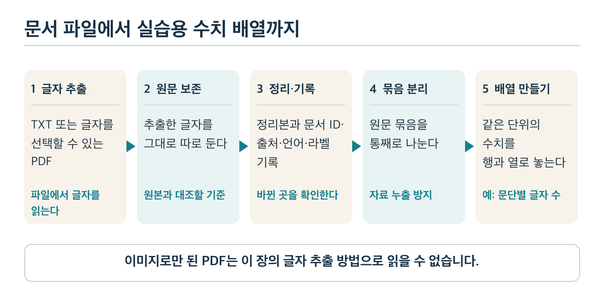
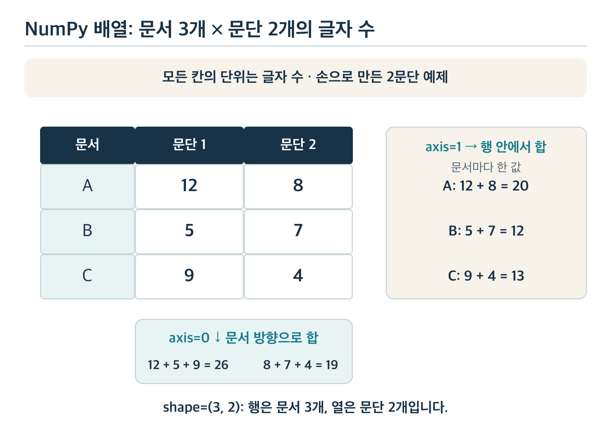
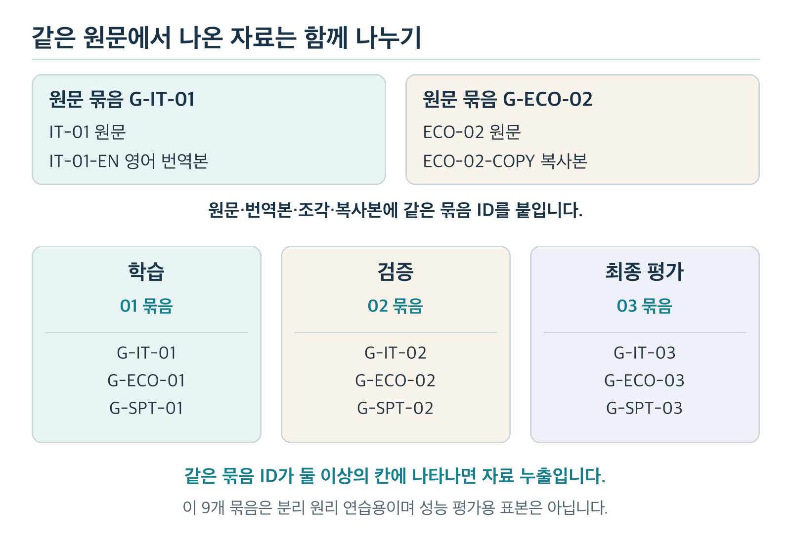

# 과목 2 Python·NumPy와 문서 데이터 처리

이 과목에서는 문서 파일을 읽어 내용과 출처를 기록한 뒤 계산에 쓸 수 있는 숫자 배열을 만듭니다. TXT는 글자 중심의 텍스트 파일이고 PDF는 페이지 모양을 유지한 문서 파일입니다. NumPy는 숫자 배열을 다루는 Python 패키지입니다. 최종 목표인 문서 분류와 생성형 요약에 쓰일 자료를 준비하는 단계입니다. 아직 모델을 학습하거나 성능을 재지 않습니다.

Python으로 앱이나 업무 코드를 작성해 본 독자도 AI 실습에서는 데이터가 어디서 왔는지, 무엇을 지웠는지, 어떤 문서가 서로 연결돼 있는지를 새롭게 확인해야 합니다. 이 교재는 Python 문법을 짧게 복습하고 문서 데이터의 판단 과정에 시간을 더 씁니다.

전체 학습 순서는 [학습 계획서](../README.md)에서 확인할 수 있습니다. 이 과목에 나오는 문서와 수치는 학습을 위해 만든 자료입니다.

## 1. 이 과목을 마치면 할 수 있는 일

1. 한국어·영어 TXT 파일과 글자를 선택할 수 있는 PDF에서 텍스트를 꺼내고 추출이 실패했을 때 이유를 구분합니다.
2. 원본 파일과 추출한 글을 보존하면서 정리한 문단·문장과 문서 정보를 따로 기록합니다.
3. 같은 단위의 숫자를 NumPy 배열에 넣고 모양, 원소, 행별·열별 합계를 설명합니다.
4. 원문·번역본·복사본·조각을 한 묶음으로 다뤄 학습·검증·최종 평가 자료 사이의 정보 누출을 막습니다.
5. 라벨을 붙일 근거가 부족한 문서와 비어 있거나 읽을 수 없는 입력을 정답 자료에 억지로 넣지 않습니다.

**학습 순서:** 2~4절에서 파일을 읽고 5~6절에서 문서 내용을 정리하고 기록합니다. 7절의 작은 배열을 손으로 계산한 다음 8절에서 문서 묶음을 나눕니다. 9절의 단원 실습에서 실제 파일에 같은 순서를 적용하고 10~11절에서 결과와 이유를 확인합니다.



*그림 1. 문서 파일에서 학습 준비 자료까지의 흐름. 숫자 배열을 만드는 일은 원문 확인과 기록을 끝낸 뒤에 진행합니다.*

## 2. 실행 환경과 Python 핵심 복습

### 2.1 패키지와 가상 환경

**패키지(package)**는 다른 사람이 만든 기능을 다시 사용할 수 있게 묶은 코드입니다. 이 과목에서는 숫자 배열에 NumPy를, PDF의 글자 추출에 pypdf를 사용합니다. 프로젝트마다 필요한 패키지 버전을 분리해 두는 폴더가 **가상 환경(virtual environment)**입니다. 시스템 전체의 Python 환경을 바꾸지 않도록 저장소 루트에서 다음 명령을 실행합니다.

```sh
python3 -m venv _workspace/chapter2/venv
_workspace/chapter2/venv/bin/python -m pip install -r \
    study/chapter2/requirements.txt
_workspace/chapter2/venv/bin/python \
    study/chapter2/examples/run_pipeline.py
```

`_workspace/chapter2/`는 생성 결과를 두는 폴더입니다. Git에 추가하지 않는 작업 공간이며 실행 코드는 저장소의 `study/chapter2/examples/`에 있습니다. 첫 명령으로 가상 환경을 만듭니다. 둘째 명령으로 실습 패키지를 설치하고 마지막 명령으로 예제를 실행합니다. Windows에서는 가상 환경의 Python 실행 파일 경로가 다르므로 해당 환경의 Python으로 같은 스크립트를 실행하면 됩니다.

실행에 앞서 현재 위치가 저장소 루트인지 확인합니다. 상대 경로는 현재 위치를 기준으로 해석되므로 다른 폴더에서 같은 명령을 실행하면 입력 파일을 찾지 못할 수 있습니다. 실습 코드는 자신의 파일 위치를 기준으로 입력을 찾지만 위 명령의 스크립트 경로는 저장소 루트를 기준으로 적었습니다.

### 2.2 변수·함수·목록·딕셔너리는 어떤 일을 하나요?

다음은 한 문서의 정보를 적은 작은 예제입니다. **변수**는 값을 가리키는 이름이고 **목록(list)**은 순서가 있는 값의 모음입니다. **딕셔너리(dictionary)**는 `doc_id`처럼 이름을 붙여 값을 찾는 모음입니다. **함수(function)**는 입력을 받아 정해 둔 계산을 반복합니다.

```python
from pathlib import Path

source = Path("study/chapter2/examples/it01_ko.txt")
paragraphs = ["새 기능을 발표했다.", "화면 밝기가 낮아진다."]
record = {
    "doc_id": "IT-01",
    "language": "ko",
    "paragraphs": paragraphs,
}

def paragraph_count(items: list[str]) -> int:
    return len(items)

print(record["doc_id"], paragraph_count(record["paragraphs"]))
```

이 예제는 파일을 읽지 않습니다. `Path`는 파일 경로를 표현하고 `paragraphs`에는 사람이 미리 적은 두 문단을 넣었습니다. 출력은 `IT-01 2`입니다. 딕셔너리에서 `doc_id`를 꺼내고 함수가 목록의 원소 두 개를 세었기 때문입니다. 경로가 가리키는 실제 파일의 존재 여부는 이 코드의 출력과 무관합니다.

**직접 해보기:** 둘째 문단을 목록에서 빼면 함수의 출력 숫자는 어떻게 될까요? 먼저 예상하고 코드를 바꾸어 확인하세요.

**결과와 이유:** `IT-01 1`이 나옵니다. `len()`이 읽는 것은 현재 목록의 원소 개수입니다. 문단 안의 글자 수를 세는 함수가 아닙니다.

## 3. TXT에서 글자 읽기: 인코딩과 입력 검사

### 3.1 파일의 바이트와 화면의 글자는 다릅니다

파일에는 바이트가 저장됩니다. 바이트를 글자로 해석하는 규칙을 **문자 인코딩(character encoding)**이라고 합니다. 이 실습의 TXT 입력은 한국어·영어 모두 UTF-8로 저장합니다. 한글이 있는 파일을 잘못된 인코딩으로 읽으면 오류가 나거나 글자가 깨질 수 있습니다.

```python
from pathlib import Path

path = Path("study/chapter2/examples/it01_ko.txt")
raw_text = path.read_bytes().decode("utf-8", errors="strict")
clean_input = raw_text.removeprefix("\ufeff")
```

`read_bytes()`는 파일의 바이트를 가져오고 `decode()`는 UTF-8 규칙으로 글자로 바꿉니다. UTF-8 파일 앞에는 **BOM(Byte Order Mark, 파일 맨 앞의 표시)**이 붙을 수 있습니다. `raw_text`에는 이 표시를 남겨 두고 정리용 `clean_input`에서만 제거합니다. 잘못된 바이트를 임의의 다른 글자로 바꾸지 않고 오류를 내는 `errors="strict"`를 사용합니다. `errors="replace"`로 읽으면 어느 글자가 손상됐는지 놓치기 쉽습니다.

**원본 파일은 보존합니다.** `raw_text`도 파일 바이트 자체가 아니라 디코딩한 글입니다. 원본 바이트가 필요하면 입력 파일을 그대로 보관해야 합니다. 9절의 실습도 입력 파일을 수정하지 않습니다. BOM을 읽는 순간 자동으로 없애고 싶다면 `encoding="utf-8-sig"`로 읽는 방법도 있지만 이 교재의 실습 코드는 전후 비교를 위해 추출 직후 글에 BOM을 남깁니다.

### 3.2 빈 문서와 읽기 오류를 구분하기

파일 읽기가 성공해도 내용이 `""`이거나 공백만 있다면 문서 분석에 쓸 글이 없습니다. `text.strip()`은 문자열 양쪽의 공백을 떼므로 비었는지 검사하는 데 쓸 수 있습니다. 반면 파일이 없으면 경로 오류가, UTF-8 규칙에 맞지 않으면 `UnicodeDecodeError`가 발생합니다. 세 경우의 원인과 조치는 다릅니다.

| 상태 | 확인할 것 | 이 과목에서의 처리 |
| --- | --- | --- |
| 파일을 읽었고 내용이 있다 | 글자가 정상이며 문서의 시작·끝이 맞는가 | 원문을 보존하고 다음 단계로 보낸다 |
| 파일을 읽었지만 비었다 | 파일 자체가 비었는가, 공백만 있는가 | 입력 오류로 기록하고 라벨 학습에서 제외한다 |
| 파일을 읽지 못했다 | 경로 또는 인코딩 오류인가 | 오류 종류와 파일 경로를 남기고 원문을 추측해 채우지 않는다 |

**직접 해보기:** `"  \n  "`과 `"배터리 안내"`에 각각 `.strip()`을 적용해 보세요. 어느 쪽을 빈 입력으로 기록해야 할까요?

**결과와 이유:** 첫 문자열은 `""`이 되고 둘째 문자열은 그대로 남습니다. 화면에서 공백이 보인다고 정보가 있는 문서는 아닙니다. 반대로 파일을 읽지 못한 경우에는 `.strip()`을 적용할 문자열조차 없으므로 빈 문서와 같은 상태로 기록하면 안 됩니다.

## 4. PDF의 글자 추출과 확인 범위

### 4.1 페이지에서 글자를 얻는 순서

PDF는 화면에 보이는 페이지를 저장하지만 프로그램이 읽는 글자의 순서가 그 화면 순서와 항상 같지는 않습니다. 이 과목에서는 **글자를 선택할 수 있는 PDF**를 입력으로 사용합니다. pypdf로 각 페이지를 열고 글자를 추출합니다.

```python
from pypdf import PdfReader

reader = PdfReader("study/chapter2/examples/it02_ko.pdf")
page_texts = [page.extract_text() or "" for page in reader.pages]
```

`page_texts`는 페이지 순서대로 꺼낸 문자열의 목록입니다. `extract_text()`가 글자를 돌려주지 않으면 예제에서는 빈 문자열로 표시합니다. 빈 페이지 문자열만 보고 실제 페이지가 비었다고 확정하지는 않습니다. PDF에 눈으로 볼 수 있는 글자가 있는데 추출 결과가 비었다면 파일을 직접 열어 확인해야 합니다.

이 실습의 [2쪽 실습 PDF](examples/it02_ko.pdf)에는 같은 머리말이 반복됩니다. 페이지별 추출 결과와 화면을 비교한 뒤 머리말인지 판단합니다. 머리말과 본문에 같은 단어가 있을 수 있으므로 특정 단어가 보인다는 이유만으로 모든 페이지에서 무조건 지우면 본문까지 사라질 수 있습니다. 문서의 어디에서 어떤 문자열을 뺐는지 기록하고 처리 전후를 나란히 읽어 봅니다.

### 4.2 글자 추출이 보장하지 않는 것

PDF의 여러 열, 표, 각주와 머리말은 눈에 보이는 순서와 다른 순서로 추출될 수 있습니다. 띄어쓰기나 줄바꿈도 원본 작성 도구에 따라 달라집니다. 따라서 글자를 꺼냈다는 사실만으로 문단과 문장이 정확해졌다고 볼 수 없습니다.

스캔한 이미지로만 이루어진 PDF에는 선택 가능한 글자가 없을 수 있습니다. 이미지의 글자를 알아내는 **광학 문자 인식(OCR, Optical Character Recognition)**은 별도 기술입니다. 이 과목의 pypdf 예제에는 OCR이 없으므로 그런 파일의 내용을 추측해 만들지 않습니다. 추출할 수 없는 PDF는 상태를 기록하고 별도 처리 대상으로 남깁니다.

**직접 해보기:** 9절의 학습용 PDF를 열어 두 페이지에 반복된 머리말을 찾고 추출한 페이지 문자열에서도 같은 부분을 찾으세요. 다음으로 본문의 첫 문장과 마지막 문장이 페이지별 추출 결과에 남아 있는지 확인합니다.

**결과와 실패 이유:** 반복 머리말이 본문과 함께 추출될 수 있습니다. 페이지마다 같은 글이 있다고 모두 머리말인 것은 아닙니다. 화면의 본문과 추출 문자열의 순서가 다르거나 글자가 빠졌다면 숫자를 세기 전에 해당 페이지를 다시 확인해야 합니다.

## 5. 원문을 보존하고 정리 결과를 따로 만들기

### 5.1 전처리는 무엇을 바꾸나요?

**전처리(preprocessing)**는 파일에서 얻은 글을 이후 작업에 쓰기 좋게 정리하는 과정입니다. 입력은 추출한 텍스트이고 출력은 규칙을 적용한 새 텍스트입니다. 원본 파일과 추출 직후의 글은 그대로 두어야 무엇이 달라졌는지 다시 확인할 수 있습니다.

다음은 사람이 만든 작은 예입니다. 표에서 `\n`은 줄바꿈 한 번, `\n\n`은 빈 줄 하나를 뜻합니다. 원래 글에는 이 표기 대신 실제 줄바꿈이 들어 있습니다.

| 단계 | 글 |
| --- | --- |
| 추출 직후 | `새 배터리 기능\n\n화면 밝기가\n자동으로 낮아진다.  ` |
| 정리 후 | `새 배터리 기능\n\n화면 밝기가 자동으로 낮아진다.` |

둘째 문단 중간의 한 줄바꿈은 화면 폭 때문에 들어간 줄바꿈이라고 확인한 뒤 공백 하나로 바꿨습니다. 문단을 나누는 빈 줄은 남겼고 끝 공백은 지웠습니다. `"화면 밝기가"`와 `"자동으로 낮아진다."`가 서로 다른 문단이었다면 이런 변경은 잘못입니다. **먼저 원문 화면이나 파일을 확인한 뒤 규칙을 적용해야** 정리한 글을 신뢰할 수 있습니다.

실습 코드의 TXT 정리는 다음 원리로 움직입니다. `\r\n`은 일부 환경에서 쓰는 줄바꿈이고 `\n`은 이 코드가 정리 중에 쓰는 줄바꿈입니다. 먼저 둘을 통일하고 빈 줄을 문단 경계로 삼습니다. 한 문단 안의 줄바꿈은 공백 하나로 잇습니다.

```python
import re

raw_text = "\ufeff첫 문장.\r\n둘째 문장.\r\n\r\n새 문단."
clean_input = raw_text.removeprefix("\ufeff")
clean_input = clean_input.replace("\r\n", "\n")
clean_input = clean_input.replace("\r", "\n")

def normalize_lines(lines: list[str]) -> str:
    clean_lines = [
        re.sub(r"[ \t]+", " ", line.strip())
        for line in lines
        if line.strip()
    ]
    return " ".join(clean_lines).strip()

blocks = re.split(r"\n\s*\n", clean_input)
paragraphs = [
    normalize_lines(block.splitlines())
    for block in blocks
]
paragraphs = [paragraph for paragraph in paragraphs if paragraph]
print(repr(raw_text[:1]), paragraphs)
```

출력은 `'\ufeff' ['첫 문장. 둘째 문장.', '새 문단.']`입니다. 원문 앞의 BOM은 `raw_text`에 그대로 있고 정리한 문단에는 없습니다. `re.split()`이 빈 줄에서 두 문단을 나눴고 `normalize_lines()`가 첫 문단의 한 줄바꿈을 공백으로 바꿨습니다. 이 규칙은 제공한 TXT의 문단 표시를 확인하고 정한 것입니다. 빈 줄이 문단을 뜻하지 않는 다른 파일에는 그대로 적용할 수 없습니다.

### 5.2 문단과 문장은 같은 단위가 아닙니다

**문단(paragraph)**은 하나의 생각을 묶어 쓴 글 덩어리입니다. 빈 줄이나 들여쓰기가 단서일 수 있지만 PDF의 페이지 경계나 한 줄바꿈이 언제나 문단 경계는 아닙니다. **문장(sentence)**은 보통 하나의 서술이 끝나는 단위입니다. 한 문단에 문장이 여럿 있을 수 있습니다.

예를 들어 `"배터리 기능을 공개했다. 화면 밝기가 자동으로 낮아진다."`는 한 문단 안의 두 문장입니다. 마침표에서 자르면 이 사례는 맞지만 `"사용 시간은 3.5시간이다."`를 모든 마침표에서 자르면 숫자 `3.5`도 갈라집니다. 영어의 약어 뒤 마침표, 따옴표, 한국어의 문장부호 없는 제목도 단순한 규칙을 흔듭니다. 9절의 길이 계산은 자료 구조를 연습하는 보조 수치이며 정확한 문장 경계 분석을 인증하지 않습니다.

9.2절의 `records.json`에서 영어 번역본 `IT-01-EN`의 `paragraphs`와 `sentences`를 읽어 보세요. 빈 줄을 기준으로 두 문단이 나옵니다. 이 실습의 문장 규칙은 마침표 뒤 공백에서 끊어 네 문장을 만듭니다. 첫 문단의 둘째 문장은 `It compared the old and new versions under the same conditions.`입니다. `e.g. models`처럼 약어 뒤에 공백이 있으면 이 규칙이 약어를 문장 끝으로 잘못 볼 수 있습니다. 네 문장이 나왔다는 사실만으로 다른 영어 문서의 경계도 정확하다고 판단하지 마세요.

문단 수가 다른 문서를 읽을 때에는 원래 문단의 순서를 유지합니다. 문장을 나누는 규칙을 바꾸었다면 같은 원문으로 결과를 다시 만듭니다. 예전 규칙으로 만든 결과와 혼동하지 않도록 기록합니다. 원문에서 어느 사실이 빠졌는지 확인할 수 있어야 생성형 요약의 정답 예시도 검토할 수 있습니다.

**직접 해보기:** 다음 글에서 줄바꿈만 보고 문단을 둘로 나누면 어떤 내용이 갈라질까요?

> `회사는 새 기능을 공개했고\n다음 달부터 모든 기기에 적용한다.`

**결과와 이유:** 이 줄바꿈은 한 문장의 중간일 수 있습니다. 화면 폭 때문에 생긴 줄바꿈이라면 `"회사는 새 기능을 공개했고 다음 달부터 모든 기기에 적용한다."`처럼 이어야 합니다. 실제 파일에서는 줄바꿈의 이유를 확인해야 하며 이 한 줄만으로 자동 규칙이 항상 옳다고 할 수 없습니다.

## 6. 문서 한 건의 기록과 정답 판단

### 6.1 문서 ID·출처·언어·원문 묶음

문서가 늘어나면 텍스트만 담은 목록으로는 어디서 온 글인지 찾기 어렵습니다. 한 문서마다 다음 정보를 기록합니다. **문서 ID(identifier)**는 개별 파일·문서를 구별하는 이름이고 **원문 묶음 ID**는 번역본이나 조각처럼 같은 원문에서 나온 자료들을 연결하는 이름입니다. 둘은 같은 역할이 아닙니다.

| 기록 | 쓰는 이유 | 학습용 예 |
| --- | --- | --- |
| `doc_id` | 개별 문서를 다시 찾는다 | `IT-01-EN` |
| `source_path` | 입력 파일의 위치를 찾는다 | `it01_en_translation.txt` |
| `language` | 추출·정리 결과를 언어별로 살핀다 | `en` |
| `label` | 분류의 정답 종류를 기록한다 | `IT` |
| `group_id` | 같은 원문에서 나온 문서를 연결한다 | `G-IT-01` |
| `summary` | 원문과 짝지은 사람이 쓴 한 문장 요약을 둔다 | `A brightness update extended average video playback by 40 minutes in a test of three phones.` |
| `status` | 사용 가능·판단 보류·입력 오류를 구분한다 | `ready` |

이 값들은 9절 실습의 [문서 목록](examples/manifest.json)에 쓰인 항목입니다. JSON은 딕셔너리와 목록을 텍스트 파일로 저장하는 형식입니다. 표의 `source_path`는 `examples/` 폴더를 기준으로 한 입력 파일 위치이지 출처의 품질을 보증하는 이름이 아닙니다. 실제 자료라면 작성 주체·수집 일시 등 필요한 출처 정보도 별도로 기록해야 합니다. 이 과목의 파일은 모두 직접 만든 연습 자료입니다.

### 6.2 라벨과 요약문은 각각 무엇의 정답인가요?

문서 분류의 **라벨(label)**은 미리 정한 종류 중 하나입니다. 이 실습에서는 IT·경제·스포츠를 사용합니다. Chapter 1의 8.1절 「이번 실습의 분류 기준」처럼 **문서의 주요 내용**을 보고 붙입니다. 회사 이름이나 `"경기"` 같은 한 단어만으로 결정하지 않습니다. 두 주제가 비슷한 비중으로 섞였거나 자료가 부족하면 판단을 보류하고 이유를 적습니다. 보류는 세 분류 중 네 번째 정답 종류가 아닙니다.

요약용 정답 예시는 원문과 요약문을 짝지은 것입니다. 사람이 쓴 요약문에도 원문에 없는 사실이 들어가거나 중요한 내용이 빠질 수 있으므로 원문과 대조해야 합니다. 예를 들어 원문이 `"금요일에 새 버전을 배포한다."`라면 `"토요일에 새 버전이 나온다."`는 짧고 자연스러워도 정답으로 쓸 수 없습니다. 이 과목에서는 짝을 기록하고 사실 일치 여부를 확인합니다. 좋은 요약의 평가 기준과 모델 학습은 Chapter 7 「문서 요약 모델 설계와 추가학습」에서 다룹니다.

**직접 해보기:** `"축구 경기 기록을 관리하는 앱의 새 검색 기능"`을 다룬 문서에 스포츠 라벨을 붙였다면 어떤 질문을 다시 해야 할까요? 원문이 금요일 배포라고 할 때 요약문이 `"다음 주 배포"`라고 쓰면 무엇을 확인해야 할까요?

**결과와 이유:** 첫 문서는 앱 기능이 중심인지 경기 기록 자체가 중심인지 살핍니다. 앱 검색 기능 소개라면 IT가 더 알맞을 수 있습니다. 둘째 요약은 금요일이 어느 주의 금요일인지 원문에 없는 정보를 추측해서 넣었는지 확인해야 합니다. 근거가 없으면 요약문을 고치거나 보류합니다.

## 7. NumPy로 같은 단위의 숫자를 계산하기

### 7.1 배열의 모양과 위치

**NumPy**는 여러 숫자를 일정한 모양으로 담고 계산하는 Python 패키지입니다. **배열(array)**의 가로줄은 행(row), 세로줄은 열(column)입니다. 다음 숫자는 실제 실습 파일의 측정값이 아니라 **손계산을 위한 가상 자료**입니다. 문서 A·B·C에 각각 문단이 정확히 두 개 있고 모든 숫자는 그 문단의 **글자 수**라고 가정합니다.

| 문서 | 첫째 문단 글자 수 | 둘째 문단 글자 수 |
| --- | --- | --- |
| A | 12 | 8 |
| B | 5 | 7 |
| C | 9 | 4 |

```python
import numpy as np

lengths = np.array([[12, 8], [5, 7], [9, 4]])
print(lengths.shape)
print(lengths[1, 0])
print(lengths.sum(axis=0))
print(lengths.sum(axis=1))
```

**출력**은 차례로 `(3, 2)`, `5`, `[26 19]`, `[20 12 13]`입니다. `shape`는 행 세 개와 열 두 개를 뜻합니다. Python의 위치 번호는 0부터 시작하므로 `[1, 0]`은 둘째 행인 B의 첫째 문단이며 값은 5입니다.



*그림 2. `axis=0`은 행 방향으로 내려가며 같은 열의 값을 더해 `[26, 19]`를 만듭니다. `axis=1`은 열 방향으로 가며 각 문서의 값을 더해 `[20, 12, 13]`을 만듭니다.*

### 7.2 합계가 무엇을 뜻하는지 확인하기

첫 열의 합 `12+5+9=26`은 세 문서의 **첫째 문단 글자 수를 모두 더한 값**입니다. 둘째 열의 합 `8+7+4=19`도 같은 방식입니다. `axis=0` 결과를 한 문서의 길이라고 해석하면 틀립니다. `axis=1` 결과의 첫 값 `12+8=20`은 문서 A의 두 문단 글자 수 합입니다. 둘째와 셋째 값은 B가 12, C가 13입니다.

**직접 해보기:** 문서 C의 둘째 문단이 4글자에서 6글자로 늘면 `shape`, 두 축의 합계, B의 첫째 문단 값은 각각 어떻게 될까요?

**결과와 이유:** 모양은 여전히 `(3, 2)`이고 `axis=0`의 합계는 `[26, 21]`, `axis=1`의 합계는 `[20, 12, 15]`가 됩니다. B의 첫째 문단인 `[1, 0]`은 5 그대로입니다. 한 칸을 바꾸면 그 칸이 속한 행의 합과 열의 합만 달라집니다.

실제 문서에는 문단이 하나인 글도 있고 열 개가 넘는 글도 있습니다. 문단마다 한 열을 주려면 행마다 열 개수가 같아야 하는 위 배열을 그대로 만들 수 없습니다. 빈 칸을 0으로 채우는 **패딩(padding)**은 실제 문단과 채운 칸을 구분해야 하고 긴 글을 자르면 정보가 빠집니다. 둘 다 조건을 정하고 표시해야 합니다. 이 교재의 학습용 원문 아홉 개는 두 문단씩 만들었으므로 실습에서는 실제 글자 수의 9×2 배열도 계산합니다. 다만 문서별 문단 목록을 함께 보존하고 다른 자료에도 두 문단 규칙을 강요하지 않습니다. 문서를 모델 입력 숫자로 바꾸는 원리는 Chapter 3 「기초 수학과 전통적 머신러닝」과 Chapter 5 「자연어 처리와 사전학습 모델 이해」에서 배웁니다.

## 8. 원문 묶음째 학습·검증·최종 평가로 나누기

### 8.1 셋의 역할과 정보 누출

학습 자료는 모델을 맞추는 데 사용합니다. 검증 자료는 여러 설정 가운데 무엇을 쓸지 고르는 데 사용합니다. **최종 평가 자료**는 선택을 끝낸 뒤 한 번 확인할 자료로 남깁니다. 여기서 말하는 분리는 아직 모델을 학습하지 않아도 자료를 준비할 때 먼저 지켜야 합니다.

같은 문장을 복사한 문서가 학습과 최종 평가에 각각 들어가면 모델이 처음 보는 자료를 맞힌 것처럼 보일 수 있습니다. 원문을 영어로 번역한 문서나 일부만 잘라 만든 조각도 같은 사실을 공유합니다. 이런 정보가 분할 경계를 넘어가면 **자료 누출(data leakage)**이 됩니다. 단순한 파일 이름이나 문서 ID만 다르다고 새 자료가 되지는 않습니다.

**원문 묶음(group)**은 같은 원문에서 파생된 문서를 연결한 단위입니다. 이 실습에서는 `IT-01`과 영어 번역 `IT-01-EN`을 `G-IT-01`로 묶고 `ECO-02`와 내용이 같은 `ECO-02-COPY`를 `G-ECO-02`로 묶습니다. `SPT-03`의 일부를 뗀 `SPT-03-FRAG`도 원문 묶음에 들어갑니다. 조각만 읽으면 라벨을 알기 어렵더라도 원문과의 관계는 유지합니다.



*그림 3. 문서 한 건씩 흩어 놓지 않고 원문 묶음을 통째로 배정합니다. 이 그림의 01·02·03 규칙은 학습용 자료에서 미리 정한 배정이며 일반적인 분할 비율을 뜻하지 않습니다.*

### 8.2 이 교재의 작은 자료를 나누는 규칙

원문 묶음은 IT·경제·스포츠마다 세 개씩, 모두 아홉 개입니다. 묶음 ID 끝의 `01`은 학습, `02`는 검증, `03`은 최종 평가에 넣습니다. 따라서 각 부분에는 세 종류의 **원문 묶음이 하나씩** 있습니다. 파생 문서가 있는 부분은 문서 건수가 세 건보다 많을 수 있습니다.

| 분리 결과 | 들어가는 원문 묶음 | 이 단계에서 하는 일 |
| --- | --- | --- |
| 학습 | `G-IT-01`, `G-ECO-01`, `G-SPT-01` | 학습 방법을 연습할 자료로 보관 |
| 검증 | `G-IT-02`, `G-ECO-02`, `G-SPT-02` | 선택 기준을 점검할 자료로 보관 |
| 최종 평가 | `G-IT-03`, `G-ECO-03`, `G-SPT-03` | 선택이 끝날 때까지 별도로 보관 |

실습 코드는 먼저 문서를 `group_id`별로 모으고 묶음 ID의 끝 두 자리로 분리 위치를 정합니다. 다음은 그중 원문과 번역본만 떼어 낸 작은 실행 예제입니다.

```python
from collections import defaultdict

members = [("IT-01", "G-IT-01"), ("IT-01-EN", "G-IT-01")]
groups = defaultdict(list)
for doc_id, group_id in members:
    groups[group_id].append(doc_id)

split_by_suffix = {
    "01": "train",
    "02": "validation",
    "03": "final_test",
}
for group_id, doc_ids in groups.items():
    print(split_by_suffix[group_id[-2:]], doc_ids)

wrong_split = {"IT-01": "train", "IT-01-EN": "final_test"}
seen_splits = {
    wrong_split[doc_id]
    for doc_id in groups["G-IT-01"]
}
print(len(seen_splits) == 1)
```

첫 출력은 `train ['IT-01', 'IT-01-EN']`입니다. 두 문서가 같은 묶음이므로 함께 배정됩니다. 마지막 출력은 `False`입니다. 일부러 잘못 적은 `wrong_split`에서는 두 문서가 서로 다른 부분에 있습니다. 한 묶음이 한 부분에만 있는지 검사했으므로 `False`가 나왔습니다. 실제 `run_pipeline.py`는 준비된 라벨을 가진 문서를 묶음별로 모은 다음 분리하므로 이런 문서별 배정을 하지 않습니다.

같은 `group_id`가 서로 다른 두 부분에 한 번이라도 나오면 분리에 실패한 것입니다. 완전히 같은 글은 문자열이나 파일 내용 비교로 찾을 수 있지만 번역문과 일부 조각은 그렇게 찾기 어렵습니다. 그래서 파생 자료를 만들 때 원문 묶음 ID를 함께 기록하고 사람이 관계를 검토해야 합니다. 이 실습 코드는 이미 알고 있는 번역본·복사본·조각 세 건이 원문과 같은 `group_id`인지 검사합니다. 번역 관계를 파일 바이트만으로 새로 찾아내지는 않습니다. 요약용 문서–요약문 쌍도 문서의 원문 묶음을 따라갑니다. 요약문만 다른 부분에 옮겨 놓아도 정답 정보가 새어 들어갈 수 있습니다.

**직접 해보기:** `IT-01`을 학습에 넣고 `IT-01-EN`을 최종 평가에 넣었다면 어떤 확인이 잘못됐나요? `G-ECO-02`에 속한 복사본은 어디에 들어가야 하나요?

**결과와 이유:** 첫 경우는 문서 ID만 살펴보고 원문 묶음 ID를 확인하지 않은 것입니다. 원문과 번역본이 같은 사실을 공유하므로 둘 다 학습 쪽에 있어야 합니다. 경제 복사본은 원문과 같은 `G-ECO-02`이므로 검증 쪽에 둡니다.

이 작은 자료는 분리 규칙을 익히기 위한 것입니다. 각 종류가 분할마다 한 묶음뿐이어서 모델 성능을 안정적으로 평가할 표본은 아닙니다. 실제 평가에는 출처와 시기, 언어, 주제의 다양성까지 고려해 충분한 자료를 따로 모아야 합니다. 여러 원문에 걸쳐 내용이 거의 같은 자료가 있으면 묶음 ID만 믿지 말고 중복 관계를 다시 확인합니다.

## 9. 단원 실습: 파일에서 분리 결과까지

### 9.1 입력 자료와 실행

`study/chapter2/examples/manifest.json`에는 파일별 문서 ID, 경로, 언어, 라벨, 원문 묶음 ID, 요약문, 상태가 적혀 있습니다. 한국어·영어 TXT와 4.1절의 2쪽짜리 텍스트 PDF가 포함됩니다. 빈 파일, 판단 보류, 잘못된 UTF-8 바이트도 별도의 경우로 준비했습니다. 정상 자료 아홉 묶음과 예외 사례는 역할이 다릅니다. 예외를 억지로 IT·경제·스포츠 학습 자료에 넣지 않습니다.

2.1절의 명령을 저장소 루트에서 실행합니다. [실행 예제](examples/run_pipeline.py)는 입력 파일과 목록을 읽어 `_workspace/chapter2/records.json`, `_workspace/chapter2/splits.json`, `_workspace/chapter2/paragraph_lengths.json`을 만듭니다. 원본 입력은 바꾸지 않습니다.

**실습 기록표:** 파일을 보기 전에 예상하고 실행 후 실제 값을 적습니다. 맨 오른쪽에는 결과가 그렇게 나온 근거를 적으세요.

| 확인할 것 | 실행 전 예상 | 실행 결과와 근거 |
| --- | --- | --- |
| 두 쪽 PDF의 반복 머리말이 기록되는 위치 |  |  |
| 빈 입력과 잘못된 UTF-8 입력의 상태 차이 |  |  |
| `IT-01`과 `IT-01-EN`의 `group_id` |  |  |
| `ECO-02`와 `ECO-02-COPY`의 분리 위치 |  |  |
| `SPT-03-FRAG`와 원문의 분리 위치 |  |  |
| 원문 9건의 문단 길이 배열 모양과 손계산용 3×2 배열의 차이 |  |  |

### 9.2 출력 읽기와 잘못된 결과 찾기

`records.json`에서는 각 문서의 추출 직후 글과 정리 결과, PDF의 페이지별 글, 상태를 대조합니다. PDF의 두 페이지에 반복된 머리말이 보이면 화면에서도 반복되는지 확인합니다. 실습 코드는 이 학습용 PDF에서 확인한 `IT-02 | LEARNING SAMPLE` 한 줄만 각 페이지의 머리말로 제거하고 제거 횟수를 기록합니다. 또 화면에서 두 페이지의 본문이 각각 한 문단인 것을 확인했으므로 이 파일에 한해 페이지마다 문단 하나로 정리합니다. 일반 PDF에 적용할 문단 규칙은 아닙니다. `splits.json`에서는 같은 `group_id`가 여러 부분에 나타나지 않는지 살핍니다. `paragraph_lengths.json`에서는 손계산용 3×2 값과 실제 원문 9건의 9×2 글자 수를 구분해 읽습니다. 두 배열의 숫자가 같을 이유는 없습니다.

`records.json`의 각 문서에는 6.1절의 목록 항목에 다음 계산 결과가 붙습니다. 같은 이름의 필드를 다른 문서 처리에도 쓸 때에는 어느 단계의 글을 담는지부터 정하세요.

| 필드 | 뜻 |
| --- | --- |
| `raw_text` | TXT를 읽은 직후 글 또는 PDF 페이지별 추출 글을 이어 둔 값. 반복 머리말과 BOM이 남을 수 있다 |
| `clean_text` | 정리한 문단을 빈 줄로 이은 값. 이 실습 PDF에서는 확인된 머리말을 제거했다 |
| `paragraphs`, `sentences` | 정리한 문단 목록과 간단한 문장 경계 규칙으로 나눈 목록. 문장 경계는 항상 정확하지 않다 |
| `page_texts`, `removed_headers` | PDF의 페이지별 추출 글과 제거한 머리말 수. TXT의 `page_texts`는 빈 목록이다 |
| `sha256`, `duplicate_of`, `error` | 입력 파일 비교값, 발견한 완전 복사본의 원본 ID, 읽기 실패 이유 |

실제 결과를 열어 `IT-02`의 페이지 수와 머리말 제거 횟수를 직접 확인할 수 있습니다.

```python
import json
from pathlib import Path

path = Path("_workspace/chapter2/records.json")
records = json.loads(path.read_text(encoding="utf-8"))
pdf = next(r for r in records if r["doc_id"] == "IT-02")
page_count = len(pdf["page_texts"])
header_count = pdf["removed_headers"]
paragraph_count = len(pdf["paragraphs"])
print(page_count, header_count, paragraph_count)
```

출력은 `2 2 2`입니다. 2쪽에서 머리말을 하나씩 지웠고 이 학습용 PDF에서는 본문을 페이지마다 한 문단으로 정리했습니다. 새 PDF에서도 같은 결과가 나와야 한다는 규칙은 아닙니다.

제공한 입력 파일을 바꾸지 않고 실행했을 때의 **기준 결과**는 다음과 같습니다. 아래 수치는 직접 만든 이 자료에서 관찰한 값이며 일반 문서의 통계가 아닙니다. 숫자가 다르면 입력 파일이나 정리 규칙이 달라졌는지 먼저 확인하세요.

| 확인 대상 | 기준 결과 | 이유 |
| --- | --- | --- |
| 전체 입력 | 15건 중 처리 가능 12건, 판단 보류 1건, 빈 입력 1건, 읽기 오류 1건 | 예외 세 건은 분류 학습 자료에서 제외합니다 |
| 세 분리 결과 | 학습·검증·최종 평가에 각각 원문 묶음 3개, 문서 4건 | 각 부분에 세 종류의 원문이 하나씩 있고 파생 문서가 한 건씩 있습니다 |
| PDF `IT-02` | 2쪽, 같은 머리말 2개 제거 | `page_texts`와 `raw_text`에는 머리말이 남고 `clean_text`에는 없습니다 |
| 완전 복사본 | `ECO-02-COPY`는 `ECO-02`의 복사본 | 파일 바이트의 SHA-256 비교값이 같습니다 |
| 손계산 배열 | 3×2, 열별 합 `[26, 19]`, 행별 합 `[20, 12, 13]` | 7절에서 만든 가상 숫자입니다 |
| 실제 원문 길이 | 9×2, 열별 합 `[711, 628]`, 첫 원문 `IT-01`의 행 합 143 | 각 문단을 Python 문자열의 `len()`으로 셉니다 |

**SHA-256**은 파일 바이트에서 계산하는 긴 비교값입니다. 여기서는 완전히 같은 파일을 찾는 단서로 사용합니다. 번역본은 바이트가 다르므로 이 값만으로 연결할 수 없고 8.1절의 원문 묶음 기록이 필요합니다. `len()`의 값도 화면에서 보는 글자 모양의 개수와 언제나 같지는 않습니다. 조합 문자 같은 경우 한 글자로 보여도 Python 문자열의 내부 문자 수는 다를 수 있습니다. 이 실습의 수치는 문서 주제나 요약 품질을 뜻하지 않습니다.

### 9.3 복사한 입력의 글자와 문단 바꾸기

원본은 그대로 두고 실습 입력만 복사합니다. 아래 명령은 저장소 루트에서 실행합니다. 이미 복사본을 바꾸어 본 적이 있다면 두 번째 명령으로 제공된 입력을 다시 복사해 처음 상태로 되돌릴 수 있습니다.

```sh
mkdir -p _workspace/chapter2/edited_examples
cp study/chapter2/examples/*.txt \
    study/chapter2/examples/*.pdf \
    study/chapter2/examples/manifest.json \
    _workspace/chapter2/edited_examples/
```

먼저 `_workspace/chapter2/edited_examples/it01_ko.txt`에서 첫 문단의 `새 휴대전화`를 `휴대전화`로 바꿉니다. `새`와 그 뒤 공백, 두 글자를 지운 것입니다. 그다음 별도의 출력 폴더에 결과를 만듭니다.

```sh
_workspace/chapter2/venv/bin/python \
    study/chapter2/examples/run_pipeline.py \
    --input-dir _workspace/chapter2/edited_examples \
    --output-dir _workspace/chapter2/edited_result_chars
```

**예상 결과:** 복사본의 `paragraph_lengths.json`에서 `IT-01`의 두 문단 길이는 `[80, 61]`이고 원문 9건의 첫째 문단 열 합은 `709`입니다. 원래 출력의 `[82, 61]`, `711`보다 각각 2 작습니다. 둘째 문단 길이와 묶음 ID·라벨은 그대로입니다. 한 문서의 본문 두 글자를 지웠다고 다른 문서의 정답 종류가 바뀌지는 않습니다.

이번에는 복사본의 `it01_ko.txt`만 제공된 원래 파일로 되돌립니다.

```sh
cp study/chapter2/examples/it01_ko.txt \
    _workspace/chapter2/edited_examples/it01_ko.txt
```

첫 문단의 `업데이트했다. 개발팀은`을 `업데이트했다.` 다음 **빈 줄 하나**, 이어서 `개발팀은`으로 바꿉니다. 두 문장 사이에 문단 경계를 새로 넣는 변경입니다. 다시 실행하되 결과는 새 출력 폴더에 둡니다.

```sh
_workspace/chapter2/venv/bin/python \
    study/chapter2/examples/run_pipeline.py \
    --input-dir _workspace/chapter2/edited_examples \
    --output-dir _workspace/chapter2/edited_result_paragraphs
```

**예상 결과:** 이 복사본의 `IT-01`은 문단 세 개가 되고 길이는 `[47, 34, 61]`입니다. 원문 아홉 건의 문단 수가 이제 같지 않습니다. 그래서 `paragraph_lengths.json`의 실제 원문 `matrix`, `shape`, 축별 합계는 `null`로 남습니다. 대신 `paragraph_lengths`와 `paragraph_counts`에 문서별 목록과 개수를 보존하고 `note`에 2차원 배열을 만들지 않은 이유를 적습니다. 손계산용 3×2 배열은 그대로입니다. 원문을 억지로 자르거나 0을 채워 배열을 만든 결과가 아니라는 점이 중요합니다.

출력이 예상과 다르면 복사본의 파일, `records.json`의 `raw_text`, `clean_text`, `paragraphs`, 길이 결과의 순서로 확인합니다. PDF는 내용을 임의로 수정하기보다 4.1절의 원본 화면과 출력 문자열을 비교하세요. 읽기 오류는 원문을 복구했다는 뜻이 아니고 빈 입력은 정답을 모른다는 뜻과도 다릅니다.

### 9.4 단원 실습을 마치기 전 판단

다음 세 문장에 자신의 실제 결과를 넣어 설명해 보세요.

1. `___` 문서는 원본 화면과 추출 결과가 `___`에서 달랐고 그래서 `___`를 확인했다.
2. `___` 문서의 원문 묶음 ID는 `___`이므로 `___` 자료에 배정했다.
3. 길이 계산의 한 칸은 `___`을 뜻하며 이 숫자만으로 문서 주제나 요약의 정확성을 판단할 수 없는 이유는 `___`이다.

실행 성공만으로 실습을 끝내지 마세요. 입력을 바꾸었을 때 어떤 출력이 변할지 예상하고 잘못된 입력을 왜 학습 자료에 넣지 않았는지 말할 수 있어야 합니다.

## 10. 확인 문제와 해설

질문을 먼저 풀고 각 문제의 해설과 비교하세요. 막히면 적힌 절의 예제로 돌아가 입력을 하나 바꿔 다시 설명해 봅니다.

**1. 질문:** UTF-8 TXT를 읽은 결과가 공백뿐인 경우와 UTF-8 규칙에 맞지 않아 읽기 오류가 난 경우는 어떻게 다른가요? **복습:** 3.1~3.2절.

**해설:** 전자는 글자로 읽는 데 성공했지만 사용할 내용이 없는 빈 입력입니다. 후자는 바이트를 글자로 해석하는 데 실패했습니다. 두 경우 모두 정답 종류를 추측해 붙이지 않지만 원인과 해결 방법이 다르므로 상태를 나누어 기록합니다.

**2. 질문:** PDF에서 글자가 추출됐는데도 화면을 확인해야 하는 이유는 무엇인가요? 스캔 PDF에는 어떤 한계가 있나요? **복습:** 4.1~4.2절.

**해설:** 추출 순서와 줄바꿈, 반복 머리말이 화면의 문서 구조와 다를 수 있습니다. 이미지로만 된 PDF에서는 pypdf가 읽을 글자가 없을 수 있습니다. 별도 OCR 없이는 그 글을 얻었다고 할 수 없습니다.

**3. 질문:** 정리한 문단만 남기고 추출 직후 글을 지우면 무엇을 검증할 수 없나요? **복습:** 5.1절.

**해설:** 어떤 줄바꿈이나 본문을 지웠는지 대조하기 어렵습니다. 잘못된 전처리 규칙이 중요한 문장을 없애도 원래 상태로 돌아가 원인을 확인할 자료가 부족해집니다.

**4. 질문:** 7절의 배열에서 `lengths[2, 1]`과 `lengths.sum(axis=0)`은 무엇을 뜻하며 값은 각각 얼마인가요? **복습:** 7.1~7.2절.

**해설:** `[2, 1]`은 셋째 행 문서 C의 둘째 문단 글자 수이므로 4입니다. `axis=0`은 첫째 문단끼리, 둘째 문단끼리 더하므로 `[26, 19]`입니다. 두 합은 문서별 길이가 아닙니다.

**5. 질문:** 어느 문서는 문단이 하나이고 다른 문서는 세 개입니다. 두 문서를 문단별 길이 행으로 위아래에 바로 쌓아도 되나요? **복습:** 7.2절.

**해설:** 위 예제 같은 일정한 2차원 숫자 배열에는 행마다 같은 열 개수가 필요합니다. 실제 문단 길이는 문서별 목록으로 보존하거나, 채우기·자르기 규칙과 그로 인한 정보 변화를 명시해야 합니다.

**6. 질문:** 복사본의 글자가 원문과 같고 번역본의 글자는 다릅니다. 두 경우의 분리 규칙은 어떻게 같고 발견 방법은 어떻게 다른가요? **복습:** 8.1~8.2절.

**해설:** 두 경우 모두 원문에서 파생됐으므로 같은 `group_id`를 주어 한 부분에 둡니다. 완전 복사본은 글자 비교로 찾을 수 있지만 번역본은 문장 표면이 달라 원문과의 관계를 별도로 기록하고 검토해야 합니다.

**7. 질문:** `G-SPT-03`이 최종 평가에 있고 `SPT-03-FRAG`가 학습에 있다면 어떤 문제가 생기나요? **복습:** 8.2절.

**해설:** 조각이 원문 내용을 공유해 학습에서 본 정보가 최종 평가로 넘어갑니다. 조각과 원문을 같은 원문 묶음에 넣어 최종 평가 쪽에 두거나, 별도 사용 보류 사유가 있으면 그 관계를 유지한 채 제외해야 합니다.

**8. 질문:** 이 교재의 분할에서 종류마다 한 원문 묶음씩 최종 평가에 있다면 실제 모델 품질을 믿을 만하게 잴 수 있나요? **복습:** 8.2절.

**해설:** 아니요. 아홉 묶음은 분리 원리를 연습하기 위한 아주 작은 자료입니다. 특정 표현이나 출처 한두 개의 영향이 커서 일반적인 성능을 말할 수 없습니다. 충분한 독립 자료와 평가 기준이 필요합니다.

**9. 질문:** 문서의 라벨이 IT라고 적혀 있으면 요약문도 사실에 맞다고 결론 내릴 수 있나요? **복습:** 6.2절.

**해설:** 아니요. 라벨은 문서 주제에 대한 정답이고 요약문은 원문 내용을 줄여 쓴 별도의 정답 예시입니다. 요약문에는 원문에 없는 날짜나 기능이 들어갈 수 있으므로 원문과 대조해야 합니다.

## 11. 과목 2 완료 확인

다음 항목을 실제 실습 결과와 함께 설명할 수 있으면 이 과목을 마친 것입니다. 답을 암기하는 것보다 새 입력에 같은 기준을 적용할 수 있는지 확인하세요.

| 확인할 능력 | 스스로 제시할 근거 |
| --- | --- |
| 파일 읽기 | 정상 TXT, 빈 TXT, 읽기 오류, 글자 추출이 어려운 PDF를 구분한다 |
| 원문 보존과 정리 | 한 문서의 추출 직후 글과 정리 결과를 보여 주고 바뀐 부분의 이유를 말한다 |
| 기록과 정답 | 문서 ID·출처·언어·라벨·원문 묶음 ID·요약문·상태가 각각 필요한 이유를 말한다 |
| 숫자 배열 | 7절의 모양·인덱싱·두 축의 합을 손으로 다시 계산하고 실제 문단 수가 다를 때의 한계를 설명한다 |
| 자료 분리 | 번역본·복사본·조각을 같은 묶음에 두고 학습·검증·최종 평가 사이에 겹침이 없음을 확인한다 |
| 오류 설명 | 원문을 바꿨을 때 어느 출력이 달라질지 예측하고 실제 결과와 비교한다 |

막히는 항목이 있으면 표에 적힌 개념을 다룬 3~9절에서 작은 입력 하나를 바꿔 다시 실행하고 이유를 적습니다. 단원 실습을 실행했다는 사실과 자료를 올바르게 준비했다는 판단은 다릅니다.

이 과목에서는 글을 추출하고 정리하며 수치 배열과 분할을 준비했습니다. 다음 [Chapter 3 「기초 수학과 전통적 머신러닝」](../README.md)에서는 문서를 숫자로 표현해 단순한 분류 모델을 만드는 원리를 배웁니다. Chapter 5 「자연어 처리와 사전학습 모델 이해」에서는 모델이 문장을 처리하는 단위와 문맥 표현을 배웁니다.
