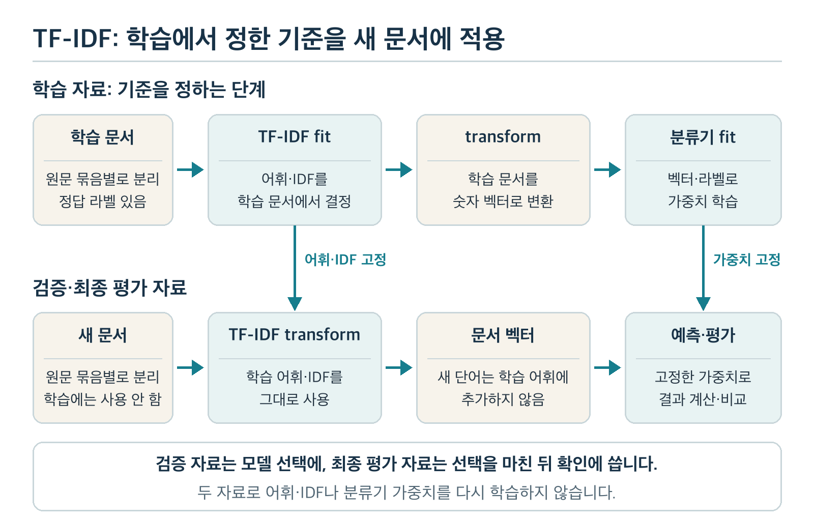

# 과목 3 기초 수학과 전통적 머신러닝

두 글이 모두 100자라면 내용도 비슷할까요? Chapter 2 「Python·NumPy와 문서 데이터 처리」에서 계산한 글자 수와 문단 수만으로는 주제를 가리기 어렵습니다. 이제 문서에 나온 단어를 숫자로 바꾸고, 그 숫자가 분류 결과에 어떻게 영향을 주는지 살펴봅니다.

이 과목에서는 계산을 이해하기 위한 작은 손 예제와 실제 파일로 실행하는 **기준선(baseline)**을 함께 사용합니다. 기준선은 나중에 만든 모델이 나아졌는지 비교할 첫 방법입니다. 손 예제의 가중치는 사람이 정한 값입니다. 실행 예제의 가중치는 학습 문서에서 구합니다. 두 결과의 숫자가 같을 필요는 없습니다.

전체 순서와 후속 과목은 [학습 계획서](../README.md)에서 확인할 수 있습니다. 이 교재의 문장과 자료는 학습을 위해 만든 예시입니다.

## 1. 이 과목을 마치면 할 수 있는 일

1. 숫자 목록인 **벡터(vector)**와 벡터를 행·열로 모은 **행렬(matrix)**을 읽고, 평균·분산·내적의 계산 결과가 무엇을 뜻하는지 설명합니다.
2. 단어 빈도와 TF-IDF의 입력·계산·출력을 작은 문서로 구하고, 학습 자료에서 얻은 단어 통계를 새 문서에 그대로 적용합니다.
3. 단어별 값과 종류별 가중치를 곱해 더하고, 분류 점수·확률 형태의 값·실제 정답 여부를 구분합니다.
4. 정답 라벨 없이 숫자 점을 묶는 K-Means의 배정과 중심 갱신을 한 번 계산합니다.
5. 문장 점수를 이용한 추출 요약을 만들고, 원문 사실·누락을 확인합니다.
6. Chapter 2의 문서 분할을 재사용해 분류·요약 기준선을 실행하고, 작은 자료에서 얻은 결과의 한계를 설명합니다.

**학습 순서:** 2절에서 숫자 계산의 뜻을 확인하고 3~4절에서 문서를 숫자로 바꿉니다. 5절에서 분류 점수를 계산합니다. 6~7절에서는 정답 없는 묶기와 문장 고르기를 각각 살펴봅니다. 8절의 단원 실습과 9절의 확인 문제를 마친 뒤 10절의 완료 기준으로 이해를 점검합니다.

## 2. 숫자 목록으로 문서를 다루는 기초 수학

### 2.1 벡터와 행렬은 어떤 정보를 담나요?

Chapter 2에서는 문서 A의 첫째·둘째 문단 길이를 `[12, 8]`처럼 적었습니다. 첫 칸이 첫째 문단, 둘째 칸이 둘째 문단이라는 **순서**를 정했기에 숫자를 해석할 수 있었습니다. 순서가 있는 숫자 목록을 벡터라고 합니다. 각 칸은 하나의 **특성(feature, 입력에서 계산에 사용하는 정보)**입니다.

| 문서 | 첫째 문단 길이 | 둘째 문단 길이 | 벡터 |
| --- | ---: | ---: | --- |
| A | 12자 | 8자 | `[12, 8]` |
| B | 5자 | 7자 | `[5, 7]` |
| C | 9자 | 4자 | `[9, 4]` |

세 벡터를 위아래로 놓은 `[[12, 8], [5, 7], [9, 4]]`는 **3행 2열 행렬**입니다. 행은 문서 하나, 열은 같은 뜻의 특성 하나를 나타냅니다. 첫째 열의 합은 `12+5+9=26`자입니다. 단위를 섞거나 열 순서를 바꾸면 합계도 다른 의미가 됩니다.

열의 뜻을 문단 길이에서 `[배터리, 경기]`의 단어로 바꾸면 행 하나가 문서의 단어 정보를 담습니다. 같은 모양의 행렬이어도 **각 칸이 무엇을 뜻하는지**를 함께 기록해야 합니다. 단어 칸의 숫자를 만드는 과정은 3~4절에서 살펴봅니다.

**생각해 보기:** A의 `[12, 8]`과 B의 `[5, 7]`을 비교할 때 첫째 칸을 서로 바꾸어 놓으면 무엇이 잘못될까요?

**확인:** A의 첫째 문단과 B의 둘째 문단을 같은 열에서 비교하게 됩니다. 숫자 목록은 칸의 순서와 뜻을 고정해야 비교할 수 있습니다.

### 2.2 평균과 분산은 숫자의 어떤 면을 보여 주나요?

같은 평균 길이를 가진 문서 모음이라도 길이가 거의 같은 경우와 크게 벌어진 경우는 다릅니다. 대표 크기와 흩어진 정도를 따로 보려면 **평균(mean)**과 **분산(variance)**이 필요합니다.

세 값 `[2, 4, 6]`을 한 모음의 전체 값이라고 가정합니다. **모평균**은 전체 합을 전체 개수로 나눈 값입니다. 여기서는 `(2+4+6)/3=4`입니다. 값마다 평균과 얼마나 다른지 구한 뒤 그 차이를 제곱하고 평균내면 **모분산**입니다.

| 값 | 평균 4와의 차이 | 차이의 제곱 |
| ---: | ---: | ---: |
| 2 | -2 | 4 |
| 4 | 0 | 0 |
| 6 | 2 | 4 |
| 합계 | 0 | 8 |

이 모음의 모분산은 `8/3 ≈ 2.67`입니다. 제곱은 음수와 양수가 서로 지워지는 일을 막습니다. 길이의 단위가 글자라면 평균의 단위는 글자, 분산의 단위는 글자 수의 제곱입니다. 값의 크기와 흩어짐을 같은 단위로 보고 싶으면 분산에 제곱근을 취한 **표준편차(standard deviation)**를 씁니다.

여기서는 **주어진 세 값을 전체로 본 모분산**을 구했습니다. 더 큰 모음에서 뽑은 일부 자료로 전체의 흩어짐을 추정하는 **표본분산**은 보통 분모를 `개수-1`로 둡니다. 위 세 값을 표본으로 해석하면 표본분산은 `8/2=4`입니다. 어느 값을 묻는지 먼저 확인하세요.

**직접 해보기:** `[2, 4, 6]`의 마지막 값을 `4`로 바꾸면 평균과 모분산은 각각 얼마인가요? 계산 전에 흩어짐이 커질지 예상해 보세요.

**결과와 이유:** `[2, 4, 4]`의 평균은 `10/3 ≈ 3.33`입니다. 평균과의 차이를 제곱해 더하면 `8/3`이고, 이를 세 값으로 나눈 모분산은 `8/9 ≈ 0.89`입니다. 극단에 있던 `6`이 `4`로 옮겨 와 흩어짐이 작아졌습니다.

### 2.3 내적은 같은 칸의 값을 함께 계산합니다

한 문서에 ‘배터리’가 많다는 숫자가 있어도 그것이 IT 분류에 얼마나 영향을 줄지는 따로 정해야 합니다. 각 칸의 입력 값에 그 칸의 **가중치(weight, 영향력을 나타내는 숫자)**를 곱해 더하는 계산이 필요합니다. 이 계산을 **내적(dot product)**이라고 합니다.

두 벡터가 `[1, 2]`와 `[3, 4]`라면 내적은 `1×3 + 2×4 = 11`입니다. 첫 칸끼리, 둘째 칸끼리만 곱합니다. 벡터의 칸 수와 순서가 맞아야 결과를 해석할 수 있습니다.

| 입력 벡터 | 가중치 벡터 | 계산 | 결과 |
| --- | --- | --- | ---: |
| `[1, 2]` | `[3, 4]` | `1×3 + 2×4` | 11 |
| `[1, 2]` | `[3, -4]` | `1×3 + 2×(-4)` | -5 |

둘째 예에서는 둘째 칸이 음수 방향으로 영향을 줍니다. 5절의 분류기는 종류마다 가중치 벡터를 따로 두고 이런 내적을 계산합니다. 숫자의 역할이 달라도 계산 규칙은 같습니다.

#### 심화 디딤돌: 벡터 길이와 정규화

벡터 `[3, 4]`의 **L2 길이(norm)**는 `√(3²+4²)=5`입니다. 모든 칸을 5로 나누면 `[0.6, 0.8]`이 됩니다. 새 벡터의 L2 길이는 1입니다. 입력 벡터의 길이를 맞추는 **정규화(normalization)**는 4.2절의 TF-IDF 계산에서도 사용합니다. 단위가 다른 여러 수치를 무조건 함께 정규화하면 각 칸의 본래 뜻을 흐릴 수 있으므로 적용 목적을 먼저 정합니다.

## 3. 문서를 단어 칸으로 표현하기

### 3.1 단어 가방과 두 가지 빈도

문서 길이가 같아도 ‘배터리 충전’과 ‘경기 결과’는 주제가 다릅니다. 단어가 몇 번 나왔는지를 칸별로 세면 이 차이를 숫자로 드러낼 수 있습니다. 단어 순서를 버리고 **어휘(vocabulary, 계산에 사용할 단어 목록)**의 칸에 횟수를 담는 표현을 **단어 가방(Bag of Words)**이라고 합니다.

다음 세 문서가 학습 자료라고 가정합니다. 띄어쓰기로 나눈 두 글자 이상의 단어를 그대로 세는 작은 예제입니다. 실제 단어 경계 문제는 3.2절에서 짚습니다.

| 문서 | 내용 | 배터리 횟수 | 경기 횟수 |
| --- | --- | ---: | ---: |
| D1 | 배터리 개선 | 1 | 0 |
| D2 | 배터리 충전 | 1 | 0 |
| D3 | 경기 결과 | 0 | 1 |

한 문서 안에서 단어가 나온 횟수를 **단어 빈도(TF, term frequency)**라고 합니다. 위 표에서 D1의 배터리 TF는 1입니다. 단어가 나타난 **문서의 수**는 **문서 빈도(DF, document frequency)**입니다. 배터리의 DF는 2, 경기의 DF는 1입니다. D1에 ‘배터리’를 두 번 썼다면 D1의 TF만 2로 변하고 배터리의 DF는 여전히 2입니다.

어휘가 많아도 한 문서에는 그중 일부 단어만 나옵니다. 따라서 문서 벡터의 많은 칸이 0인 **희소 벡터(sparse vector)**가 됩니다. 위 표에서 D1의 경기 칸도 0입니다.

8.2절의 `TfidfVectorizer`는 0이 아닌 값과 그 위치를 중심으로 담는 **희소 행렬(sparse matrix)**을 돌려줍니다. 이렇게 저장해도 어휘 수와 분류기 가중치의 개수가 자동으로 줄어들지는 않습니다.

**생각해 보기:** 세 문서 모두에 ‘문서’라는 단어가 들어 있다면 이 단어만 보고 D3의 주제를 고를 수 있을까요?

**확인:** 그 단어는 어느 문서에서도 나타나므로 세 문서를 가르는 단서가 약합니다. 4절에서 전체에 흔한 단어의 비중을 낮추는 방법을 배웁니다.

### 3.2 단어 칸에는 순서와 문맥이 빠집니다

단어 가방에서는 ‘경기 후 배터리를 소개했다’와 ‘배터리 후 경기를 소개했다’가 같은 단어 횟수를 가질 수 있습니다. ‘배터리’와 ‘배터리가’도 단순 띄어쓰기 규칙에서는 다른 칸이 됩니다. 그래서 단어 세기만으로 문장의 뜻을 온전히 보존하지는 못합니다.

가까운 단어의 순서를 남기려면 이웃한 두 단어를 한 칸으로 세는 **바이그램(bigram, 두 단어 묶음)**을 쓸 수 있습니다. `배터리 충전`과 `충전 배터리`는 단어별 횟수는 같아도 두 단어 묶음이 다릅니다.

바이그램은 가까운 순서만 보여 주며 문장 전체의 맥락을 이해하지는 않습니다. 묶음마다 칸이 생겨 어휘도 늘어납니다. 이 과목의 실행 예제는 기본 설정으로 한 단어씩만 셉니다.

실습의 scikit-learn **토큰 패턴(token pattern, 텍스트에서 단어를 찾는 규칙)**은 기본적으로 한글·영어 문자와 숫자 등을 포함하는 두 글자 이상 덩어리를 찾습니다. `3대`는 남지만 한 글자인 `3`은 빠집니다.

‘경기’와 ‘경기도’를 서로 다른 단어로 다루지만 조사나 활용형을 자동으로 하나로 합치지는 않습니다. 한국어 형태와 영어 단어의 경계가 다르므로 실제 결과에서는 언어별 오류를 따로 살펴야 합니다. 단어를 나누고 문맥을 표현하는 방법은 Chapter 5 「자연어 처리와 사전학습 모델 이해」에서 배웁니다.

## 4. TF-IDF와 학습 자료의 경계

### 4.1 흔한 단어와 드문 단어를 어떻게 다르게 볼까요?

모든 글에 공통으로 나오는 단어가 한 문서에 여러 번 등장할 수 있습니다. 그 횟수만으로 주제를 판단하면 공통 단어가 결과를 좌우합니다. **TF-IDF(Term Frequency–Inverse Document Frequency)**는 문서 안의 단어 빈도와 학습 문서 전체에서 그 단어가 얼마나 흔한지를 함께 사용해 각 단어 칸의 값을 만듭니다.

**역문서빈도(IDF, inverse document frequency)**는 많은 문서에 나타나는 단어에 작은 가중치를 주는 값입니다. 이 실습의 `TfidfVectorizer` 기본 설정은 학습 문서 수를 `N`, 어떤 단어가 나온 학습 문서 수를 `DF`라고 할 때 `IDF = 1 + ln((1+N)/(1+DF))`를 씁니다. `ln`은 **자연로그**라는 계산이며 비율이 클수록 값이 커집니다. 분자·분모에 1을 더하는 **평활화(smoothing)**는 모든 단어가 들어 있는 문서 한 건을 더한 것처럼 계산해 단어별 IDF가 극단적으로 벌어지는 폭을 줄입니다.

3.1절의 학습 문서 세 개에서 배터리의 DF는 2이고 경기의 DF는 1입니다.

| 단어 | 학습 문서 수 `N` | `DF` | 계산 | 기본 설정의 IDF |
| --- | ---: | ---: | --- | ---: |
| 배터리 | 3 | 2 | `1+ln(4/3)` | 약 1.288 |
| 경기 | 3 | 1 | `1+ln(4/2)` | 약 1.693 |

경기는 한 문서에만 나타나므로 이 작은 모음에서는 배터리보다 큰 IDF를 받습니다. 큰 IDF가 곧 스포츠 라벨의 증거라는 뜻은 아닙니다. 어떤 단어가 어느 종류를 가리키는지는 5절의 라벨이 붙은 학습에서 따로 구합니다.

모든 학습 문서에 나온 단어는 `DF=N`이므로 이 설정의 IDF가 1입니다. 흔한 단어의 비중이 상대적으로 낮아질 뿐 자동으로 삭제되거나 0이 되지는 않습니다. 한 문서에서 자주 반복되면 TF의 영향도 남습니다.

### 4.2 새 문서의 두 칸을 실제 기본 설정으로 계산하기

새 문서가 `배터리 경기`라면 두 단어의 TF는 각각 1입니다. TF와 IDF를 곱한 값은 배터리 약 1.288, 경기 약 1.693입니다. 기본 설정은 이 벡터의 L2 길이 `√(1.288²+1.693²) ≈ 2.127`로 각 칸을 나눕니다. 두 칸의 결과는 약 `[0.605, 0.796]`입니다. 3.1절의 다른 학습 단어는 새 문서에 없으므로 값이 0입니다.

| 순서 | 입력·중간값 | 두 단어 칸 `[배터리, 경기]` |
| --- | --- | --- |
| 1 | 새 문서의 TF | `[1, 1]` |
| 2 | 학습 자료에서 정한 IDF를 곱함 | `[1.288, 1.693]` |
| 3 | L2 길이로 나눔 | 약 `[0.605, 0.796]` |

5절에서는 손으로 편하게 곱하기 위해 이 결과를 `[0.6, 0.8]`로 **반올림한 학습용 벡터**를 씁니다. 실제 실행 예제는 학습 자료의 전체 어휘와 실제 가중치를 사용합니다. 그 결과를 손 예제의 숫자와 동일하다고 기대하지 마세요.

교재에 따라 TF를 문서 길이로 나누고 IDF를 `ln(N/DF)`처럼 쓰기도 합니다. 그 방식은 위의 평활화·끝의 `+1`·L2 정규화를 사용하는 실습 설정과 값이 다릅니다. 방법의 이름만 보고 계산값을 섞지 말고 **정의와 설정**을 함께 적어야 합니다.

#### 심화 디딤돌: 기본 설정의 단어 빈도

이 실습의 `TfidfVectorizer`는 기본적으로 단어가 나온 **횟수**를 TF로 사용합니다. 단어를 두 번 썼으면 TF는 2입니다. 로그로 TF의 증가 폭을 줄이는 선택 설정인 `sublinear_tf`는 기본값이 꺼져 있습니다. `smooth_idf`와 L2 정규화는 기본값이 켜져 있습니다. 이 차이를 기억하면 교재 손계산과 라이브러리 출력을 대조할 때 혼란이 줄어듭니다.

### 4.3 어휘와 IDF는 학습 문서에서만 구합니다

이미 답을 본 시험으로 실력을 재면 결과를 믿기 어렵습니다. 단어 표현도 마찬가지입니다. 검증·최종 평가 문서를 미리 읽어 단어 목록과 IDF를 정하면 평가 정보가 준비 단계로 새어 들어갑니다. 이런 문제를 **자료 누출(data leakage)**이라고 합니다.



*그림 1. 학습 자료로 `fit`을 수행해 어휘·IDF와 분류기의 가중치를 구합니다. 검증·최종 평가에서는 이 값을 다시 구하지 않고 `transform`과 예측만 수행합니다.*

| 단계 | 학습 자료 | 검증 자료 | 최종 평가 자료 |
| --- | --- | --- | --- |
| 단어 표현 | `fit_transform`: 어휘·IDF를 구하고 숫자로 바꾼다 | `transform`: 정한 어휘·IDF로 바꾼다 | `transform`: 정한 어휘·IDF로 바꾼다 |
| 분류기 | 정답 라벨로 가중치를 학습한다 | 가중치를 고정해 예측하고 선택을 검토한다 | 선택이 끝난 뒤 고정된 방법을 확인한다 |

`fit`은 자료에서 변환에 필요한 값을 **맞추는 작업**이고 `transform`은 맞춘 값을 사용해 입력을 **바꾸는 작업**입니다. 학습 어휘에 없는 단어는 그 단어만의 새 칸이 생기지 않습니다. 새 문서의 모든 단어가 학습 어휘 밖이면 이 표현에서는 0만 남을 수 있습니다. 그런 출력에서도 분류기가 종류를 고를 수 있으므로 예측값만 보고 뜻을 이해했다고 판단하면 안 됩니다.

**직접 해보기:** 검증 문서에만 ‘혜성’이라는 단어가 있습니다. 이 문서를 `fit_transform`하면 어떤 정보가 학습 단계에 들어갈까요? 학습 어휘를 고정하고 `transform`하면 무엇이 다를까요?

**결과와 이유:** 전자는 검증 문서의 ‘혜성’을 어휘와 IDF 계산에 반영할 수 있습니다. 후자는 학습 중 정한 어휘를 유지하므로 새 단어의 독립된 칸을 만들지 않습니다. 다른 단어가 함께 있으면 그 단어들의 값은 원래 어휘와 IDF에 따라 계산합니다.

## 5. 선형 분류기는 종류별 점수를 어떻게 구하나요?

### 5.1 단어 칸과 가중치를 곱해 더하기

문서 벡터만으로 IT·경제·스포츠 중 하나를 고를 수는 없습니다. **선형 분류기(linear classifier)**는 종류마다 단어 칸에 대응하는 가중치를 구한 뒤 입력과 내적해 점수를 만듭니다. 여기에 **절편(intercept, 입력이 모두 0일 때도 더하는 기본 점수)**을 더할 수 있습니다.

다음 표는 4.2절의 반올림 벡터 `[배터리 0.6, 경기 0.8]`에 사람이 정한 가중치를 적용한 **손계산 전용 예제**입니다. 세 종류의 절편은 모두 0으로 놓습니다.

| 종류 | 배터리 가중치 | 경기 가중치 | 계산 | 점수 |
| --- | ---: | ---: | --- | ---: |
| IT | 2 | -1 | `0.6×2 + 0.8×(-1)` | 0.4 |
| 경제 | 0.5 | 0.5 | `0.6×0.5 + 0.8×0.5` | 0.7 |
| 스포츠 | -1 | 2 | `0.6×(-1) + 0.8×2` | 1.0 |

가장 높은 점수는 스포츠의 1.0이므로 이 손 예제는 스포츠를 고릅니다. 경기 단어의 스포츠 가중치가 커서 경기 칸의 영향이 큽니다. 경제 점수 0.7은 70%라는 뜻이 아닙니다. 점수 차이도 정답 여부를 보장하지 않습니다.

**생각해 보기:** 입력에 배터리만 있고 경기 칸이 0이라면, 세 종류 중 어떤 가중치가 유리할까요?

**확인:** IT의 배터리 가중치 2가 가장 큽니다. 다만 실제 입력을 새로 TF-IDF로 변환하면 정규화 때문에 배터리 칸의 값도 0.6에서 달라집니다. 한 칸만 남고 값이 양수라면 IT 점수가 가장 큽니다.

### 5.2 점수와 확률 형태의 값은 다릅니다

세 종류의 점수는 음수나 1보다 큰 수가 될 수 있습니다. `0.4, 0.7, 1.0`을 합해도 1이 아닙니다. 세 종류를 함께 다루는 **로지스틱 회귀(logistic regression)** 분류기는 학습한 가중치·절편으로 점수를 만든 뒤, **소프트맥스(softmax)**라는 변환으로 각 종류의 값이 0~1 사이이고 합이 1인 형태를 얻습니다.

소프트맥스는 각 점수의 지수값을 구한 뒤 세 지수값의 합으로 각각 나눕니다. 지수값은 점수가 커질수록 커지는 양수입니다. 위의 **손으로 정한** 점수를 변환하면 아래와 같습니다.

| 종류 | 손 예제 점수 | 소프트맥스 값 약 |
| --- | ---: | ---: |
| IT | 0.4 | 0.240 |
| 경제 | 0.7 | 0.324 |
| 스포츠 | 1.0 | 0.437 |

표의 값은 반올림해 보이므로 합계가 1에서 조금 벗어나 보일 수 있습니다. 실제 계산에서는 합이 1입니다. 가장 큰 점수와 가장 큰 소프트맥스 값의 종류는 같습니다. 그러나 **0.437은 이 한 예제에 대해 계산된 모델의 출력**이지, 스포츠가 실제 정답일 확률이 검증됐다는 증거가 아닙니다. 좋은 확률 추정인지 확인하려면 충분한 별도 자료에서 예측한 값과 실제 빈도를 비교해야 합니다. 이 과목의 작은 자료로는 그 품질을 판단하기 어렵습니다.

실제 학습에서는 정답 라벨을 어떻게 이용할까요? 학습 문서마다 현재 가중치로 종류별 점수와 소프트맥스 값을 구합니다.

정답 종류에 배정된 소프트맥스 값이 낮을수록 **손실(loss, 예측이 정답과 어긋난 정도를 나타내는 학습용 값)**이 커지도록 계산합니다. 예를 들어 정답이 IT라면 IT에 0.2를 준 경우의 손실이 0.8을 준 경우보다 큽니다. 학습 알고리즘은 학습 문서들의 손실과 지나치게 큰 가중치에 대한 벌점을 함께 줄이는 방향으로 가중치와 절편을 반복해 조정합니다.

실습에서 학습하는 가중치는 표의 `2, -1`처럼 손으로 계산한 예제 숫자가 아닙니다. scikit-learn의 로지스틱 회귀는 정답 라벨이 붙은 학습 문서에 맞추어 가중치와 절편을 구합니다.

기본 설정의 학습에는 이 벌점인 **정규화 항(regularization)**이 포함됩니다. 여기서 정규화 항은 2.3절의 벡터 길이를 1로 맞추는 정규화와 목적이 다릅니다. 자세한 학습 원리는 Chapter 4 「딥러닝 기초와 PyTorch」와 Chapter 9 「수학·통계와 실험 설계 심화」에서 더 깊이 다룹니다.

### 5.3 분류가 틀리면 무엇부터 확인할까요?

실제 문서에 ‘배터리’가 없지만 ‘배터리가’가 있다면 단어 칸이 예상과 달라질 수 있습니다. 배터리 기능을 설명하며 경기 중계를 언급한 문서는 두 주제의 단어를 함께 가질 수 있습니다. 번역본은 같은 내용이어도 다른 언어의 단어 칸을 씁니다. 잘못 붙인 라벨과 한 종류당 너무 적은 원문도 학습한 가중치를 흔듭니다.

분류 결과를 볼 때는 **원문 → 분리 위치 → 숫자로 변환된 칸 → 가중치와 점수 → 예측·정답**을 함께 확인합니다. 종류별 성능과 보류 기준을 정해 비교하는 방법은 Chapter 6 「문서 분류 모델 설계와 평가」에서 배웁니다.

## 6. 정답 이름 없이 가까운 점을 모으는 K-Means

Chapter 1 「AI와 머신러닝 기본 개념」에서는 정답 라벨 없이 문서를 비슷한 것끼리 모으는 **군집화(clustering)**를 소개했습니다. 분류에 쓸 라벨이 없다면 숫자로 표현한 문서가 서로 얼마나 가까운지 기준을 정해 묶을 수 있습니다. **K-Means**는 모을 묶음 수 `K`를 먼저 정하고 가까운 중심에 점을 배정하는 방법입니다.

문서 표현은 복잡할 수 있으므로 두 숫자 좌표의 작은 점 세 개로 **한 번의 계산**을 살펴봅니다. 점 A는 `(0, 0)`, B는 `(0, 2)`, C는 `(4, 0)`입니다. `K=2`로 정하고 첫 중심을 A와 C에 놓습니다. 이 예제에서는 같은 거리로 두 중심 사이에 놓인 점이나 비어 있는 묶음이 없습니다. **제곱거리(squared Euclidean distance)**는 각 좌표 차이를 제곱해 더한 값입니다. 제곱근을 취하지 않아도 어느 중심이 더 가까운지는 같습니다.

| 점 | 중심 1 `(0, 0)`까지의 제곱거리 | 중심 2 `(4, 0)`까지의 제곱거리 | 가까운 중심 |
| --- | ---: | ---: | --- |
| A `(0, 0)` | `0²+0²=0` | `(-4)²+0²=16` | 1 |
| B `(0, 2)` | `0²+2²=4` | `(-4)²+2²=20` | 1 |
| C `(4, 0)` | `4²+0²=16` | `0²+0²=0` | 2 |

중심 1에는 A와 B가 들어갑니다. 이 두 점의 좌표별 평균은 `((0+0)/2, (0+2)/2)=(0, 1)`입니다. 중심 2에는 C만 있으므로 `(4, 0)` 그대로입니다. 이것이 **배정 → 평균으로 중심 갱신**의 한 차례입니다. 일반적인 K-Means는 배정과 갱신을 반복하며, 초기 중심과 거리의 기준에 따라 묶음 결과가 달라질 수 있습니다.

**직접 해보기:** 중심 1을 `(0, 1)`로 바꾼 다음 B에서 두 중심까지의 제곱거리를 다시 구하세요. B의 묶음이 바뀌나요?

**결과와 이유:** B에서 새 중심 1까지는 `0²+1²=1`, 중심 2까지는 `(-4)²+2²=20`입니다. B는 계속 묶음 1입니다. 이 계산은 세 점과 정한 초기 중심에만 해당합니다.

군집 번호 1·2는 IT·스포츠 같은 정답 이름이 아닙니다. 각 묶음이 실제로 유용한지는 원문을 읽고 확인해야 합니다. 단어 순서·문맥이 빠진 표현이나 서로 다른 단위의 좌표를 그대로 쓰면 거리와 묶음도 달라집니다. 실제 자료에서 거리 동점이나 빈 묶음이 생기면 구현마다 다른 처리 규칙도 결과에 영향을 줍니다. 이 절의 점 세 개는 거리와 평균 갱신을 배우는 예이며 실제 문서의 군집 품질을 보여 주지는 않습니다.

## 7. 원문에서 문장 두 개를 고르는 추출 요약

분류는 종류 이름을 주지만 내용을 짧게 전해 주지는 않습니다. 가장 단순한 비교 방법으로 원문 문장에 점수를 주고 높은 문장을 고를 수 있습니다. 원문 문장을 그대로 고르는 방식이 **추출 요약(extractive summarization)**입니다. 새 문장으로 다시 쓰는 **생성 요약(abstractive summarization)**과 출력 방법이 다릅니다.

다음 원문은 세 문장입니다. 이 절에서는 문장마다 두 글자 이상 단어를 세고, 문서 전체에서 각 단어가 나온 횟수를 그 문장의 점수에 더합니다. 같은 문장에 같은 단어가 반복되면 **서로 다른 단어 한 번씩만** 더합니다. 이 규칙은 8절의 실습 스크립트와 같습니다.

이 요약기는 정답 라벨이나 사람이 쓴 요약문으로 가중치를 배우지 않습니다. 사람이 정한 빈도 기준으로 문장을 고르는 **규칙 기반 기준선**입니다.

| 원문 순서 | 문장 | 단어 빈도의 합 |
| ---: | --- | ---: |
| 1 | 배터리 수명이 늘었다. | 배터리 2 + 수명이 1 + 늘었다 1 = 4 |
| 2 | 배터리 충전 시간이 줄었다. | 배터리 2 + 충전 1 + 시간이 1 + 줄었다 1 = 5 |
| 3 | 경기 일정이 바뀌었다. | 경기 1 + 일정이 1 + 바뀌었다 1 = 3 |

점수가 큰 순서로 고르면 2번과 1번입니다. 읽는 사람에게 제시할 때에는 원래 순서인 **1번 다음 2번**으로 다시 놓습니다. 동점이면 원문에서 앞에 나온 문장을 먼저 고릅니다.

이 방법은 고른 문장의 글자를 바꾸지 않으므로 원문에 없던 문장을 새로 쓰지는 않습니다. 그러나 사이에 있던 문장을 빼면 앞뒤 맥락이 달라지거나 중요한 조건이 빠질 수 있습니다. 위 예제에서도 경기 일정 변경이 빠집니다. 원문 자체에 오류가 있으면 그 문장도 그대로 남습니다. 문장이 길수록 더 많은 단어의 점수를 받을 수도 있습니다.

**생각해 보기:** 경기 일정 변경이 독자에게 가장 중요한 소식이라면 위의 요약은 충분할까요?

**확인:** 아닙니다. 점수 상위 문장 두 개가 모두 배터리 이야기여서 경기 일정이 빠졌습니다. 원문과 대조해 핵심의 누락을 살펴야 합니다. 생성 요약도 원문과 사실 일치를 확인해야 하며, 평가 방법은 Chapter 7 「문서 요약 모델 설계와 추가학습」에서 배웁니다.

#### 심화 디딤돌: 문장 점수의 선택

빈도를 그냥 더하는 대신 문장 길이로 나누거나 TF-IDF로 문장을 비교할 수도 있습니다. 점수 규칙을 바꾸면 고르는 문장이 달라집니다. 이 과목에서는 규칙을 고정해 **왜 그 문장을 골랐는지** 설명하는 데 집중합니다. 더 높은 점수를 받았다는 사실만으로 더 좋은 요약이 되지는 않습니다.

## 8. 단원 실습: 문서 분류·추출 요약 기준선 실행

### 8.1 준비한 자료와 실행 순서

Chapter 2의 예제에는 15개 입력이 있습니다. 처리 가능한 `ready` 문서는 12건이고, 보류 1건·빈 입력 1건·읽기 오류 1건이 따로 있습니다. 분류 학습에는 `ready`만 사용합니다. 12건에는 번역본·복사본·조각이 포함되므로 서로 독립적인 원문 묶음은 **9개**입니다.

학습·검증·최종 평가 각각에는 원문 묶음 3개와 문서 4건이 있습니다. 종류마다 학습에 독립된 원문 묶음이 **하나뿐**입니다. 이 결과는 계산과 자료 분리 연습에 쓰며 실제 서비스에서 기대할 일반적인 성능을 말해 주지 않습니다.

아래 명령은 저장소 루트에서 실행합니다. Chapter 2의 문서 입력을 먼저 읽어 `_workspace/chapter3/input/`에 `records.json`과 `splits.json` 등을 만듭니다. 이어서 Chapter 3의 [실행 예제](examples/run_baseline.py)가 기준선을 학습하고 보고서를 씁니다. `requirements.txt`는 이 과목의 Python 패키지 목록입니다.

```sh
python3 -m venv _workspace/chapter3/venv
_workspace/chapter3/venv/bin/python -m pip install -r \
    study/chapter3/requirements.txt
_workspace/chapter3/venv/bin/python \
    study/chapter2/examples/run_pipeline.py \
    --output-dir _workspace/chapter3/input
_workspace/chapter3/venv/bin/python \
    study/chapter3/examples/run_baseline.py \
    --input-dir _workspace/chapter3/input \
    --output-dir _workspace/chapter3
```

Windows라면 가상 환경의 Python 실행 파일 경로에 맞추어 같은 스크립트를 실행합니다. 이미 Chapter 2의 실습을 마쳤더라도 이 명령을 실행하면 Chapter 3의 입력과 결과를 같은 작업 폴더에서 확인할 수 있습니다. `_workspace/`는 Git에 넣지 않는 실습 결과 폴더입니다. `study/chapter2/examples/`의 원본 입력은 바꾸지 않습니다.

### 8.2 분류 결과의 어떤 부분을 읽나요?

실행 예제는 `splits.json`에 정해진 원문 묶음을 그대로 사용합니다. 학습 문서의 `clean_text`에서 `TfidfVectorizer`의 어휘·IDF를 구하고, 학습 문서의 정답 라벨로 `LogisticRegression`의 가중치를 구합니다. 분류기에는 `max_iter=1000`을 주어 반복 계산의 최대 횟수를 지정합니다. 검증·최종 평가 문서는 이미 맞춘 표현으로 바꾼 뒤 예측합니다.

`_workspace/chapter3/baseline_report.json`에는 세 부분의 결과가 `classification.splits` 아래에 기록됩니다. `feature_extraction.fitted_on_doc_ids`에서 어휘를 맞추는 데 사용한 문서를 확인하고 `features_in_index_order`에서 실제 학습 어휘를 읽습니다. 보고서 맨 위의 `excluded`는 학습에서 뺀 문서와 이유를, `group_overlap_count`는 분할 사이에 겹친 원문 묶음 수를 보여 줍니다.

각 문서의 `true_label`과 `predicted_label`은 각각 정답과 예측입니다. `decision_scores`와 `probabilities`는 종류별 점수와 확률 형태의 출력입니다. `nonzero_feature_count`는 3.1절의 희소 벡터에서 **0이 아닌 단어 칸 수**입니다. 값이 작다면 학습에 없던 표현이 많았는지 원문과 대조합니다.

이 예제를 원본 그대로 실행한 경우 학습 어휘는 117개였습니다. 학습 문서 4건은 모두 맞혔지만 검증 문서 4건 중 3건, 최종 평가 문서 4건 중 3건을 잘못 분류했습니다. 이 수치는 준비된 **학습용 예제에 한정한 실행 결과**입니다. 패키지 버전이나 입력을 바꾸면 수치가 달라질 수 있습니다.

| 분리 위치 | 원문 묶음 | 문서 | 이 실행의 오분류 |
| --- | ---: | ---: | ---: |
| 학습 | 3개 | 4건 | 0건 |
| 검증 | 3개 | 4건 | 3건 |
| 최종 평가 | 3개 | 4건 | 3건 |

최종 평가의 `ECO-03`, `SPT-03`, `SPT-03-FRAG`는 `nonzero_feature_count`가 0이었습니다. 세 문서는 학습 어휘에 겹치는 단어 칸이 없어 모두 IT로 예측됐습니다. 입력 벡터가 모두 0이어도 분류기는 절편으로 점수를 내므로 결과가 나옵니다. 결과 옆에 표시된 큰 확률 형태의 값만으로 이 예측을 믿어서는 안 됩니다.

다음 순서로 한 문서를 추적해 보세요.

1. `records.json`에서 해당 문서의 `doc_id`, `status`, `group_id`, `label`, `clean_text`를 읽습니다.
2. `splits.json`에서 그 묶음이 학습·검증·최종 평가 중 어디에 있는지 확인합니다.
3. 보고서에서 정답과 예측, 종류별 점수·확률 형태의 출력과 0이 아닌 단어 칸 수를 비교합니다.
4. 틀렸다면 원문 표현, 다른 언어의 번역, 라벨 판단, 학습 어휘에 없는 단어 중 어떤 설명이 가능한지 기록합니다. 이 자료만으로 오류의 원인을 하나로 확정하지 않습니다.

검증 결과를 보고 방법을 고쳤다면 최종 평가 자료는 그 결정에 사용하지 않아야 합니다. 이 교재의 실행은 계산 흐름을 확인하는 기준선이며, 실험을 반복해 선택하는 절차까지 성능 연구로 주장하지 않습니다.

**직접 해보기 1:** 학습에 없고 검증 문서에만 있는 단어 하나를 고릅니다. 학습 어휘를 다시 맞추지 않은 상태에서 이 단어가 새 칸을 만드는지 확인하세요. 검증 문서 전체를 `fit`에 넣으면 왜 검사 목적이 흐려질지도 적습니다.

**예상 결과와 이유:** 고정된 학습 어휘에는 새 단어의 칸이 생기지 않습니다. 검증 문서를 `fit`에 쓰면 어휘·IDF가 검증 정보에 영향을 받아, 독립된 문서에서 확인한다는 조건을 깨뜨립니다.

**직접 해보기 2:** 정답과 예측이 다른 문서 하나를 고릅니다. 점수가 높은 종류의 단어가 원문에서 어떤 뜻인지 읽고, 번역본·조각과 같은 `group_id`의 분리 위치를 함께 확인하세요.

**판단 기준:** 점수가 높다는 이유만으로 원문 뜻이나 라벨이 틀렸다고 단정하지 않습니다. 원문 내용과 라벨 규칙을 확인하고, 묶음이 한 부분에 남아 있는지 검사합니다. 모든 예측이 맞더라도 종류당 학습 원문이 하나라는 한계는 남습니다.

### 8.3 추출 요약 결과는 원문과 대조합니다

실행 예제는 준비 완료인 **원문 9건**의 문장을 다룹니다. 원문에서 두 글자 이상 단어를 찾고 문서 전체 빈도를 셉니다. 문장별로 서로 다른 단어의 빈도를 더해 상위 두 문장을 고른 뒤 원문 순서대로 놓습니다. 문장 수가 두 개 이하라면 있는 문장만 고릅니다.

보고서의 `extractive_summaries`에서 `sentence_scores`와 `selected_source_indices`를 읽습니다. `source_index`는 **0부터 시작**합니다. 7절의 설명 표는 읽기 쉬우라고 문장을 1번부터 셌으므로 두 번호 체계를 구분하세요.

원본 예제의 `IT-01`은 문장 점수가 원문 순서로 `13, 10, 11, 5`였습니다. 선택된 인덱스는 `0, 2`입니다. 선택 결과에는 동영상 재생 시간이 평균 40분 길었다는 문장이 남지만 **실험 기기가 세 대뿐이었다는 한계**는 빠집니다. `human_summary`에는 세 대라는 정보가 들어 있습니다. 사람 요약도 정답이라고 단정하기 전에 원문과 대조하며, 이 비교로 빈도 기반 추출 요약의 누락을 확인합니다.

보고서의 문장별 점수와 선택된 문장 번호를 보고 다음을 기록하세요.

| 확인할 항목 | 직접 적을 내용 |
| --- | --- |
| 문서 ID와 원문의 중요한 사실 | `____________________` |
| 고른 두 문장의 원래 번호와 점수 | `____________________` |
| 원문 순서로 읽은 추출 결과 | `____________________` |
| 빠진 사실 또는 원문 자체의 오류 | `____________________` |

**직접 해보기:** 원문에서 날짜·금액·부정 표현 하나가 선택 문장에 남았는지 확인하세요. 빠졌다면 문장 점수 규칙 때문인지, 문장을 나누는 규칙 때문인지 구분해 보세요.

**결과를 해석하는 법:** 추출 결과의 각 문장은 Chapter 2에서 정리해 둔 `sentences`의 문장과 글자가 같아야 하며 순서도 유지해야 합니다. 정리 과정에서 줄바꿈이나 PDF 머리말을 처리했으므로 원본 파일의 바이트와 같다는 뜻은 아닙니다.

중요한 사실이 빠졌다면 점수 규칙이 핵심을 골라내지 못한 것입니다. 문장 자체가 잘못 갈라졌다면 Chapter 2의 `sentences`와 `paragraphs`부터 살펴봅니다. 이 실습은 추출 요약의 기준선을 만드는 작업입니다. 생성 요약의 사실성과 품질을 검증한 결과로 쓰지 않습니다.

### 8.4 바꿔 보고 설명하기

실습용 입력을 바꾸려면 Chapter 2의 9.3절 「복사한 입력의 글자와 문단 바꾸기」에 따라 `examples/`의 파일을 `_workspace/chapter2/edited_examples/`에 복사하세요. 복사본의 검증 원문 한 문장에 학습 어휘에 없는 단어를 더하거나 문단 경계를 바꿉니다. 저장소 루트에서 두 스크립트의 입력·출력 폴더를 다음처럼 연결해 실행합니다.

```sh
_workspace/chapter3/venv/bin/python \
    study/chapter2/examples/run_pipeline.py \
    --input-dir _workspace/chapter2/edited_examples \
    --output-dir _workspace/chapter3/variant_input
_workspace/chapter3/venv/bin/python \
    study/chapter3/examples/run_baseline.py \
    --input-dir _workspace/chapter3/variant_input \
    --output-dir _workspace/chapter3/variant_report
```

변경 결과는 `_workspace/chapter3/variant_report/baseline_report.json`에 남습니다. 원본 실행의 `_workspace/chapter3/baseline_report.json`과 비교하세요.

변경 전에 **어느 값이 바뀔지** 적어 둡니다. 검증 문서만 바꾸었다면 학습 어휘·IDF·분류기 가중치는 그대로여야 합니다. 해당 검증 문서의 숫자 표현과 예측은 바뀔 수 있습니다.

`ECO-02`처럼 요약 대상인 원문을 바꾸면 그 문장 점수도 바뀔 수 있습니다. `ECO-02-COPY` 같은 복사본은 추출 요약 대상이 아니므로 해당 문장의 점수가 보고서에 새로 나타나지 않습니다. 결과가 예상과 다르면 `raw_text` → `clean_text` → `sentences` → 보고서의 해당 문서 순서로 대조합니다.

복사본에 다른 원문의 내용까지 넣으면 기존 `group_id`만으로 독립성을 보장할 수 없습니다. 그런 변경을 했는지 함께 기록합니다. 재실행 결과가 달라진 사실과 모델 품질이 좋아졌다는 판단도 구분하세요.

## 9. 확인 문제와 해설

문제를 먼저 손으로 풀고 바로 아래 해설에서 계산 과정과 이유를 확인합니다. 실습 파일의 실제 수치와 손 예제의 수치가 다른 경우에는 각각의 전제를 다시 확인하세요.

**1. 질문:** `[2, 4, 6]`의 모평균과 모분산은 얼마인가요? 표본분산으로 읽으면 무엇이 달라지나요? **복습:** 2.2절.

**해설:** 모평균은 4입니다. 평균에서 떨어진 정도의 제곱은 `4, 0, 4`이므로 모분산은 `8/3`입니다. 세 값을 더 큰 모음의 표본으로 보고 추정한다면 분모를 2로 둔 표본분산은 4입니다. 분산의 종류를 먼저 밝힙니다.

**2. 질문:** 두 벡터 `[1, 2]`와 `[3, -4]`의 내적을 구하세요. 둘째 칸은 결과에 어떤 방향으로 영향을 주나요? **복습:** 2.3절.

**해설:** `1×3+2×(-4)=3-8=-5`입니다. 둘째 칸이 결과를 8만큼 낮춥니다. 같은 칸끼리 곱해야 합니다.

**3. 질문:** D1에 ‘배터리’를 한 번 더 써서 `배터리 배터리 개선`으로 바꾸면 D1의 TF와 세 학습 문서의 배터리 DF는 각각 어떻게 되나요? **복습:** 3.1절.

**해설:** D1의 배터리 TF는 2가 됩니다. 배터리가 있는 문서는 여전히 D1과 D2 두 건이므로 DF는 2입니다. 횟수와 문서 수의 차이입니다.

**4. 질문:** 4.1절의 세 학습 문서에서 경기의 IDF가 배터리보다 큰 이유는 무엇인가요? 새 검증 문서에서 경기가 열 번 나왔다면 학습 IDF를 다시 구해야 하나요? **복습:** 4.1~4.3절.

**해설:** 경기는 학습 문서 한 건, 배터리는 두 건에 나타나므로 경기의 DF가 작습니다. 검증 문서의 경기 횟수는 그 문서의 TF에 영향을 주지만 학습 자료에서 정한 IDF를 바꾸지는 않습니다. 검증 문서로 다시 `fit`하면 자료 누출입니다.

**5. 질문:** 반올림 벡터 `[0.6, 0.8]`과 5.1절의 세 가중치로 종류별 점수를 구하고 가장 높은 종류를 적으세요. 이 결과가 정확한 확률이라고 말할 수 있나요? **복습:** 5.1~5.2절.

**해설:** IT는 0.4, 경제는 0.7, 스포츠는 1.0이므로 스포츠가 가장 높습니다. 점수는 확률이 아닙니다. 소프트맥스로 합이 1인 값을 만들 수 있어도 그 값이 실제 정답 빈도와 맞는지는 별도 자료로 확인해야 합니다.

**6. 질문:** K-Means 예제에서 처음 배정 후 중심 1과 중심 2의 좌표는 무엇인가요? 묶음 1을 자동으로 IT라고 불러도 되나요? **복습:** 6절.

**해설:** A와 B의 평균은 `(0, 1)`이고 C 하나의 중심은 `(4, 0)`입니다. 묶음 번호는 정답 라벨이 아니므로 내용을 확인하지 않고 IT라고 붙일 수 없습니다.

**7. 질문:** 7절의 문장 점수로 고른 두 문장의 번호와 출력 순서를 적으세요. 빠지는 사실은 무엇인가요? **복습:** 7절.

**해설:** 점수 순위는 2번 5점, 1번 4점입니다. 출력은 원문 순서인 1번 다음 2번입니다. 3번의 경기 일정 변경은 빠집니다. 높은 빈도 점수가 원문의 모든 중요한 사실을 보존하지는 않습니다.

**8. 질문:** Chapter 2의 실습에서 12건을 세 부분에 나누면 각 부분의 문서 건수는 4건입니다. 이를 각 종류의 독립된 원문이 충분하다는 뜻으로 볼 수 있나요? **복습:** 8.1~8.2절.

**해설:** 볼 수 없습니다. 서로 관련된 번역본·복사본·조각이 포함되어 독립 원문은 전체 아홉 묶음이고, 학습에는 종류마다 한 묶음뿐입니다. 평가 문서가 네 건이라는 숫자만으로 대표성이나 일반적인 성능을 주장할 수 없습니다.

**9. 질문:** 검증 문서에 새 단어를 추가했는데 학습 어휘가 바뀌었습니다. 어떤 처리 경계를 의심해야 하나요? **복습:** 4.3절과 8.4절.

**해설:** 검증 문서에 `fit` 또는 `fit_transform`을 다시 실행했거나 전체 문서로 어휘를 구했는지 확인합니다. 고정된 표현으로 `transform`만 했다면 학습 어휘는 바뀌지 않습니다. 새 단어를 더하기 전에 검증 문서를 학습 목록에 잘못 넣지 않았는지도 확인합니다.

## 10. 핵심 요약과 완료 확인

### 10.1 핵심 요약

1. 벡터의 칸은 정한 순서와 뜻으로 읽고, 내적은 같은 칸의 입력과 가중치를 곱해 더합니다.
2. TF-IDF의 어휘와 IDF, 분류기의 가중치는 학습 자료에서 구합니다. 새 문서에는 그 값을 고정해 적용합니다.
3. 분류 점수·군집 번호·추출 문장 점수는 목적이 다릅니다. 각각 정답 여부, 묶음의 의미, 핵심 사실의 누락을 원문과 별도 자료로 확인합니다.

### 10.2 직접 설명하며 점검하기

| 확인할 능력 | 스스로 제시할 근거 |
| --- | --- |
| 벡터·행렬과 계산 | 2절의 열 뜻, `[2,4,6]`의 두 분산 정의, 두 칸 내적을 손으로 계산한다 |
| 단어 표현 | TF와 DF를 구분하고 세 학습 문서의 IDF가 달라지는 이유와 희소 벡터의 0인 칸을 설명한다 |
| 자료 경계 | 검증 문서에 새 단어를 더해도 학습 어휘·IDF가 고정되는 이유를 설명한다 |
| 분류 | 반올림한 손 예제 점수와 실행으로 학습한 가중치를 구분하고 정답 종류에 준 값과 손실의 관계를 설명한다 |
| 군집화 | A·B·C의 거리·중심을 한 번 갱신하고 묶음 번호가 라벨이 아닌 이유를 말한다 |
| 요약 | 규칙 기반 기준선의 선택 문장이 원문에 있는지와 원문 순서인지 확인하고 빠진 사실을 짚는다 |
| 실습 결과 | 원문 묶음 겹침과 보류 입력 제외를 확인하고 작은 자료가 일반적인 품질을 보장하지 않는 이유를 설명한다 |

체크하기 어려운 항목은 표의 해당 절과 9절의 해설로 돌아가 입력 한 가지를 바꿔 다시 풀어 보세요. 스크립트를 실행한 것만으로 이 과목을 마쳤다고 판단하지 않습니다.

### 10.3 다음 학습 이정표

| 이 과목에서 확인한 원리와 남은 문제 | 다음 학습 |
| --- | --- |
| 단어 칸과 선형 가중치로 결과를 계산했습니다. 여러 계산 층이 가중치를 배우는 과정은 남아 있습니다. | Chapter 4 「딥러닝 기초와 PyTorch」에서 신경망의 계산과 학습을 익힙니다. |
| 같은 단어가 다른 문맥에서 쓰이고 한국어 표현이 조사에 따라 달라집니다. | Chapter 5 「자연어 처리와 사전학습 모델 이해」에서 입력 단위와 문맥 표현을 배웁니다. |
| 종류별 점수와 오류 사례를 만들었지만 충분한 독립 자료로 성능을 판단하지는 못했습니다. | Chapter 6 「문서 분류 모델 설계와 평가」에서 라벨 규칙·종류별 평가·비교 기준을 정합니다. |
| 빈도로 문장을 골랐지만 중요한 사실이 빠질 수 있습니다. | Chapter 7 「문서 요약 모델 설계와 추가학습」에서 생성 요약과 사실성·누락 평가를 배웁니다. |

계산의 통계적 근거와 실험 설계를 더 깊이 배우고 싶다면 기본 과정을 마친 뒤 Chapter 9 「수학·통계와 실험 설계 심화」로 이어집니다. 다음 순서는 Chapter 4 「딥러닝 기초와 PyTorch」입니다.
