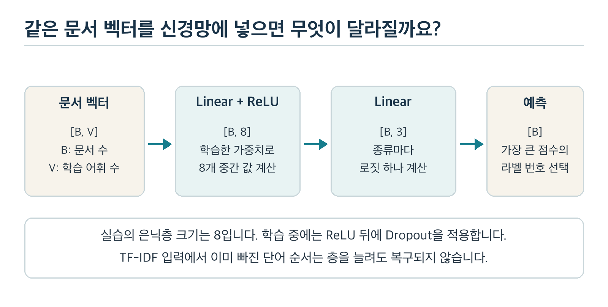
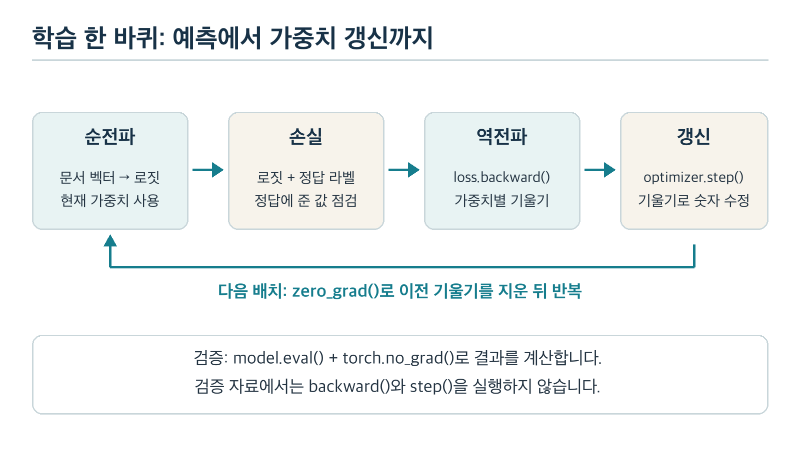

# 과목 4 딥러닝 기초와 PyTorch

같은 시험 문제를 여러 번 풀면 점수는 오릅니다. 처음 보는 문제에서도 잘 풀 수 있을까요? Chapter 3의 분류기를 신경망으로 바꾸어도 이 질문은 남습니다. 이번에는 예측이 만들어지는 과정과 가중치가 바뀌는 과정을 직접 따라갑니다.

**PyTorch**는 숫자 배열을 계산하고 신경망의 학습을 구현하는 도구입니다. 이 교재에서는 Chapter 3의 TF-IDF 문서 벡터와 정답 라벨을 재사용합니다. 입력을 고정해야 분류기의 계산 방식에서 무엇이 달라졌는지 살펴볼 수 있습니다.

전체 과정은 [학습 계획서](../README.md), 선수 내용은 [Chapter 3 교재](../chapter3/기초_수학과_전통적_머신러닝.md)에서 확인합니다. 손으로 정한 숫자 예제와 실제 학습 결과는 구분해서 읽으세요.

## 1. 이 과목을 마치면 할 수 있는 일

1. 문서 배열의 모양과 숫자 형식을 읽고 PyTorch의 입력·라벨·출력을 구분합니다.
2. 선형 층과 활성화 함수가 어떤 계산을 하는지 작은 입력으로 설명합니다.
3. 순전파 → 손실 → 역전파 → 가중치 갱신을 한 번 계산하고 코드와 연결합니다.
4. 학습률·배치 크기·에포크를 구분하고 학습·검증 결과를 비교합니다.
5. 모델과 입력 표현을 함께 저장하고 다시 불러온 출력이 같은지 확인합니다.
6. 신경망으로 바꾸어도 TF-IDF에서 사라진 단어 순서는 복구되지 않음을 설명합니다.

**학습 순서:** 2절에서 입력 배열을 읽고 3절에서 신경망의 예측을 계산합니다. 4~5절에서 학습 한 바퀴를 이해합니다. 6~7절에서 학습 설정과 저장 방법을 확인합니다. 8절의 단원 실습과 9절의 문제를 마치면 10절에서 완료 여부를 점검합니다.

## 2. 문서 벡터를 Tensor로 옮기기

### 2.1 배열의 모양부터 읽습니다

Chapter 3에서는 문서마다 같은 단어 순서의 숫자 목록을 만들었습니다. 문서 4개와 학습 어휘 117개라면 입력은 4행 117열입니다. 행 하나는 문서, 열 하나는 학습 어휘의 단어를 뜻합니다.

**텐서(Tensor)**는 PyTorch가 계산에 사용하는 숫자 배열입니다. 숫자 하나, 벡터, 행렬과 그보다 축이 많은 배열도 텐서로 표현합니다. **모양(shape)**은 축마다 칸이 몇 개인지 적은 값입니다. `[4, 117]`과 `[117, 4]`는 칸 수가 같아도 역할이 다릅니다.

| 배열 | 모양 | 각 칸의 의미 |
| --- | --- | --- |
| 문서 입력 `x` | `[B, V]` | 문서 B개 × 학습 어휘 V개 |
| 정답 라벨 `y` | `[B]` | 문서마다 정답 번호 하나 |
| 분류 출력 `logits` | `[B, C]` | 문서 B개 × 종류 C개의 점수 |

`B`는 한 번에 처리할 문서 수, `V`는 학습 어휘 수, `C`는 종류 수입니다. 이 교재에서는 단일 라벨 분류를 다룹니다. 문서 하나의 정답은 IT·경제·스포츠 중 하나입니다.

#### 함께 풀기: 정답 번호와 확률의 차이

종류 순서를 `['IT', '경제', '스포츠']`로 정합니다. 두 문서의 정답이 IT와 스포츠라면 라벨은 `[0, 2]`입니다. `2`는 스포츠를 가리키는 번호입니다. IT보다 두 배 강한 뜻이나 확률을 나타내지 않습니다.

문서 둘을 계산해 점수를 `[[2, 0, -1], [-1, 0, 2]]`로 얻었다면 출력 모양은 `[2, 3]`입니다. 각 행에서 가장 큰 값의 위치를 고르면 예측 번호는 `[0, 2]`입니다. 실제 정답과 비교하려면 종류 순서가 고정되어 있어야 합니다.

**직접 해보기:** 문서 3개, 어휘 50개, 종류 4개인 분류기의 입력·라벨·출력 모양을 적어 보세요.

**결과와 이유:** 각각 `[3, 50]`, `[3]`, `[3, 4]`입니다. 문서의 수는 함께 움직이지만 입력의 단어 칸과 출력의 종류 칸은 역할이 다릅니다.

### 2.2 숫자 형식과 계산 위치도 맞춥니다

소수인 TF-IDF 값을 정수로 바꾸면 작은 값이 사라질 수 있습니다. **자료형(dtype)**은 배열에 숫자를 어떤 형식으로 담을지 정합니다. 입력과 가중치는 이 실습에서 `torch.float32`로 표현합니다. 숫자 하나를 32비트로 나타내는 실수 형식입니다.

정답 번호에는 `torch.long`을 씁니다. 이 실습의 손실 함수는 정답을 종류의 정수 번호로 받습니다. `0.0`과 `0`은 사람에게 비슷해 보여도 코드에서는 자료형이 다를 수 있습니다.

**장치(device)**는 계산을 수행할 위치입니다. 이 실습은 일반 계산 장치인 CPU만 사용합니다. 입력과 모델이 다른 장치에 놓이면 계산할 수 없으므로 함께 맞춥니다. 가속 장치의 설정을 배우기 전에 배열과 학습 흐름부터 확인합니다.

```python
x = torch.tensor([[0.8, 0.0], [0.0, 0.6]], dtype=torch.float32)
y = torch.tensor([0, 2], dtype=torch.long)
```

이 두 줄은 입력과 라벨을 만드는 부분 예시입니다. `torch`를 가져온 전체 실행은 8.1절의 명령을 사용합니다. 입력 열 순서와 종류 순서를 정하지 않으면 이 숫자만으로 문서를 해석할 수 없습니다.

### 2.3 희소 행렬을 큰 배열로 바꿔도 될까요?

Chapter 3의 `TfidfVectorizer`는 희소 행렬을 만듭니다. 희소 행렬은 0이 아닌 값과 위치를 중심으로 저장합니다.

이번 실습에서는 `.toarray()`를 사용해 **밀집 배열(dense array)**로 바꿉니다. 밀집 배열은 모든 칸의 값을 저장합니다. 작은 신경망의 모양을 읽기 쉽게 하려는 선택입니다.

이 선택을 큰 문서 모음에 그대로 적용하면 메모리가 부족할 수 있습니다. 문서 1만 개와 어휘 5만 개를 모두 32비트 실수로 담으면 숫자만 약 20억 바이트, 곧 2GB입니다. 부가 메모리는 별도로 필요합니다.

이번 입력은 4행 117열이어서 작습니다. 더 큰 자료에서는 희소 연산 지원, 배치별 변환, 입력 표현 변경을 검토해야 합니다. 신경망을 쓴다는 이유만으로 전체 자료를 밀집 배열로 바꾸지는 않습니다.

## 3. 신경망은 예측을 어떻게 만드나요?

### 3.1 선형 층은 단어별 가중치를 더합니다

Chapter 3에서 IT 점수는 단어별 입력 값과 가중치를 곱해 더했습니다. 여기에 기본 점수인 **편향(bias)**을 더하면 하나의 **선형 층(linear layer)** 계산입니다. 엄밀히는 편향을 포함하므로 아핀 변환이라고 부르지만 PyTorch에서는 `Linear`라는 이름을 사용합니다.

입력 `[배터리, 경기] = [1, 0]`을 중간 값 두 개로 바꾸는 손 예제를 보겠습니다. 아래 가중치와 편향은 학습 결과가 아니라 사람이 정한 숫자입니다.

| 중간 칸 | 입력에 곱할 가중치 | 편향 | 계산 결과 |
| --- | --- | ---: | ---: |
| 첫째 | `[1, -1]` | 0 | `1×1 + 0×(-1) = 1` |
| 둘째 | `[-1, 1]` | 0 | `1×(-1) + 0×1 = -1` |

중간 결과는 `[1, -1]`입니다. `nn.Linear(2, 2)`는 입력 두 칸을 출력 두 칸으로 바꾸는 이런 계산을 구현합니다. 가중치 네 개와 편향 두 개가 학습으로 정할 숫자입니다.

### 3.2 활성화 함수가 필요한 이유

두 선형 층을 연달아 연결하기만 하면 더 복잡한 모양을 배울까요? 두 번의 곱셈과 덧셈은 하나의 곱셈과 덧셈으로 합칠 수 있습니다. 따라서 **활성화 함수(activation function)**로 중간 값을 비선형으로 바꿉니다. 비선형은 하나의 직선 관계로 표현되지 않는 성질입니다.

**ReLU(Rectified Linear Unit)**는 양수는 그대로 두고 음수는 0으로 만드는 함수입니다. `[-1, 0, 2]`는 `[0, 0, 2]`가 됩니다. 3.1절의 `[1, -1]`에 적용하면 `[1, 0]`입니다. 음수가 0으로 바뀌는 경계가 생기므로 선형 층을 단순히 하나로 합칠 수 없게 됩니다.

#### 함께 풀기: 하나만 있을 때 골라내기

입력 두 칸을 0이나 1로만 제한합니다. 학습용 규칙은 ‘두 칸 중 정확히 하나만 1이면 양성’입니다. 문서 주제를 실제로 정의한 라벨 규칙과는 별개의 계산 예제입니다.

중간 값은 `h1 = ReLU(x1-x2)`, `h2 = ReLU(x2-x1)`로 정합니다. 두 중간 값의 합이 0.5보다 크면 양성으로 고릅니다.

| 입력 `[x1, x2]` | `[h1, h2]` | 합 | 결과 |
| --- | --- | ---: | --- |
| `[0, 0]` | `[0, 0]` | 0 | 음성 |
| `[1, 0]` | `[1, 0]` | 1 | 양성 |
| `[0, 1]` | `[0, 1]` | 1 | 양성 |
| `[1, 1]` | `[0, 0]` | 0 | 음성 |

이 규칙은 XOR라고 부르며 한 개의 직선 경계로 두 종류를 나눌 수 없습니다. 중간 계산과 ReLU를 두면 표현할 수 있습니다. 다만 표현 가능한 구조를 만들었다고 학습이 원하는 가중치를 반드시 찾는 것은 아닙니다.

### 3.3 중간 표현에서 종류별 점수로

입력과 최종 출력 사이의 계산 층을 **은닉층(hidden layer)**이라고 부릅니다. 은닉은 사람이 볼 수 없다는 뜻이 아닙니다. 입력 라벨 자체가 아닌 중간 표현을 계산하는 위치를 뜻합니다.

3.2절에서 얻은 `[1, 0]`을 최종 선형 층에 넣는다고 가정합니다. IT 가중치를 `[2, 0]`, 경제 가중치를 `[0, 1]`, 스포츠 가중치를 `[-1, 0]`으로 두고 편향은 모두 0으로 둡니다. 결과는 `[2, 0, -1]`입니다.

이처럼 확률로 바꾸기 전의 종류별 점수를 **로짓(logit)**이라고 합니다. 가장 큰 점수의 위치를 구하는 `argmax`는 여기서 IT의 번호 0을 돌려줍니다. 점수의 크기 자체가 맞힐 확률은 아닙니다.

**소프트맥스(softmax)**는 로짓들을 양수로 바꾼 뒤 합이 1이 되도록 나눕니다. `[2, 0, -1]`의 결과는 약 `[0.844, 0.114, 0.042]`입니다. 높은 로짓에 큰 값을 주지만 이 값이 실제 정답 비율과 같다는 보장은 없습니다.

### 3.4 실행 예제의 구조와 파라미터 수

8절의 실행 예제에서는 입력 어휘가 117개입니다. 중간 값은 8개, 출력 종류는 3개입니다. 층을 연결해 만든 신경망을 **다층 퍼셉트론(MLP, Multilayer Perceptron)**이라고 부릅니다. 이 실습은 은닉층 하나를 둔 작은 MLP입니다.



*그림 1. 실행 예제의 배열 모양. `[B, V]` 입력이 `[B, 8]` 중간 값과 `[B, 3]` 로짓으로 바뀝니다. 학습 중에는 ReLU 뒤에 Dropout을 적용합니다.*

| 부분 | 가중치 수 | 편향 수 | 합계 |
| --- | ---: | ---: | ---: |
| 입력 117 → 중간 8 | `117×8 = 936` | 8 | 944 |
| 중간 8 → 종류 3 | `8×3 = 24` | 3 | 27 |
| 전체 | 960 | 11 | 971 |

중간 값 8개를 16개로 늘리면 표현할 여지와 학습할 숫자가 함께 늘어납니다. 자료가 적으면 외운 패턴이 늘어날 수도 있습니다. 층이나 숫자의 개수를 늘린 결과는 검증 자료에서 확인합니다.

## 4. 손실과 기울기로 학습 방향 찾기

### 4.1 정답에 낮은 값을 주면 손실이 커집니다

예측이 맞았는지만 보면 가중치를 어느 방향으로 바꿀지 세밀하게 알기 어렵습니다. 정답에 준 값이 0.4에서 0.6으로 좋아진 변화도 숫자로 읽어야 합니다. 예측과 정답 사이의 어긋남을 하나의 숫자로 표현하는 것이 **손실(loss)**입니다.

단일 라벨 분류의 **교차 엔트로피(cross entropy)** 손실은 정답 종류에 준 소프트맥스 값이 작을수록 커집니다. 이 실습에서는 `정답에 준 값의 자연로그에 마이너스를 붙인 값`을 문서마다 구해 평균냅니다. 자연로그는 곱셈 관계를 덧셈으로 바꾸는 로그의 한 종류입니다. 지금은 작은 정답 값에 큰 불이익을 주는 모양을 읽으면 됩니다.

| 정답 종류에 준 값 | 문서 하나의 손실 | 읽는 방법 |
| ---: | ---: | --- |
| 0.8 | 약 0.223 | 정답에 비교적 큰 값을 줌 |
| 0.2 | 약 1.609 | 정답에 작은 값을 줌 |
| 0.01 | 약 4.605 | 정답을 강하게 놓침 |

손실은 정답 라벨이 있어야 계산할 수 있습니다. 낮은 손실은 학습 목표에 잘 맞춘다는 뜻입니다. 라벨 자체가 틀렸다면 잘못된 목표에 맞출 수도 있습니다. 손실을 실제 서비스 품질 전체와 같게 보지는 않습니다.

PyTorch의 `nn.CrossEntropyLoss()`에는 **로짓을 그대로 넣습니다.** 이 함수가 소프트맥스에 해당하는 계산을 수치적으로 안정된 방식으로 함께 처리합니다. 미리 소프트맥스를 적용해 넣으면 여기서 의도한 손실과 다른 계산이 됩니다.

### 4.2 기울기는 어느 쪽으로 바꿀지 알려 줍니다

볼륨을 조금 올렸더니 소리가 너무 커졌다고 생각해 보세요. 작은 조작이 결과를 어느 방향으로 얼마나 바꾸는지 알면 다음 조작을 정하기 쉽습니다. **기울기(gradient)**는 각 학습 숫자를 조금 바꿀 때 손실이 어떻게 변하는지 나타내는 값입니다.

먼저 가중치 하나짜리 계산을 사용합니다. 입력은 2, 목표 출력은 3입니다. 예측은 `2×w`, 손실은 `(예측-3)²`로 정합니다. 이 제곱 손실은 원리를 보기 위한 예제이며 4.1절 분류기의 교차 엔트로피와 다릅니다.

| 가중치 w | 예측 | 제곱 손실 |
| ---: | ---: | ---: |
| 0.49 | 0.98 | 4.0804 |
| 0.50 | 1.00 | 4.0000 |
| 0.51 | 1.02 | 3.9204 |

w가 0.50 부근에서 커지면 손실이 줄어듭니다. 양쪽 손실 차이를 가중치 차이로 나누면 `(3.9204-4.0804)/0.02 = -8`입니다. 작은 변화로 기울기를 어림하는 **유한차분(finite difference)** 계산입니다. 이 지점의 정확한 미분값도 -8입니다.

**미분(derivative)**은 변화 폭을 아주 작게 보았을 때의 변화율입니다. 가중치가 여러 개면 각각의 미분값을 모아 기울기를 만듭니다. 기울기가 음수라면 현재 지점에서 그 가중치를 조금 늘리는 쪽이 손실을 줄이는 방향입니다.

### 4.3 학습률을 곱해 한 걸음 이동합니다

**학습률(learning rate)**은 기울기를 보고 얼마나 크게 움직일지 정하는 값입니다. 기본 갱신 규칙은 `새 가중치 = 현재 가중치 - 학습률×기울기`입니다. 손실이 증가하는 방향의 반대로 작은 걸음을 옮깁니다.

4.2절의 w=0.5에서 학습률을 0.1로 정하면 `0.5 - 0.1×(-8) = 1.3`입니다. 새 예측은 2.6이고 새 손실은 `(2.6-3)² = 0.16`입니다. 4보다 작아졌습니다.

**직접 해보기:** 같은 지점에서 학습률을 1로 정하면 새 가중치와 손실은 얼마인가요?

**결과와 이유:** 새 가중치는 8.5, 예측은 17, 손실은 196입니다. 기울기가 알려 준 방향은 맞아도 한 번에 너무 멀리 가면 손실이 커집니다. 한 번의 갱신이 항상 손실을 낮춘다는 보장은 없습니다.

### 4.4 자동미분과 역전파는 어떻게 연결되나요?

신경망에서는 앞선 층의 가중치가 중간 값을 거쳐 최종 손실에 영향을 줍니다. 각 계산의 변화율을 뒤에서부터 연결하면 앞선 가중치까지 영향을 계산할 수 있습니다. 이 연결 규칙은 **연쇄법칙(chain rule)**입니다.

**역전파(backpropagation)**는 손실에서 앞선 계산 방향으로 이 규칙을 적용해 기울기를 구하는 과정입니다. **자동미분(automatic differentiation, autograd)**은 실제로 수행한 계산의 연결과 미분 규칙을 기록해 미분값을 구하는 기능입니다. PyTorch에서는 `loss.backward()`가 기록된 연결을 따라 기울기를 계산합니다.

자동미분은 4.2절처럼 모든 가중치를 조금씩 바꿔 손실을 다시 재는 방식이 아닙니다. 이미 알려진 연산별 미분 규칙을 조합합니다. 예측과 손실을 계산하는 **순전파(forward pass)**가 먼저 있어야 어떤 연결로 역전파할지 알 수 있습니다.

#### 심화 디딤돌: 경계의 미분과 계산 연결

ReLU의 0 지점은 보통의 의미에서 미분값이 하나로 정해지지 않습니다. PyTorch는 이 지점의 역전파 값으로 0을 사용합니다. 이런 연산별 규칙까지 포함해 자동미분이 동작합니다.

`requires_grad=True`는 그 텐서의 미분을 추적한다는 뜻입니다. 학습할 파라미터는 기본적으로 추적됩니다. 계산 중간에 값을 Python 숫자로 꺼내 다시 텐서를 만들면 원래 연결이 끊길 수 있습니다. 출력 기록용 `.item()`과 손실 계산용 텐서를 구분하세요.

## 5. 학습 한 바퀴를 코드와 연결하기

### 5.1 다섯 줄의 역할을 구분합니다

여러 문서를 조금씩 묶어 예측·손실·기울기·갱신을 반복합니다. 가중치를 실제로 바꾸는 도구가 **옵티마이저(optimizer)**입니다. 이 실습은 기울기의 반대 방향으로 이동하는 **SGD(Stochastic Gradient Descent, 확률적 경사 하강법)**를 사용합니다. 일부 자료의 기울기로 전체 학습 방향을 어림합니다.

아래 코드는 8.1절 실행 파일의 학습 반복 부분입니다. `model`, `loss_fn`, `optimizer`와 배치 입력이 이미 준비되어 있다고 가정합니다. 이 블록만 따로 실행하지는 않습니다.

```python
optimizer.zero_grad()
logits = model(x_batch)
loss = loss_fn(logits, y_batch)
loss.backward()
optimizer.step()
```

| 코드 | 하는 일 | 가중치가 바뀌나요? |
| --- | --- | --- |
| `zero_grad()` | 이전에 쌓인 기울기를 지움 | 아니요 |
| `model(x_batch)` | 현재 가중치로 로짓 계산 | 아니요 |
| `loss_fn(...)` | 로짓과 정답으로 손실 계산 | 아니요 |
| `backward()` | 가중치별 기울기를 구해 `.grad`에 더함 | 아니요 |
| `step()` | 기울기를 사용해 가중치 갱신 | 예 |

PyTorch는 기본적으로 기울기를 누적합니다. 배치마다 새 기울기만 사용하려면 이전 값을 지웁니다. `backward()`가 가중치까지 바꾸는 것으로 생각하면 학습 코드의 오류를 찾기 어렵습니다.



*그림 2. 손실을 계산하는 일과 가중치를 바꾸는 일은 별개의 단계입니다. 검증에서는 가중치를 갱신하지 않습니다.*

### 5.2 배치·에포크·갱신 횟수

한꺼번에 전체 문서를 넣으면 메모리가 많이 들 수 있습니다. **배치(batch)**는 한 번에 처리하는 자료 묶음입니다. **배치 크기(batch size)**는 그 묶음에 든 문서 수입니다. 전체 학습 자료를 한 차례 훑으면 **에포크(epoch)** 하나를 마칩니다.

학습 문서 4개를 배치 크기 2로 처리하면 에포크마다 배치가 두 개입니다. 각 배치 뒤에 `step()`을 한 번 실행하므로 80에포크 동안 갱신은 160번입니다. 배치 크기를 4로 바꾸면 같은 80에포크여도 갱신은 80번입니다.

마지막 배치가 덜 차도 버리지 않는다면, 문서 5개에 배치 크기 2일 때는 2개·2개·1개의 세 배치가 생깁니다. **DataLoader**는 이런 배치를 꺼내는 도구입니다. **TensorDataset**은 입력 텐서와 정답 텐서를 같은 순서로 묶습니다.

학습 자료의 순서를 섞는 `shuffle=True`도 사용합니다. 일부 순서에만 의존하는 일을 줄이려는 방법입니다. 섞는 것만으로 자료의 편향이나 부족함이 해결되지는 않습니다.

### 5.3 학습 모드와 평가 모드는 서로 다릅니다

자료에 지나치게 맞추는 일을 줄이려고 **드롭아웃(Dropout)**을 쓸 수 있습니다. 드롭아웃은 일부 중간 값을 무작위로 0으로 만드는 방법입니다.

이번 MLP는 ReLU 뒤에서 비율 0.2를 사용합니다. 학습 중 각 중간 값을 확률 0.2로 0으로 만듭니다. 남은 값은 평균 크기를 맞추도록 조정합니다.

추론할 때도 매번 중간 값을 지우면 같은 입력의 출력이 흔들릴 수 있습니다. `model.train()`은 학습 동작을, `model.eval()`은 평가 동작을 선택합니다. Dropout은 평가 모드에서 값을 지우지 않습니다. 이 실습의 선형 비교 모델에는 Dropout이 없습니다.

| 설정 | 바꾸는 것 | 바꾸지 않는 것 |
| --- | --- | --- |
| `model.eval()` | Dropout 등 일부 층의 동작 | 자동미분 기록 자체 |
| `torch.no_grad()` | 구간 안의 미분 기록을 끔 | 모델의 학습·평가 모드 |

검증과 저장 후 재실행에서는 둘을 함께 사용합니다. `eval()`만 호출하면 미분 기록이 남을 수 있습니다. `no_grad()`만 사용하면 Dropout은 계속 학습 모드로 동작할 수 있습니다.

## 6. 낮은 학습 손실과 좋은 모델을 구분하기

### 6.1 학습·검증·최종 평가의 역할

배운 문서를 외우는 것과 새 문서에 적용하는 것은 다릅니다. 새 자료에서도 잘 적용하는 능력이 **일반화(generalization)**입니다. 학습 자료에는 점점 잘 맞지만 새 자료에서 나빠지는 현상은 **과적합(overfitting)**입니다.

가중치를 구할 자료는 학습용, 설정과 저장 시점을 고를 자료는 검증용으로 둡니다. 최종 평가 자료는 선택을 마친 뒤 확인합니다. 같은 원문의 복사본·조각·번역본은 하나의 묶음으로 나누는 Chapter 3의 규칙을 유지합니다.

검증 결과를 여러 번 보며 선택했으므로 검증 자료도 선택 과정에 영향을 줍니다. 최종 평가 결과를 보고 다시 설정을 바꾸면 그 자료는 더 이상 독립된 마지막 확인 자료가 아닙니다. Chapter 6의 실제 평가에서는 별도의 충분한 자료가 필요합니다.

### 6.2 실행에서 관찰한 학습 곡선 읽기

다음 값은 8.1절의 기본 설정을 CPU에서 실행한 관측값입니다. Python 3.12.14, PyTorch 2.14.1, scikit-learn 1.9.1에서 확인했습니다. 학습률 0.1, 배치 크기 2, 80에포크, 난수 시드 7을 사용했습니다. **난수 시드(seed)**는 초기 가중치와 섞는 순서를 재현하기 위한 시작 값입니다.

| 에포크 | 학습 손실 | 검증 손실 | 학습 정확도 | 검증 정확도 |
| ---: | ---: | ---: | ---: | ---: |
| 1 | 1.0807 | 1.1368 | 0.50 | 0.25 |
| 10 | 0.9826 | 1.1916 | 0.50 | 0.25 |
| 40 | 0.4097 | 1.3931 | 1.00 | 0.25 |
| 80 | 0.0846 | 1.7350 | 1.00 | 0.25 |

**생각해 보기:** 마지막 모델은 학습 문서를 모두 맞혔습니다. 80에포크의 가중치를 저장하는 것이 좋을까요?

**확인:** 이 실행에서는 검증 손실이 가장 낮은 1에포크를 저장했습니다. 학습 손실만 보면 학습을 오래할수록 좋아 보입니다. 검증 손실은 점점 나빠져 과적합을 의심할 근거가 됩니다. 검증 정확도가 같아도 틀린 예측에 더 큰 값을 주면 손실은 커질 수 있습니다.

표의 두 손실은 에포크가 끝난 시점의 같은 가중치로 `eval()`에서 다시 계산했습니다. 학습 중 배치별로 기록한 손실은 가중치와 Dropout 상태가 계속 달라집니다. 보고서의 `online_train_loss`는 이 별도 값입니다. 검증 손실과 비교할 학습 곡선에는 `train_eval_loss`를 사용합니다.

표는 학습 흐름을 보는 예제입니다. 학습에는 종류마다 독립된 원문 묶음이 하나뿐입니다. 검증 문서도 네 개뿐이어서 한 문서의 정오가 정확도를 0.25만큼 바꿉니다. 이 숫자로 실제 성능이나 MLP의 우수성을 판단할 수는 없습니다.

### 6.3 설정을 하나씩 바꾸어 비교합니다

학습률·에포크·배치 크기는 학습으로 얻는 가중치와 달리 실험 전에 정하는 **하이퍼파라미터(hyperparameter)**입니다. 설정을 동시에 바꾸면 결과 차이의 원인을 가리기 어렵습니다.

| 바꿀 설정 | 먼저 예상할 일 | 결과에서 확인할 항목 |
| --- | --- | --- |
| 학습률 0.1 → 0.01 | 한 번의 갱신이 작아짐 | 학습 손실의 감소 속도·검증 손실 |
| 80 → 20에포크 | 자료를 훑는 횟수가 줄어듦 | 20회까지의 곡선·선택된 저장 시점 |
| 배치 크기 2 → 4 | 에포크당 갱신이 두 번에서 한 번으로 줄어듦 | 갱신 횟수·학습 및 검증 결과 |
| MLP → 선형 모델 | 중간 층과 ReLU가 없어짐 | 같은 입력으로 계산·검증한 결과 |

배치 크기는 평균 기울기의 변동과 갱신 횟수를 함께 바꿉니다. 큰 배치가 무조건 빠르거나 정확한 것은 아닙니다. 이 단원에서는 일정한 에포크 수로 비교하고 갱신 횟수 차이도 기록합니다.

### 6.4 손실이 줄지 않을 때의 확인 순서

실행이 끝났는데 손실이 거의 그대로라면 모델을 키우기 전에 입력부터 살핍니다. 이미 사라진 정보는 더 큰 신경망으로 되살릴 수 없습니다.

| 관찰 | 확인할 내용 | 이유 |
| --- | --- | --- |
| 문서 벡터가 전부 0 | 학습 어휘와 새 문서 표현 | 단어 단서가 모델에 전달되지 않음 |
| 손실이 불규칙하게 커짐 | 학습률·입력 크기·잘못된 라벨 | 너무 큰 갱신이나 잘못된 목표 가능성 |
| 학습 손실만 낮아짐 | 원문 묶음 분리·자료 수·검증 오류 | 과적합 또는 자료 차이 가능성 |
| 가중치가 바뀌지 않음 | `backward()`·`step()`·미분 연결 | 기울기 계산과 갱신의 누락 가능성 |
| 같은 입력의 결과가 흔들림 | `eval()`·Dropout·실행 조건 | 학습 동작 또는 환경 차이 가능성 |

한 가지 관찰만으로 원인을 확정하지는 않습니다. 어떤 입력과 어느 단계에서 차이가 생겼는지 기록하고 한 조건씩 확인하세요.

## 7. 저장한 모델을 다시 사용할 수 있게 만들기

### 7.1 가중치 파일만으로는 부족합니다

단어 칸 순서를 바꾸면 같은 가중치가 다른 단어에 곱해집니다. 종류 순서를 바꾸면 IT 점수를 스포츠로 읽을 수도 있습니다. 재실행하려면 숫자뿐 아니라 그 숫자의 의미도 저장해야 합니다.

| 저장할 것 | 필요한 이유 |
| --- | --- |
| 모델 구조와 입력·출력 크기 | 같은 모양의 계산 층을 다시 만들기 위해 |
| 모델의 가중치·편향 | 학습 결과를 재사용하기 위해 |
| TF-IDF 어휘·IDF와 전처리 규칙 | 같은 문서를 같은 열의 값으로 바꾸기 위해 |
| 종류의 순서 | 출력 칸을 올바른 라벨로 읽기 위해 |
| 패키지 버전·난수 시드·설정 | 실행 차이를 추적하기 위해 |

**state_dict**는 PyTorch 모델의 파라미터 등 상태를 이름별로 모은 자료입니다. 실행 예제는 이 자료를 `model_state.pt`에 저장합니다. 같은 구조를 만든 뒤 이 상태를 불러옵니다.

학습을 중단한 지점부터 정확히 이어 하려면 옵티마이저 상태, 에포크, 난수 상태 등도 필요합니다. 이번 저장은 **추론 재실행용**입니다. 학습 재개까지 보장하는 저장 파일은 아닙니다.

### 7.2 저장 전후에는 같은 입력으로 대조합니다

저장 시점의 가중치를 복사해 두지 않으면 이후 학습이 그 상태까지 바꿀 수 있습니다. 실행 예제는 검증 손실이 개선될 때 `copy.deepcopy(model.state_dict())`로 별도 복사합니다. 마지막에는 이 복사본을 불러와 저장합니다.

재실행에서는 저장한 어휘와 IDF로 검증 입력을 다시 변환합니다. 새 어휘를 학습하지 않습니다. 저장 전후의 로짓을 같은 `eval()`·CPU 조건에서 비교합니다. 이 예제는 최대 차이가 0.0000001보다 크면 오류로 알립니다.

`torch.load(..., weights_only=True)`로 모델 상태를 불러옵니다. 본인이 만든 실습 파일을 사용하세요. 임의로 받은 Python 객체를 실행하는 방식으로 전체 모델을 불러오지는 않습니다.

같은 시드라도 기기·패키지 버전·계산 장치가 달라지면 모든 숫자가 같다고 보장할 수 없습니다. 결과 비교에는 실제 환경을 함께 기록합니다.

## 8. 단원 실습: 같은 문서 입력에서 분류기 비교하기

### 8.1 준비와 기본 실행

다음 명령은 저장소 루트에서 실행합니다. `requirements.txt`는 필요한 패키지 목록입니다. 이미 만든 Chapter 3 입력이 있어도 첫 실행의 자료 흐름을 확인하려면 아래 순서대로 실행할 수 있습니다.

```sh
python3 -m venv _workspace/chapter4/venv
_workspace/chapter4/venv/bin/python -m pip install -r \
    study/chapter4/requirements.txt
_workspace/chapter4/venv/bin/python \
    study/chapter2/examples/run_pipeline.py \
    --output-dir _workspace/chapter3/input
_workspace/chapter4/venv/bin/python \
    study/chapter4/examples/train_text_mlp.py
```

[학습 실행 파일](examples/train_text_mlp.py)은 학습·검증 분할을 Chapter 3의 검사 함수로 확인합니다. 학습 문서에서만 TF-IDF를 맞춥니다. 같은 벡터로 Chapter 3의 로지스틱 회귀도 계산해 비교 자료를 남깁니다. 기본 실행에서는 최종 평가 점수를 출력하지 않습니다.

Windows에서는 가상 환경의 Python 경로를 `Scripts/python.exe`에 맞춥니다. 패키지 설치에는 인터넷이 필요합니다. 설치와 Chapter 2의 입력 파일 준비를 마치면 이 단원의 모델 학습은 외부 모델 다운로드 없이 CPU에서 실행합니다.

### 8.2 보고서에서 계산과 관측을 찾습니다

기본 결과는 `_workspace/chapter4/base/`에 만들어집니다. 실행 결과를 읽고 아래 표를 먼저 채워 보세요. 값이 다른 환경에서는 그대로 옮겨 적고 버전을 함께 남깁니다.

| 보고서 항목 | 직접 기록할 내용 |
| --- | --- |
| `input_shape`, `class_order` | 입력 모양: ______ / 종류 순서: ______ |
| `parameter_count` | 파라미터 수: ______ |
| `gradient_demo` | 이전 손실: ______ / 기울기: ______ / 새 손실: ______ |
| `best_epoch_by_validation_loss` | 저장한 에포크: ______ |
| `history` | 학습·검증 손실이 달라진 지점: ______ |
| `reload_max_logit_difference` | 저장 전후 최대 차이: ______ |

**해설:** 이 교재의 기본 실행에서는 입력이 `[4, 117]`, 종류 순서는 IT·경제·스포츠, 파라미터 수는 971개였습니다. 손 계산의 손실은 4에서 약 0.16으로 줄었고 기울기는 -8이었습니다. 선택된 에포크는 1, 저장 전후 최대 로짓 차이는 0이었습니다.

`training_report.json`의 `splits`에는 선택된 가중치의 결과가 들어 있습니다. `history`의 마지막 행은 마지막 에포크의 결과입니다. 두 위치가 서로 다른 시점일 수 있으므로 혼동하지 마세요. `features_and_model.json`은 구조·어휘·IDF·종류 순서를 담습니다.

### 8.3 하나씩 바꾼 실험과 기록

8.1절에서 만든 환경으로 다음 세 명령을 각각 실행합니다. 출력 폴더를 다르게 두어 기본 결과를 보존합니다. 나머지 설정은 기본값과 같습니다.

```sh
_workspace/chapter4/venv/bin/python \
    study/chapter4/examples/train_text_mlp.py \
    --lr 0.01 --output-dir _workspace/chapter4/lr001
_workspace/chapter4/venv/bin/python \
    study/chapter4/examples/train_text_mlp.py \
    --batch-size 4 --output-dir _workspace/chapter4/batch4
_workspace/chapter4/venv/bin/python \
    study/chapter4/examples/train_text_mlp.py \
    --model linear --output-dir _workspace/chapter4/linear
```

에포크 수는 `--epochs 20`으로 따로 바꿔 볼 수 있습니다. 비교하는 조건이 학습률인지, 배치 크기인지, 모델 구조인지 먼저 적습니다. 실행 횟수보다 결과를 설명하는 일이 중요합니다.

| 실험 | 바꾼 조건 | 에포크당 갱신 수 | 선택한 에포크 | 검증 손실 | 해석 |
| --- | --- | --- | --- | --- | --- |
| 기본 | 없음 | ______ | ______ | ______ | ______ |
| 작은 학습률 | 0.01 | ______ | ______ | ______ | ______ |
| 큰 배치 | 4 | ______ | ______ | ______ | ______ |
| 선형 모델 | 은닉층 없음 | ______ | ______ | ______ | ______ |

**결과와 해석:** 기본·작은 학습률·선형 모델은 에포크당 두 번, 큰 배치는 한 번 갱신합니다. 실험별 손실은 실행 보고서에서 읽습니다. 검증 결과가 같거나 나빠져도 실패한 실습은 아닙니다. 계산 구조와 갱신 조건이 어떻게 달라졌는지 설명할 수 있으면 됩니다.

로지스틱 회귀와 PyTorch 선형 모델은 점수를 만드는 형태가 비슷합니다. 그러나 전자는 별도의 최적화 방법과 기본 정규화를 사용합니다. PyTorch 실습의 SGD 학습과 설정이 같지 않으므로 숫자가 같을 필요는 없습니다.

### 8.4 선택을 마친 뒤 최종 평가를 확인합니다

검증 결과로 모델 종류와 설정을 먼저 고릅니다. 선택한 실행 명령에 `--evaluate-final`을 더하면 같은 설정으로 학습·저장 후 최종 평가 결과도 남깁니다. 이 값을 보고 다시 설정을 고르지 않습니다.

Chapter 3에서 이미 이 실습 자료의 최종 평가를 읽었다면 완전히 새로운 시험으로 해석할 수 없습니다. 여기서는 자료의 역할을 연습합니다. 실제 모델 선택은 Chapter 6과 POC A에서 새 평가 자료로 수행합니다.

### 8.5 입력 한 가지를 바꿔 원인을 설명합니다

8.3절에서 모델 구조를 바꿔도 ‘어휘에 없는 단어’와 ‘버린 순서’의 문제는 남습니다. TF-IDF 열이 모두 0인 문서는 편향과 중간 계산만으로 점수가 정해질 수 있습니다. 높은 소프트맥스 값이 나오더라도 문서 내용을 잘 읽었다는 증거는 아닙니다.

종이에 ‘배터리 충전’과 ‘충전 배터리’를 적어 보세요. 단어별 TF-IDF를 사용하면 두 문서의 입력이 같습니다. 같은 모델을 `eval()`로 실행하면 두 입력의 출력도 같습니다. 문맥을 다루려면 순서가 남아 있는 다른 입력 표현이 필요합니다.

## 9. 확인 문제와 해설

### 9.1 먼저 직접 답해 보세요

1. 문서 5개, 어휘 20개, 종류 3개일 때 입력·라벨·로짓의 모양은 각각 무엇인가요?
2. 선형 층 두 개 사이에 ReLU 같은 활성화 함수를 넣는 이유는 무엇인가요?
3. 입력 2, 목표 3, w=0.5인 4.2절 예제에서 학습률 0.01을 쓰면 새 w와 손실은 얼마인가요?
4. `backward()`와 `step()` 중 가중치를 바꾸는 단계는 무엇인가요? `zero_grad()`는 왜 필요한가요?
5. 로짓 `[2, 0, -1]`을 얻었습니다. `CrossEntropyLoss`에 소프트맥스 결과를 넣어야 할까요?
6. 학습 문서 5개, 배치 크기 2, 3에포크입니다. 마지막 작은 배치를 버리지 않으면 갱신은 몇 번인가요?
7. `model.eval()`과 `torch.no_grad()`가 각각 바꾸는 것은 무엇인가요?
8. 학습 손실은 줄고 검증 손실은 커집니다. 무엇을 의심하고 어느 자료로 저장 시점을 고르나요?
9. 가중치만 저장하고 TF-IDF 어휘와 라벨 순서를 잃으면 무엇이 잘못될 수 있나요?
10. TF-IDF 입력에 단어 순서가 없을 때 신경망 층을 늘리면 순서를 복구할 수 있나요?

### 9.2 답과 이유를 확인합니다

1. `[5, 20]`, `[5]`, `[5, 3]`입니다. 문서 축을 맞추고 단어 축과 종류 축은 구분합니다. 2.1절을 확인하세요.
2. 선형 층만 연결하면 하나의 선형·편향 계산으로 합칠 수 있습니다. ReLU는 비선형 관계를 표현할 여지를 만듭니다. 3.2절의 XOR 표를 다른 입력으로 계산해 보세요.
3. 기울기는 -8이므로 새 w는 `0.5-0.01×(-8)=0.58`입니다. 예측은 1.16, 손실은 `(-1.84)²=3.3856`입니다. 4.3절의 학습률 0.1보다 한 걸음이 작습니다.
4. `step()`이 가중치를 바꿉니다. `backward()`는 기울기를 계산해 더합니다. 이전 기울기를 쓰지 않으려면 `zero_grad()`로 지웁니다. 5.1절을 확인하세요.
5. 로짓을 그대로 넣습니다. 해당 손실 함수가 필요한 변환을 함께 계산합니다. 4.1절의 입력 조건을 확인하세요.
6. 에포크마다 2개·2개·1개로 세 번 갱신합니다. 3에포크에는 총 9번입니다. 5.2절의 배치 규칙을 적용합니다.
7. `eval()`은 Dropout 같은 층의 동작을 바꿉니다. `no_grad()`는 미분 기록을 끕니다. 5.3절의 표에서 두 역할을 구분하세요.
8. 과적합을 의심합니다. 검증 자료로 저장 시점을 고르며 최종 평가 자료는 마지막 확인에 씁니다. 자료 차이와 라벨 오류도 함께 살핍니다. 6.1~6.2절을 확인하세요.
9. 입력 열이나 출력 라벨의 뜻이 바뀔 수 있습니다. 같은 숫자라도 다른 문서 단서와 라벨로 해석하게 됩니다. 7.1절의 저장 목록을 확인하세요.
10. 복구할 수 없습니다. 같은 입력은 고정한 모델에서 같은 계산을 거칩니다. 8.5절에서 단어 순서를 바꾼 두 문서를 비교하세요.

## 10. 핵심 요약과 다음 학습

### 10.1 세 문장으로 돌아보기

- 신경망은 문서 벡터를 여러 계산 층에 통과시켜 종류별 로짓을 만듭니다.
- 학습은 손실에서 기울기를 구하고 학습률과 옵티마이저로 가중치를 갱신하는 반복입니다.
- 검증 결과와 저장 후 재실행을 함께 확인해야 하며 입력에서 버린 정보는 층을 늘려도 돌아오지 않습니다.

### 10.2 완료 점검

- [ ] 입력·라벨·로짓의 모양과 자료형을 내 말로 설명했습니다.
- [ ] ReLU와 선형 층을 작은 입력으로 계산했습니다.
- [ ] 기울기 -8과 학습률을 이용해 새 가중치와 손실을 구했습니다.
- [ ] 학습 반복 다섯 줄의 역할과 가중치가 바뀌는 시점을 설명했습니다.
- [ ] 학습률·배치 크기·모델 구조를 하나씩 바꾼 보고서를 비교했습니다.
- [ ] 학습·검증 손실과 선택된 저장 시점을 구분했습니다.
- [ ] 어휘·IDF·라벨 순서를 복원하고 저장 전후 로짓을 대조했습니다.
- [ ] 작은 자료의 점수와 TF-IDF 입력의 한계를 설명했습니다.

### 10.3 심화 디딤돌과 다음 Chapter

학습의 한 바퀴를 알게 되었습니다. 하지만 단어 칸으로 만든 입력만으로는 문맥과 순서를 충분히 다루기 어렵습니다. [Chapter 5 「자연어 처리와 사전학습 모델 이해」](../chapter5/자연어_처리와_사전학습_모델_이해.md)에서는 토큰과 임베딩을 거쳐 문맥에 따른 표현을 만드는 방법을 배웁니다.

미분 계산을 더 깊이 공부할 때는 편미분, 연쇄법칙, 행렬 미분을 연결해 보세요. 각각 여러 가중치 중 하나의 변화, 계산 연결의 영향, 배열 전체의 미분을 다루는 말입니다. 이번 과목의 학습 흐름을 먼저 설명한 뒤 수학으로 확장하면 됩니다.
