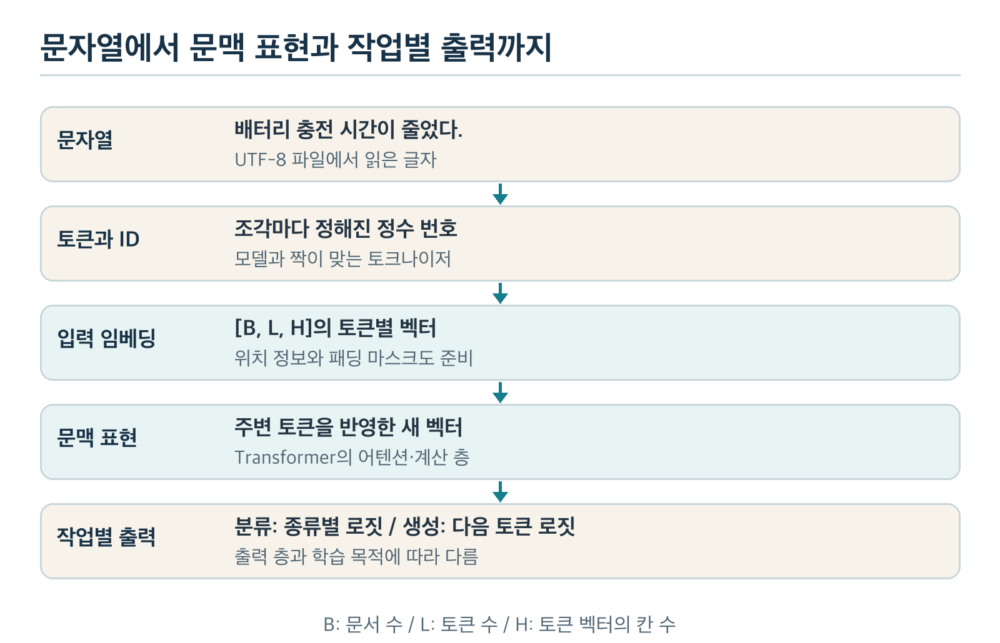
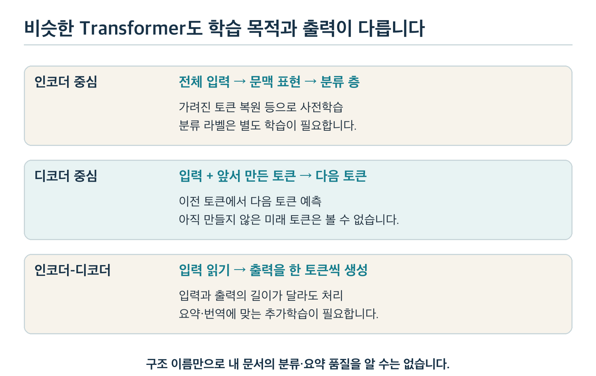
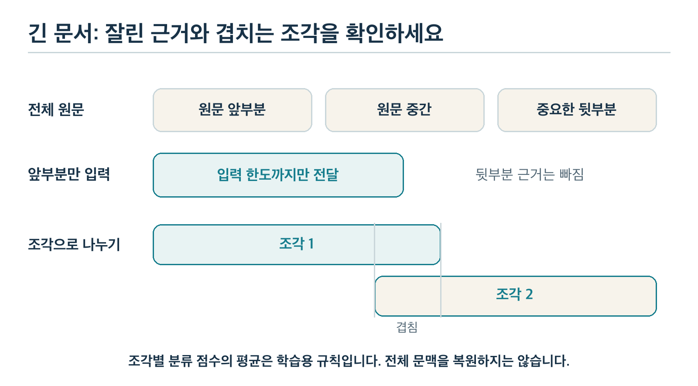

# 과목 5 자연어 처리와 사전학습 모델 이해

‘은행에서 대출을 받았다’와 ‘은행 열매가 익었다’를 생각해 보세요. 단어를 세는 것만으로는 주변 말에 따라 달라지는 뜻을 충분히 나타내기 어렵습니다. Chapter 4에서 신경망을 배웠지만 입력에서 단어 순서를 버렸다면 이 문제는 남습니다.

**자연어 처리(NLP, Natural Language Processing)**는 사람이 쓰는 언어를 컴퓨터로 다루는 분야입니다. 이 과목에서는 문자열을 토큰과 벡터로 바꾸고 문맥을 반영하는 방법을 배웁니다. 많은 자료로 미리 학습한 모델을 가져와 분류와 짧은 생성 예제에 사용합니다.

전체 경로는 [학습 계획서](../README.md), 학습 한 바퀴는 [Chapter 4 교재](../chapter4/딥러닝_기초와_PyTorch.md)에서 확인합니다. 손으로 만든 토크나이저·벡터 예제와 실제 사전학습 모델의 관측값은 구분해서 읽으세요.

## 1. 이 과목을 마치면 할 수 있는 일

1. UTF-8 인코딩, 토큰화, 토큰 ID의 역할을 구분합니다.
2. 한·영 문장의 토큰 수와 입력 한도를 비교하고 잘린 원문 근거를 찾습니다.
3. 패딩·마스크·위치 정보가 필요한 이유를 설명합니다.
4. 입력 임베딩과 문맥 표현을 구분하고 어텐션의 정보 혼합을 작은 예로 계산합니다.
5. 사전학습 본체·작업별 출력 층·추가학습의 관계를 설명합니다.
6. 분류 점수와 생성 토큰을 구분하고 실제 실행의 실패 원인을 기록합니다.
7. 긴 문서의 조각별 분류 결과를 합치고 모델 후보의 한계와 확인할 조건을 정리합니다.

**학습 순서:** 2~3절에서 입력 조각과 배열을 만듭니다. 4~5절에서 문맥 표현과 사전학습 모델을 이해합니다. 6~7절에서 분류·생성·긴 문서 처리를 연결합니다. 8절의 실행 실습을 마친 뒤 9절에서 후보를 검토하고 10~11절에서 이해를 점검합니다.

## 2. 글자·바이트·토큰은 서로 다릅니다

### 2.1 파일의 표현과 모델의 입력 단위

‘가’를 파일에 저장하는 일과 모델이 읽을 조각으로 나누는 일은 목적이 다릅니다. Chapter 2의 **인코딩(encoding)**은 문자열을 바이트로 표현하는 규칙입니다. **바이트(byte)**는 8비트 묶음이며 UTF-8에서 ‘가’ 한 글자는 세 바이트입니다. 파일을 읽을 때는 반대로 바이트를 문자열로 **디코딩(decoding)**합니다.

**토큰화(tokenization)**는 읽은 문자열을 모델이 처리하는 단위인 **토큰(token)**으로 나눕니다. 띄어쓰기 단어 하나가 토큰 하나일 수도 있지만 여러 조각으로 나뉠 수도 있습니다. 토큰의 목록과 번호를 가진 도구를 **토크나이저(tokenizer)**라고 합니다.

| 단계 | 입력 → 출력 | 목적 |
| --- | --- | --- |
| UTF-8 인코딩 | 문자열 → 바이트 | 파일 저장·전송 |
| UTF-8 디코딩 | 바이트 → 문자열 | 저장된 글자 읽기 |
| 모델 토큰화 | 문자열 → 토큰·ID | 모델의 입력 조각 준비 |
| 토큰 디코딩 | 토큰 ID → 문자열 | 생성 결과를 글자로 읽기 |

토크나이저 도구도 문자열을 ID로 바꾸는 메서드를 `encode`라고 부를 수 있습니다. 이름만 보고 UTF-8 인코딩과 같은 과정으로 생각하지 마세요. 입력과 출력이 바이트인지 토큰 ID인지 확인합니다. 바이트 단위 토큰을 사용하는 모델도 있지만 저장 인코딩과 모델의 입력 규칙은 여전히 구분합니다.

### 2.2 띄어쓰기만으로 부족한 이유

‘배터리’, ‘배터리가’, ‘배터리를’을 모두 다른 단어로만 저장하면 어휘가 커집니다. 처음 보는 활용형도 자주 생깁니다. 한 단어를 더 작은 조각으로 나누는 **부분단어(subword)** 방식은 자주 쓰는 조각을 재사용합니다.

손 예제에서는 ‘배터리가’를 `[배터리, 가]`로 나눈다고 가정해 보겠습니다. ‘배터리를’은 `[배터리, 를]`로 나눌 수 있습니다. 실제 토크나이저가 반드시 이렇게 나누지는 않습니다. 조각의 경계는 학습한 어휘와 알고리즘에 따라 달라집니다.

한국어는 조사와 어미가 붙고 띄어쓰기 방식도 달라질 수 있습니다. 형태소 분석은 뜻이나 문법 역할이 있는 단위를 찾는 별도의 방법입니다. 부분단어 토큰이 항상 형태소와 같은 것은 아닙니다. 영어에서도 `charging`이 하나 또는 여러 조각이 될 수 있습니다.

#### 심화 디딤돌: 토크나이저 이름을 읽는 법

| 이름 | 현재 알아둘 원리 | 구분할 점 |
| --- | --- | --- |
| BPE, Byte Pair Encoding | 자주 함께 나타나는 인접 조각을 합쳐 어휘를 만듦 | 바이트를 기본 단위로 쓰는 변형도 있음 |
| WordPiece | 부분단어 어휘를 만들고 그 어휘로 문자열을 나눔 | BPE와 어휘 학습·분할 규칙이 같지는 않음 |
| Unigram | 여러 후보 조각의 점수를 이용해 분할을 선택 | 빈도 높은 쌍을 합치는 규칙과 다름 |
| SentencePiece | 원시 문자열에서 부분단어 처리를 지원하는 도구 | 그 안에서 Unigram이나 BPE 등을 사용할 수 있음 |

이 과목에서는 새 토크나이저를 학습하지 않습니다. 사전학습 모델과 함께 제공된 어휘·분할 규칙을 그대로 사용합니다. 어휘를 바꾸면 임베딩 행과 ID의 대응도 다시 맞춰야 합니다.

### 2.3 토큰 ID는 뜻의 크기가 아닙니다

도서관 책의 청구 번호는 책의 중요도 순서를 나타내지 않습니다. 토큰에도 목록에서 찾기 위한 번호인 **토큰 ID(token ID)**를 붙입니다. ID가 더 크다고 뜻이 비슷하거나 강한 것은 아닙니다.

다음은 계산을 읽기 위해 직접 정한 어휘입니다. 실제 모델의 번호표와 다릅니다. 공백으로 이미 나눈 문자열 `배터리 가 오래 간다 .`를 입력한다고 가정합니다.

| 토큰 | ID | 역할 |
| --- | ---: | --- |
| `[PAD]` | 0 | 짧은 입력의 길이를 채움 |
| `[UNK]` | 1 | 어휘로 표현하지 못한 조각 |
| `[CLS]` | 2 | 이 손 예제에서 시작을 알림 |
| `[SEP]` | 3 | 이 손 예제에서 끝을 알림 |
| 배터리 / 가 / 오래 / 간다 | 4 / 5 / 6 / 7 | 본문 조각 |
| . / 충전 | 8 / 9 | 문장부호·본문 조각 |

시작·끝 같은 별도 역할을 가진 조각을 **특수 토큰(special token)**이라고 합니다. 위 문장은 시작·끝을 포함해 `[2, 4, 5, 6, 7, 8, 3]`이 됩니다. 문장부호도 토큰 수를 차지합니다.

**생각해 보기:** ID 9인 ‘충전’은 ID 4인 ‘배터리’보다 두 배 이상 중요한가요?

**확인:** 번호만으로 중요도나 의미 거리를 비교할 수 없습니다. 모델은 4.1절의 임베딩 표에서 해당 행을 찾습니다. 의미를 계산할 벡터 값은 ID 숫자와 다릅니다.

### 2.4 모르는 토큰과 복원 손실

`[UNK]`는 표현하지 못한 부분을 알리는 표시입니다. 서로 다른 많은 단어가 같은 미지 토큰으로 바뀌면 원래 차이를 잃습니다. 반대로 미지 토큰이 없더라도 잘게 쪼개진 토큰을 모델이 잘 이해한다고 단정할 수는 없습니다.

어떤 토크나이저는 바이트 조각으로 생소한 글자도 표현합니다. 이때 미지 토큰 문제는 줄어들 수 있지만 토큰 수가 늘거나 언어별 품질 차이가 남을 수 있습니다. ‘입력 가능’과 ‘좋은 결과’는 따로 확인합니다.

토큰 디코딩도 원문을 언제나 글자 단위로 완벽히 복원하는 것은 아닙니다. 정규화·공백 처리·미지 토큰 때문에 차이가 날 수 있습니다. 날짜·수치·줄바꿈의 근거를 찾으려면 원문을 따로 보존합니다.

## 3. 길이가 다른 문장을 배열로 묶기

### 3.1 패딩과 입력 마스크

2.3절의 첫 문장은 특수 토큰을 포함해 7개입니다. 짧은 문장 `배터리 충전 .`은 `[2, 4, 9, 8, 3]`으로 5개입니다. 두 문장을 한 행렬로 계산하려면 행 길이를 맞춰야 합니다.

길이를 채우는 **패딩(padding)**을 넣어 둘 다 7개로 만듭니다. 채운 부분과 실제 입력을 구분하는 표시가 **마스크(mask)**입니다. 이 예제의 `attention_mask`는 사용할 위치에 1, 패딩 위치에 0을 둡니다.

| 입력 | 토큰 ID | 패딩 마스크 |
| --- | --- | --- |
| 긴 문장 | `[2, 4, 5, 6, 7, 8, 3]` | `[1, 1, 1, 1, 1, 1, 1]` |
| 짧은 문장 | `[2, 4, 9, 8, 3, 0, 0]` | `[1, 1, 1, 1, 1, 0, 0]` |

마스크 0은 해당 위치를 본문 근거로 섞지 않도록 알리는 값입니다. 토큰 ID가 0이어서 무조건 패딩인 것은 아닙니다. 8절 실제 모델의 시작 토큰 ID는 0이고 패딩 ID는 1입니다. 손 예제의 번호표를 실제 모델에 적용하면 안 됩니다.

### 3.2 순서 정보가 따로 필요합니다

ID 목록은 순서를 갖지만 같은 계산을 위치 구분 없이 적용하면 순서 차이를 활용하기 어렵습니다. **위치 정보(positional information)**는 토큰이 어느 자리에 있는지 모델의 계산에 알립니다. 위치 벡터를 더하거나 토큰 사이의 상대 위치를 계산하는 등 모델별 방법이 다릅니다.

‘개가 사람을 물었다’와 ‘사람이 개를 물었다’에서 순서와 조사는 역할을 바꿉니다. 위치 정보와 문맥 계산은 이런 차이를 표현할 수 있게 합니다. 다만 구조가 차이를 표현할 수 있다는 사실이 모든 문장의 뜻을 정확히 구분한다는 보장은 아닙니다.

패딩 마스크는 유효한 입력 위치를, 위치 정보는 순서를 알립니다. 생성 모델에는 미래 토큰을 보지 못하게 하는 별도의 마스크도 있습니다. 그 역할은 5.2절에서 구분합니다.

### 3.3 토큰 한도와 잘림

입력 한도를 넘은 부분을 자르는 처리를 **잘림(truncation)**이라고 합니다. 앞에서부터 한도까지만 남기면 뒷부분의 핵심 근거가 사라질 수 있습니다. 잘린 문장을 모델이 추측으로 복원했다고 생각하면 안 됩니다.

손 예제의 입력 한도를 특수 토큰 포함 6개로 둔다고 가정합니다. 시작·끝이 두 자리를 쓰므로 본문은 네 조각만 들어갑니다. `[배터리, 가, 오래, 간다, .]`에서 마지막 마침표가 빠지고 입력은 `[2, 4, 5, 6, 7, 3]`입니다.

**직접 해보기:** 한도를 5개로 줄이면 남는 본문과 빠지는 부분은 무엇인가요?

**결과와 이유:** 본문 세 조각 `[배터리, 가, 오래]`만 남습니다. ‘간다’와 마침표가 빠집니다. 이 예제는 끝 토큰을 보존하는 규칙입니다. 실제 토크나이저에서는 사용하는 특수 토큰 수와 잘림 방향을 함께 확인합니다.

### 3.4 글자 수가 같아도 토큰 수는 다릅니다

같은 뜻의 한국어와 영어 문장도 바이트·글자·토큰 수가 서로 다릅니다. 다음 값은 8.2절에서 고정한 실제 토크나이저를 사용한 관측값입니다. 토큰 수는 특수 토큰을 포함하고 패딩은 제외합니다.

| 문장 | 글자 수 | UTF-8 바이트 수 | 토큰 수 |
| --- | ---: | ---: | ---: |
| 배터리 충전 시간이 줄었다. | 15 | 37 | 8 |
| Battery charging time decreased. | 32 | 32 | 10 |
| 선수가 경기에서 골을 넣었다. | 16 | 40 | 12 |
| The player scored a goal in the game. | 37 | 37 | 12 |

한국어가 언제나 더 많은 토큰을 쓴다는 규칙은 없습니다. 이 예제의 첫 문장은 영어보다 토큰 수가 적습니다. 다른 어휘나 토크나이저를 사용하면 결과가 달라질 수 있습니다. 입력 한도는 글자 수의 고정 비율로 어림하지 말고 실제 토큰으로 셉니다.

8.2절의 `offset_mapping`은 각 토큰 조각이 원문에서 차지한 시작·끝 위치입니다. 범위는 `[시작, 끝)`으로 읽으며 끝 위치의 글자는 포함하지 않습니다. 특수 토큰의 `(0, 0)`처럼 원문 글자를 가리키지 않는 범위도 있습니다. 잘린 사실을 찾을 때 이런 위치를 제외합니다.

## 4. 임베딩에서 문맥 표현으로

### 4.1 ID로 찾는 임베딩 표

책의 번호만으로 내용을 비교하지 못하듯 토큰 ID만으로 뜻을 비교하기는 어렵습니다. **임베딩(embedding)**은 각 ID를 여러 실수로 이루어진 벡터에 대응시키는 표현입니다. 모델은 ID에 해당하는 임베딩 표의 행을 찾아 입력으로 사용합니다.

2.3절 손 예제에서 ID 4의 임베딩을 `[0.2, 0.8]`로 정해 보겠습니다. 이 값은 사람이 정한 예시입니다. ID 4를 4.0이라는 한 숫자로 넣는 것과 다릅니다. 첫째 칸이 반드시 ‘IT’, 둘째 칸이 ‘스포츠’인 것도 아닙니다. 벡터의 역할은 학습 목표와 여러 계산을 통해 정해집니다.

| 표현 | 모양 | 의미 |
| --- | --- | --- |
| ID 입력 | `[B, L]` | 문서 B개 × 토큰 자리 L개 |
| 임베딩 표 | `[V, H]` | 어휘 V개 × 벡터의 칸 H개 |
| 찾아온 입력 임베딩 | `[B, L, H]` | 문서·토큰마다 H칸 벡터 |

`H`는 **은닉 차원(hidden size)**입니다. 하나의 토큰 벡터가 가진 칸 수를 뜻합니다. TF-IDF에서는 열마다 특정 단어가 대응했습니다. 임베딩의 H개 칸은 보통 여러 학습된 특성을 함께 담습니다. 토큰 자리 L개는 그대로 남아 있습니다.

### 4.2 같은 토큰도 문맥을 거치면 달라집니다

‘I sat by the bank.’와 ‘I went to the bank for money.’에는 같은 토큰 `bank`가 있습니다. 강둑과 금융기관은 문맥이 다릅니다. 입력 임베딩 표에서 같은 ID의 행을 찾으면 처음 값은 같습니다.

주변 토큰을 반영한 **문맥 표현(contextual representation)**은 이와 다릅니다. 토큰 사이의 정보를 여러 층에서 섞으면서 각 위치의 벡터를 바꿉니다. 같은 `bank`라도 다른 문장에서는 다른 벡터가 나올 수 있습니다.

8.3절의 실제 인코더에서 두 문장의 `bank` ID는 같았습니다. 입력 임베딩의 최대 차이는 0이었고 문맥 표현의 최대 차이는 약 0.415였습니다. 이는 주변 입력이 계산 결과에 영향을 준 관측입니다. 그 차이 하나만으로 모델이 단어의 모든 뜻을 정확히 이해했다고 판단하지는 않습니다.



*그림 1. 모델 입력은 ID 번호에 머무르지 않습니다. 임베딩과 위치 정보·마스크를 사용해 문맥 표현을 만들고 작업별 출력을 계산합니다.*

### 4.3 어텐션은 필요한 정보를 얼마나 섞을지 계산합니다

‘은행이 대출을 승인했다’에서 은행을 해석할 때 ‘대출’이 강한 단서일 수 있습니다. **어텐션(attention)**은 한 위치가 다른 위치들의 정보를 얼마나 섞을지 가중치를 구하는 계산입니다. 사람이 표시한 중요 단어 목록과 항상 같지는 않습니다.

계산을 읽기 위해 세 토큰의 정보 벡터와 혼합 비중을 손으로 정합니다. 실제 모델의 어텐션을 관찰한 값은 아닙니다. 한 위치에서 새 정보 벡터를 구한다고 가정합니다.

| 참조할 토큰 | 가져올 정보 벡터 | 혼합 비중 | 곱한 값 |
| --- | --- | ---: | --- |
| 은행 | `[1, 0]` | 0.1 | `[0.1, 0]` |
| 대출 | `[0, 2]` | 0.6 | `[0, 1.2]` |
| 승인 | `[1, 1]` | 0.3 | `[0.3, 0.3]` |

비중의 합은 1입니다. 마지막 열을 같은 칸끼리 더하면 `[0.4, 1.5]`입니다. 이렇게 여러 위치의 정보를 가중합으로 섞습니다. 실제 모델에서는 각 토큰의 벡터에서 관계 점수를 계산하고 마스크와 소프트맥스를 적용해 비중을 구합니다. 이 비중도 입력이 바뀌면 달라집니다.

**직접 해보기:** 혼합 비중을 `[0.5, 0.2, 0.3]`으로 바꾸면 새 벡터는 무엇인가요?

**결과와 이유:** `[0.5, 0] + [0, 0.4] + [0.3, 0.3] = [0.8, 0.7]`입니다. 같은 정보 벡터라도 어느 위치를 얼마나 섞는지에 따라 결과가 달라집니다.

### 4.4 Transformer가 더하는 계산

**Transformer**는 어텐션과 토큰별 비선형 계산 등을 층으로 연결한 신경망 구조입니다. 어텐션으로 다른 토큰의 정보를 섞고, 각 위치에서 선형 층과 활성화 함수를 거쳐 표현을 다시 바꿉니다. 여러 층을 지나며 문맥 표현을 만듭니다.

원래 정보를 더해 전달하는 **잔차 연결(residual connection)**도 사용합니다. 층의 새 계산 결과만 전달하는 부담을 줄여 학습을 돕습니다. **층 정규화(Layer Normalization)**는 벡터 값의 크기를 정리하고 학습한 보정을 적용합니다. 모든 값이 폭주하지 않게 관리하는 계산의 일부입니다.

Transformer가 모든 문서 관계를 알아서 해결하는 것은 아닙니다. 학습 자료·목표·입력 한도에 영향을 받습니다. 일반적인 전체 어텐션에서는 토큰 사이의 쌍을 계산하므로 토큰 수가 늘 때 관계 점수의 수는 제곱으로 늘어납니다. 전체 실행 시간과 메모리의 증가율은 다른 계산과 구현에도 영향을 받습니다.

#### 심화 디딤돌: 어텐션 내부를 공부할 때

**Q·K·V(Query·Key·Value)**는 입력 벡터를 각각 바꾼 표현입니다. 관계 점수를 구하고 정보를 가져오는 데 사용합니다. Q와 K로 참조 관계의 점수를 구하고 그 비중으로 V를 섞습니다. 서로 다른 관계를 병렬로 계산하는 방식은 **멀티헤드 어텐션(multi-head attention)**입니다.

지금은 4.3절의 ‘관계 점수 → 비중 → 정보 벡터의 가중합’을 설명하면 됩니다. 행렬 계산, 마스크의 정확한 위치, 여러 헤드를 합치는 과정은 Chapter 10 「Transformer와 문서 요약 추가학습 심화」에서 배웁니다.

## 5. 사전학습은 무엇을 미리 배우나요?

### 5.1 많은 글에서 다음 작업의 토대를 만듭니다

내 문서 몇 개만으로 언어 표현 전체를 배우기는 어렵습니다. **사전학습(pretraining)**은 많은 자료와 학습 목표로 모델의 가중치를 먼저 구하는 과정입니다. 글 자체에서 학습할 정답을 만드는 방법도 흔합니다. 사람이 모든 문장에 IT·경제 라벨을 붙여야 하는 것은 아닙니다.

예를 들어 문장의 일부를 가리고 원래 토큰을 복원하거나, 앞선 토큰에서 다음 토큰을 예측하게 할 수 있습니다. 모델은 이런 목표의 손실을 줄이며 가중치를 바꿉니다. Chapter 4의 예측·손실·역전파·갱신이라는 학습 흐름이 여기에도 적용됩니다.

사전학습 모델은 정해진 시점의 가중치를 가진 파일로 배포됩니다. 이 저장본을 **체크포인트(checkpoint)**라고 부릅니다. 모델의 구조 이름만 같아도 학습 자료·목표·저장 시점이 다르면 결과가 다를 수 있습니다.

### 5.2 인코더·디코더·인코더-디코더

문서를 분류하는 출력과 새 문장을 만드는 출력은 다릅니다. Transformer를 어떤 방식으로 구성하고 학습했는지에 따라 잘 맞는 작업도 달라집니다.

| 구조 | 주된 계산 방식 | 대표적인 활용 |
| --- | --- | --- |
| 인코더(encoder) 중심 | 입력의 좌우 문맥을 함께 반영해 표현 계산 | 분류·문장 유사도·정보 추출 |
| 디코더(decoder) 중심 | 앞선 토큰에서 다음 토큰을 순서대로 예측 | 이어쓰기·대화·생성 요약 |
| 인코더-디코더 | 인코더가 입력을 읽고 디코더가 출력을 생성 | 요약·번역 등 입력과 출력이 다른 작업 |

BERT는 가린 토큰 복원 등을 사용한 인코더 모델의 대표 예입니다. 디코더의 다음 토큰 학습에서는 정답의 미래 토큰을 미리 보지 못하게 해야 합니다. 이를 위한 **인과 마스크(causal mask)**는 각 위치가 자기 자신과 앞선 위치만 참조하도록 제한합니다.

패딩 마스크는 채운 자리를 구분합니다. 인과 마스크는 미래 정보가 새어 들어가는 것을 막습니다. 목적이 다릅니다. 인코더-디코더의 생성 부분은 앞서 만든 출력과 인코더가 읽은 입력 표현을 함께 사용합니다.



*그림 2. 구조와 학습 목적을 함께 읽어야 작업에 맞는 모델을 고를 수 있습니다. 어떤 구조도 이름만으로 분류·요약 품질을 보장하지 않습니다.*

### 5.3 본체와 작업별 출력 층

언어 표현을 만드는 부분을 **본체(backbone)**, 작업에 필요한 점수를 계산하는 마지막 부분을 **출력 층 또는 헤드(head)**라고 부릅니다. 문장 벡터를 돌려주는 사전학습 본체가 있다고 IT·경제·스포츠의 종류별 점수까지 준비된 것은 아닙니다.

| 가져온 것 | 바로 얻을 수 있는 것 | 추가로 필요한 것 |
| --- | --- | --- |
| 문장 표현용 인코더 | 토큰별·문장별 벡터 | 내 라벨에 맞춘 분류 층과 학습 |
| 특정 라벨로 학습한 분류 모델 | 그 라벨의 종류별 점수 | 라벨 뜻·순서·입력 분야 확인 |
| 생성 작업에 맞춘 모델 | 다음 토큰 점수·생성문 | 작업 지시·생성 설정·품질 평가 |

새 분류 층을 무작위로 만들고 바로 예측하면 임의의 점수일 수 있습니다. 내 문서의 라벨로 그 층을 학습해야 합니다. 학습 때 사용하지 않은 라벨을 이름만 바꿔 붙여도 올바른 분류기가 되지 않습니다.

### 5.4 고정한 본체와 추가학습의 차이

**추가학습(fine-tuning)**은 이미 학습된 모델을 목표 자료로 더 학습하는 일입니다. 무엇을 고정하고 무엇을 바꾸는지 명시해야 합니다. **동결(freeze)**은 선택한 파라미터의 갱신을 막는 설정입니다.

8.3절에서는 사전학습 인코더를 고정하고 작은 분류 층만 학습합니다. 본체가 만든 벡터를 입력으로 삼는 전이학습 방식입니다. **전이학습(transfer learning)**은 다른 자료에서 배운 표현이나 가중치를 새 작업에 이용하는 넓은 개념입니다.

| 방법 | 바뀌는 가중치 | 확인할 점 |
| --- | --- | --- |
| 본체 고정 + 분류 층 학습 | 새 분류 층 | 본체 표현이 내 문서를 구분하는지 |
| 전체 추가학습 | 본체와 출력 층 | 자료 수·과적합·학습 메모리 |
| 프롬프트 변경 | 없음 | 같은 모델에서 입력 지시만 바뀜 |

**프롬프트(prompt)**는 모델에 작업과 입력 조건을 전달하는 지시입니다. ‘한 문장으로 요약해 줘’라고 적는 일은 실행 입력을 바꿉니다. 역전파와 갱신을 수행해 가중치를 바꾸는 추가학습과 구분합니다.

## 6. 분류 점수와 생성 토큰을 구분하기

### 6.1 문맥 표현에서 문서 분류로

인코더 출력은 보통 `[B, L, H]`입니다. 문서마다 토큰 벡터가 여러 개 있으므로 문서 하나의 벡터로 모으는 방법이 필요합니다. 여러 위치의 정보를 한 표현으로 모으는 계산을 **풀링(pooling)**이라고 부릅니다.

이번 실습은 **마스크 평균 풀링(masked mean pooling)**을 사용합니다. 패딩이 아닌 토큰 벡터를 더한 뒤 그 토큰 수로 나눕니다. `[2, 0]`, `[0, 2]`, 패딩 벡터 `[9, 9]`가 있고 마스크가 `[1, 1, 0]`이라면 평균은 `[1, 1]`입니다. 패딩까지 평균내면 `[11/3, 11/3]`이 되어 길이를 채운 값에 영향을 받습니다.

실제 인코더에서는 패딩 위치의 출력 벡터가 모두 0이라고 가정할 수 없습니다. 어텐션 마스크와 풀링 마스크를 각각 올바르게 적용합니다. 이번 모델의 제공 방식에 맞춰 평균을 냅니다. 패딩은 제외하고 특수 토큰은 포함합니다. 다른 모델은 시작 토큰이나 별도의 풀링 층을 사용할 수 있습니다.

문서 벡터 `[B, H]`에 선형 분류 층을 적용하면 `[B, C]` 로짓이 됩니다. 이후 정답 라벨로 교차 엔트로피를 구해 분류 층을 학습합니다. Chapter 4에서 배운 학습 흐름이 그대로 이어집니다.

### 6.2 생성은 다음 토큰을 반복해서 고릅니다

생성 모델은 문서 전체의 종류 하나를 고르는 데서 멈추지 않습니다. 문서와 이미 만든 출력에 이어질 토큰 후보의 로짓을 구합니다. 종류 수 C 대신 어휘 수 V만큼 후보가 있을 수 있습니다.

다음은 손으로 만든 생성 예제입니다. ‘열람실은’ 다음 후보가 ‘무료다’, ‘닫힌다’, 종료 토큰이라고 가정합니다. 실제 토크나이저는 이 단어들을 여러 조각으로 나눌 수도 있습니다.

| 단계 | 이미 만든 출력 | 후보 값의 예 | 선택 |
| --- | --- | --- | --- |
| 1 | 열람실은 | 무료다 0.7 / 닫힌다 0.2 / 끝 0.1 | 무료다 |
| 2 | 열람실은 무료다 | 끝 0.8 / 무료다 0.15 / 닫힌다 0.05 | 끝 |

가장 높은 값을 고르는 방법을 **탐욕 선택(greedy decoding)**이라고 합니다. 확률에 따라 후보를 뽑는 **샘플링(sampling)**도 있습니다. 토큰을 고른 뒤 입력 상태에 그 결과를 반영하고 다음 후보를 다시 계산합니다.

종료를 알리는 **EOS(End Of Sequence) 토큰**이 나오거나 최대 새 토큰 수에 도달하면 멈춥니다. 최대 새 토큰 수는 글자 수가 아닙니다. 디코더 중심 모델에서는 입력과 생성 길이의 합도 문맥 한도 안에 들어야 합니다. 인코더-디코더는 입력과 출력 제한을 각각 확인합니다.

### 6.3 잘 쓴 문장도 사실과 다를 수 있습니다

원문이 ‘열람실은 20석이며 월요일에는 닫는다’인데 ‘월요일에도 무료로 이용할 수 있다’고 만들면 자연스러워도 틀립니다. 다음 토큰 예측의 학습 목표가 원문의 모든 사실을 반드시 보장하지는 않습니다.

원문에 없는 내용을 사실처럼 쓰는 오류를 **환각(hallucination)**이라고 부릅니다. 사실 오류, 중요한 내용의 누락, 반복을 따로 기록합니다. 원문과 대조할 때는 날짜·숫자·주체·조건이 유지됐는지 확인하세요.

추출 요약은 원문 문장을 고르지만 필요한 문맥을 빼면 오해를 만들 수도 있습니다. 생성 요약은 내용을 다시 표현하면서 사실을 바꿀 수 있습니다. 두 방식 모두 원문 근거와 누락을 확인해야 합니다. 체계적인 요약 평가와 생성 설정 비교는 Chapter 7 「문서 요약 모델 설계와 추가학습」에서 배웁니다.

### 6.4 학습 때 보는 정답과 추론 때의 출력을 구분합니다

생성 모델 학습에서는 정답 문장의 앞부분을 주고 그다음 정답 토큰을 맞히게 하는 방법을 흔히 씁니다. 이를 **교사 강요(teacher forcing)**라고 합니다. 패딩 위치는 학습 손실에서 제외하는 등 별도 처리가 필요합니다.

추론 때는 정답의 앞부분을 받을 수 없습니다. 모델이 직전에 만든 토큰을 이어받습니다. 앞선 실수가 다음 계산에도 영향을 줄 수 있습니다. 이 과목은 이미 준비된 생성 모델을 실행하며 생성 모델의 추가학습 코드는 Chapter 7과 Chapter 10에서 다룹니다.

## 7. 긴 문서의 근거를 잃지 않기

### 7.1 앞부분만 읽으면 무엇을 놓칠까요?

공지의 끝에 ‘앞서 안내한 일정은 취소되었습니다’가 붙었다고 생각해 보세요. 입력 한도로 그 부분이 잘리면 모델은 취소 전 내용을 바탕으로 판단합니다. 모델의 크기를 늘리는 것보다 전달한 근거를 먼저 확인해야 합니다.

문서를 한도 안의 **조각(chunk)**으로 나눌 수 있습니다. 경계의 문장이 잘리지 않도록 일부 토큰을 겹치는 방법도 있습니다. 겹치는 토큰 수를 여기서는 `stride`로 지정합니다. 겹침을 늘리면 문맥 단절을 줄일 수 있지만 처리할 토큰과 반복 근거도 늘어납니다.



*그림 3. 조각을 나누었다고 전체 문맥이 자동으로 복원되지는 않습니다. 원문의 위치·겹침과 결과를 합치는 규칙을 함께 기록합니다.*

### 7.2 조각별 분류 결과를 문서 판단으로 합칩니다

각 조각을 분류해도 문서 전체의 라벨 하나를 정해야 합니다. 손 예제의 종류 순서는 IT·경제·스포츠입니다. 다음 두 조각의 확률 형태 값을 단순 평균한다고 가정합니다.

| 조각 | IT | 경제 | 스포츠 |
| --- | ---: | ---: | ---: |
| 1 | 0.8 | 0.1 | 0.1 |
| 2 | 0.2 | 0.7 | 0.1 |
| 평균 | 0.5 | 0.4 | 0.1 |

평균에서 가장 큰 IT를 문서 예측으로 고릅니다. 이것은 **이 실습의 합산 규칙**입니다. 전체 문서의 정답 확률이 0.5라는 보장은 없습니다. 평균한 확률과 평균한 로짓에 소프트맥스를 적용한 값도 일반적으로 다릅니다.

조각 길이가 다르거나 중요한 근거가 짧은 한 조각에만 있으면 단순 평균은 부적절할 수 있습니다. 겹친 부분은 반복해서 반영됩니다. 문장·문단 경계와 근거 위치를 고려한 합산 방법은 Chapter 6에서 실제 라벨 규칙과 함께 비교합니다.

### 7.3 요약에서는 다른 합산 과정이 필요합니다

조각별 분류 점수의 평균으로 요약문을 만들 수는 없습니다. 요약에서는 조각마다 핵심을 정리하고 원문의 사실을 보존하며 전체 내용을 다시 통합해야 합니다. 앞·중간·끝의 관계가 조각 경계에서 끊길 수 있습니다.

이 과목의 긴 문서 실습은 **분류 결과 합치기**까지 수행합니다. 긴 문서의 조각 요약·통합·사실성 비교는 Chapter 7 「문서 요약 모델 설계와 추가학습」에서 다룹니다.

## 8. 단원 실습: 실제 입력과 출력 관찰하기

### 8.1 실행 환경과 자료 준비

[실행 파일](examples/explore_nlp.py)은 `toy`, `tokenize`, `classify`, `generate`의 네 단계를 제공합니다. 먼저 손 예제를 실행하고 실제 모델로 확장합니다. 아래 명령은 저장소 루트에서 실행합니다.

```sh
python3 study/chapter5/examples/explore_nlp.py toy
_workspace/chapter4/venv/bin/python -m pip install -r \
    study/chapter5/requirements.txt
```

`toy`는 Python 표준 기능만 사용하며 다운로드가 없습니다. 나머지 단계는 Chapter 4에서 만든 가상 환경을 사용합니다. 환경이 없다면 Chapter 4 교재 8.1절부터 준비합니다. 분류 실습은 `_workspace/chapter3/input/`의 `records.json`과 `splits.json`도 필요합니다.

실제 모델의 첫 실행에는 인터넷과 모델 파일 다운로드가 필요합니다. 이 예제의 두 모델 가중치와 토크나이저는 합쳐 대략 0.8GB의 저장 공간을 사용합니다. 패키지와 실행 메모리는 별도입니다. 모델은 CPU에서 하나씩 실행합니다. 받은 파일은 `_workspace/chapter5/cache/`에 둡니다.

이미 받은 뒤에는 명령에 `--offline`을 붙여 로컬 파일만 사용할 수 있습니다. 모델 식별자와 저장본의 리비전(revision, 특정 버전을 가리키는 식별값)은 코드에 고정했습니다. 각 보고서에도 기록합니다. 모델 파일은 Git에 추가하지 않습니다.

### 8.2 토큰과 잘린 원문을 읽습니다

```sh
_workspace/chapter4/venv/bin/python \
    study/chapter5/examples/explore_nlp.py tokenize
_workspace/chapter4/venv/bin/python \
    study/chapter5/examples/explore_nlp.py tokenize \
    --max-length 8 --output-dir _workspace/chapter5/limit8
```

`tokenize_report.json`에는 토큰 조각·ID·마스크·원문 위치가 들어 있습니다. 기본 결과와 `limit8/` 결과를 비교합니다. 이 인코더로 문장 표현을 만들 때 사용하는 설정에 맞춰 기본 한도를 128로 두었습니다. 모델 구조가 허용하는 위치 수와 문장 표현 모델의 사용 한도는 같지 않을 수 있습니다.

실제 토크나이저에서 ‘배터리 충전 시간이 줄었다.’는 `<s>`, `▁배터리`, `▁충전`, `▁시간이`, `▁줄`, `었다`, `.`, `</s>`의 8개였습니다. `▁`는 이 토크나이저에서 공백 경계를 나타내는 표기입니다. 출력 표시를 본문 문자로 잘못 복사하지 마세요.

**직접 기록:** 각 문장의 `full_token_count`, `truncated`, `omitted_source_suffix`를 읽습니다. 한도 8에서 어느 문장의 술어나 숫자가 빠졌는지 원문과 대조하세요. `input_ids` 길이는 패딩을 포함할 수 있으므로 유효 토큰 수는 `attention_mask`의 1 개수로도 확인합니다.

**결과와 이유:** 기본 네 문장의 토큰 수는 3.4절 표와 같습니다. 첫 한국어 문장은 한도 8에서도 온전히 들어갑니다. 나머지는 길이가 10 또는 12라 뒷부분이 잘립니다. 제거된 문자열은 보고서에 기록됩니다. 디코딩한 문장만 보지 말고 원문의 빠진 위치를 확인하세요.

### 8.3 고정한 인코더 위에 분류 층을 학습합니다

```sh
_workspace/chapter4/venv/bin/python \
    study/chapter5/examples/explore_nlp.py classify
```

사용하는 본체는 `sentence-transformers/paraphrase-multilingual-MiniLM-L12-v2`입니다. 여러 언어의 문장 표현을 만들도록 학습된 인코더입니다. 모델 이름의 ‘Mini’가 휴대폰의 목표 성능을 보장하지는 않습니다. 이 실습은 PC에서 표현과 분류 흐름을 확인하는 단계입니다.

실행 순서는 다음과 같습니다.

1. 본체의 파라미터 갱신을 끄고 `eval()`로 설정합니다.
2. 학습·검증 문서를 각각 토큰화하고 마스크 평균 풀링으로 384칸 문서 벡터를 구합니다.
3. 학습 문서 네 개와 정답 라벨로 `Linear(384, 3)` 분류 층을 80회 학습합니다.
4. 고정한 본체와 학습한 분류 층으로 종류별 점수와 예측을 기록합니다.
5. 검증 문서를 반복한 긴 처리 연습 입력을 조각으로 나누고 확률 형태 값을 평균냅니다.

학습할 분류 층의 숫자는 `384×3 + 3 = 1,155`개입니다. 본체에는 117,653,760개 파라미터가 있지만 이 실습에서 갱신하지 않습니다. 본체가 고정되어도 실행 메모리와 연산은 필요합니다. 작은 층만 학습한다는 사실이 전체 모델 파일을 작게 만드는 것은 아닙니다.

`classify_report.json`의 `trained_on_doc_ids`, `encoder_frozen`, `class_order`를 확인하세요. `language_pairs`에서 3.4절의 한·영 문장 네 개를 비교합니다. 같은 뜻의 두 문장과 종류가 다른 문장의 점수를 각각 읽습니다. `splits`에서는 학습·검증 문서의 정답과 예측을 대조합니다. 기존 자료의 검증 문서 네 개는 이 환경에서 모두 맞혔습니다. 원문 중복을 제외한 검증 묶음은 세 개뿐이며 검증 문서는 모두 한국어입니다. 한·영 짧은 문장 비교와 별개로, 충분한 언어별 평가가 필요합니다. 이 결과를 일반적인 다국어 성능으로 해석하지 않습니다.

`context_demo`에는 4.2절의 `bank` 비교가 있습니다. `long_example`에는 원문의 위치 범위와 조각별 점수가 있습니다. 이 실행의 긴 입력은 본문 토큰 528개를 한도 128·겹침 8로 나누어 조각 5개가 되었습니다. 원문을 반복한 인공 입력이므로 긴 문서의 의미 판단 품질을 평가하는 자료는 아닙니다.

**직접 해보기:** `--max-length 64 --output-dir _workspace/chapter5/limit64`를 붙여 분류 단계를 다시 실행합니다. 조각 수와 잘린 입력이 어떻게 바뀌었는지 적습니다. 이 설정은 학습 입력도 바꾸므로 결과 차이를 합산 방식 하나의 영향으로만 해석하지 마세요.

### 8.4 짧은 문서를 생성하고 실패를 기록합니다

```sh
_workspace/chapter4/venv/bin/python \
    study/chapter5/examples/explore_nlp.py generate
```

사용하는 생성 저장본은 `google/flan-t5-small`입니다. 입력을 읽는 부분과 출력을 생성하는 부분을 가진 인코더-디코더 모델입니다. 이 예제는 실행 흐름과 언어별 실패를 관찰하기 위해 선택했습니다. 한·영 문서 요약에 적합하다고 확정한 후보는 아닙니다.

원문은 5월 3일 개관한 열람실에 관한 네 문장입니다. ‘20석’, ‘무료’, ‘월요일 휴실’이라는 조건이 있습니다. 코드에 한·영 원문을 각각 넣었습니다. 동일 언어의 한 문장 요약을 요청하고 `do_sample=False`, `num_beams=1`, `max_new_tokens=48`로 실행합니다. 이는 가장 높은 다음 토큰을 하나씩 고르는 설정입니다.

관측 환경은 Python 3.12.14, PyTorch 2.14.1, Transformers 4.57.6입니다. **Transformers**는 여러 사전학습 모델과 토크나이저를 공통 방식으로 불러오는 라이브러리입니다.

| 항목 | 영어 원문 | 한국어 원문 |
| --- | --- | --- |
| 입력의 미지 토큰 수 | 0 | 14 |
| 새 토큰 수 | 15 | 48 |
| 종료 토큰 생성 | 예 | 아니요 |
| 읽을 수 있는 요약 | 개관일과 새 열람실을 언급 | 공백만 남는 출력 |

영어 출력은 `The library opened a new reading room on May 3rd.`였습니다. 날짜와 개관 사실은 원문에 맞지만 좌석·무료·월요일 조건은 빠졌습니다. 목적상 중요한 조건이라면 누락 오류로 기록합니다. 한국어는 표현하지 못한 입력 조각이 많았고 최대 새 토큰 수까지 생성했지만 읽을 만한 요약이 나오지 않았습니다.

**직접 기록:** `generate_report.json`에서 `unknown_token_count`, `has_eos`, `empty_summary`, `summary`를 읽으세요. 각 출력의 날짜·숫자·조건을 원문에 표시합니다. 종료 토큰이 없다고 항상 출력이 틀린 것은 아니지만 최대 길이 때문에 중단됐는지 확인해야 합니다.

**결과와 해석:** 이 실행에서는 한국어 경로를 목표 요약 후보로 채택할 수 없습니다. 한도나 프롬프트만 바꾸면 반드시 해결된다고 보장할 수 없습니다. 토크나이저의 표현 능력, 언어별 학습과 작업 적합성을 함께 확인해야 합니다. 미지 토큰이 없는 영어도 누락 검토가 필요합니다.

### 8.5 두 출력의 모양을 직접 비교합니다

| 비교할 항목 | 분류 | 생성 |
| --- | --- | --- |
| 한 번의 후보 점수 | IT·경제·스포츠 3개 | 어휘의 다음 토큰 후보 |
| 최종 결과 | 라벨 하나와 종류별 값 | 여러 단계에서 고른 토큰의 문자열 |
| 바뀌는 조건 | 입력 표현·분류 층·합산 규칙 | 입력·프롬프트·토큰 선택·종료 조건 |
| 확인할 오류 | 틀린 라벨·범위 밖 문서의 억지 분류 | 사실 변경·누락·반복·빈 출력 |

8.2~8.4절을 마치면 이 표를 보지 않고 설명해 보세요. 프로그램이 예외 없이 끝났다는 사실은 출력 품질을 통과했다는 뜻이 아닙니다. 이번 실습의 실패 사례도 학습 결과로 남깁니다.

## 9. 내 문서에 맞는 모델 후보 검토하기

### 9.1 모델 이름보다 입력·출력·조건을 확인합니다

어떤 체크포인트를 받을지 정하기 전에 작업과 제약을 적습니다. 모델 설명 문서인 **모델 카드(model card)**와 설정 파일을 읽고, 실제 문서의 작은 실행 결과를 대조합니다. 설명에 적힌 언어 목록은 내 문서 품질 평가를 대신하지 않습니다.

| 확인 항목 | 직접 남길 기록 |
| --- | --- |
| 작업과 라벨 | 문장 벡터·특정 라벨 분류·생성 중 무엇인가? |
| 언어와 분야 | 한국어·영어 각각의 대표 입력과 실패 예시 |
| 토크나이저 | 짝이 맞는 ID·특수 토큰·미지 토큰·토큰 수 |
| 입력·출력 한도 | 특수 토큰 포함 한도·잘림 방향·생성 종료 |
| 사용 조건 | 고정한 버전의 라이선스와 사용 목적에 맞는 조건 |
| 저장·실행 비용 | 파일 크기·자료형·실행 메모리·처리 시간 |
| 실행 도구 지원 | 목표 도구가 모델 연산과 토크나이저를 지원하는지 |

파라미터 수와 파일 크기는 실행 메모리 전체가 아닙니다. 중간 텐서·입력 길이·생성 중 저장 정보도 필요합니다. 본체를 고정해도 이 계산 비용이 사라지지는 않습니다.

이 실습의 두 저장본은 모델 카드에 Apache-2.0으로 표시되어 있습니다. 실제 사용에서는 받은 버전과 배포 조건을 다시 확인합니다. 이름이 비슷한 다른 저장본까지 같은 조건으로 일반화하지 않습니다.

### 9.2 이 과목에서 내릴 수 있는 판단과 다음 검증

직접 기록할 후보 메모를 먼저 채워 보세요. 검증하지 않은 항목은 ‘미확인’으로 남깁니다. PC 실행만으로 휴대폰의 성능을 확정하지 않습니다.

| 후보 | 현재 확인한 역할 | 한·영 입력 관측 | 비용·한도 | 다음 확인 |
| --- | --- | --- | --- | --- |
| 인코더 + 새 분류 층 | ______ | ______ | ______ | ______ |
| 생성 저장본 | ______ | ______ | ______ | ______ |

**작성 예:** 인코더는 384칸 표현을 만들며 새 라벨 분류 층이 필요했습니다. 기본 입력 한도는 128로 두었습니다. 작은 검증 자료의 예측은 확인했지만 실제 분야와 문서 길이별 성능은 미확인입니다. 생성 모델은 영어의 조건 누락과 한국어의 빈 출력을 기록했습니다. 두 모델의 실기기 메모리와 지연은 아직 측정하지 않았습니다.

후속 추가학습에 시간과 비용을 쓰기 전에는 목표 실행 도구의 형식·연산·토크나이저 지원도 작은 입력으로 시험해야 합니다. 실제 변환과 Android 비교 절차는 Chapter 8 「Android 온디바이스 배포와 경량화」와 POC C에서 수행합니다. 이 과목에서는 후보 메모에 그 확인 필요성을 남깁니다.

## 10. 확인 문제와 해설

### 10.1 먼저 직접 답해 보세요

1. UTF-8 인코딩의 출력과 모델 토큰화의 출력은 각각 무엇인가요?
2. ID 100인 토큰은 ID 10인 토큰보다 열 배 중요한가요? ID에서 실제로 찾는 값은 무엇인가요?
3. 2.3절 손 예제의 두 문장을 7개로 묶을 때 짧은 문장의 패딩 마스크는 무엇인가요?
4. 패딩 마스크, 인과 마스크, 위치 정보의 목적을 각각 설명해 보세요.
5. 토큰 벡터가 `[2, 0]`, `[0, 2]`, `[9, 9]`이고 마스크가 `[1, 1, 0]`이면 마스크 평균 풀링은 무엇인가요?
6. 4.3절 정보 벡터에서 혼합 비중이 `[0.2, 0.5, 0.3]`이면 가중합은 무엇인가요?
7. 사전학습 문장 인코더에 무작위 분류 층을 붙였습니다. 바로 IT·경제·스포츠의 좋은 점수로 읽어도 될까요?
8. 분류 층만 학습할 때 본체가 고정됐는지 어떻게 확인하나요? ‘한 문장으로’라는 프롬프트 변경은 가중치를 바꾸나요?
9. 조각별 분류 값이 `[0.8, 0.1, 0.1]`, `[0.2, 0.7, 0.1]`이면 단순 평균의 예측은 무엇인가요? 그 값은 전체 문서의 실제 정답 확률인가요?
10. 한국어 입력에 미지 토큰이 없으면 한국어 요약 품질도 충분하다고 할 수 있나요?
11. 생성 모델이 48개 토큰을 만들고 종료 토큰 없이 멈췄습니다. 무엇을 확인해야 하나요?
12. 사전학습 모델의 PC 실행 성공으로 휴대폰 배포 가능성과 실제 품질을 확정할 수 있나요?

### 10.2 답과 이유를 확인합니다

1. 인코딩은 바이트, 모델 토큰화는 토큰 조각과 ID를 만듭니다. 2.1절의 입력·출력 표에서 토큰 디코딩도 구분하세요.
2. 번호의 크기는 중요도가 아닙니다. ID로 임베딩 표의 행 벡터를 찾습니다. 2.3절과 4.1절을 확인하세요.
3. `[1, 1, 1, 1, 1, 0, 0]`입니다. 시작·본문·끝은 유효한 입력이며 패딩 두 개만 0입니다. 3.1절의 표를 확인하세요.
4. 패딩 마스크는 채운 위치를 구분합니다. 인과 마스크는 미래 토큰 참조를 막습니다. 위치 정보는 순서를 알립니다. 3.2절과 5.2절을 확인하세요.
5. 두 유효 벡터만 평균내므로 `[1, 1]`입니다. 6.1절에서 나누는 수가 전체 세 자리가 아닌 유효 두 자리임을 확인하세요.
6. `[0.2, 0] + [0, 1.0] + [0.3, 0.3] = [0.5, 1.3]`입니다. 비중과 벡터를 곱해 같은 칸끼리 더합니다. 4.3절을 확인하세요.
7. 좋은 점수로 볼 수 없습니다. 본체 표현과 내 라벨의 대응을 분류 층이 배워야 합니다. 5.3절과 8.3절의 학습 단계를 확인하세요.
8. 본체의 기울기 추적과 갱신을 끄고 옵티마이저에는 분류 층만 전달합니다. 실행 예제는 본체를 `requires_grad_(False)`·`eval()`로 둡니다. 프롬프트 변경만으로 가중치는 바뀌지 않습니다. 5.4절을 확인하세요.
9. 평균은 `[0.5, 0.4, 0.1]`이므로 IT입니다. 실습의 합산 결과이며 실제 정답 확률을 보장하지 않습니다. 7.2절의 짧은 중요 근거와 겹침 문제를 확인하세요.
10. 충분하다고 할 수 없습니다. 입력 표현과 언어별·작업별 학습, 원문 사실과 누락까지 확인해야 합니다. 2.4절과 8.4절의 실패 원인을 구분하세요.
11. 최대 새 토큰 수 때문에 중단됐는지, 문장이 끝났는지, 반복과 누락이 있는지 확인합니다. 6.2절의 종료 조건과 8.4절 보고서를 대조하세요.
12. 확정할 수 없습니다. 언어별 품질, 입력 한도, 사용 조건, 실행 도구와 실제 메모리·지연을 별도로 확인합니다. 9.1~9.2절의 후보 메모에 미확인 사항을 남깁니다.

## 11. 핵심 요약과 다음 학습

### 11.1 세 문장으로 돌아보기

- 문자열은 모델과 짝이 맞는 토크나이저로 나뉘고 ID·임베딩·위치 정보·마스크를 거쳐 문맥 표현이 됩니다.
- 사전학습 본체의 표현, 내 라벨의 분류 점수, 다음 토큰을 이어 만든 생성문은 서로 다른 출력입니다.
- 언어별 토큰 수·잘린 근거·빈 출력·사실 변경·누락을 관찰해야 내 문서에 맞는 후보를 판단할 수 있습니다.

### 11.2 완료 점검

- [ ] 바이트 수·글자 수·토큰 수를 예제로 구분했습니다.
- [ ] 손 예제와 실제 모델의 ID 번호표를 구분했습니다.
- [ ] 패딩·위치 정보·두 마스크의 목적을 설명했습니다.
- [ ] 임베딩 표와 문맥 표현의 차이를 `bank` 관측과 연결했습니다.
- [ ] 어텐션의 가중합과 마스크 평균 풀링을 직접 계산했습니다.
- [ ] 고정한 본체와 학습한 분류 층의 역할을 보고서에서 찾았습니다.
- [ ] 입력 한도를 줄여 잘린 원문의 위치와 조각 수를 비교했습니다.
- [ ] 한·영 생성 결과의 원문 근거·누락·빈 출력을 기록했습니다.
- [ ] 두 후보의 입력·출력·버전·한계와 미확인 조건을 적었습니다.

### 11.3 심화 디딤돌과 다음 Chapter

이제 문서를 어떤 숫자로 표현하고 어떤 출력으로 읽는지 구분할 수 있습니다. 그러나 작은 예제의 성공만으로 내 문서 분류기를 고를 수는 없습니다. Chapter 6 「문서 분류 모델 설계와 평가」에서는 라벨 규칙과 충분한 평가 자료를 정하고 종류·언어·길이별 오류와 보류 기준을 비교합니다.

생성 출력의 사실성과 긴 문서 통합은 Chapter 7 「문서 요약 모델 설계와 추가학습」으로 이어집니다. 어텐션 행렬과 생성 학습의 자세한 계산은 Chapter 10 「Transformer와 문서 요약 추가학습 심화」에서 확장합니다. 현재는 출력의 모양과 원문 근거를 직접 설명하는 데 집중하세요.
