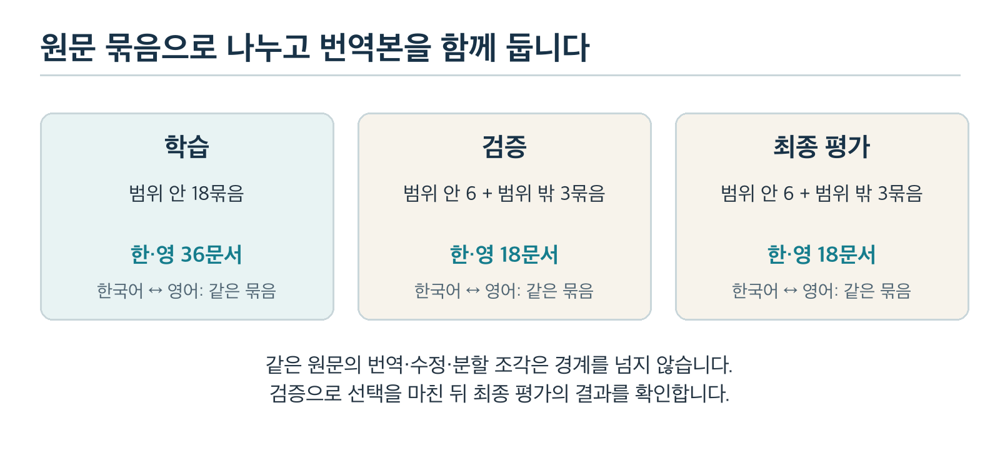
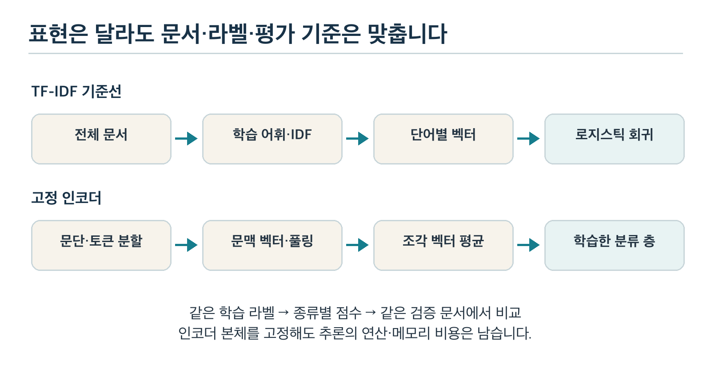
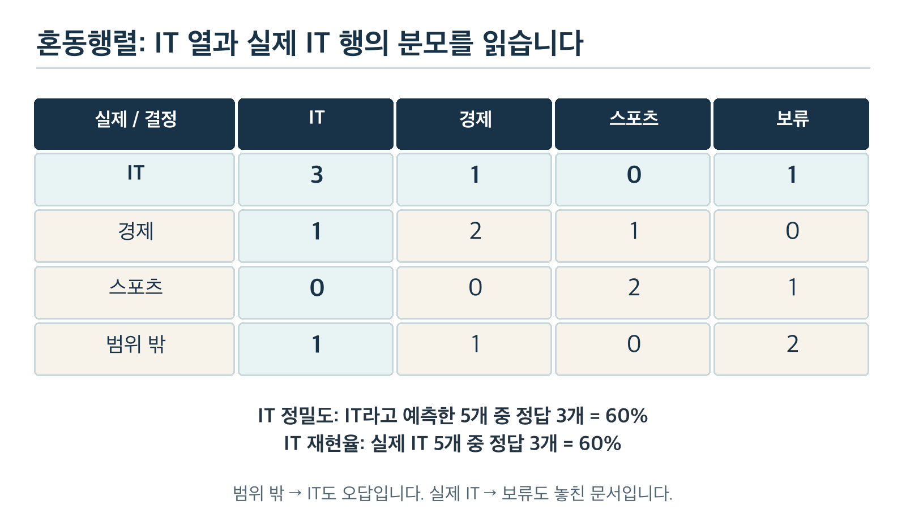
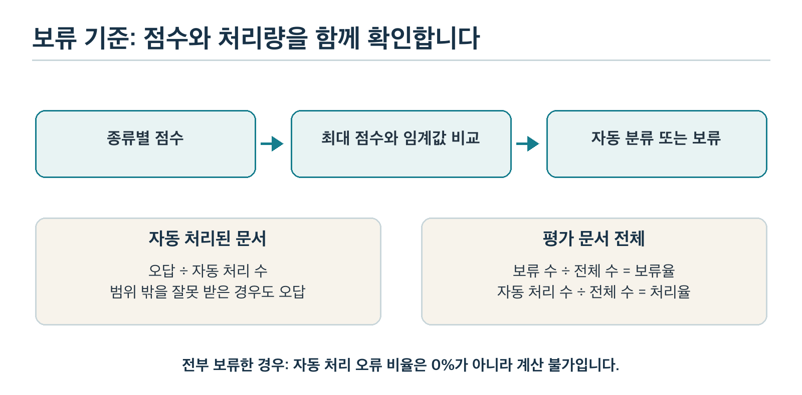

# 과목 6 문서 분류 모델 설계와 평가

‘반도체 회사가 채권을 발행했다’는 글을 IT로 분류해야 할까요, 경제로 분류해야 할까요? 반도체라는 단어만 보면 IT를 고르기 쉽습니다. 그러나 글이 설명하려는 일이 자금 조달이라면 경제가 더 알맞습니다. 어떤 관점으로 문서를 나눌지 정하지 않으면 모델을 평가할 정답부터 흔들립니다.

이번 과목은 모델의 이름보다 **무엇을 정답으로 삼고 어떤 자료에서 어떤 기준으로 고를지**에 집중합니다. Chapter 3의 단어 기반 분류기와 Chapter 5의 사전학습 인코더를 같은 문서에서 비교합니다. 틀린 문서와 판단을 보류한 문서도 평가에 남깁니다.

전체 경로는 [학습 계획서](../README.md)에서 확인합니다. 선수 학습은 [Chapter 3 교재](../chapter3/기초_수학과_전통적_머신러닝.md)의 TF-IDF·로지스틱 회귀, [Chapter 4 교재](../chapter4/딥러닝_기초와_PyTorch.md)의 학습 한 바퀴, [Chapter 5 교재](../chapter5/자연어_처리와_사전학습_모델_이해.md)의 토큰·문맥 표현·분류 층입니다. 각 용어의 현재 필요한 뜻은 이 교재에서도 짚습니다.

## 1. 이 과목을 마치면 할 수 있는 일

1. IT·경제·스포츠의 포함·제외 예시와 경계 사례 처리 규칙을 작성합니다.
2. 같은 원문의 번역·수정·분할 문서가 자료 분리 경계를 넘는 오류를 찾습니다.
3. 두 분류기의 입력·학습할 숫자·출력을 비교하고 같은 자료에서 실행합니다.
4. 보류와 범위 밖 문서를 포함한 혼동행렬에서 정밀도·재현율·F1을 계산합니다.
5. 전체 점수와 종류·언어·길이별 결과를 구분하고 원문에서 실패 이유를 찾습니다.
6. 검증 자료로 모델과 보류 기준을 고른 뒤 최종 평가에서 조건을 유지합니다.
7. 모델을 선택한 이유와 남은 한계를 기록하고 POC A의 진입 조건을 점검합니다.

**학습 순서:** 2~3절에서 정답과 자료를 설계합니다. 4절에서 두 모델의 처리 흐름을 비교합니다. 5~7절에서 평가·긴 문서·보류를 배웁니다. 8절에서 실제 실습 결과를 읽고 9~10절에서 이해와 다음 단계 진입을 점검합니다.

## 2. 모델보다 먼저 정답의 뜻을 정합니다

### 2.1 카테고리와 라벨은 어떤 관계인가요?

서류를 세 서랍에 넣는 상황을 생각해 보세요. 서랍의 이름만 IT·경제·스포츠라고 적으면 경계에 걸친 글을 어디에 넣을지 헷갈립니다. 각 서랍에 어떤 글이 들어가야 하는지도 정해야 합니다.

**카테고리(category)**는 나눌 종류입니다. **라벨(label)**은 문서에 붙인 정답 종류입니다. IT(Information Technology)는 정보 기술을 뜻합니다. 이번 과목의 **단일 라벨 분류(single-label classification)**는 문서 하나에 세 종류 중 하나만 붙이는 작업입니다. 여러 라벨을 동시에 예측하는 다중 라벨 분류와는 문제 설정이 다릅니다.

이 교재는 문서에서 **중심으로 설명하는 사건이나 목적**을 기준으로 나눕니다. 한 단어의 등장이나 문서에 나온 회사 이름만으로 결정하지 않습니다.

| 카테고리 | 포함할 중심 내용 | 제외하거나 다른 종류로 볼 내용 |
| --- | --- | --- |
| IT | 소프트웨어·기기의 구조, 기능, 동작과 기술적 개선 | 기술 회사의 이자 비용·자금 조달이 중심이면 경제 |
| 경제 | 가격·금리·매출·투자·자금 조달 등 경제 활동 | 기기의 작동 원리나 경기의 승패 자체 |
| 스포츠 | 경기·기록·전술·선수의 경기 수행 | 구단의 재무 실적이 중심이면 경제 |

### 2.2 두 종류가 섞였을 때의 처리 순서

‘스포츠 분석 앱을 쓰는 양궁팀이 대회에서 우승했다’는 문장을 보세요. 앱이 등장해도 중심 사건은 대회 우승입니다. 선수의 자세와 마지막 화살의 점수를 설명한다면 스포츠로 붙입니다. 앱의 계산 구조와 처리 속도를 설명하는 글이라면 IT를 검토합니다.

라벨을 붙이는 **주석 작업(annotation)**은 사람이 자료의 정답과 근거를 기록하는 일입니다. 다음 순서로 판단을 남깁니다.

1. 문서에서 중심 사건을 한 문장으로 적습니다.
2. 2.1절 표의 포함·제외 규칙과 대조합니다.
3. 제목만 보지 말고 본문에서 근거 문장을 표시합니다.
4. 두 종류를 같은 비중으로 다루고 우선할 목적이 없으면 판단을 보류합니다.
5. 다른 사람이 같은 규칙으로 검토하고 합의한 근거를 남깁니다.

여기서 사람의 보류는 **정답 라벨을 아직 확정하지 못했다는 상태**입니다. 7절에서 배울 모델의 보류는 **학습한 모델의 예측을 자동 처리하지 않겠다는 결정**입니다. 두 상태를 같은 정답 종류로 합치지 않습니다.

### 2.3 범위 밖 문서와 애매한 문서는 다릅니다

요리 조리 순서처럼 세 종류에 해당하지 않는 글은 **범위 밖(out-of-distribution, 여기서는 정한 세 종류 바깥의 입력)**으로 표시합니다. IT·경제가 섞여 정답을 합의하지 못한 글과는 이유가 다릅니다. 이 교재의 범위 밖 예시는 주제 범위만 연습하며 실제 입력 분포의 모든 차이를 대표하지 않습니다.

#### 직접 해보기: 먼저 사람의 규칙을 적용합니다

다음 글의 라벨과 근거를 적으세요. 정답을 확정하기 어려우면 필요한 추가 규칙을 씁니다.

- 반도체 회사가 공장 투자금 마련을 위해 채권을 발행했다. 글은 이자 비용과 상환 계획을 설명한다.
- 축구단이 이번 분기의 입장권 수입과 운영 비용을 발표했다. 경기 결과는 한 줄만 언급한다.
- 한 문서는 앱의 새 기능과 개발사의 자금 조달을 같은 분량으로 설명한다. 어느 내용을 우선할지 정하지 않았다.

#### 결과와 해석

첫째와 둘째는 경제입니다. 회사·구단의 종류보다 자금과 수입·비용이라는 중심 내용을 따릅니다. 셋째는 사람이 라벨을 보류하고 규칙을 보완할 사례입니다. 이런 문서를 임의로 학습 정답에 넣으면 같은 내용에 상반된 정답을 가르칠 수 있습니다.

라벨 규칙을 바꿨다면 바뀐 날짜와 이유를 남깁니다. 해당 규칙을 적용한 자료 전체도 다시 확인해야 합니다. 기존 점수와 새 점수는 정답의 정의가 같을 때 비교할 수 있습니다.

## 3. 자료를 나누는 일이 평가를 결정합니다

### 3.1 학습·검증·최종 평가의 역할

같은 시험 문제의 한국어판으로 연습하고 영어판으로 시험을 보면 완전히 새로운 문제를 풀었다고 볼 수 있을까요? 글자는 달라도 사건과 정답의 근거는 같을 수 있습니다. 문서 수만 세면 이 겹침을 놓칩니다.

| 자료 | 사용하는 목적 | 바꾸면 안 되는 경계 |
| --- | --- | --- |
| 학습(train) | 어휘·IDF와 분류기의 가중치를 구함 | 검증·최종 평가의 정답과 본문으로 가중치나 어휘를 학습하지 않음 |
| 검증(validation) | 모델·입력 처리·보류 기준을 비교하고 선택 | 최종 평가 점수를 보고 선택을 바꾸지 않음 |
| 최종 평가(final test) | 선택을 마친 처리 흐름을 별도 문서에서 확인 | 결과를 다음 조정의 정답처럼 반복 사용하지 않음 |

**데이터 누출(data leakage)**은 실제 예측 때 알 수 없는 정보나 평가 자료의 정보가 학습·선택에 들어가는 일입니다. 누출이 생기면 평가 점수를 믿기 어려워집니다.

예를 들어 TF-IDF는 단어를 숫자로 나타낼 때 여러 문서에서 그 단어가 얼마나 흔한지도 반영합니다. 이 흔한 정도를 반영하는 값이 IDF이며 4.1절에서 뜻과 계산 흐름을 연결합니다. 자료 전체에서 어휘와 IDF를 구하면 최종 평가 문서의 단어 분포도 미리 반영합니다. 정답 라벨만 숨겼다고 누출이 모두 사라지지는 않습니다.

### 3.2 문서가 아니라 원문 묶음을 나눕니다

**원문 묶음(group)**은 같은 사건의 원문·번역본·수정본·분할 조각을 연결하는 단위입니다. 먼저 묶음을 한 분할에 배정한 뒤 그 안에서 언어와 조각을 만듭니다. 같은 문서의 조각을 무작위로 나눠 학습과 평가에 넣지 않습니다.



*그림 1. 번역·분할보다 원문 묶음의 경계를 먼저 지킵니다. 범위 밖 검증 문서와 최종 평가 문서도 다른 묶음입니다.*

자동 검사는 문서의 식별 번호인 ID의 중복, 완전히 같은 본문, 묶음의 분할·라벨 일치를 확인합니다. 표현만 바꾼 복제나 사실상 같은 사건은 사람이 원문을 대조해야 합니다. 파일명이 다르다는 이유만으로 독립된 자료가 되지는 않습니다.

### 3.3 이번 실습의 자료와 의도적인 한계

[실습 데이터](examples/documents.json)는 사람이 직접 구성한 교육용 한·영 문서 72개입니다. IT·경제·스포츠를 범위 안으로 두고 조리 안내·전시 안내 등은 범위 밖으로 둡니다. 각 원문 묶음에는 같은 내용을 담은 한국어·영어 문서가 한 개씩 있습니다.

| 분할 | 범위 안 원문 묶음 | 범위 밖 원문 묶음 | 문서 수 |
| --- | --- | --- | --- |
| 학습 | 18개: 종류마다 6개 | 0개 | 36개 |
| 검증 | 6개: 종류마다 2개 | 3개 | 18개 |
| 최종 평가 | 6개: 종류마다 2개 | 3개 | 18개 |

학습 문서는 종류마다 12개입니다. 검증·최종 평가에는 종류마다 4개와 범위 밖 6개가 있습니다. 세 분할 모두 한국어와 영어의 수가 같습니다. 번역 문서 두 개는 서로 관련되므로 독립된 사례가 두 개 늘어난 것으로 해석하지 않습니다.

긴 문서는 **공통 안내문 앞부분에 실제 사건 문단을 덧붙인 인공 입력**입니다. 앞부분만 읽으면 핵심 사건을 놓치는 상황을 의도적으로 만듭니다. 실제 사건을 뒤에 두는 구성과 공통 문장이 반복되는 특징은 실제 문서 전체를 대표하지 않습니다. 서로 다른 묶음에도 이 공통 안내문은 있습니다. 분류 정답을 직접 알려 주지는 않지만 문체·형식이 단순해 실험 결과가 좋아 보일 수 있습니다.

각 종류의 학습 묶음 6개는 짧은 글 3개와 긴 글 3개입니다. 검증·최종 평가의 종류별 묶음 2개는 짧은 글과 긴 글이 한 개씩입니다. 길이의 기준은 6.1절에서 토큰 수로 정합니다. 범위 밖 문서도 각 평가 분할에 짧은 묶음 2개와 긴 묶음 1개를 둡니다.

#### 직접 해보기: 문서 수와 묶음 수를 구분합니다

검증 문서 18개에서 한국어와 영어를 따로 세어 보세요. 원문 묶음은 몇 개일까요? 한국어판이 학습으로 이동하면 영어판의 검증 점수를 계속 믿어도 될까요?

#### 결과와 해석

한국어 9개와 영어 9개이며 원문 묶음은 9개입니다. 번역본을 학습으로 옮기면 같은 사건이 경계를 넘습니다. 자료가 작고 서로 관련되어 있으므로 한두 건의 변화가 점수를 크게 바꿉니다. 8절의 관측값은 평가 절차를 연습하는 결과이며 일반적인 다국어 성능의 근거가 아닙니다.

## 4. 같은 문서에서 두 모델을 설계합니다

### 4.1 단어 기반 기준선부터 만듭니다

복잡한 모델이 필요했는지 알려면 비교할 첫 방법이 있어야 합니다. **기준선(baseline)**은 새 방법의 개선과 비용을 판단할 때 비교하는 단순한 방법입니다. 이 과목에서는 Chapter 3에서 배운 TF-IDF와 로지스틱 회귀를 사용합니다.

**TF-IDF(Term Frequency-Inverse Document Frequency)**는 문서의 단어별 값을 만드는 방식입니다. 문서 안의 단어 빈도와 여러 문서에서 흔한 정도를 함께 고려합니다. **로지스틱 회귀(logistic regression)** 분류기는 이 값에 종류별 가중치를 곱해 더하고 편향을 더합니다. 종류별 점수를 확률 형태의 값으로 바꾼 뒤 가장 큰 종류를 고릅니다.

1. 학습 문서 36개에서만 어휘 목록과 IDF를 구합니다.
2. 같은 학습 문서의 라벨로 종류별 가중치와 편향을 학습합니다.
3. 검증 문서를 이미 정한 어휘·IDF로 변환합니다.
4. 종류별 점수와 예측을 기록합니다. 새 단어 때문에 어휘를 다시 만들지 않습니다.

기본 `TfidfVectorizer()`는 띄어쓰기와 정규식으로 단어를 찾습니다. 한국어 조사·어미를 같은 단어로 묶어 주는 형태 분석기는 아닙니다. 단어 순서도 보존하지 않습니다. 이번 실행의 학습 어휘는 671개이며 그 수는 문서나 토큰 규칙을 바꾸면 달라집니다.

### 4.2 고정한 인코더 위에 분류 층을 붙입니다

Chapter 5의 **사전학습 인코더(pretrained encoder)**는 많은 자료에서 미리 구한 가중치로 토큰의 문맥 표현을 만듭니다. 본체를 **고정(freeze)**하면 이번 학습에서 본체의 가중치는 갱신하지 않습니다. 대신 문서 벡터에서 세 종류의 점수를 내는 작은 **분류 층(classification head)**을 학습합니다.

본체는 `sentence-transformers/paraphrase-multilingual-MiniLM-L12-v2`이며 Chapter 5와 같은 리비전을 사용합니다. 리비전은 같은 저장본을 다시 받을 수 있게 정하는 버전 식별값입니다. 실제 값은 실행 파일과 `training.json`에 기록합니다.

짧은 글의 계산 순서는 다음과 같습니다. 긴 글은 6.2절에서 문서 벡터를 만드는 부분만 확장합니다.

1. 글을 토큰 ID로 바꾸고 패딩 마스크를 만듭니다.
2. 고정한 본체로 토큰마다 384칸 문맥 벡터를 구합니다.
3. **마스크 평균 풀링(masked mean pooling)**으로 패딩을 제외한 벡터를 평균냅니다. 이 실습은 유효한 특수 토큰도 평균에 포함합니다.
4. `Linear(384, 3)`이 문서 벡터에서 세 종류의 점수인 **로짓(logit)**을 계산합니다.
5. 학습 때는 로짓과 정답으로 교차 엔트로피 손실을 구합니다. 손실을 줄이는 방향으로 분류 층만 갱신합니다.
6. 추론 때는 **소프트맥스(softmax)**로 로짓을 합이 1인 값으로 바꿉니다. 가장 큰 값의 종류를 예측합니다.

**교차 엔트로피(cross entropy)**는 정답 종류에 작은 값을 주었을수록 크게 벌점을 주는 손실입니다. 자세한 기울기와 가중치 갱신은 Chapter 4에서 배웠습니다. 소프트맥스 값을 교차 엔트로피 함수에 다시 넣지 않고 로짓을 바로 넣습니다.

### 4.3 무엇을 같게 두어야 공정할까요?



*그림 2. 두 모델은 표현 방식이 다릅니다. 문서 ID·라벨·분할·평가 규칙을 맞춰 전체 처리 흐름을 비교합니다.*

| 비교 항목 | TF-IDF 기준선 | 고정 인코더와 분류 층 |
| --- | --- | --- |
| 학습할 부분 | 학습 어휘·IDF, 분류 가중치·편향 | 본체는 고정, 분류 층 1,155개 숫자만 갱신 |
| 문서 표현 | 단어별 값 | 문맥 벡터 384칸 |
| 긴 문서 입력 | 전체 본문을 단어 값으로 변환 | 한도 안의 조각 표현을 문서 벡터로 합침 |
| 주요 한계 | 표현이 달라진 단어와 문맥에 약할 수 있음 | 본체의 비용과 조각 사이 문맥 단절이 남음 |

인코더 본체에는 117,653,760개 파라미터가 있습니다. 분류 층은 `384×3 + 3 = 1,155`개입니다. 작은 층만 학습해도 본체의 저장 공간·추론 연산·실행 메모리는 필요합니다. 이 숫자는 휴대폰의 속도나 메모리 사용량 측정값이 아닙니다.

두 방식의 입력 표현을 억지로 같게 만들지는 않습니다. 같은 문서를 처리하는 두 설계를 비교하고 차이가 생긴 단계를 기록합니다. 처리 규칙을 여러 개 바꾼 결과라면 성능 차이를 모델 구조 하나의 효과라고 단정하지 않습니다.

## 5. 전체 점수보다 먼저 틀린 위치를 읽습니다

### 5.1 정확도만 보면 무엇을 놓칠까요?

문서 100개 중 IT가 90개, 경제와 스포츠가 5개씩 있다고 해 보세요. 전부 IT라고 답해도 **정확도(accuracy)**는 90%입니다. 그러나 경제·스포츠를 한 개도 찾지 못합니다. 이 예시는 실제 모델 결과가 아니라 자료 불균형의 영향을 보기 위해 만든 수치입니다.

정확도는 맞힌 수를 평가 문서 수로 나눈 비율입니다. 이번 교재에서 범위 밖 문서가 함께 있으면 `known_accuracy`는 **범위 안 문서만 분모로** 삼습니다. 범위 안 문서를 보류하면 맞힌 수에 넣지 않습니다. 범위 밖 보류도 정답 분류 한 건으로 더하지 않습니다.

### 5.2 혼동행렬의 행과 열

**혼동행렬(confusion matrix)**은 실제 종류와 모델의 결정을 교차해 센 표입니다. 행은 실제 종류, 열은 예측 결과로 고정합니다. 보류는 실제 주제가 아니라 처리 결정이므로 예측 열에 둡니다. 범위 밖은 실제 입력 상태이므로 행에 둡니다.

다음은 계산을 연습하도록 사람이 만든 문서 16개의 결과입니다. 8절에서 실행할 실제 모델 점수와 구분하세요.

| 실제 종류 / 결정 | IT | 경제 | 스포츠 | 보류 |
| --- | --- | --- | --- | --- |
| IT | 3 | 1 | 0 | 1 |
| 경제 | 1 | 2 | 1 | 0 |
| 스포츠 | 0 | 0 | 2 | 1 |
| 범위 밖 | 1 | 1 | 0 | 2 |



*그림 3. IT 정밀도는 IT 열을 읽고 IT 재현율은 실제 IT 행을 읽습니다. 범위 밖 오분류와 실제 IT의 보류를 지우지 않습니다.*

### 5.3 정밀도·재현율·F1을 손으로 계산합니다

IT 서랍에 잘못 넣은 글이 많은지 알고 싶다면 어느 쪽을 세어야 할까요? IT라고 예측한 열을 읽습니다. 실제 IT를 얼마나 놓쳤는지 알고 싶다면 실제 IT 행을 읽습니다.

- **정밀도(precision):** IT로 자동 분류한 문서 중 실제 IT의 비율입니다. IT 열은 `3 + 1 + 0 + 1 = 5`개입니다. 따라서 `3/5 = 60%`입니다.
- **재현율(recall):** 실제 IT 중 IT로 맞힌 비율입니다. IT 행은 보류 1개까지 합쳐 5개입니다. 따라서 `3/5 = 60%`입니다.
- **F1:** 정밀도와 재현율의 조화평균입니다. 두 비율 중 하나가 낮으면 크게 떨어집니다. 두 값이 모두 60%이면 F1도 60%입니다.

계산에서 **참양성(TP, true positive)**은 해당 종류를 맞힌 수입니다. **거짓양성(FP, false positive)**은 다른 종류나 범위 밖 문서를 해당 종류라고 잘못 붙인 수입니다. **거짓음성(FN, false negative)**은 실제 해당 종류인데 다른 종류로 보내거나 보류한 수입니다.

F1은 `2×TP ÷ (2×TP + FP + FN)`으로도 구합니다. IT에서는 TP 3개, FP 2개, FN 2개이므로 `6/10 = 60%`입니다. 이 짧은 식은 두 오류를 모두 반영한다는 뜻을 보여 줍니다.

#### 직접 해보기: 두 분모를 지켜 보세요

5.2절 표에서 경제와 스포츠의 정밀도·재현율·F1을 계산하세요. 실제 IT의 보류 1개를 표에서 지우면 IT 재현율은 얼마로 보일까요?

#### 결과와 해석

경제는 열과 행이 각각 4개이고 맞힌 수가 2개라 세 값이 모두 50%입니다. 스포츠는 열과 행이 각각 3개이고 맞힌 수가 2개라 세 값이 모두 약 66.7%입니다. IT의 보류를 지우면 `3/4 = 75%`로 부풀어 보입니다. 평가에서 어려운 사례를 제거해 점수를 높인 셈입니다.

### 5.4 종류별 평균도 서로 다릅니다

**매크로 평균(macro average)**은 종류마다 같은 비중을 주는 평균입니다. 이 교재의 macro F1은 IT·경제·스포츠의 F1을 각각 구한 뒤 세 개를 평균냅니다. 범위 밖과 보류를 네 번째·다섯 번째 종류로 평균에 넣지 않습니다. 다만 범위 밖 오분류는 세 종류의 FP에 이미 반영됩니다.

5.2절 표의 macro F1은 `(0.6 + 0.5 + 0.6667)/3`으로 약 58.9%입니다. **가중 평균(weighted average)**은 실제 종류별 문서 수인 **지원 수(support)**를 가중치로 씁니다. 이 표의 weighted F1은 `(0.6×5 + 0.5×4 + 0.6667×3)/12`로 약 58.3%입니다.

5.1절의 전부 IT라고 답하는 예시에서는 IT F1이 약 94.7%이고 나머지는 0입니다. macro F1은 약 31.6%, weighted F1은 약 85.3%입니다. 흔한 종류가 많으면 가중 평균도 높아질 수 있습니다. 어느 평균이든 종류별 표를 대신하지는 못합니다.

### 5.5 분모가 0이면 0점과 계산 불가를 구분합니다

한 종류로 예측한 문서가 없으면 그 종류의 정밀도 분모는 0입니다. 실제 해당 종류가 없으면 재현율 분모도 0입니다. 작은 언어·길이별 표에서는 이런 일이 쉽게 생깁니다.

실행 파일은 종류별 집계를 일정하게 맞추기 위해 `zero_division=0`에 해당하는 계산 규칙을 씁니다. 값 0과 함께 `precision_undefined`, `recall_undefined`를 표시합니다. 실제 종류가 없는 표의 0을 그 종류에서 실패했다고 해석하지 않습니다. 세 종류를 고정해 계산한 macro F1에도 이 규칙이 적용되므로 지원 수를 함께 읽어야 합니다.

자동 처리 문서가 아예 없는 경우는 따로 다룹니다. 자동 분류 오분류율은 0% 대신 `null`, 즉 계산할 수 없다는 값으로 기록합니다. 7.3절에서 이 차이를 다시 확인합니다.

## 6. 긴 문서와 세부 오류를 살핍니다

### 6.1 길이는 어떤 기준으로 나눌까요?

한글 100자와 영어 100자가 같은 수의 토큰으로 바뀌지는 않습니다. **토큰(token)**은 모델이 처리하는 조각이며 **토크나이저(tokenizer)**는 글을 조각과 ID로 바꾸는 도구입니다. 글자 수와 모델 입력 길이를 구분해야 잘린 이유를 설명할 수 있습니다.

이 실습은 고정한 인코더 토크나이저로 원문 전체의 토큰 수를 셉니다. 특수 토큰 2개를 포함해 128개 이하면 `short`, 넘으면 `long`입니다. 기본 조각은 특수 토큰을 빼고 본문 토큰 최대 126개입니다. 이 기준은 비교하는 두 모델의 결과에 동일하게 붙이는 길이 표식입니다.

검증의 짧은 글은 10개, 긴 글은 8개입니다. 각 길이 표에는 범위 밖 문서도 들어 있습니다. 범위 안의 검증 문서는 짧은 글과 긴 글이 각각 6개입니다. `documents`와 종류별 `support`가 가리키는 범위를 구별하세요.

### 6.2 문단을 먼저 살피고 조각 벡터를 합칩니다

실제 사건이 마지막 문단에 있는데 처음 128개 토큰만 넣으면 어떤 일이 생길까요? 모델은 공통 안내만 읽습니다. 중요한 문단을 사람이 읽었다고 해서 그 정보가 모델에도 전달된 것은 아닙니다.

실행 파일은 다음 규칙으로 긴 글을 처리합니다.

1. 원문 전체를 토큰 ID와 원문 글자 위치로 바꿉니다.
2. 본문 토큰 한도 126개 안에서 가장 뒤의 문단 경계를 우선합니다.
3. 한 문단 자체가 한도를 넘으면 토큰 한도에서 나눕니다. 조각은 겹치지 않습니다.
4. 각 조각에 특수 토큰을 붙이고 고정 인코더의 마스크 평균 풀링으로 384칸 벡터를 만듭니다.
5. 조각 벡터를 같은 비중으로 평균해 문서 벡터 하나를 만듭니다.
6. 문서 벡터 하나와 문서 라벨 하나로 분류 층을 학습합니다.

조각마다 전체 문서의 라벨을 무조건 복제해 학습하지 않습니다. 긴 글의 공통 안내 문단만 보고도 IT라고 답하라고 가르치면 잘못된 단서를 줄 수 있기 때문입니다. 문서 라벨은 문서 벡터와 연결합니다.

같은 비중의 평균은 조각 길이와 중요도를 구분하지 않습니다. 짧은 핵심 문단이 안내문 사이에서 희석될 수 있습니다. 실제 사건이 뒤에 있는 이유뿐 아니라 평균에 얼마나 반영되는지도 확인해야 합니다. 분할한 뒤의 인코더는 다른 조각의 토큰을 함께 참조하지 못하므로 전체 문맥이 복원되지는 않습니다.

### 6.3 벡터 평균과 확률 평균은 같지 않습니다

분류 층을 고정하면 조각 벡터의 평균에서 얻은 로짓은 조각 로짓의 평균과 같습니다. 가중치 곱과 덧셈이 선형 계산이기 때문입니다. 그러나 소프트맥스를 평균 전과 후에 적용한 결과는 일반적으로 다릅니다.

| 비교 방식 | 합치는 위치 | 확인할 점 |
| --- | --- | --- |
| 기본 방식 | 조각 벡터 평균 → 분류 층 → 소프트맥스 | 문서 단위로 학습한 흐름을 유지 |
| 확률 평균 대조 | 조각별 분류 층 → 소프트맥스 → 평균 | 같은 예측 라벨이어도 보류에 쓰는 점수는 달라질 수 있음 |
| 앞부분 대조 | 첫 본문 토큰 126개만 → 분류 층 | 원문 뒤쪽 근거가 빠짐 |

대조 실험에서는 분류 층의 가중치를 다시 학습하지 않습니다. 입력 처리와 합치는 위치만 바꿉니다. 앞부분만 쓰는 대조는 기본 학습과 입력 표현이 달라지는 실험이기도 합니다. 결과 차이를 잘림 하나의 효과로 일반화하지 않습니다.

검증의 `IT-08-en`은 전체 216개 토큰이며 문단 경계를 따라 조각 3개가 됩니다. 한국어판은 205개 토큰이며 조각 2개입니다. 같은 사건이라도 문단별 토큰 수가 달라 조각 비중이 달라집니다. `source_ranges`는 원문 문자열의 시작 위치와 끝 다음 위치를 기록합니다. 그 구간을 읽어 실제 사건이 들어 있는지 확인하세요.

### 6.4 오류는 관측과 원인 추정을 나눠 기록합니다

예측이 틀렸다고 곧바로 ‘학습 자료가 부족해서’라고 적으면 어디를 바꿔야 할지 알기 어렵습니다. 다음 표처럼 확인한 사실과 검증할 가설을 구분합니다.

| 확인한 현상 | 원문과 중간 결과에서 확인할 것 | 다음 검증의 예 |
| --- | --- | --- |
| 반도체 회사의 채권 글을 IT로 예측 | 경제 라벨 규칙, 기술 단어의 영향, 조각별 점수 | 비슷한 경계 사례를 새 검증 자료로 대조 |
| 영어는 맞고 한국어는 틀림 | 번역 의미 일치, 토큰·조각 수, 종류별 학습 예시 | 같은 뜻의 다른 표현을 추가해 관찰 |
| 앞부분 입력에서 긴 글이 같은 종류로 몰림 | 첫 입력이 공통 안내문인지, 실제 사건의 위치 | 전체 조각 처리와 비교 |
| 범위 밖 글에 높은 점수 | 정한 세 종류 중 상대 점수만 높았는지 | 별도의 범위 밖 검증 문서를 늘려 확인 |

이 표의 다음 검증은 원인을 확정하는 답이 아닙니다. 한 번에 한 조건을 바꾸고 검증 자료에서 비교할 계획입니다. 최종 평가 문서의 정답을 학습에 넣어 같은 점수의 개선으로 보고하지 않습니다.

## 7. 판단을 보류하는 기준을 정합니다

### 7.1 점수 0.8은 정답 확률 80%를 보장할까요?

분류기는 세 종류 중 가장 큰 점수를 고를 수밖에 없습니다. 요리 안내를 넣어도 경제가 다른 두 종류보다 높게 나올 수 있습니다. 세 종류의 합이 1이라는 사실은 범위 밖을 알아본다는 뜻이 아닙니다.

**확률 보정(calibration)**은 확률 형태의 점수와 실제 맞는 비율이 잘 대응하는 성질입니다. 비슷한 점수를 준 충분한 사례를 모아 실제 정답 비율과 대조해야 확인할 수 있습니다. 점수 하나가 높다는 이유로 그 대응이 검증되지는 않습니다.

이번 실습은 보정을 학습하지 않습니다. 가장 큰 점수를 보류 판단의 간단한 단서로 사용합니다. **임계값(threshold)**은 이 단서가 어느 수준을 넘어야 자동 분류할지 정하는 경계값입니다. 모델마다 점수 분포가 다르므로 같은 임계값을 그대로 옮겨 쓰지 않습니다.

### 7.2 임계값과 처리량을 함께 봅니다

규칙은 ‘가장 큰 점수가 임계값 이상이면 해당 종류로 자동 분류하고 작으면 보류’입니다. 점수가 임계값과 같으면 자동 처리합니다. 종류별 점수가 같으면 코드의 순서인 IT·경제·스포츠 중 앞선 종류를 고릅니다. 이것은 동률 처리 규칙이며 앞선 종류가 더 옳다는 뜻은 아닙니다.



*그림 4. 보류를 늘리면 자동 처리 문서도 줄어듭니다. 자동 처리된 문서의 오류와 전체 문서의 보류를 함께 봅니다.*

| 지표 | 분자와 분모 | 읽는 목적 |
| --- | --- | --- |
| 자동 분류 오분류율 | 잘못 자동 분류한 수 ÷ 자동 분류한 수 | 자동 처리 결과 중 잘못 붙인 비율 |
| 보류율 | 보류한 수 ÷ 평가 문서 전체 수 | 판단을 넘긴 양 |
| 자동 처리율(coverage) | 자동 분류한 수 ÷ 평가 문서 전체 수 | 스스로 처리한 양, `1 - 보류율` |
| 범위 밖 오수락률 | 범위 밖인데 종류를 붙인 수 ÷ 범위 밖 문서 수 | 세 종류 바깥의 문서를 얼마나 받아들였는지 |

범위 밖에 종류를 붙인 경우도 자동 분류 오분류율의 오답에 넣습니다. 5.2절의 손 계산 표는 자동 처리 12개 중 오류 5개이므로 약 41.7%입니다. 보류율은 `4/16 = 25%`, 자동 처리율은 75%입니다. 범위 밖 오수락률은 `2/4 = 50%`입니다.

### 7.3 전부 보류하면 좋은 분류기일까요?

전부 보류하면 자동 처리한 문서는 0개입니다. 따라서 자동 분류 오분류율은 `0/0`이 되어 계산할 수 없습니다. ‘오류가 없으니 100% 안전하다’고 보고하지 않습니다. 범위 안 정확도는 0이고 보류율은 100%입니다.

임계값이 높아지면 자동 처리 건수는 줄거나 같습니다. 그러나 남은 자동 처리 문서의 **오분류 비율은 반드시 줄지는 않습니다**. 높은 점수의 오답이 남고 낮은 점수의 정답이 빠질 수 있기 때문입니다. 이 현상은 8.4절의 실제 검증 결과에서도 확인합니다.

### 7.4 검증에서 선택하고 최종 평가에서 유지합니다

실습의 교육용 선택 조건은 **자동 분류 오분류율 10% 이하, 자동 처리율 50% 이상**입니다. 실제 서비스의 허용 오류나 목표가 아닙니다. 작은 자료에서 조건을 만족해도 앞으로 발생할 오류가 10% 이하라고 보장할 수 없습니다.

선택 절차를 결과를 보기 전에 정합니다.

1. 두 모델 각각에서 임계값 0.00부터 1.00까지 0.05 간격으로 비교합니다.
2. 검증의 범위 안 12개와 범위 밖 6개를 함께 평가합니다.
3. 자동 처리 0개인 후보를 제외하고 교육용 두 조건을 모두 만족하는 후보만 남깁니다.
4. 자동 처리율이 높은 후보를 고릅니다. 같으면 macro F1이 높은 후보를 고릅니다.
5. 여전히 같으면 TF-IDF 기준선을 고릅니다. 같은 모델 안에서는 낮은 임계값을 고릅니다.
6. 후보가 없으면 `requirements_not_met`, 즉 목표 미달로 남깁니다. 점수가 가장 높은 후보를 통과했다고 바꾸지 않습니다.

선택한 모델과 임계값, 자료·모델의 식별값을 저장합니다. **해시(hash)**는 파일 내용이 같은지 확인할 식별값입니다. 자료나 모델 파일이 선택 후 달라지면 실습은 최종 평가를 중단합니다. 파일의 내용이 같다는 확인이며 성능을 보장하는 장치는 아닙니다.

#### 심화 디딤돌: 더 믿을 수 있는 보류로 가려면

확률 보정, 범위 밖 탐지, 오류 비용을 반영한 의사결정, 원문 묶음 단위의 재표집을 통한 불확실성 평가를 더 공부할 수 있습니다. 재표집은 자료를 묶음째 다시 뽑아 점수가 얼마나 흔들리는지 살피는 방법입니다. 보정이나 선택에 쓴 자료와 최종 평가 자료의 역할을 계속 구분해야 합니다. 이 교재의 작은 자료로 안정적인 오차 범위를 추정했다고 주장하지 않습니다.

## 8. 단원 실습: 비교부터 선택과 최종 평가까지

### 8.1 실행 환경과 자료 준비

[실행 파일](examples/run_classification.py)은 `toy`, `train`, `select`, `evaluate-final`의 네 단계를 제공합니다. 명령은 저장소 루트에서 차례로 실행합니다. Python 3.12 환경을 권장하며 실제 관측 환경은 8.3절에 기록했습니다.

```sh
python3 study/chapter6/examples/run_classification.py toy
python3.12 -m venv _workspace/chapter6/venv
_workspace/chapter6/venv/bin/python -m pip install -r \
    study/chapter6/requirements.txt
```

Python 3.12가 다른 실행 이름으로 설치돼 있다면 그 실행 파일로 가상 환경을 만듭니다. **가상 환경(virtual environment)**은 이 실습에서 쓸 Python 패키지를 모아 두는 별도 공간입니다. `toy`는 표준 라이브러리만 사용하며 모델 다운로드가 없습니다.

처음 모델을 받을 때는 인터넷이 필요합니다. 인코더 본체의 32비트 가중치만 계산하면 약 471MB이며 토크나이저·패키지·실행 메모리는 별도입니다. 모델 캐시의 실제 크기는 파일 형식과 받은 파일에 따라 달라집니다. 모델 파일과 실행 결과는 Git에 추가하지 않습니다.

Chapter 5에서 받은 인코더가 있으면 기본 캐시인 `_workspace/chapter5/cache/`를 재사용합니다. 다른 위치를 쓰려면 `--cache-dir`을 지정합니다. 다운로드한 뒤에는 `--offline`으로 로컬 파일만 읽습니다. 모델을 처음 받을 때는 이 옵션을 빼세요.

### 8.2 손 계산부터 확인합니다

첫 명령의 `toy_report.json`은 5.2절의 표와 7.2절의 지표를 담습니다. 기본 출력 위치는 `_workspace/chapter6/run/`입니다. `--output-dir`로 별도 위치를 지정할 수 있습니다.

1. `metrics.matrix`가 5.2절의 16개 문서 표와 같은지 확인합니다.
2. IT 정밀도·재현율이 각각 0.6인지 확인합니다.
3. 자동 처리 오류가 5개, 자동 처리가 12개인지 확인합니다.
4. `all_held.automatic_error_rate`가 0이 아니라 `null`인지 확인합니다.

#### 직접 해보기: 입력 하나를 바꿉니다

5.2절 표에서 범위 밖 → IT 한 건이 범위 밖 → 보류로 바뀐 경우를 종이에 계산하세요. IT 재현율도 바뀔까요? 먼저 답한 뒤 9.2절의 5번 해설과 대조합니다.

평가 계산의 회귀 검사는 [검사 파일](examples/test_evaluation.py)에 있습니다. **회귀 검사(regression test)**는 계산이나 규칙을 바꾼 뒤 기존에 맞던 결과가 깨지지 않았는지 확인하는 검사입니다.

```sh
_workspace/chapter6/venv/bin/python -m unittest discover \
    -s study/chapter6/examples -p 'test_*.py'
```

### 8.3 두 모델을 학습하고 검증 예측을 만듭니다

```sh
_workspace/chapter6/venv/bin/python \
    study/chapter6/examples/run_classification.py train --offline
```

학습은 시드 7, CPU 한 스레드 조건으로 진행합니다. 전체 학습 문서 36개를 한 배치로 묶어 SGD를 80회 수행합니다. 학습률은 0.1입니다.

**시드(seed)**는 무작위 초기값의 출발을 고정하는 숫자입니다. **CPU**는 범용 계산을 수행하는 처리 장치이며 **스레드(thread)**는 프로그램의 실행 흐름입니다.

**배치(batch)**는 가중치를 한 번 갱신할 때 묶어 계산하는 자료입니다. **SGD(Stochastic Gradient Descent, 확률적 경사 하강법)**는 기울기로 가중치를 갱신하는 최적화 방법이며 여기서는 전체 배치를 사용합니다. 학습률은 갱신할 보폭을 조절합니다. 고정 인코더는 평가 모드로 실행하고 기울기 계산도 끕니다.

실제 관측 환경은 Python 3.12.12, PyTorch 2.14.1, Transformers 4.57.6, scikit-learn 1.9.1, NumPy 2.5.4였습니다. 같은 환경에서 재실행한 학습·검증 보고서는 같았습니다. 패키지·연산 장치가 달라지면 시드만으로 숫자까지 같다고 보장할 수는 없습니다.

| 출력 파일 | 확인할 내용 |
| --- | --- |
| `training.json` | 학습 문서 ID, 어휘 수, 라벨 순서, 고정한 모델 리비전, 설정·버전·손실 |
| `baseline.joblib`, `classifier_head.pt` | 학습한 기준선 묶음과 인코더 분류 층의 가중치 |
| `validation.json` | 같은 검증 문서의 점수와 종류·언어·길이별 지표, 입력 처리 대조 |
| `validation_predictions.csv` | 문서별 정답·예측·점수·길이를 사람이 비교할 표 |
| `reload_check.json` | 저장한 모델을 다시 읽었을 때 결과의 최대 차이 |

분류 층의 학습 손실은 첫 계산 약 1.062에서 마지막 계산 약 0.378로 줄었습니다. 이 값만으로 좋은 모델이라고 결정하지 않습니다. 저장·재로딩 후 기준선 확률과 분류 층 로짓의 최대 차이는 이 실행에서 각각 0이었습니다. 재로딩 검사는 검증 자료에서 수행하며 최종 평가 예측은 아직 계산하지 않습니다.

다음은 **보류를 적용하기 전의 검증 결과**입니다. `known_accuracy`는 범위 안 12개를 분모로 합니다. macro F1에는 범위 밖 6개의 잘못된 자동 분류도 FP로 들어갑니다.

| 모델 | 범위 안 정답 수 / 12 | macro F1 | 자동 처리 오류 수 / 18 |
| --- | --- | --- | --- |
| TF-IDF 기준선 | 10 / 12 | 66.7% | 8 / 18 |
| 고정 인코더·분류 층 | 11 / 12 | 74.5% | 7 / 18 |

인코더가 이 작은 표에서 높다고 모든 문서에서 더 낫다는 결론은 아닙니다. 기준선은 `IT-08`의 한·영 긴 문서를 스포츠로 잘못 붙였습니다. 인코더는 `ECO-08-ko`의 반도체 회사 채권 글을 IT로 붙였습니다. 원문과 라벨 규칙, 조각별 입력을 읽고 어떤 단서를 확인할지 적으세요.

인코더의 보류 전 언어별 macro F1은 한국어 약 65.6%, 영어 약 85.7%였습니다. 각 언어는 9개 문서이며 원문 묶음이 서로 대응합니다. 이 언어별 점수 차이는 이번 입력과 모델에서 확인한 결과입니다. 이 결과만으로 ‘영어가 본질적으로 더 쉽다’고 결론 내릴 수는 없습니다.

### 8.4 긴 문서 대조와 보류 선택

`validation.json`의 `encoder_controls`에는 같은 분류 층에서 앞부분만 넣은 결과와 조각별 확률 평균 결과가 있습니다. 기본 결과의 범위 안 정확도는 `11/12`였습니다. 앞부분만 넣으면 `8/12`였고 긴 범위 안 문서 6개 중 맞힌 수는 `2/6`이었습니다.

긴 글의 첫 부분이 공통 안내문이므로 같은 언어의 앞부분 예측이 여러 문서에서 같았습니다. `source_ranges`와 원문을 대조해 실제 사건이 전달됐는지 확인하세요. 문서를 반복해서 길게 만든 예시와 실제 긴 문서를 구분하듯, 이 공통 안내 실험도 실제 문서 품질 평가와 구분합니다.

조각별 확률 평균은 이 실행에서 예측 라벨이 기본 방식과 같았습니다. 그러나 `IT-08-en`의 최대 점수는 기본 약 0.465, 확률 평균 약 0.445로 달랐습니다. 임계값 0.45를 그대로 쓰면 처리 결정이 달라집니다. 합산 규칙을 바꾸면 보류 기준도 검증 자료로 다시 정해야 합니다.

```sh
_workspace/chapter6/venv/bin/python \
    study/chapter6/examples/run_classification.py select
```

`selection.json`에서 조건을 만족하는 후보와 선택 이유를 읽습니다. 이번 실행은 인코더 모델과 임계값 0.45를 선택했습니다. 다음 표는 같은 검증 문서 18개에 대한 인코더의 결과입니다.

| 임계값 | 자동 처리 수 | 자동 처리 오류 수 | 교육용 조건 충족 |
| --- | --- | --- | --- |
| 0.00 | 18 | 7 | 아니요 |
| 0.40 | 14 | 4 | 아니요 |
| 0.45 | 11 | 1 | 예 |
| 0.50 | 9 | 1 | 아니요 |
| 0.80 | 4 | 0 | 아니요 |
| 1.00 | 0 | 0 | 아니요: 오류 비율 계산 불가 |

0.45에서 자동 분류 오분류율은 `1/11 ≈ 9.1%`, 자동 처리율은 `11/18 ≈ 61.1%`입니다. 0.50에서는 오답 하나가 그대로 남고 자동 처리 수가 줄어 `1/9 ≈ 11.1%`가 됩니다. 0.80은 관측 오류가 없지만 자동 처리율이 50%보다 낮아 탈락합니다.

선택한 후보의 보류율은 `7/18 ≈ 38.9%`, macro F1은 약 86.9%입니다. 범위 안 정답은 `10/12`이며 보류 전의 `11/12`보다 줄었습니다. 보류가 모든 지표를 동시에 올리는 것은 아닙니다.

남은 오답은 범위 밖 영어 진료 안내 `OUT-01-en`을 경제로 받은 경우입니다. 모델은 이 문서에 높은 점수를 줬습니다.

#### 직접 해보기: 점수표를 원문으로 되돌립니다

`selection.json`의 선택 후보에서 경제 정밀도와 재현율을 손으로 계산하세요. `validation_predictions.csv`에서 `OUT-01-en`의 점수와 본문을 찾으세요. 어떤 추가 자료가 있어야 이 오류의 원인을 더 분명히 검증할 수 있을지 적습니다.

#### 결과와 해석

경제로 받은 4개 중 3개가 맞아 정밀도는 75%입니다. 실제 경제 4개 중 3개를 맞혀 재현율도 75%입니다. 진료 안내의 최대 점수는 약 0.653이었습니다. 높은 점수의 범위 밖 오답이 존재한다는 관측입니다. 원인을 확인하려면 표현이 다른 진료 안내와 경제 문서, 언어별 새 검증 사례를 더 모아 비교해야 합니다.

### 8.5 고정한 선택을 최종 평가에서 확인합니다

아래 명령은 `selection.json`이 있어야 실행합니다. 선택한 모델·임계값과 학습 자료·모델의 식별값을 확인한 뒤 최종 평가 예측을 처음 계산합니다.

```sh
_workspace/chapter6/venv/bin/python \
    study/chapter6/examples/run_classification.py evaluate-final --offline
```

`final_report.json`에는 두 모델의 보류 전 비교와 선택한 처리 흐름의 지표가 있습니다. `final_predictions.json`은 라벨 순서와 문서별 점수를 담고 `final_predictions.csv`는 선택한 모델에 보류 규칙을 적용한 결정도 보여 줍니다. 선택되지 않은 모델의 CSV 결정은 보류 없는 비교값입니다. 선택 자체는 검증에서 끝났으므로 이 표로 다시 고르지 않습니다.

선택한 인코더와 임계값 0.45의 최종 평가 결과는 다음과 같습니다. 표의 정확도는 보류를 오답으로 센 범위 안 정확도이며 자동 처리 오류에는 범위 밖 오분류도 포함합니다.

| 평가 구간 | 전체 문서 수 | 범위 안 정답 수 / 지원 수 | 자동 처리 오류 수 / 자동 처리 수 |
| --- | --- | --- | --- |
| 전체 | 18 | 10 / 12 | 4 / 14 |
| 한국어 | 9 | 4 / 6 | 2 / 6 |
| 영어 | 9 | 6 / 6 | 2 / 8 |
| 짧은 문서 | 10 | 6 / 6 | 4 / 10 |
| 긴 문서 | 8 | 4 / 6 | 0 / 4 |

전체 macro F1은 약 77.5%, 보류율은 `4/18 ≈ 22.2%`, 자동 처리율은 `14/18 ≈ 77.8%`였습니다. 자동 분류 오분류율은 `4/14 ≈ 28.6%`로, 검증에서 만족했던 교육용 10% 조건을 최종 평가에서는 넘었습니다. 목표 미달이라는 관측을 그대로 남깁니다. 최종 점수에 맞춰 임계값을 다시 골라 통과했다고 쓰지 않습니다.

보류 전 비교에서는 TF-IDF가 범위 안 `9/12`, 인코더가 `12/12`를 맞혔습니다. 인코더도 범위 밖까지 함께 넣으면 자동 처리 오류가 `6/18`입니다. 범위 안 정답을 모두 맞혔다는 사실만으로 범위 밖 처리까지 잘됐다고 볼 수 없습니다.

선택한 흐름에서 남은 오답 4개는 모두 짧은 범위 밖 문서였습니다. `OUT-04`의 공원 꽃 안내와 `OUT-05`의 소설 독서 모임을 한·영에서 잘못 받아들였습니다. 반면 긴 문서의 자동 처리 오류가 0개여도 실제 범위 안 긴 문서 2개를 보류했다는 점이 남습니다. ‘긴 문서는 해결했다’고 결론 내리지 않습니다.

같은 출력 경로에서 최종 평가를 반복하거나 최종 평가 후 다시 학습하려 하면 중단합니다. 이 장치는 실습 순서를 돕습니다. 별도 경로를 만들어 같은 최종 자료를 계속 보는 행동까지 막지는 못합니다. 결과를 보고 새 설계를 시작한다면 POC A에서 새 최종 평가 자료를 확보해야 합니다.

선택 조건을 만족하는 검증 후보가 없을 때도 최종 비교는 실행할 수 있습니다. 이때 선택된 처리 흐름은 `null`로 남고 목표 미달 상태를 유지합니다. 기준을 낮춰 통과했다고 기록하지 않습니다.

### 8.6 설계와 실패를 자신의 말로 남깁니다

다음 표는 직접 채우는 기록입니다. 8.3~8.5절의 관측 해설과 구분하세요.

| 내가 기록할 항목 | 내가 정한 내용 |
| --- | --- |
| IT와 경제의 경계를 정한 규칙·근거 문장 |  |
| 같은 원문 묶음을 지킨 분리 방법 |  |
| 두 모델의 학습 부분과 입력 처리 차이 |  |
| 검증에서 선택한 모델·임계값과 선택 근거 |  |
| 한·영 및 짧은·긴 문서의 실패 사례 |  |
| 범위 밖 문서와 보류가 지표에 들어간 방식 |  |
| 최종 평가에서 유지한 조건과 남은 한계 |  |

실제 분야로 옮길 때는 짧고 규칙적인 예시보다 다양한 출처·표현·시점의 문서를 모읍니다. 라벨 경계와 범위 밖 입력의 비중이 달라지면 같은 모델의 처리율과 오류도 달라집니다. 이번 교육용 10%·50%를 서비스 요구사항으로 복사하지 않습니다.

## 9. 확인 문제와 해설

### 9.1 먼저 직접 답해 보세요

1. 반도체 회사의 채권 발행 글을 경제로 붙이는 근거는 무엇인가요? ‘반도체’가 있다는 이유만으로 IT를 고르면 어떤 규칙을 어기나요?
2. 한 문서의 한국어판과 영어판을 서로 다른 분할에 넣으면 왜 새로운 문서의 성능을 과장할 수 있나요?
3. TF-IDF의 IDF를 자료 전체에서 구하면 라벨을 숨겨도 왜 문제가 될까요?
4. 5.2절 표에서 IT 정밀도·재현율·F1을 계산하세요. 보류된 IT를 분모에서 빼면 무엇이 달라지나요?
5. 같은 표의 범위 밖 → IT 한 건을 범위 밖 → 보류로 바꾸면 IT 정밀도와 재현율, 자동 분류 오분류율, 보류율은 어떻게 바뀌나요?
6. IT 90개·경제 5개·스포츠 5개를 모두 IT라고 답하면 정확도와 macro F1이 왜 크게 다른가요?
7. 실제 해당 종류가 없는 길이별 표의 재현율 0을 ‘그 종류를 하나도 못 찾았다’고 읽으면 왜 틀리나요?
8. 긴 문서의 조각마다 문서 라벨을 복제해 학습하는 방법과 문서 벡터를 만들어 학습하는 방법은 무엇이 다른가요?
9. 벡터 평균 뒤 소프트맥스와 조각별 소프트맥스 뒤 평균은 같나요? 예측 라벨이 같으면 보류 결정도 같을까요?
10. 최대 점수가 높아도 범위 밖 문서를 정답으로 분류했다고 볼 수 없는 이유는 무엇인가요?
11. 검증의 임계값 0.45·0.50·0.80 중 교육용 조건을 만족하는 것은 무엇인가요? 자동 처리 오류가 0개인 후보가 왜 탈락할 수 있나요?
12. 최종 평가를 본 뒤 임계값을 다시 골랐다면 같은 자료를 계속 최종 평가라고 부를 수 있을까요? POC A에 들어가기 전에 무엇을 남겨야 하나요?

### 9.2 답과 이유를 확인합니다

1. 중심 내용이 자금 조달·이자·상환 계획이기 때문입니다. 2.1절은 회사 이름이나 단어의 등장보다 문서가 중심으로 설명하는 사건과 목적을 따릅니다.
2. 두 문서는 글자가 달라도 사건과 정답의 근거를 공유합니다. 3.2절처럼 원문 묶음째 나눠야 합니다. 이 실습의 검증 18개도 독립된 원문은 9묶음입니다.
3. IDF는 문서들에서 단어가 얼마나 흔한지 반영합니다. 평가 본문까지 포함하면 새로운 문서의 단어 분포를 미리 표현에 반영합니다. 4.1절처럼 학습 자료에서만 구하고 나머지는 변환합니다.
4. IT로 예측한 5개 중 정답은 3개라 정밀도 60%입니다. 실제 IT 5개 중 정답이 3개라 재현율 60%, F1 60%입니다. 보류된 IT를 빼면 재현율이 75%로 부풀어 보입니다.
5. IT 예측은 4개로 줄어 정밀도는 `3/4 = 75%`가 됩니다. 실제 IT 행은 그대로라 재현율은 60%입니다. 자동 처리 11개 중 오류 4개로 약 36.4%, 보류 5개로 보류율은 `5/16 = 31.25%`입니다.
6. 정확도 90%는 흔한 IT를 맞힌 효과입니다. 경제·스포츠의 F1은 0이고 IT F1은 약 94.7%라 macro F1은 약 31.6%입니다. 종류마다 같은 비중을 준 평균이 놓친 종류를 드러냅니다.
7. 실제 해당 종류가 없으므로 분모가 0입니다. 5.5절의 집계 규칙상 0을 쓰되 `recall_undefined`와 지원 수 0을 함께 읽어야 합니다. 실제 사례에서 측정한 실패율이 아닙니다.
8. 문서 전체가 IT라고 안내 문단까지 IT 근거가 되는 것은 아닙니다. 조각에 같은 라벨을 복제하면 정답 근거가 없는 조각도 따로 학습시킬 수 있습니다. 기본 실습은 조각 벡터를 합친 문서 하나에 라벨을 연결합니다. 평균에서 핵심이 희석되는 한계는 남습니다.
9. 소프트맥스는 선형 계산이 아니어서 일반적으로 다릅니다. `IT-08-en`은 같은 IT 예측이지만 최대 점수가 약 0.465와 0.445로 달라 임계값 0.45에서 결정이 바뀝니다. 합산 규칙 변경 후에는 보류 기준을 다시 검증해야 합니다.
10. 세 종류 안에서 상대 점수를 낼 뿐 범위 밖을 학습한 출력 종류가 아닙니다. 범위 밖 영어 진료 안내는 경제 점수 약 0.653으로 자동 분류됐습니다. 확률 보정과 범위 밖 탐지의 확인도 별도입니다.
11. 0.45만 만족합니다. `1/11 ≈ 9.1%`, `11/18 ≈ 61.1%`입니다. 0.50은 `1/9 ≈ 11.1%`로 오류 조건을 넘습니다. 0.80은 자동 처리 4개로 처리율 조건을 충족하지 못합니다. 전부 보류한 1.00의 자동 분류 오분류율은 계산 불가입니다.
12. 그 자료는 선택에도 사용한 자료가 됩니다. 새로운 최종 평가를 준비해야 합니다. POC A 진입 전에는 라벨 규칙·원문 묶음 분리·두 모델의 설계 차이·검증 선택 근거·종류·언어·길이·범위 밖 오류와 보류 계산을 재현하고 설명할 수 있어야 합니다.

## 10. 핵심 요약과 다음 학습

### 10.1 세 문장으로 돌아보기

- 라벨 규칙과 원문 묶음의 분리가 정답과 평가의 신뢰도를 결정합니다.
- 두 모델은 같은 자료에서 비교하고 종류·언어·길이·범위 밖 실패를 원문과 함께 읽습니다.
- 보류도 평가에 남기며 검증에서 고른 모델·처리 규칙·임계값을 최종 평가에서 유지합니다.

### 10.2 완료 점검

다음 항목을 코드 실행 성공과 별도로 확인합니다. 답하기 어려운 항목은 표시된 절로 돌아가 입력 하나를 바꿔 설명해 보세요.

| 내가 확인할 일 | 복습할 위치 |
| --- | --- |
| 경계 문서의 라벨과 사람의 보류 이유를 말할 수 있다 | 2.1~2.3절 카테고리와 라벨 규칙 |
| 번역·분할 문서의 누출을 찾고 묶음째 분리할 수 있다 | 3.1~3.3절 자료 설계 |
| 두 모델에서 무엇을 학습하고 무엇을 고정하는지 설명한다 | 4.1~4.3절 모델 설계 |
| 보류와 범위 밖을 포함해 정밀도·재현율·F1을 계산한다 | 5.2~5.5절 혼동행렬과 평균 |
| 길이·언어별 원문과 입력을 대조해 관측과 가설을 나눈다 | 6.1~6.4절 긴 문서와 오류 |
| 자동 처리 0개와 높은 점수의 오답을 올바르게 해석한다 | 7.1~7.4절 보류 기준 |
| 선택을 고정해 최종 평가하고 설계 기록표를 채웠다 | 8.3~8.6절 실행과 결과 |

### 10.3 POC A와 이후 학습으로 이어갑니다

**POC(Proof of Concept)**는 실제 목적에 맞는 설계가 가능한지 확인하는 시제품 검증입니다. 이 교재의 인공 자료에서 조건을 만족한 일과 POC A를 마친 일은 다릅니다. POC A에서는 사용할 분야·카테고리·실제 한·영 자료·휴대폰 목표 조건을 정하고 같은 분리·선택·평가 절차를 새 자료에 적용합니다.

POC A의 진입 조건은 Chapter 1~6의 이론·단원 실습·이해와 평가 점검을 마치는 것입니다. 완료하려면 재실행 가능한 코드·전처리·라벨 목록·모델 설정과 보류를 포함한 평가표를 남겨야 합니다. 새 문서에서도 종류·언어·길이·범위 밖 실패를 설명하고 선택 근거를 기록합니다. 세부 기준은 [학습 계획서의 POC A](../README.md)에 있습니다.

분류는 문서의 종류를 알려 주지만 핵심 내용을 짧게 쓰지는 않습니다. POC A를 마친 뒤 Chapter 7 「문서 요약 모델 설계와 추가학습」에서 추출·생성 요약과 원문 사실의 평가를 배웁니다. Chapter 8 「Android 온디바이스 배포와 경량화」에서는 변환·기기 자원·PC와 기기 결과의 일치를 검증합니다.

#### 심화 디딤돌: 평가의 깊이를 넓히기

교차 검증(cross-validation)은 자료를 여러 번 나눠 학습·검증 결과의 흔들림을 살피는 방법입니다. 묶음 단위 분리를 유지해야 번역본과 조각이 경계를 넘지 않습니다. 여러 설정을 비교하는 선택 절차까지 평가하려면 선택에 쓰는 자료와 평가에 쓰는 자료를 한 단계 더 구분해야 합니다.

Chapter 9 「수학·통계와 실험 설계 심화」에서는 평가 결과의 흔들림과 실험 설계를 더 살핍니다. 일반화는 학습에 없던 새 문서에서도 배운 판단이 성립하는 정도입니다. 그 전에 이 과목의 혼동행렬 한 칸을 바꿔 지표와 선택이 어떻게 달라지는지 설명할 수 있는지 확인하세요.
